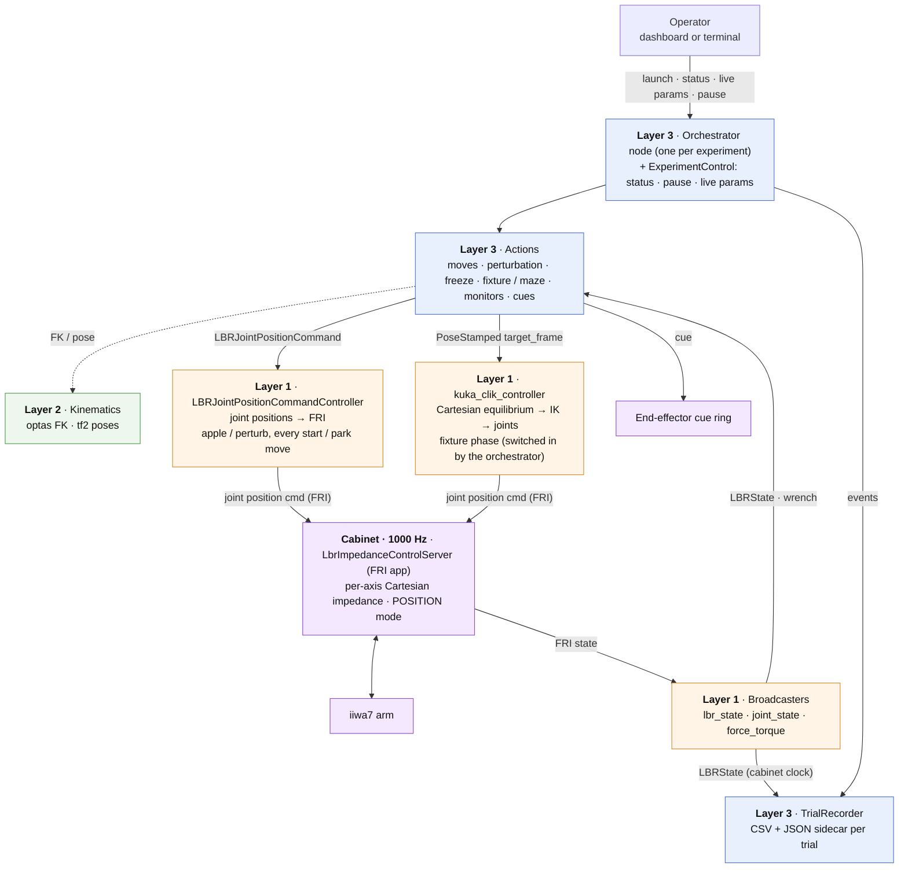
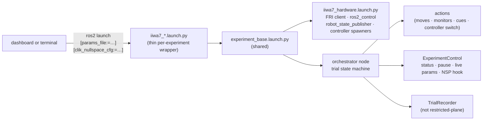
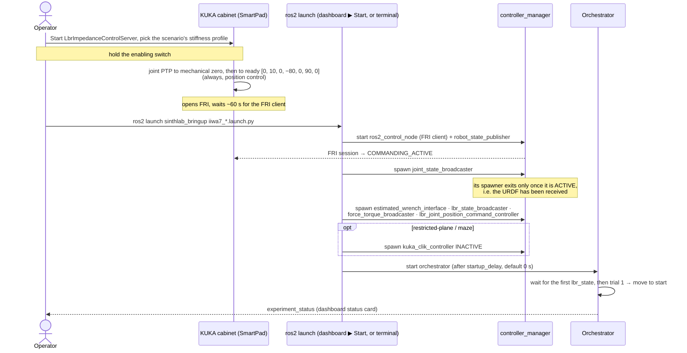
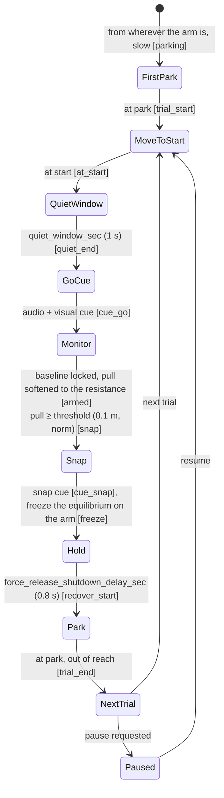
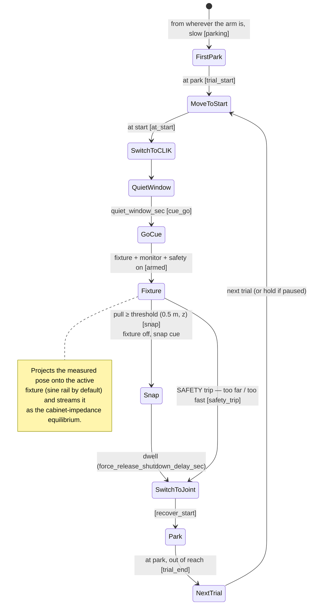
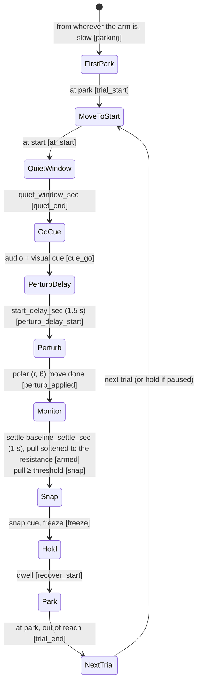
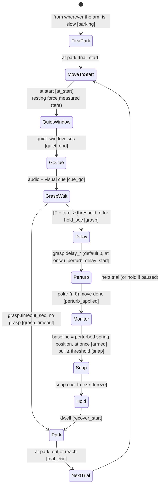
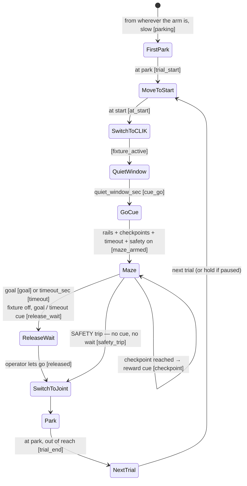
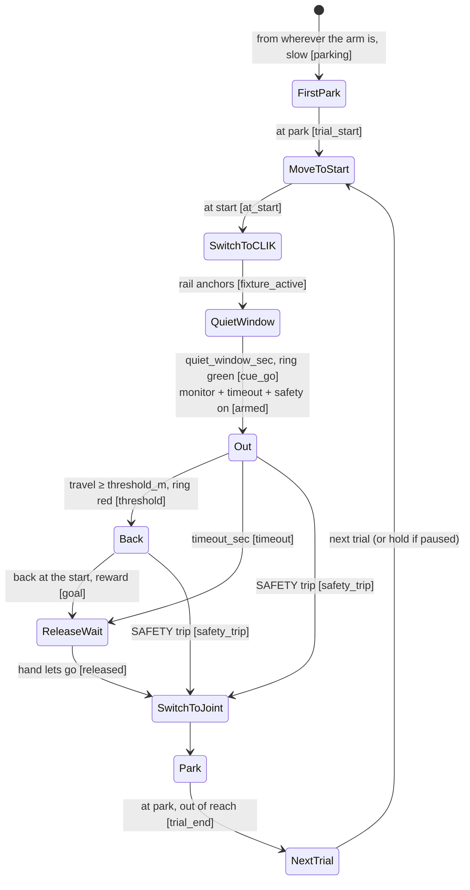

# Sinthlab KUKA Stack

A ROS 2 (Jazzy) control stack for running **compliant "apple‑pluck" experiments** on a KUKA
LBR iiwa7. It is built as an *overlay* on top of the [`lbr_fri_ros2_stack`][^1], adding the
high‑level experiment orchestration, motion actions, and the KUKA Sunrise (FRI) applications
needed to drive the arm.

All experiments run in FRI **position** mode, with the **cabinet** (`LbrImpedanceControlServer`)
providing the Cartesian spring at 1000 Hz. Apple-pluck / perturb stream **joint** setpoints via
`LBRJointPositionCommandController`; restricted-plane / maze stream a fixture-constrained **Cartesian
equilibrium** via `kuka_clik_controller`. Python state machines sequence each trial
(move → cue → monitor displacement → recoil → repeat).

The repo also carries the physical end of the rig: the parametric
[end‑effector design](end_effector_design/README.md) and the
[end‑effector board firmware](end_effector_metro_code/README.md) — a NeoPixel cue ring triggered
over a hardwired media‑flange line, whose **appearance is configured on the board over its own
Wi‑Fi**, see [§6.7](#67-end-effector-board--the-visual-cue).

**To run an experiment, start with the
[experiment control dashboard](#quick-start-the-experiment-dashboard)**, a local web page for
picking an experiment, editing its parameters, Start / Pause / Stop, changing cues between trials,
and following the status and log. Every experiment can also be run from a terminal
([§5](#5-running-experiments-on-hardware)).

Why FRI **position** mode rather than torque mode (ROS-side impedance), and when torque mode would be
worth reconsidering, is in the [appendix](#appendix--why-fri-position-mode-not-torque-mode).

## Table of Contents
- [Quick start: the experiment dashboard](#quick-start-the-experiment-dashboard)
- [1. Hardware Setup (KUKA Arm)](#1-hardware-setup-kuka-arm)
- [2. Windows Laptop Setup](#2-windows-laptop-setup)
- [3. Building the Stack](#3-building-the-stack)
- [4. Simulation & Visualization (no hardware)](#4-simulation--visualization-no-hardware)
- [5. Running Experiments on Hardware](#5-running-experiments-on-hardware)
  - [Pre-training — Free Move, Move Vertical, Move Horizontal](#pre-training--free-move-move-vertical-move-horizontal)
- [6. Software Architecture](#6-software-architecture)
- [7. Data Collected](#7-data-collected)
- [8. Neural Synchronisation](#8-neural-synchronisation)
- [9. Troubleshooting](#9-troubleshooting)
- [10. Development & Contributing](#10-development--contributing)
- [Acknowledgement](#acknowledgement)
- [Appendix — why FRI position mode, not torque mode](#appendix--why-fri-position-mode-not-torque-mode)

---

## Quick start: the experiment dashboard

The quickest way to run an experiment is the **experiment control dashboard**, a local web page on
the ROS computer. From it you:

- pick an experiment (Apple Pluck, with its *normal*, *perturb* and *random start* paradigms, Restricted Plane or Maze), or a pre-training task;
- check or change its parameters;
- Start, Pause, Stop and Restart it;
- change cues and other live settings between trials;
- follow the trial, its events and the full log.

Every experiment can still be run from a terminal instead: see
[§5](#5-running-experiments-on-hardware) and [Without the dashboard](#without-the-dashboard). How the
dashboard is built is in [`experiment_ctrl_gui/README.md`](experiment_ctrl_gui/README.md).

> ⚠️ **Stop is not an emergency stop.** It parks the arm, then sends Ctrl-C to the launch. **The SmartPad
> E-stop is the E-stop.** On the first run of any experiment, work in **T1** with a hand on it.

### Start the dashboard
On the ROS computer wired to the arm, with the workspace built ([§3](#3-building-the-stack)):

```bash
~/lbr-stack/src/sinthlab-kuka-stack/experiment_ctrl_gui/run_gui.sh     # then open http://localhost:8080
```

Under WSL2 a Windows browser works, because Windows forwards `localhost` to WSL. `run_gui.sh`
sources ROS 2 and the workspace first. The page needs nothing extra installed and loads nothing
from the internet.

**Try it without the robot first.** This runs a simulated experiment with the same controls;
nothing is launched and nothing connects to the arm:

```bash
python3 ~/lbr-stack/src/sinthlab-kuka-stack/experiment_ctrl_gui/server.py --demo
```

| Option | Effect |
|---|---|
| `--port 8081` | serve on another port |
| `--robot-name lbr` | the arm's ROS namespace (default `lbr`) |
| `--demo` | simulated robot: nothing is launched |
| `--host 0.0.0.0` | serve beyond this computer. **Anyone who can reach the port can start the robot.** Prefer an SSH tunnel: `ssh -L 8080:localhost:8080 <ros-box>` |

### The page
- **Left column:** the experiment list (tabs **Experiments** and **Pre-training**), the **Run** controls, and a **Before you start** checklist
  with the SmartPad selections for the chosen experiment.
- **Middle column:** the **status**, then the **parameters**. Status shows the trial number, the
  current phase, the trial's steps, and a list of every event.
- **Log:** on the right on a wide screen, below on a narrow one.
- **Top bar pills:** the ROS connection, the robot (FRI session state and `lbr_state` rate), and the
  run state. **Diagnostics** (top right) opens the hardware checks — see below.

### Diagnostics — hardware checks
The **Diagnostics** button at the top right opens a separate page (`/diagnostics.html`) of hardware
checks that **never move the arm**. Its first tab is **Visual cue**, for the end-effector NeoPixel ring.
It talks to the ring's Metro board over the board's own Wi-Fi, so **join this computer to
`KUKA_NEOPIXEL` first**.

- **Cue board** — *Check board*: is it reachable, and what does it report (enabled, brightness, colour,
  pattern, whether a cue is running, how many wire cues it has fired, uptime). Start here.
- **Path: Wi-Fi** — set what a cue looks like (colour, pattern, duration, brightness, enabled), apply
  it, fire a cue, show a solid colour, turn it off, save the settings on the board, or reset them. The
  **LED-by-LED test** lights each LED in turn and shows which one is lit, to find where a ring goes
  dark. *If the ring lights from here, the board, the Pixel Shifter and the ring are fine.*
- **Path: Wire** — the experiment trigger (X76 1–2 → tool pin 9 → Metro D2). Nothing on the computer
  can close it yet, so **short X76 contacts 1 and 2 by hand** while *Start watching* shows the board's
  D2 input live and logs every edge and every cue the wire fires. It flags a line that reads
  "asserted" with nothing shorted (inverted polarity — untick *Active low*, no rewiring) and a board
  that is not enabled. *If Wi-Fi works but the wire does not, the fault is in the trigger wiring.*

It works in `--demo` too, against a simulated board. Details: `experiment_ctrl_gui/README.md`.

### Running an experiment
1. **Pick the experiment:** Apple Pluck (with its paradigm tabs **Pluck normal** / **Pluck perturb** / **Pluck random start**
   on the card), Restricted Plane or Maze; or, under
   **Pre-training**, Free Move, Move Vertical or Move Horizontal ([§5](#pre-training--free-move-move-vertical-move-horizontal)).
2. **Prepare the SmartPad.** Start `LbrImpedanceControlServer` and make the selections listed under
   *Before you start*: FRI send period, remote IP, stiffness profile, damping, elbow stiffness (each
   question also offers **Cancel**). The app
   then **always** moves the arm to mechanical zero and on to the ready pose `[0, 10, 0, −80, 0, 90, 0]`
   (no prompt; hold the enabling switch while it moves; see
   [Start-up posture](#start-up-posture-zero-then-ready)). It then waits about 60 s for ROS.
3. **Check the parameters** ([below](#live-per-run-and-fixed-parameters)). Edited rows get an
   `edited` badge, and ↺ puts one back to the YAML value. Hover over any parameter for its full
   help.
4. **▶ Start.** This runs `ros2 launch sinthlab_bringup <experiment>.launch.py`, plus your edited
   parameters if you changed any. The status card then follows each trial, e.g.
   `start → at start → quiet → go cue → armed → threshold → park → end`. Before the first trial the
   arm makes one slow move to the [park pose](#park-pose--out-of-reach-between-trials), out of reach.
5. **Change live settings** on the **Live** tab at any time. A change applies **from the next
   trial**; the trial in progress is never changed. Until then the row shows a purple
   `next trial → …` badge, and the log records when the change was accepted and when it was applied.
6. **⏸ Pause after trial** lets the current trial finish. The arm moves to the park pose, out of the
   monkey's reach, and **holds there, still under control and compliant**. **▶ Resume** starts the next trial, with any live
   changes made meanwhile. Pressing the button again before the trial ends cancels the pause.
   **Free Move** has no trial end, so there the button (labelled **End session & pause**) ends the
   session at once, the way Stop now does: the arm parks straight away and holds.
7. **Stop:**
   - **■ Stop after trial:** finishes this trial, parks, then stops cleanly, so every trial on disk is
     complete. **Use this one.** In the **pre-training** tasks it is labelled **End session & stop** and
     works exactly like Stop now: the trial or session ends at once, the arm parks, then the launch stops.
   - **■ Stop now:** ends the trial in progress at once — no cue, no release wait — **parks the arm**,
     and only then Ctrl-Cs the launch, so FRI always closes with the arm out of reach. The cut-short
     trial is saved, marked `stop_requested`. While it parks the button reads **Parking… (press to
     skip)**: a second press Ctrl-Cs at once, wherever the arm is. If the orchestrator does not
     answer, or the arm has not parked within 60 s, the launch is stopped anyway.
   - **↻ Restart:** Ctrl-C at once (no parking), then Start again with the current edits.
   - **However a run ends** — any Stop, a finished run or a crash — the dashboard then ends every node
     the launch left behind, so a lingering process can never block the next run.
   - **From a terminal**, Ctrl-C reaches every process at once, so nothing parks first. To park, call
     `ros2 service call /lbr/<orchestrator>/stop std_srvs/srv/Trigger` and Ctrl-C once the log says it
     is holding.
8. **Validate recording** checks this run's data folder
   (`analysis/validate_recording.py --folder …`) and prints the result in the log. To plot the
   run afterwards, see [Working with the data](#working-with-the-data).

**The log** is the launch's own output from every node, colour-coded by level. Filter it by level or
text, or turn off *Follow* to scroll back. It is also saved to `experiment_ctrl_gui/logs/`.

**An experiment started in a terminal** is picked up automatically. Live changes and pause work
from the page; stop it with Ctrl-C in its own terminal.

### Live, Per-run and Fixed parameters

| Tab | When it can change | What is in it |
|---|---|---|
| **Live** | Any time, **including while running**; applies from the next trial | cue switches, colours, tones and timing; NSP sync; move speeds; the pull threshold and hold; the perturbation; the start pose (apple pluck); the maze timeout ([full list](#live-parameters)) |
| **Per-run** | Before **Start**, then **locked for the run** | everything else in the experiment YAML: the start pose in restricted plane / maze, rails, checkpoints and goal, move tolerances, safety limits, the fixture profile, the displacement axis, frames, debug logging |
| **Fixed** | Not from the dashboard: at the SmartPad or in the file named | what every experiment shares: SmartPad (FRI) selections, launch arguments, `iiwa7_hardware_controllers.yaml`, the CLIK redundancy posture |

- **Your edits never change the package YAML.** They go into a copy for that run, and every
  recorded trial's sidecar keeps the full parameter set it ran with, live changes included.
- **Poses** are 7 joint angles in degrees. They are checked against the iiwa7 joint limits, and a
  nearly straight (singular) arm is refused — by the dashboard and again by the orchestrator.
  - **Start and park must bend the elbow the same way** (A4 on the same side); an edit that flips one
    is refused — see [Park pose](#park-pose--out-of-reach-between-trials).
  - **Apple Pluck:** the start pose is live. The next trial moves to it from park. The park pose is
    Per-run everywhere.
  - **Restricted Plane and Maze:** the CLIK redundancy posture follows an edited start pose
    automatically.
  - **Maze:** a new start moves the whole maze with it. Run `check_maze.py` on the edited copy
    before trusting it.
- **Amber ⚠ notes** flag parameters other things depend on; **blue 🔗 notes** name what else an
  edit changes. Rails and checkpoints must keep their number of entries; adding a rail is a YAML
  edit.
- **Values are checked** for type, range and allowed choices before they are sent, and again inside
  the orchestrator. A refused change says why.

### Live parameters
**Every experiment:**

| Parameter | Meaning |
|---|---|
| `quiet_window_sec` | pause at the start pose before the go cue [s] (apple pluck 1.0, the CLIK experiments 2.0–4.0) |
| `move_to_park.hold_sec` | wait at park before each trial's move to the start [s] (default 2.0) |
| `audio_cue.enabled` | master switch for every beep; off, the trial runs the same but silent |
| `audio_cue_*.frequency_hz`, `audio_cue_*.duration_ms` | each tone (37–32767 Hz, 10–10000 ms) |
| `visual_cue.enabled` | master switch for the NeoPixel ring |
| `visual_cue.remote_test_trigger` | fire the ring over its Wi-Fi (demos) or the X76 wire |
| `visual_cue.colours.<site>` | `[r, g, b, w]` per cue site (Wi-Fi trigger only) |
| `nsp_sync.enabled` | send sync pulses to the Blackrock NSP. **The ROS side is not wired yet**: when on, it warns once and sends nothing ([§8](#8-neural-synchronisation)) |
| `move_to_start.speed_scale`, `move_to_park.speed_scale` | **move speed** (slider, 0.25–2, default 1): time-stretches the move — 0.5 = twice as slow, 2 = twice as fast. **Applies at once** (badge *applies now*), from the next move — even within the current trial; a move already under way finishes at its speed. Each change is logged in the trial sidecar's `live_changes`. See [Move speed](#move-speed). |

**Plus, per experiment** (`…displacement` = `apple_pluck_impedance_control_displacement`):

| Experiment | Extra live parameters |
|---|---|
| Apple Pluck | **the resistance** `resistance.stiffness_n_per_m` (slider + text box in steps of 10, from 50 N/m up to the SmartPad base you enter; see [Resistance](#resistance--the-felt-stiffness-of-the-pull)), `…displacement.cartesian_displacement_threshold_m`, `…displacement.force_release_shutdown_delay_sec`, **the start pose** (`move_to_start.target_joint_position`; its elbow must bend the same way as the park pose's) |
| Apple Pluck — **perturb and perturb bump paradigms** (shown under *Pluck perturb* / *Pluck perturb bump*) | the perturbation: `perturb_start.polar_r_m` (capped per plane; **0 = an unperturbed trial**), `perturb_start.polar_theta_deg`, `perturb_start.polar_plane`; **when** (perturb only, after the go cue): `perturb_start.start_delay_mode` (`fixed` / `random`), `start_delay_sec` (fixed), `start_delay_min_sec` / `start_delay_max_sec` (random); `perturb_start.baseline_settle_sec` (perturb only); and its speed `perturb_start.speed_scale` (perturb only; applies at once) |
| Apple Pluck — **perturb bump paradigm only** (shown under *Pluck perturb bump*) | the grasp: `grasp.threshold_n`, `grasp.hold_sec`, `grasp.timeout_sec`; **when**, after the grasp: `grasp.delay_mode` (`fixed` / `random`), `grasp.delay_sec` (fixed, default **0** — at once), `grasp.delay_min_sec` / `grasp.delay_max_sec` (random); **how fast** the bump moves: `grasp.bump_speed_scale` (slider, 0.25–3, default 3; applies at once) |
| Apple Pluck — **random start paradigm only** (shown under *Pluck random start*) | none live. The 9 start positions `random_start.positions.*` are **per-run**; each trial picks its own start, so the start pose above does not apply in this paradigm |
| Restricted Plane | `…displacement.cartesian_displacement_threshold_m`, `…displacement.force_release_shutdown_delay_sec` |
| Maze | `timeout_sec`, `virtual_fixtures.rail_lead_sec` (how easy moving along a rail feels: + lighter, − heavier, −0.15 to +0.05 s) |
| Free Move | `session_sec` (0 = until Pause / Stop after trial); the ring `ring_cue.quarters`, `ring_cue.colours.*`; the feel `free_move.damping_ns_per_m` (3–200, lower = lighter), `free_move.deadband_n` (0–15, default 2.5), `free_move.max_speed_mps` (≤ 0.5), `free_move.accel_limit_mps2`, `free_move.force_filter_tau_sec`, `free_move.tare_sec` |
| Move Vertical / Move Horizontal | `timeout_sec`, `virtual_fixtures.rail_lead_sec`, the task `travel_task.threshold_m` / `direction` / `require_return` / `return_tolerance_m`, the ring `ring_cue.quarters`, `ring_cue.colours.*` |

These are deliberately **not** live:
- `cartesian_axis`: it changes what the threshold means, so it is a different experiment, not a
  different trial.
- **Safety limits:** a limit must not be loosened mid-session.
- **Move tolerances** (`joint_move_tolerance`, `cartesian_move_tolerance`): they decide when a move
  counts as arrived.
- **The start pose in Restricted Plane and Maze:** those experiments hand the arm to the CLIK, whose
  redundancy posture must equal the start pose and is read once, when the controller starts; and the
  maze's geometry hangs off the start. Edit it per-run (the posture then follows automatically).
- **Maze rails, checkpoints and goal:** verified offline by `check_maze.py`.
- **The pre-training rails:** checked by IK for reach; edit them per-run.

### Move speed
Every joint-space move — to the start, to park, the perturbation — has one **`speed_scale`**
slider (Live tab, 0.25–2, default 1). It time-stretches the whole move: it multiplies that move's
limits `move_to_pos_v_max` / `_a_max` / `_j_max` (Per-run, the base) by s, s² and s³, which makes the
move take exactly **1/s as long** along the same path. 0.5 = twice as slow, 2 = twice as fast.

*Why a scale and not the limits themselves.* These moves are short — a few to ~18° of joint travel —
so the joints never reach `v_max` (changing it does nothing), and `a_max` / `j_max` act only through
square and cube roots: quartering `a_max` stretches a 1.1 s move to just 1.5 s. The scale changes
all three together, so every move, however short, changes by exactly the factor you set.

| Move (apple pluck, from the start pose) | ×0.5 | ×1 | ×2 |
|---|---|---|---|
| Back from a 10 cm pull to the start | 2.3 s | 1.1 s | 0.6 s |
| Perturbation, 5 cm | 1.5 s | 0.7 s | 0.4 s |
| Random start, C → N (5 cm) | 2.1 s | 1.0 s | 0.5 s |

*When it applies.* **At once, from the next move** — not at the next trial: lower the park speed
during a pull and that trial's park move already uses it. A move already under way finishes at the
speed it started with: lowering the limits mid-move would leave the trajectory generator holding an
acceleration above the new limit, and its correction overshoots the target. Every change goes into the
trial sidecar's `live_changes` (name, value, time and CSV row), and every move into its `moves`: the
scale it ran at, the effective (scaled) limits and its duration — so each move's speed is recorded
directly, ready to use as an experimental variable. Joint speed stays capped at 90 deg/s after scaling.

### Parameter help
Each parameter shows a one-line description. **Hover over its name**, or tab to it, for the full
help:
- the type, YAML default, and allowed range or choices;
- whether it is live;
- the **notes from the YAML**: the reasoning, measurements and knobs;
- any caution or linked parameters.

Group headings and Fixed rows have the same help. To send someone straight to one parameter's help:
`http://localhost:8080/?exp=perturb&hover=perturb_start.polar_theta_deg`.

All of it is read from the YAML files themselves, so the page and the files cannot disagree. To
document a new parameter, see [§10](#10-development--contributing).

### Without the dashboard
The same controls from a terminal (namespace `lbr`, apple pluck shown). The orchestrator nodes are
`apple_pluck_orchestrator` (all paradigms), `restricted_plane_orchestrator` and
`maze_orchestrator`; for pre-training, `free_move_orchestrator` and `rail_training_orchestrator`
(Move Vertical and Move Horizontal).

```bash
ros2 launch sinthlab_bringup iiwa7_apple_pluck_impedance_control.launch.py                 # start; Ctrl-C stops
ros2 launch sinthlab_bringup iiwa7_apple_pluck_impedance_control.launch.py params_file:=/path/edited.yaml

ros2 topic echo /lbr/experiment_status                                                     # where the run is
ros2 param set /lbr/apple_pluck_orchestrator visual_cue.enabled false                       # live: next trial
ros2 param set /lbr/apple_pluck_orchestrator move_to_start.speed_scale 0.5                  # half-speed approach, now
ros2 service call /lbr/apple_pluck_orchestrator/pause std_srvs/srv/SetBool "{data: true}"   # pause after trial
ros2 service call /lbr/apple_pluck_orchestrator/pause std_srvs/srv/SetBool "{data: false}"  # resume
ros2 service call /lbr/apple_pluck_orchestrator/stop std_srvs/srv/Trigger                    # end trial now, park, hold
```

A `ros2 param set` on anything that is not live is **rejected with the reason**, because the
orchestrator read it once at start-up. A start pose whose elbow bends the other way from the park
pose is refused. The maze, restricted-plane and
pre-training launches also accept `clik_nullspace_cfg:=`.

### Files the dashboard writes
| Where | What |
|---|---|
| `experiment_ctrl_gui/runs/<exp>_<time>.yaml` | the edited parameter copy a Start used (only when something was edited), plus `…_clik_nullspace.yaml` when a CLIK start pose was edited |
| `experiment_ctrl_gui/logs/<exp>_<time>.log` | the full launch output of each run |
| `analysis/expt_<run_name>_<time>/` | the trial recordings, written by the orchestrator as always ([§7](#7-data-collected)) |

None of these are committed to git.

### If something is wrong
- **"ROS ✗" in the top bar.** The dashboard was started without ROS sourced, so use `run_gui.sh`.
  Start, Stop and the log still work, but live changes, pause and robot state need ROS.
- **"Robot: no state".** Nothing is publishing `/lbr/lbr_state` yet: the launch has not connected
  to FRI, or the SmartPad app is not running or timed out. Restart the app, then Start.
- **The run pill stays on "Starting…".** The orchestrator has not reported yet. Look in the log for
  its first lines or an exception.
- **A live change is refused.** The message gives the reason: not a live parameter, out of range, or
  wrong type. A per-run parameter needs Stop, edit, Start.
- **Stop takes a while.** The nodes shut down in order. After 20 s the dashboard escalates, and the
  log says so.
- **The cue ring does not light.** Open **Diagnostics → Visual cue**: *Check board*, then *Fire cue* over
  Wi-Fi. That separates the board and ring from the wiring; see [Diagnostics](#diagnostics--hardware-checks).
- **"Dashboard disconnected".** The dashboard server stopped. Restart it. If it was running an
  experiment, that experiment was stopped cleanly when the server stopped.

---

## 1. Hardware Setup (KUKA Arm)
- Use the "Quick Start guide" to cable up the Arm, Cabinet and the SmartPad.
- For the Safety on the X11 interface in the Cabinet:
  - First create 6 jumper cables with the provided pins.
  - Based on the PIN diagram (pg‑53 of `Spez_KUKA_Sunrise_Cabinet_en.pdf`, section 6.6.2),
    jump pins 1/2, 10/11 (external E‑Stop), 3/4, 12/13 (Operator Safety) and 5/6, 14/15
    (Safety stop 1).

---

## 2. Windows Laptop Setup
> **Why Windows + WSL2?** KUKA's robot software (Sunrise Workbench) requires Windows, while our
> stack requires Ubuntu. We use the Windows laptop to install applications onto the robot, and
> run our stack inside WSL2 (Ubuntu) on the same laptop to control the arm.

### Prerequisites
- Install Ubuntu 24.04 with `wsl --install -d Ubuntu-24.04` (the version matters — do **not**
  install the default).
- Confirm you are on WSL version 2 (`wsl -l -v` shows the version and the installed distro).
- Make sure the robot controller box is on.
- Install `Sunrise Workbench` on the laptop. For our arm version we use
  `SunriseWorkbench-1.17.0.4-setup.exe`, provided by KUKA Support.
- Install the FRI plugin in the Sunrise Workbench project (steps to be elaborated).
- For the neural-sync outputs only ([§8](#8-neural-synchronisation)): install **KUKA WorkVisual 5.0.5
  Build 600**, the build the Sunrise.OS 1.17 release notes name (Workbench: *Help → Sunrise.OS
  Release Notes*), with the `Sunrise.kop` option package from this Workbench's installation. Sunrise Workbench opens it to edit
  the cabinet's I/O configuration.

### Connection Verification
- Connect your computer to the robot controller at **X66** (default IP `172.31.1.147`) via an
  ethernet cable.
- Put your computer on the same network — set your IP to `172.31.1.148` (or anything else in the
  `/16` subnet).
  - On Windows: Settings → Network & Internet → Ethernet, edit the IPv4 manual setup to IP
    `172.31.1.148` and gateway `255.255.0.0`; leave other options as is and save.
- Ping the robot from PowerShell — `ping 172.31.1.147` — and expect something like:
  ```
  PING 172.31.1.147 (172.31.1.147) 56(84) bytes of data.
  64 bytes from 172.31.1.147: icmp_seq=1 ttl=64 time=0.868 ms
  ```
- Enable Hyper‑V on the laptop.
- Set up networking for WSL2: open WSL settings (in the Start menu) and change the Networking
  mode to **Mirrored**.
  
- In a PowerShell window **with admin privileges**, allow inbound Hyper‑V connections:
  ```powershell
  Set-NetFirewallHyperVVMSetting -Name '{40E0AC32-46A5-438A-A0B2-2B479E8F2E90}' -DefaultInboundAction Allow
  ```
  This also lets in the SmartPad app's settings report (UDP 30001, see
  [Cancelling the app / settings report](#smartpad-app-close-and-settings-report)). If the dashboard says
  *No report from the SmartPad app* while FRI works, check that port first.

### Install Application to Robot
Follow [these steps](https://lbr-stack.readthedocs.io/en/latest/lbr_fri_ros2_stack/lbr_fri_ros2_stack/doc/hardware_setup.html#install-applications-to-the-robot)
to install the application to the robot. Our application is
[`sunrise_controller_code/LbrImpedanceControlServer.java`](sunrise_controller_code/LbrImpedanceControlServer.java),
with [`TtlPulser.java`](sunrise_controller_code/TtlPulser.java) beside it in the same package, and
[`PulseTestServer.java`](sunrise_controller_code/PulseTestServer.java) as a second app for testing the
neural-sync lines ([§8](#8-neural-synchronisation)). Copy all three into the Sunrise project and
redeploy from Sunrise Workbench whenever any of them changes.

### Tool Load Data (payload calibration)
The cabinet must know the end‑effector's mass, or the compliant control modes (Cartesian / joint
impedance) refuse to activate. With an uncalibrated tool the experiment launch aborts with:
```
[lbr_fri_ros2::StateGuard]: External torque not in limits for joint lbr_A2. Measured: 2.4 Nm, limit: 2 Nm
... External torque limits exceeded. Perform load data calibration!
```
You define a **tool** in Sunrise Workbench, then let the controller measure its mass and centre of
mass with the smartPAD's **Load data** view (Sunrise.OS 1.16 SI manual §7.5; ours is 1.17).

1. **Define the tool** in Sunrise Workbench — open the project's `RoboticsAPI.data.xml` and add a
   tool under `objectTemplates`. Keep the TCP at the flange (all‑zero transform) so the FRI control
   point stays aligned with the ROS `lbr_link_ee`, and leave `loadData` at zero (Determine fills it):
   ```xml
   <objectTemplates>
     <toolTemplate class="" defaultMotionFrameRef="/SinthLabIiwa7EE_link_ee" name="SinthLabIiwa7EE">
       <frames>
         <frame name="SinthLabIiwa7EE_link_ee">
           <transformation a="0.0" b="0.0" c="0.0" x="0.0" y="0.0" z="0.0"/>
         </frame>
       </frames>
       <loadData cogA="0.0" cogB="0.0" cogC="0.0" cogX="0.0" cogY="0.0" cogZ="0.0"
                 inertiaX="0.0" inertiaY="0.0" inertiaZ="0.0" mass="0.0"/>
     </toolTemplate>
   </objectTemplates>
   ```
   `defaultMotionFrameRef` must match the frame name exactly. **Synchronize** the project to the controller.
2. **Determine the load** on the smartPAD, in **T1**: at the **Robot** level select the **Load data**
   tile → pick `SinthLabIiwa7EE` → hold the enabling switch → **Determining the load data** →
   **Apply**. Then **synchronize** the project so Sunrise Workbench keeps the values.
   - Only the wrist moves: A7 goes to 0° then to −90°, and A6 swings ±95° (A1–A4 stay put). Tick
     **Restricted motion range for axis 6** (±15° around the start) if the effector could hit the arm.
   - Start from a pose well away from singularities, and make sure nothing on the tool can move: tie
     down cables and any battery pack. Loose parts, or anyone touching the robot, falsify the result.
   - **Below 1 kg KUKA calls the mass measurement unreliable.** Weigh the effector, enter the mass in
     the tool's `loadData`, synchronize, then choose **Use existing mass** so only the centre of mass
     is measured.
3. **Attach the tool in the FRI app** so the cabinet actually compensates it: in
   `sunrise_controller_code/LbrImpedanceControlServer.java`, create the tool
   (`createFromTemplate("SinthLabIiwa7EE")`), `attachTo(lbr_.getFlange())`, and move the **tool**
   instead of the bare flange. Without this the guard still trips even after Determine.

> **Apply** stores the mass / COM on the controller; synchronizing copies them back into the project's
> `RoboticsAPI.data.xml`. Re‑run after any change to the end‑effector — a different apple height or a
> moved battery pack counts. **Stale load data shows up as** a steady external torque at rest on the
> shoulder and elbow (A2, A4) that grows as the arm moves away from the start, and in Free Move as a
> sustained ~1 Hz oscillation, mostly in Z. The `gravitation` vector in `RoboticsAPI.data.xml` assumes a standard floor mount;
> set it to match if the arm is mounted otherwise.

---

## 3. Building the Stack
> These steps run inside **WSL2 / Ubuntu 24.04**.

1. Install ROS 2 development tools (see this [guide](https://docs.ros.org/en/jazzy/Installation/Ubuntu-Install-Debs.html) for details):
   ```bash
   sudo apt update && sudo apt install locales
   sudo locale-gen en_US en_US.UTF-8
   sudo update-locale LC_ALL=en_US.UTF-8 LANG=en_US.UTF-8
   export LANG=en_US.UTF-8
   sudo apt install software-properties-common
   sudo add-apt-repository universe
   sudo apt update && sudo apt install curl -y
   export ROS_APT_SOURCE_VERSION=$(curl -s https://api.github.com/repos/ros-infrastructure/ros-apt-source/releases/latest | grep -F "tag_name" | awk -F'"' '{print $4}')
   curl -L -o /tmp/ros2-apt-source.deb "https://github.com/ros-infrastructure/ros-apt-source/releases/download/${ROS_APT_SOURCE_VERSION}/ros2-apt-source_${ROS_APT_SOURCE_VERSION}.$(. /etc/os-release && echo ${UBUNTU_CODENAME:-${VERSION_CODENAME}})_all.deb"
   sudo dpkg -i /tmp/ros2-apt-source.deb
   sudo apt update && sudo apt install ros-dev-tools
   sudo apt update
   sudo apt upgrade
   sudo apt install ros-jazzy-desktop
   sudo apt install python3-pip
   ```
2. Create a workspace, clone, and install dependencies:
   ```bash
   source /opt/ros/jazzy/setup.bash
   mkdir -p lbr-stack/src && cd lbr-stack
   vcs import src --input https://raw.githubusercontent.com/sinthlab/sinthlab-kuka-stack/main/sinthlab_lbr_stack.repos
   rosdep install --from-paths src -i -r -y
   ```
3. **(Hardware only, one-time)** Raise the FRI external-torque limit. `lbr_fri_ros2` checks the
   *external joint torque at activation of compliant control modes*. On a
   floor-mounted iiwa7 this trips (~2.4 Nm on A2 vs. the 2 Nm default) at the extended apple-pluck
   start posture **even with no payload** — it's a gravity-model / mastering margin amplified by A2's
   moment, not a real load. Edit the upstream config
   `src/lbr_fri_ros2_stack/lbr_description/ros2_control/lbr_system_config.yaml` and raise the limit
   (keep the check enabled):
   ```yaml
   state_guard:
     external_torque_safety_check: true
     external_torque_limit: 4.0   # upstream default is 2.0
   ```
   Skip this for mock/sim. The proper long-term fix is calibrating the mounted tool's load data (see
   §2 “Tool Load Data”) so the residual stays under the default — raising the limit is the stopgap
   while the flange is load-free.
4. Install the required Python packages (only needed once per WSL session install):
   ```bash
   pip install pyoptas ruckig --break-system-packages
   ```
5. Build:
   ```bash
   colcon build --symlink-install
   ```

---

## 4. Simulation & Visualization (no hardware)

The experiments themselves need the real arm: the cabinet provides the impedance spring and the
force estimate, which no simulation here reproduces. To try the trial flow and the dashboard without
it, run the dashboard in demo mode ([Quick start](#quick-start-the-experiment-dashboard)). To look at
the arm itself:

**Mock arm in RViz** (upstream `lbr_bringup`)
```bash
# Terminal 1 — the mock arm
source install/setup.bash
ros2 launch lbr_bringup mock.launch.py model:=iiwa7
```
```bash
# Terminal 2 — visualize
source install/setup.bash
ros2 launch lbr_bringup rviz.launch.py \
  rviz_cfg_pkg:=lbr_bringup \
  rviz_cfg:=config/mock.rviz
```

**Physics simulation in Gazebo** (upstream `lbr_bringup`)
```bash
source install/setup.bash
ros2 launch lbr_bringup gazebo.launch.py model:=iiwa7
```

**MoveIt with apple (mock or gazebo)**
```bash
source install/setup.bash

# Mock + MoveIt + RViz
ros2 launch sinthlab_bringup iiwa7_moveit_apple.launch.py mode:=mock rviz:=true

# Gazebo + MoveIt + RViz
ros2 launch sinthlab_bringup iiwa7_moveit_apple.launch.py mode:=gazebo rviz:=true
```

---

## 5. Running Experiments on Hardware
> Python dependencies (`pyoptas`, `ruckig`) must be installed once per WSL session install (see
> [Building the Stack](#3-building-the-stack)).
>
> ⚠️ **Safety first.** On the first run of any scenario, operate in **T1** (reduced speed) with a
> hand on the E‑stop. The arm is actively controlled the moment a SmartPad application is running.
>
> **Start-up posture.** Every time `LbrImpedanceControlServer` starts, it moves the arm to mechanical
> zero and then to the ready pose `[0, 10, 0, −80, 0, 90, 0]`, in position control and without asking;
> each experiment's `move_to_start` then begins from there. **Keep the space above the arm clear**: at
> zero the arm stands fully upright. Why: [Start-up posture](#start-up-posture-zero-then-ready).

### Running from the dashboard
The [dashboard](#quick-start-the-experiment-dashboard) runs exactly the launches below, with the
SmartPad checklist, parameters, status and log on one page. The steps below are the terminal way, and
what the dashboard does for you. The launches accept `params_file:=/path/to.yaml` to run an edited
parameter copy; the maze, restricted-plane and pre-training launches also accept `clik_nullspace_cfg:=`.

### Scenario quick reference
| # | Scenario | Launch file | SmartPad app (FRI) | ROS controller |
|---|----------|-------------|--------------------|----------------|
| 1 | Apple Pluck          | `iiwa7_apple_pluck_impedance_control.launch.py` | `LbrImpedanceControlServer` | `LBRJointPositionCommandController` |
| 2 | Restricted on Plane  | `iiwa7_move_restricted_plane.launch.py`         | `LbrImpedanceControlServer` | `kuka_clik_controller` |
| 3 | Apple Pluck, perturb paradigm | `iiwa7_apple_pluck_impedance_control.launch.py paradigm:=perturb` | `LbrImpedanceControlServer` | `LBRJointPositionCommandController` |
| 3c | Apple Pluck, perturb bump paradigm | `iiwa7_apple_pluck_impedance_control.launch.py paradigm:=perturb_bump` | `LbrImpedanceControlServer` | `LBRJointPositionCommandController` |
| 3b | Apple Pluck, random start paradigm | `iiwa7_apple_pluck_impedance_control.launch.py paradigm:=random_start` | `LbrImpedanceControlServer` | `LBRJointPositionCommandController` |
| 4 | Maze                 | `iiwa7_maze.launch.py`                          | `LbrImpedanceControlServer` | `kuka_clik_controller` |
| P | Pre-training (Free Move, Move Vertical, Move Horizontal) | `iiwa7_pretrain_<task>.launch.py` | `LbrImpedanceControlServer` | `kuka_clik_controller` |

**One control paradigm.** Every scenario uses FRI **POSITION** command mode with the **cabinet**
(`LbrImpedanceControlServer`) running the Cartesian impedance spring at 1000 Hz. They differ only in
what ROS streams into it:

- **Apple Pluck, all paradigms (1, 3, 3b & 3c)** — **joint** setpoints via `LBRJointPositionCommandController`
  (straight to the FRI position command, no IK).
- **Restricted-plane / Maze (2 & 4)** — a fixture-constrained **Cartesian equilibrium** via
  `kuka_clik_controller` (Cartesian target → IK → joint positions).

> **The two things that decide how a fixture feels:**
>
> 1. **Soft-inside comes from tracking, not from low stiffness.** Inside the allowed region the
>    fixture's projection returns the *measured* pose, so the spring error — and hence the force — is
>    ~zero **whatever K is**. High K only bites at the walls and on locked axes. What breaks this is
>    **tracking lag**: if the commanded equilibrium cannot keep up with the operator's hand it falls
>    behind *cumulatively* and `K × error` is felt as resistance in every direction. That is governed
>    by `kuka_clik_controller.max_linear_velocity` (**1.0 m/s**, well above hand-guiding speed) and
>    the fixture's `max_target_step_m` (**0.05 m**).
> 2. **Use an anisotropic stiffness profile.** `LbrImpedanceControlServer` takes a full per-axis
>    `{X,Y,Z,A,B,C}` diagonal. A *uniform* profile forces one compromise for locked axes, walls and
>    free motion alike, and for the maze no uniform value works (400 = mushy walls, 3000 = heavy
>    everywhere). Lock the constrained axis hard and keep the free axes firm enough for
>    walls; the interior stays free by (1).

### Scenario 1 — Apple Pluck
This scenario streams **joint** setpoints to the `LBRJointPositionCommandController` (joint positions
go straight to the FRI position command — no IK), while the KUKA cabinet runs Cartesian impedance
natively via the `LbrImpedanceControlServer` FRI app. The arm acts as a virtual physical spring and
recoils when pushed off its commanded anchor.

**Start pose — the apple points at the monkey.** The posture `[0, −13, 0, −60, 0, 30, 0]` holds the
apple at about the park height, pointing toward the monkey (+X) and tilted **13° up**: flange
≈ (0.33, 0, 1.03) m, apple ≈ (0.53, 0, 1.08) m in `lbr_link_0` (park: ~1.09 m). Every joint is ≥ 59°
from its limit and the pose is well conditioned (smallest Jacobian singular value 0.125), but the arm
is **close to full stretch**: a pull toward the monkey gets ~0.16 m before nearing a limit or
singularity (the pluck threshold is 0.10 m), and a 10 cm perturbation in some directions brings the
singular value down to ~0.07 — a little less crisp, not singular. The same pose is used by every
apple paradigm (in random start it is the grid's origin, C). A **pluck** is any
**0.1 m** pull from the start, in any direction (`cartesian_axis: norm`), because the pull is toward
the monkey rather than along one base axis. Tilt, roll and height knobs are documented next to the
pose in `config/apple_pluck_impedance.yaml`.

**Steps to run:**
1. On the KUKA SmartPad, start the **`LbrImpedanceControlServer`** application. It opens five
   selection dialogs in sequence — choose:

   | Prompt | Select |
   |--------|--------|
   | FRI send period [ms] | `10` |
   | Remote IP address | `172.31.1.148` (your ROS / WSL2 laptop IP) |
   | Cartesian stiffness (K diagonal) | `Uniform 100` — the base the resistance slider softens; see [Resistance](#resistance--the-felt-stiffness-of-the-pull) |
   | Damping ratio (D0) | `0.7 (Standard)` |
   | Null-space (elbow) stiffness | `30 (Standard)` |

   *This app is hard‑wired to Cartesian Impedance control in `POSITION` command mode. Its four
   stiffness profiles are named by their values: `Uniform 100`, `Uniform 400` (a stiffer base for the
   resistance slider), `Uniform 1000` and `Z lock 2500, X/Y 1000, rot 120`. Other damping ratios (`0.1`, `0.2`,
   `0.3`, `1.0`) and elbow stiffnesses (`15`, `5`) are available if you want to change the feel.*
   The app then waits (~60 s) for the ROS client to connect.
2. **Launch the experiment** — this connects ROS to the waiting FRI app and starts the trial loop
   (nothing happens until you run this):
   ```bash
   ros2 launch sinthlab_bringup iiwa7_apple_pluck_impedance_control.launch.py
   ```
3. The arm moves to the start. At the beep (and a **green** ring, if the visual cue is on) pull the
   apple toward you; **0.1 m** in any direction counts. A second beep and a **red** ring confirm it,
   the arm holds for a moment, then returns to the start.

#### Resistance — the felt stiffness of the pull
How hard the apple pulls back is selectable per trial from the dashboard: **`resistance.stiffness_n_per_m`**
on the Live tab, a **slider (steps of 10) plus a text box** for any value in its range.

**The range runs from 50 N/m up to the SmartPad base.** Choose a stiffness profile on the SmartPad
and enter its translational stiffness as `resistance.base_stiffness_n_per_m` (Per-run): the slider then
covers **50 N/m to that value**. The default is `Uniform 100` (base 100: 50–100 N/m); `Uniform 400`
gives 50–400.

ROS cannot read the SmartPad's stiffness (FRI carries positions and torques only), so the base is the
value you set to match it. Change it on the Per-run tab and the slider's range follows; a value the
two can't both satisfy is refused with the reason.
Like every live setting it applies **from the next trial**, and each trial's sidecar records the
resistance it ran with (`resistance`: base, felt stiffness, fraction followed).

**How.** ROS cannot change the cabinet's stiffness — the SmartPad fixes it when the app starts, and FRI
streams only the spring's equilibrium. So the SmartPad runs the **base** (by default `Uniform 100`:
100 N/m, rotation 300), and ROS can **soften** it: from the moment the monitor arms until the
threshold, the equilibrium follows a fraction *f* of the pull, so the spring is stretched by only
(1 − *f*) of it:

> **felt stiffness = base × (1 − *f*)** — on the 100 base, 50 N/m is *f* = 0.5; on a 400 base, 100 N/m is *f* = 0.75.

It works in joint space on the same joint controller, measured from the settled pose at `armed`,
so the resting sag is unchanged ([`resistance_softener.py`](sinthlab_bringup/sinthlab_bringup/actions/resistance_softener.py)).
At the threshold the freeze takes over from wherever the softening left the equilibrium.

- **It can only soften:** at most the base, and never below **50 N/m** — that much spring always
  remains; following the arm completely would leave nothing holding it up.
- **`resistance.base_stiffness_n_per_m` must equal the SmartPad profile** (100 by default). If the
  SmartPad runs Uniform 100 while this says 400, every pull feels 4× softer than the slider says.
  Setting the slider to the base switches softening off: the arm feels the bare profile — which is
  the default (100 on 100).
- **Quick pulls feel somewhat stiffer** than the setting: the equilibrium follows from ROS at
  100 Hz, slightly behind the arm. Slow, steady pulls get the setting. The further below the base you
  go, the stronger this is (at 50 on a 1000 base, ROS follows 95 % of the pull): **choose a base near
  the stiffest resistance you will actually use.**
- **Rotation and the elbow soften by the same fraction,** so the tool twists a little more at low
  resistance.
- **At the same damping ratio a stiffer base is more damped** (damping scales with √K): if pulls
  feel viscous, choose a lower damping ratio on the SmartPad.

### Scenario 2 — Move Restricted on a Plane
This scenario applies mathematical **virtual fixtures** (planes, boxes, cylinders, sine rails): the
arm moves freely *within* an allowed region and is pushed back *outside* it. `kuka_clik_controller`
streams a **fixture-constrained equilibrium** pose (the measured pose projected onto the allowed
manifold) and the cabinet's Cartesian impedance turns that into the free-motion + wall feel at 1000 Hz.
Along a free axis the equilibrium tracks the arm, so the spring error — and the force — is ~zero; off
the manifold it stays put, so the spring pulls the arm back.

**Steps to run:**
1. On the KUKA SmartPad, start the **`LbrImpedanceControlServer`** application. It opens five dialogs:

   | Prompt | Select |
   |--------|--------|
   | FRI send period [ms] | `10` |
   | Remote IP address | `172.31.1.148` (your ROS / WSL2 laptop IP) |
   | Cartesian stiffness (K diagonal) | **`Uniform 1000`** |
   | Damping ratio (D0) | `0.7 (Standard)` |
   | Null-space (elbow) stiffness | `30 (Standard)` |

   The app then waits (~60 s) for the ROS client to connect.
2. **Launch the experiment** — this connects ROS to the waiting FRI app and starts it:
   ```bash
   ros2 launch sinthlab_bringup iiwa7_move_restricted_plane.launch.py
   ```
3. The arm rises to the workspace; pull it and feel it held onto the sine rail — free along the pull
   axis, walled in the other two.

> **Tune the feel with the SmartPad stiffness profile.** `Uniform 1000` pins X and holds
> the arm to the rail in Y, while Z (the pull axis) stays free because the equilibrium tracks it. If
> the pull feels heavy *while moving* rather than at the rail, that is tracking lag, not stiffness —
> raise `kuka_clik_controller.max_linear_velocity`.
>
> **Tip:** Set `virtual_fixture_profile` (`sine_wave`, `flat_table`, …) in
> `virtual_fixtures_params.yaml` — this defines *where* the fixture is. For the sine rail, size the
> **wavelength against the pull stroke** — below ~1 period over the stroke it reads as a straight lean.

#### How this relates to Apple Pluck — same cabinet compliance, different ROS controller
Both run the **same cabinet Cartesian impedance at 1000 Hz**; they differ in what ROS streams:

| | Apple Pluck (1 & 3) | Restricted Plane / Maze (2 & 4) |
|---|---|---|
| SmartPad app | `LbrImpedanceControlServer` | `LbrImpedanceControlServer` |
| Compliance | **cabinet** Cartesian impedance, 1000 Hz | **cabinet** Cartesian impedance, 1000 Hz |
| ROS controller | `LBRJointPositionCommandController` | `kuka_clik_controller` |
| ROS streams | **joint** positions (the start config) | a **Cartesian** pose projected onto the fixture manifold |
| Stiffness profile | uniform (omnidirectional spring) | **anisotropic** (lock one axis, firm walls on the others) |
| Feel | omnidirectional spring toward one pose | free within the fixture; firm wall outside it |

So the cabinet — not Python — supplies the give: the arm yields to a sudden jerk at 1 kHz, and the
"walls" are **soft impedance walls** (the arm is gently pulled back onto the manifold), which is the
safer behaviour for an animal subject. The software (`MoveRestrictedOnAPlaneAction`) just keeps the
spring's equilibrium inside the allowed region.

### Scenario 3 — Apple Pluck, perturb paradigm
The **same experiment as Scenario 1** — same orchestrator, YAML, launch file, start pose, SmartPad
setup, resistance and threshold — in its **perturb paradigm** (`paradigm: perturb`): after the go cue,
the apple is displaced by a sudden, programmatic Cartesian shift, to study the response to mechanical
perturbation. The pluck threshold is **0.1 m** in any direction, measured from where the arm settles
after the perturbation (`perturb_start.baseline_settle_sec`, 1 s).

**Choosing the paradigm.** On the dashboard, the **Apple Pluck** card has four nested tabs — **Pluck
normal**, **Pluck perturb**, **Pluck perturb bump** ([Scenario 3c](#scenario-3c--apple-pluck-perturb-bump-paradigm))
and **Pluck random start** ([Scenario 3b](#scenario-3b--apple-pluck-random-start-paradigm))
— that set `paradigm` for the next Start (fixed for the run). From a terminal, `paradigm:=perturb`
(or `perturb_bump`, `random_start`) on the launch overrides the YAML. Every trial is recorded as experiment
`apple_pluck`, with `paradigm` in its sidecar. The perturbation settings below act, and are shown on
the dashboard, only in the perturb paradigms; they are **live**. To run **unperturbed trials inside a
perturb run**, set `polar_r_m` to 0.

**Tuning the perturbation** — `perturb_start` in `config/apple_pluck_impedance.yaml`:

| Knob | Effect |
|---|---|
| `polar_r_m` | How far the apple is displaced [m]. Default `0.10` (on a held apple at Uniform 100, ~10 N). **Capped per plane:** frontal 0.15, horizontal 0.175, sagittal 0.10 m, so every direction stays ≥ 36° from every joint limit. From the near-stretched start the arm's conditioning drops toward the caps (smallest singular value ~0.07 at r 0.10, ~0.055 at the frontal cap): a smaller r is crisper. Larger r also tilts the flange more. |
| `polar_plane` | `frontal` (default) — the plane **facing the monkey**, so the apple never moves toward or away from it. `horizontal` / `sagittal` — θ = 0 points **at** the monkey. |
| `polar_theta_deg` | Direction in that plane. For `frontal`: `0` = +Y (sideways), `90` = up, `180` = −Y, `270` = down. |
| `speed_scale` | **How fast** (live slider, applies at once): 0.5 = twice as slow, 2 = twice as fast. See [Move speed](#move-speed). |
| `start_delay_mode` | **When**, counted from the go cue (perturb only; perturb bump has its own delay after the grasp, `grasp.delay_*`): `fixed` — `start_delay_sec` every trial (default `1.5` s); `random` — drawn per trial, uniformly from `start_delay_min_sec`..`start_delay_max_sec` (default 0.2–0.6 s), so the animal cannot predict it. The delay each trial used is the `perturb_delay_start` event's arg. |

At r = 0.05 m from the start pose (motion of the impedance anchor):

| `speed_scale` | Duration | Peak apple speed |
|---|---|---|
| 0.5 | 1.46 s | 0.07 m/s |
| 1 *(default)* | 0.73 s | 0.13 m/s |
| 2 | 0.37 s | 0.26 m/s |

The physical apple follows the anchor through the impedance spring, so it lags a very fast perturbation.

**Steps to run:**
1. On the KUKA SmartPad, start the **`LbrImpedanceControlServer`** application with the **same
   selections as Scenario 1**:

   | Prompt | Select |
   |--------|--------|
   | FRI send period [ms] | `10` |
   | Remote IP address | `172.31.1.148` (your ROS / WSL2 laptop IP) |
   | Cartesian stiffness (K diagonal) | `Uniform 100` — the base the resistance slider softens; see [Resistance](#resistance--the-felt-stiffness-of-the-pull) |
   | Damping ratio (D0) | `0.7 (Standard)` |
   | Null-space (elbow) stiffness | `30 (Standard)` |

   The app then waits (~60 s) for the ROS client to connect.
2. **Launch the experiment** — this connects ROS to the waiting FRI app and starts it:
   ```bash
   ros2 launch sinthlab_bringup iiwa7_apple_pluck_impedance_control.launch.py paradigm:=perturb
   ```
3. The arm acts as the standard pluck, but **1.5 s after the start cue** (`start_delay_sec`) it moves
   the apple **10 cm sideways** in the plane facing the monkey. Pull from where it settles: **0.1 m** in
   any direction counts.

### Scenario 3c — Apple Pluck, perturb bump paradigm
The **perturb paradigm, triggered by the grasp** (`paradigm: perturb_bump`): the same perturbation —
same `polar_r_m`, `polar_theta_deg`, `polar_plane`, speed and delay settings — but instead of a fixed
time after the go cue, it fires once the monkey **takes hold of the apple**. The hand is on the apple
when the spring jumps, so it is felt as a **bump**.

```
go cue → wait for the grasp → delay (fixed, or random per trial) → perturbation (apple's spring moves, stays there)
       → pull measured from the PERTURBED spring position → snap at 10 cm → hold → park
       (no grasp within grasp.timeout_sec → the trial ends: park, next trial)
```

**Detecting the grasp — no force sensor.** The hand force is computed from the arm's joint torque
sensors (as in Free Move, `helpers/hand_force.py`). The resting force (the tool-load model's error, a
few N) is measured over the last `grasp.tare_sec` (0.5 s) of the quiet window, with the apple untouched
and the arm settled after its move from park, and subtracted; a grasp is the
remaining force at or above `grasp.threshold_n` (2.5 N) for `grasp.hold_sec` (30 ms — single-sample
spikes are ignored). It detects **force on the apple, not touch**: a hand resting on it without
pushing or pulling is not seen. If the monkey is already holding the apple during the quiet window, the
resting force exceeds `grasp.tare_max_n` and the previous trial's tare is kept, with a warning.

*Choosing the threshold.* Turn on `grasp.debug_log_enabled` (Per-run): while waiting it prints the
measured force, so you can see the resting noise and what a real grasp reads. Too low triggers on
noise; too high misses light grasps. The estimate uses `grasp.jacobian_damping` 0.02, which reads 99% of
the true force at every apple start pose (Free Move's 0.1 would read ~20% low; it needs that damping
for stability while moving, the grasp detector does not).

**What the pull is measured from.** The apple is held, so it never settles where the perturbation
sends its spring — it ends up wherever the spring's pull and the hand balance. So the baseline is the
perturbation's **target** (the perturbed spring position), locked the instant the move ends:
`disp_m` is how far the monkey holds the apple from where the spring now wants it, and the 10 cm
threshold means the same as in the normal pluck. `disp_m` may already be a few cm at `armed` (the
hand resisting the bump) — that is signal, not error. `baseline_settle_sec` does not apply. Everything
before the bump is still in the CSV (pose and joint torques from trial start).

**How fast.** A bump must be sudden, so the move uses its own `grasp.bump_speed_scale` (live slider,
0.25–3, default **3**) instead of the perturb paradigm's gentle `perturb_start.speed_scale`. At the
gentle setting the spring position barely moves for ~0.2 s, and a held apple only feels the spring as
it stretches (K × displacement), so the bump reads as a slow lean. At r = 0.10 m:

| `bump_speed_scale` | spring position moves 5 mm | 2 cm | 10 cm, done |
|---|---|---|---|
| 1 | 185 ms | 305 ms | 920 ms |
| 3 *(default)* | **65 ms** | **105 ms** | 310 ms |

3 is the cap: perturb's base limits × 3 / 9 / 27 give a 18 rad/s², j 135 rad/s³, within the fastest
perturbation validated (a 20, j 150). The force the hand feels is the spring's: ~10 N for 10 cm on
Uniform 100. Grasp detection adds `hold_sec` (30 ms) plus the time the grasp force takes to rise to
`threshold_n`.

**When.** By default the bump follows the grasp **at once** (`grasp.delay_sec: 0`). `grasp.delay_mode`
`fixed` waits `grasp.delay_sec` after the grasp; `random` draws a delay per trial from
`grasp.delay_min_sec`..`grasp.delay_max_sec`, so the animal cannot anticipate the bump. These are this
paradigm's own — the perturb paradigm's delay after the go cue (`perturb_start.start_delay_*`, 1.5 s)
is separate. Both modes and all values are live.

**Before the bump** the pull is against the SmartPad profile's full stiffness: the resistance
softening starts at `armed`, after the perturbation (as in the perturb paradigm).

**Settings** (shown under *Pluck perturb bump*): the perturbation (`perturb_start.*`, as Scenario 3),
and `grasp.threshold_n`, `grasp.hold_sec`, `grasp.timeout_sec`, `grasp.delay_*` (live), `tare_max_n`,
`jacobian_damping`, debug (per-run).

**Steps to run:** as Scenario 1 (same SmartPad selections), with the **Pluck perturb bump** tab
selected, or from a terminal:
```bash
ros2 launch sinthlab_bringup iiwa7_apple_pluck_impedance_control.launch.py paradigm:=perturb_bump
```

### Scenario 3b — Apple Pluck, random start paradigm
The **same experiment as Scenario 1** — same SmartPad setup, resistance, threshold and trial — in its
**random start paradigm** (`paradigm: random_start`): each trial **starts at one of 9 positions**, the
origin and the 8 compass directions around it, chosen at random.

```
      NW   N   NE         N  = up (+Z)                 the grid lies in the plane FACING the
                          S  = down (−Z)               monkey (base Y-Z); compass as the monkey
      W    C    E         E  = the monkey's right (+Y)  sees it, facing the apple from +X
                          W  = the monkey's left (−Y)
      SW   S   SE         C  = the origin
```

- **C is the normal start pose** (`move_to_start`, the same start as the normal and perturb
  paradigms). Every other position is **5 cm from C** — the diagonals too, so the 8 lie on a circle,
  not a square. The grid spans 10 cm side to side and 10 cm top to bottom.
- **The apple only translates.** Every position keeps the start orientation, so the apple points at the
  monkey with the same 13° upward tilt wherever it starts. Each pose is solved by 6-D IK (position and
  orientation) from C.
- **All 9 are safe to pull from.** Every joint stays ≥ 46° from its limit (S, the lowest, is
  the tightest), ≥ 56° after a further 10 cm pull toward the monkey, and the arm is well conditioned
  (smallest Jacobian singular value ≥ 0.118).
- **Order: shuffled blocks of 9.** Each block visits every position once, in a random order, before any
  repeats, so the positions stay balanced however many trials you run. Every trial ends at the park
  pose, and the next trial's move-to-start goes from there to its position.
- **Recorded:** the sidecar's `start_position` (`C`, `N`, `NE`, …) and `start_joint_deg`, besides
  `paradigm: random_start`. The trial's events are the same as the normal pluck.

**Changing the grid.** The 9 joint poses are `random_start.positions` in
`config/apple_pluck_impedance.yaml` (per-run, shown only under *Pluck random start*; each is checked
like any pose). To change the spacing, or after changing the normal start pose, re-solve them and paste
the printed block in:

```bash
xacro $(ros2 pkg prefix lbr_description)/share/lbr_description/urdf/iiwa7/iiwa7.xacro > /tmp/iiwa7.urdf
IIWA7_URDF=/tmp/iiwa7.urdf ros2 run sinthlab_bringup solve_start_grid.py --spacing 0.075
```

It prints each position's joint-limit margin and conditioning, and fails if one gets too close. At
startup the orchestrator warns if `C` no longer equals `move_to_start`.

**Steps to run:** as Scenario 1 (same SmartPad selections), with the **Pluck random start** tab selected,
or from a terminal:
```bash
ros2 launch sinthlab_bringup iiwa7_apple_pluck_impedance_control.launch.py paradigm:=random_start
```

### Scenario 4 — Maze
The operator (or animal) drives the compliant arm along a network of **linear rails** in a **vertical
Y‑Z plane** in front of the robot. It reuses the same fixture engine as Scenario 2
(`MoveRestrictedOnAPlaneAction` with the `maze` profile). Hitting a checkpoint plays a reward cue
(**any order, once each**); reaching the goal — or timing out — stops the fixtures, waits for the
operator to let go, and resets to the start.

**The legs are LINES, not corridors.** Each "corridor" in `maze_params.yaml` is a *degenerate*
rectangle — a horizontal leg has `b_min == b_max`, a vertical leg has `a_min == a_max` — so the fixture
always projects the equilibrium onto the **nearest segment**, exactly like the sine rail. You slide
*along* a rail and can only turn at a junction; there is no free area to wander in.

**Why vertical, and why this start posture.** The tool axis (the EE frame's **Z** axis) points ~+X at
the subject, and the maze locks base‑X so the plane is enforced by the cabinet. The start posture
matters more than it looks: both fixtures **lock orientation**, and translating the EE while holding
orientation is far more expensive in some arm configurations than others. The start posture reaches
its EE pose with the **elbow flipped** relative to the obvious solution, which puts the cost of sideways
motion at ‖q̇‖ ≈ 2.5 instead of ≈ 19.8 (6D condition number 10 instead of 45). In the other posture the
maze is heavy in exactly the directions it is supposed to be free.

**Workspace limits (measured by IK, holding tool orientation).** From the shipped start the arm can
reach **a ∈ [−0.40, +0.40] m** sideways and **b ∈ [−0.35, +0.20] m** up/down — but that envelope is a
**trapezoid**: full width low down, pinched at the top (at b = +0.20 only a ∈ ±0.10).

**Why the maze sits entirely at or below the start.** Climbing is hard on this arm for two independent
reasons, both measured:

| | sideways cost | vertical cost | gravity at the tool |
|---|---|---|---|
| low (b = −0.15) | 2.8 | **3.4** | −5.3 N |
| high (b = +0.15) | 3.4 | **8.6** | −5.4 N |

1. The gravity-compensation residual is a constant **~5.5 N downward**, so climbing fights it and
   descending is assisted.
2. **Vertical conditioning degrades with height** — the cost of vertical motion with orientation held
   is 3.4 low down but **8.6** near the top, 2.5× the sideways cost there.

So the maze's rows are at **b = 0, −0.055 and −0.11**: every vertical leg is in the well-conditioned
lower region and gravity is on the operator's side. The whole maze is **22.5 × 11 cm**, small enough
for the subject to reach the goal easily.

**The maze is defined RELATIVE to the start EE** (`corridor_frame: relative`, `relative_to_start: true`),
so its origin is wherever the arm starts: change `move_to_start` and the whole maze — rails, checkpoints,
goal — moves with it. It is anchored on the **settled measured** pose, not the commanded one
(`anchor_settle_sec: 3.0`, `anchor_on_measured: true`): a free axis carries no restoring force, so the
arm sinks a few cm below the commanded start; anchored on the command, the whole maze would sit that
far overhead and the checkpoints would be missed.

#### What you should expect to see

A **2-D maze** of linear rails on a 0.075 m grid — shaded cells are solid, you can only travel the
rails, and only one route reaches the goal. Coordinates are **offsets from the anchored start**
(▶ = 0,0): **a = Y sideways, b = Z up/down**; X (in/out) is locked by the cabinet.

```
   a:     -0.150    -0.075     0.000    +0.075
         ┌────────────────────────────┐
 b  0.000│░░░░░░░░░░░░░░░░░░▶════════┐│  ▶ START
         │░░░░░░░░░░░░░░░░░░░░░░░░░░░║│
 b -0.055│┌════════◆═════════════════┘│  ◆ fork (reward cue)
         │║░░░░░░░░║░░░░░░░░░░░░░░░░░░│
 b -0.110│└════════◆═════════════════★│  ★ GOAL — below the start
         └────────────────────────────┘
            the two ◆ are the only choices; every vertical leg is DESCENDED
            ░ = solid (no rail)     ═ ║ ┌ ┐ └ ┘ = rail you can travel
```

**A checkpoint fires only where a turn decision is actually made** — the **two** junctions offering a
real choice (◆). Every other junction is a corner where the turn is forced, and arriving at one tells
the subject nothing to act on, so it gets no cue. A reward tone therefore means exactly one thing:
**"you are at a fork — choose."**

| fork | the choice |
|---|---|
| (−0.075, −0.055) | drop here for the **short** route, or carry on left and drop at a = −0.15 (**long**) |
| (−0.075, −0.110) | turn right for the goal, or left along the bottom (the long way round) |

The descent at a = −0.075 is a **single rail** from the first fork straight down to the second — nothing
branches off it in between, so its midpoint is not a junction and deliberately gets no cue.

**The choice is which column to descend.** Drop at a = −0.075 for the **short route (0.49 m)**, or carry
on to a = −0.15 and drop there for the **long route (0.64 m)**. Both reach the goal row, so there are
**no dead ends** — a wrong choice costs travel rather than trapping the arm. Every vertical leg is
descended, never climbed.

**The walls hold you.** The fixture latches onto the rail you are travelling and will only hand you
over to a rail that *physically touches* it — a real junction. Push sideways mid-rail and the
equilibrium stays clamped to that rail, so the cabinet spring pulls you back onto it. A hard push can
never make an unrelated rail "nearest" and drag the arm through a wall.

**The gap matters.** On the b=0 row there is deliberately **no rail between a=−0.075 and a=0.00**
(the shaded cells left of ▶). Without it the arm could run straight from START to the goal up-link and
the maze would be trivial — that gap is what forces the long way round.

Every rail is verified reachable by IK while holding the tool orientation (`check_maze.py`: all sampled
rail points reachable, sideways cost median 2.7 / max 2.8).

#### Changing or extending the maze

**The maze is pure configuration — you never edit code to change it.** Everything lives in
`sinthlab_bringup/config/maze_params.yaml`, and the geometry is *relative to the start*, so the whole
maze follows `move_to_start` automatically.

**Rails** are four parallel arrays under the `maze` profile — one entry per segment:

```yaml
#                R1     R2     R3   ...
corridor_a_min: [ 0.00,  0.15, -0.30, ...]   # a = Y sideways
corridor_a_max: [ 0.30,  0.15,  0.30, ...]
corridor_b_min: [ 0.00, -0.15, -0.15, ...]   # b = Z up/down
corridor_b_max: [ 0.00,  0.00, -0.15, ...]
```

A **horizontal** rail has `b_min == b_max`; a **vertical** rail has `a_min == a_max`. If both spans are
non-zero you have made a *box* — an open area the arm can wander inside — not a rail.

**Rules the maze must obey**

| rule | why |
|---|---|
| no key defined twice in the same block | YAML silently keeps the **last** one, so the file says one thing and ROS loads another |
| every rail linear (degenerate in one axis) | otherwise it is an open box, not a corridor |
| all four `corridor_*` arrays the same length | they are read positionally |
| START `(0,0)` lies on a rail | otherwise the arm begins pinned against a wall |
| segments **touch** to form junctions | rails that don't touch are separate; the arm can't cross between them |
| every checkpoint and the goal lies on a rail | a waypoint off the rails can never be triggered |
| `checkpoint_x/y/z/radius` the same length | read positionally, like the rails |
| `maze_safety.max_displacement_m` exceeds the farthest rail point | otherwise the safety stop fires mid-trial |
| fits the reachable envelope | see below |

**Reach.** Holding the tool orientation, the arm covers **a ∈ [−0.40, +0.40]**, **b ∈ [−0.35, +0.20]**,
and that envelope is a **trapezoid** — full width low down, sharply pinched at the top (at b = +0.20
only a ∈ ±0.10). Vertical room is the scarce resource; sideways room is plentiful.

**If you change `move_to_start`**, you must also update `config/clik_nullspace_maze.yaml`
(`nullspace_desired_configuration`) to the same joint array, or the CLIK will hold the right EE pose in
the wrong arm posture. And re-check the *orientation-constrained* cost of the free directions — that is
what decides whether guiding feels light or like treacle, and it is not visible in reach alone.

**Validate before you touch the robot:**

```bash
# reach checks need a generated URDF (once per shell)
xacro $(ros2 pkg prefix lbr_description)/share/lbr_description/urdf/iiwa7/iiwa7.xacro > /tmp/iiwa7.urdf
export IIWA7_URDF=/tmp/iiwa7.urdf

ros2 run sinthlab_bringup check_maze.py
```

It checks every rule above, then IKs points along each rail to confirm the arm can actually reach them
while holding the tool orientation, and reports the sideways-motion cost. Exit code is non-zero on
failure, so it works in CI. Example of a bad maze:

```
  [--] key 'checkpoint_x' is defined TWICE in the same block (second at line 156).
       YAML keeps the LAST one, so the file does not say what ROS loads.
  [--] rails [10] have width in BOTH axes -- they are boxes, not lines.
  [--] rails [10] are NOT connected to the start -- unreachable, the arm can never enter them.
  [--] CP4 is 70 mm off every rail -- it can never be triggered.
  [--] maze reaches 0.99 m but maze_safety.max_displacement_m is 0.20 -- the safety stop
       would fire mid-trial. Raise it above 0.99.
FAILED (5 problem(s))
```

The duplicate-key check runs **first**. A YAML file with the same key twice parses cleanly and the
later value silently wins, so every other check would pass while the maze loads different values than
the file appears to specify.

Structural checks run without the URDF; the kinematic ones are skipped with a note if `optas` or
`IIWA7_URDF` is unavailable.

**Making it harder.** Add rails (junctions, dead ends, loops), not width. Length is cheap along `a`,
expensive along `b`. A deliberate **gap** between two collinear rails — as between `a = −0.15` and
`a = 0.00` on the b = 0 row — is what forces the long way round; without gaps a grid of rails is just
an open field.

#### Diagnostic ladder

If the maze feels wrong, switch `virtual_fixture_profile` to isolate the cause — these need no code
change, because a rail spanning the whole workspace has no walls and a long thin one *is* a line:

| profile | what it is | what it tests |
|---|---|---|
| `free_plane` | one huge corridor, no reachable wall | the plane lock + stiffness + tracking, with the maze removed |
| `single_line` | one corridor, long in Y, ±2 cm in Z | adds exactly one wall pair |
| `maze` | the real thing | full geometry |

Work up the ladder and stop at the first rung that feels wrong.

**Steps to run:**
1. On the KUKA SmartPad, start the **`LbrImpedanceControlServer`** application:

   | Prompt | Select |
   |--------|--------|
   | FRI send period [ms] | `10` |
   | Remote IP address | `172.31.1.148` (your ROS / WSL2 laptop IP) |
   | Cartesian stiffness (K diagonal) | **`Z lock 2500, X/Y 1000, rot 120`** — `{1000, 1000, 2500, 120, 120, 120}` |
   | Damping ratio (D0) | `0.7 (Standard)` |
   | Null-space (elbow) stiffness | `30 (Standard)` |

   > **Use an anisotropic profile, not a uniform one.** The axes are the **flange's**, not the base's
   > (Sunrise impedance refers to the commanded frame, the flange). At the maze start the flange Z — the
   > tool axis — points along base +X, so Z 2500 locks the radial axis and the cabinet enforces the plane
   > in hardware; flange X/Y (≈ vertical and sideways) at 1000 hold the arm firmly and equally on the rails. Uniform profiles could
   > never win: 400 made the walls mushy, 3000 made everything heavy.
   >
   > **Rotation 120, not 300.** The maze's constraints are all *translational* (X = the plane, Y/Z =
   > the rails), so orientation stiffness defines nothing about the maze — it only stops the tool
   > twisting. But holding orientation *while translating* is the expensive motion, so 120 reduces
   > guiding effort **without** softening the plane or the rails. Trade-off: the tool twists a little
   > more — watch the apple angle. (To try another rotational stiffness, add a profile to
   > `LbrImpedanceControlServer.java`.)
2. **Launch:**
   ```bash
   ros2 launch sinthlab_bringup iiwa7_maze.launch.py
   ```
3. The arm drives from the ready pose (where the SmartPad app always leaves it) to ▶START.
4. The arm settles for 3 s, the fixture anchors on where it **rests**, the go cue plays, and the rails go
   live. Drive to the goal (or let the 60 s timeout expire).

   > **Watching progress.** Set `virtual_fixtures.debug_log_enabled: true` and the fixture logs your
   > maze position at `debug_log_rate_hz` (2 Hz):
   > `maze: a=+0.180 b=+0.002 -> on rail C1`, or `OFF rail (nearest C1, 31 mm away, being pulled back)`.
   > Every run also writes `analysis/robot_trajectory_*.csv` with
   > `time, x, y, z, rel_a, rel_b, corridor, off_rail, rail_dist` — plot `rel_a` vs `rel_b` straight on
   > top of the rail coordinates in `maze_params.yaml`. Set `checkpoint_monitor.debug_log_enabled: true`
   > to also see live distance to each checkpoint and the goal.

> **⚠️ Gravity matters on the free axes.** Along a rail the equilibrium tracks the arm, so the spring
> exerts ~no restoring force in that direction and the tool's weight rests on **gravity compensation**.
> Measured on the bare flange: the arm sinks ~4 cm and then **stops** (bounded, not a runaway). That is
> why the fixture anchors on the settled pose. With the real EE mounted, run tool-load **Determine**
> first — a wrong `loadData` makes the sink larger and biases every vertical leg.
>
> **Safety-stop (backstop, not a substitute).** `SafetyStopMonitor` (`maze_safety` in the params) trips if
> the EE leaves the start pose by > 0.30 m or exceeds 0.7 m/s (for 5 consecutive samples), and **aborts immediately** —
> stops the fixture and drives back to the start posture, no release wait. This exists because the FRI
> velocity guard only *neutralises the command*, it does not halt the trial. It catches a runaway; it does
> not remove the need for correct gravity compensation.
>
> **Tuning the feel.** The goal is effortless movement *along* a rail and a hard wall *across* it.
> Along a rail the spring exerts no force by design (the equilibrium is the arm's own position
> projected onto the rail), so what you feel there comes from lag, damping and the orientation lock.
> The levers, in the order worth trying:
> 1. **`virtual_fixtures.rail_lead_sec`** — the **ease knob**, Live between trials. It aims the
>    equilibrium slightly *ahead* of the arm along the rail it is on, cancelling the tracking lag that
>    reads as drag (the equilibrium reaches the arm a few tens of ms late, and stiffness × speed × lag
>    pulls back). `0` = off; **+0.01 to +0.03** = lighter (at 0.2 m/s, +0.03 is ~6 N of assist);
>    the cap is +0.05, because beyond the real lag the arm starts to pull itself along; **negative** =
>    a deliberate speed-dependent drag, if the task should be harder. It never acts across a rail, so
>    the walls are unchanged, and never leads more than 2 cm.
> 2. **Damping ratio** (SmartPad: 0.1 / 0.2 / 0.3 / 0.7 / 1.0). The cabinet damps the arm's velocity,
>    which is felt as drag along the rail that grows with speed. Lower is lighter; check the walls and
>    the return to start do not ring.
> 3. **Rotational stiffness** (the maze profile's rot 120): the biggest lever on how heavy guiding
>    feels even when moving slowly, and it costs no fixture fidelity — only more tool twist. To try
>    another value, add a profile to `LbrImpedanceControlServer.java`.
> 4. **Null-space (elbow) stiffness** (SmartPad: 30 / 15 / 5 Nm/rad): how firmly the elbow is held.
>    Moving the flange moves the elbow too, so this is felt as a steady resistance; lower is lighter,
>    but watch the elbow does not swing.
> 5. **Y/Z stiffness**: how firmly you are held on a rail. Raise if the rails feel mushy.
>
> **What is left when all of these are at their lightest** is the arm's own inertia and drive
> friction (about 23 kg of links to move), and the walls catching the part of your push that is not
> exactly along the rail. Separate the two with the ladder: the maze profile with
> `virtual_fixture_profile: free_plane` has the plane lock only, `single_line` adds one wall pair, and
> `maze` adds the rails. Wherever it gets clearly heavier is the part to work on.
>
> Damping 0.1 / 0.2 apply to the Cartesian spring only; the elbow's damping stays at 0.3, Sunrise's
> minimum for it.
>
> To tell them apart, move along one rail at a steady speed and watch
> `ros2 topic echo /lbr/force_torque_broadcaster/wrench --field wrench.force` (it reads 0 below 2 N).
> Drag that grows with speed is lag or damping; a push-back that is there even when you move slowly
> is the orientation lock or gravity.
>
> If a *free* direction feels heavy no matter what, suspect the **start posture** rather than any of
> these — see the note on orientation-constrained translation above.

> **Moving the maze = changing `move_to_start`.** Because everything is start-relative, the joint start
> pose is the one knob that positions the maze. Everything moves with it automatically — but you still have
> to respect **reach**: holding the start orientation the arm covers **a ∈ [−0.40, +0.40], b ∈ [−0.35,
> +0.20]**, and that envelope is a trapezoid (pinched at the top). Every rail point in the shipped maze
> is verified reachable. If you pick a very different start, re-check the footprint **and** re-check the
> orientation-constrained cost of the free directions — a bad posture reintroduces the treacle feel.
>
> **Two syncs to keep (both are pre-set):**
> - `config/clik_nullspace_maze.yaml` `nullspace_desired_configuration` **must equal**
>   `move_to_start.target_joint_position`. The CLIK matches only the EE *pose* and resolves the arm's
>   redundant 7th DOF toward that posture; a mismatch holds the right pose in the wrong arm shape.
> - `checkpoint_monitor.relative_to_start` and the fixture's `corridor_frame` must **both** be relative (or
>   both absolute), or the rewards land in the wrong place relative to the walls.
>
> **Editing the shape:** rails live in `maze_params.yaml` as `corridor_a_min/a_max/b_min/b_max`
> (with `restricted_axis: x`, `a = Y` sideways and `b = Z` up/down, as **offsets from start**). Keep them
> degenerate — a horizontal leg has `b_min == b_max`, a vertical leg has `a_min == a_max` — or you get a
> box with free area inside it again. Segments must **touch** to form a junction; START (0,0) must lie on
> one; the checkpoint/goal **X**-offset is 0 (on the locked plane), and Y/Z carry the position.

### Pre-training — Free Move, Move Vertical, Move Horizontal
Three short tasks that get a subject used to the arm before the real experiments. In the dashboard
they are under the **Pre-training** tab. All three:

- start at the **maze start** (tool along +X toward the subject), so they share one posture with the
  maze;
- run on the CLIK, like the maze;
- end like the maze: a cue, then the arm holds and waits for the hand to let go, then it returns to
  the start.
- record the same per-trial CSV and sidecar, into `analysis/expt_iiwa7_pretrain_<task>_<time>/`.

| Task | Launch file | SmartPad stiffness | The subject… | Success |
|---|---|---|---|---|
| **Free Move** | `iiwa7_pretrain_free_move.launch.py` | **Uniform 1000** | moves the arm anywhere; it stays where it is let go | no goal — one session, until you end it (Pause / Stop after trial) |
| **Move Vertical** | `iiwa7_pretrain_move_vertical.launch.py` | **Z lock 2500, X/Y 1000, rot 120** | slides it up or down one vertical rail to the threshold (0.10 m), then back | back at the start |
| **Move Horizontal** | `iiwa7_pretrain_move_horizontal.launch.py` | **Z lock 2500, X/Y 1000, rot 120** | slides it left or right along one horizontal rail, then back | back at the start |

Use **damping 0.7** and **elbow 30** for all three. Move Vertical and Move Horizontal share one
orchestrator (`rail_training_orchestrator.py`); their YAML picks the rail. Free Move has its own
(`free_move_orchestrator.py`).

#### Free Move — admittance, no goal, no boundary
The arm goes wherever it is pushed and stays wherever it is let go. There is no goal, no reward and
no wall. It runs as one free-movement **session** until you end it with **End session & pause**,
**End session & stop** or **■ Stop now** on the dashboard. All three end it at once, like Stop now:
no end tone, no wait for the hand to let go -- the arm parks straight away. There it holds (pause;
**▶ Resume** starts a new session) or the launch stops. For timed sessions instead, set
`session_sec` (live; 0, the default, means no limit).

ROS owns the cabinet spring's **equilibrium** and moves it at a speed proportional to the hand's force
(`speed = force / free_move.damping_ns_per_m`). The cabinet spring then pulls the arm after it
([`admittance_move.py`](sinthlab_bringup/sinthlab_bringup/actions/admittance_move.py)). The CLIK still
does the IK; ROS only moves the target point.

- **The feel is set in the YAML, not on the SmartPad, and all of it is live.**
  - `damping_ns_per_m`: the only resistance — lower is lighter. At 10, a 4 N push moves the arm
    about 0.25 m/s. Very low values may buzz or oscillate; come down gradually.
  - `deadband_n` (default **2.5 N**): a **round threshold**, the same in every direction. A force
    below it moves nothing; above it the force counts, in full from twice the threshold. It also keeps
    the arm's own small model errors from driving the motion (below). Raise it if the arm creeps or
    oscillates when nobody touches it; lower it for a lighter start.
  - `max_speed_mps`: speed cap, 0.35 m/s by default.
  - `accel_limit_mps2`: **smoothness** — how fast the speed may change (default 1.5 m/s²; 0 = off).
    The force reading is noisy and flickers across the threshold; without this the speed follows
    every jolt and the motion feels bumpy. Lower is smoother, but slower to start and stop.
  - `force_filter_tau_sec`: low-pass on the force reading (larger = smoother, but laggier, and lag
    can make low damping oscillate).
- **Where the force comes from.** Free Move computes the hand's force itself from the arm's
  **external joint torques** (`F = pinv(J)ᵀ τ_ext`), with a damped Jacobian inverse
  (`jacobian_damping`, Per-run, default **0.1**) and the round threshold above. It does not use lbr's
  estimated wrench topic: that applies its 2 N dead band **per axis**, so a diagonal push — split
  across axes that switch on and off independently — snaps between them and feels bumpy. (That topic
  is unchanged for everything else, e.g. the release check.)

  The joint torques also carry the arm's own **model errors** (gravity, dynamics, the tool's load
  data), and the elbow amplifies them most:

  | `jacobian_damping` | A push is read at | Direction bent by up to | 1 Nm of elbow (A4) error reads as |
  |---|---|---|---|
  | 0.02 | 99–100 % | 0° | 4.3 N — on the arm this **oscillated** (~1 Hz, mostly Z) |
  | **0.1** (default) | 78–96 % | 6° | 3.4 N |
  | 0.2 | 47–85 % | 17° | 2.0 N |

  At 0.1, the 2.5 N threshold absorbs a model error of up to **0.74 Nm at the elbow (A4)** and
  **1.1 Nm at the shoulder (A2)**; a steady error larger than that (stale load data showed ~1 Nm and
  2–3 Nm) creeps or oscillates the arm. **0.1 with the 2.5 N threshold is smooth and stable on this
  arm, diagonals included.** The bend is a
  constant small offset for a pose, never a snap between axes. If it ever oscillates (around the
  elbow, mostly in Z), first **re-determine the tool's load data** — stale load data is the largest
  model error — then raise `deadband_n` or `jacobian_damping`. With `debug_log_enabled` (Per-run) the
  log shows the per-joint torques. A per-joint torque dead band is not a fix: an X push loads A2 and
  A4 in opposite directions, so it would bend X pushes by 34–86°.
- **Why "Uniform 1000".** The spring is what makes the arm follow the moving
  equilibrium and hold where it stops, so it must be firm. At 1000 N/m the arm trails by a few mm. A
  soft profile makes it sag and lag, so it is no longer admittance. Rotation 300 holds the tool
  orientation.
- **The equilibrium is integrated from force, never copied from the arm.** An equilibrium set to
  the measured pose gives zero spring force, and the arm sinks under the gravity residual. That is
  the collapse the threshold give-in once caused. Upstream `lbr_ros2_control/AdmittanceController`
  integrates from the measured joints and assumes a stiff, position-controlled arm, so it is not
  used here.
- **What keeps it safe — none of these limits where the arm may go:**
  - **A leash** (`leash_m`, 3 cm): the equilibrium is never more than this ahead of the arm, so a
    bad force reading can never pull harder than 30 N.
  - **A tare:** the force at rest, about 5 N from the gravity residual, is measured each session
    before the go cue and subtracted.
  - **The runaway monitor** (`free_move_safety`), **speed only** (`max_displacement_m: 0` = no distance
    limit): it aborts to the start if the arm moves faster than 0.7 m/s.
- **No boundary means** the arm can be pushed to the edge of its reach, a joint limit or a singular
  pose — where the CLIK stops and the arm simply stops moving — and into anything near it: the table,
  the chair, its own base. Keep the area clear.
- **What is still felt:** the arm's own inertia and joint friction (as in apple pluck), the damping,
  and the threshold before it starts. The estimate of the hand's force also drifts a little with
  posture, so far from the start some directions can feel slightly assisted or held back.

#### Move Vertical / Move Horizontal — one leg of the maze
Each is the maze's rail fixture with **one straight rail** through the start (`virtual_fixtures.vertical_rail`
or `horizontal_rail`, per-run). The task is in `travel_task`, and all of it is live:

- `threshold_m`: how far out turns the ring red.
- `direction`: `both`, `positive` (up / +Y) or `negative`.
- `require_return`: `false` makes the threshold itself the success.
- `return_tolerance_m`: how close to the start counts as back.

**The ring shows the task.** It holds a state per phase (`ring_cue`, live):

| Phase | Ring |
|---|---|
| from the go cue, travelling out | travel quarters **green** |
| threshold reached, come back | travel quarters **red** (plus `audio_cue_threshold`) |
| success | **blue** (plus `audio_cue_reward`) |
| timeout, and between trials | dark |

`ring_cue.quarters` names the quarters that light: Move Vertical uses `[0, 2]` (up and down),
Move Horizontal `[1, 3]` (left and right), and Free Move all four (green while free to move). Which quarter faces up depends on
how the ring sits on the flange. Light quarter 0 alone once and set the lists to match:
```bash
curl "http://192.168.4.1/segments?factor=4&colors=0,255,0,0"     # quarter 0 green; /off to clear
```
The quarter cues use the board's existing `/segments` endpoint, so **the firmware needs no change**.
They need the **Wi-Fi trigger** (`visual_cue.remote_test_trigger: true`), because the X76 wire carries
one bit, not a pattern.

**Reach and gravity** (IK from the maze start, holding the tool orientation):
- **Sideways is easy:** at ±0.25 m every joint is still ≥ 39° from its limit.
- **Down is easy.**
- **Up is the limit.** The arm nears a singular pose above +0.12 m, and +0.20 m is unreachable.
  Hence the vertical rail is ±0.12 m and the horizontal ±0.15 m, both with a 0.10 m threshold.
- **On the vertical rail nothing holds the arm up** except the load data. An untouched arm sinks a
  few cm and stops; the rail anchors after that settle (`anchor_settle_sec`, during the 4 s quiet
  window). **Check that an untouched arm never reaches the threshold** before a session with a
  subject.

The orchestrator warns at start-up if `threshold_m` is at or beyond the rail end.

#### Before the first session with a subject
1. **Free Move, sign check (T1, hand on the E-stop).** Set `free_move.debug_log_enabled: true`
   (Per-run tab, before Start — every debug-log switch, in every experiment, is a Per-run setting).
   Push the tool gently sideways: **the arm must move with the push.** If it moves against it, stop
   at once; the force frame is wrong.
2. **Free Move, creep and feel.** Leave the arm untouched for 10 s; it must not move. Then move it
   around the space the subject will use, and tune `damping_ns_per_m` and `deadband_n` live.
3. **Move Vertical, gravity.** Let go at the start. The arm must stop well short of the threshold.
4. **Ring.** Confirm the travel quarters really are up/down (or left/right) as seen by the subject.

#### A suggested progression
1. **Free Move:** sessions of free handling, damping lowered as the subject gets confident.
2. **Move Horizontal:** first `require_return: false` (reward at the threshold), then `true`.
3. **Move Vertical:** first `direction: negative` (down only, gravity helps), then `both`.
4. **Maze**, along its own diagnostic ladder: `free_plane` → `single_line` → `maze`.

#### Further pre-training tasks worth adding (not implemented yet)
- **Touch and hold.** The arm holds still; the reward comes for holding the apple (force above a
  level for a time). It teaches contact and needs only the force topic.
- **Wait for go.** The reward is withheld if the arm is moved before the go cue. It teaches the quiet
  window every real experiment starts with.
- **One corner.** An L-shaped, two-rail maze profile (one turn), between the single rails and the
  maze. This needs YAML only.
- **Short pull.** Apple Pluck with a 2–3 cm threshold, raised live as the subject learns. No new code.
- **Automatic staircase.** Raise `threshold_m` by itself after N successes in a row. This is a small
  orchestrator addition.

---

## 6. Software Architecture
The stack separates **hard real‑time physical loops** from **high‑level orchestration**, so that
Python state transitions never compromise the 1000 Hz hardware control loops.

**Parameters come from the YAML only.** Every experiment parameter is read with `get_required_param`
([`helpers/node_utils.py`](sinthlab_bringup/sinthlab_bringup/helpers/node_utils.py)): no defaults
in code, so a key missing from the YAML stops the orchestrator at startup with its name. Only values
the launch supplies (`robot_description`, `run_name`, `paradigm_override`, `subject`) are optional,
via `get_launch_param`. Live changes go through the dashboard ([Live parameters](#live-parameters)).

### 6.1 System Overview — data flow
Both paths end in a joint **position command** over FRI, and the **cabinet's Cartesian impedance
provides the compliance**. Every start and park move sends **joint** setpoints via
`LBRJointPositionCommandController`, and so does the whole apple-pluck / perturb trial. For their
fixture phase, restricted-plane / maze switch to `kuka_clik_controller` and send a fixture-constrained
**Cartesian equilibrium**, which it IKs to joints. Robot state flows *back up* to the Python actions
and the recorder, and the operator drives the orchestrator from the dashboard or a terminal.



Blue: Layer 3, orchestration (Python). Green: Layer 2, kinematics (Python). Orange: Layer 1,
real-time control (C++, ros2_control). Purple: hardware.

The actions, one by one, are in the [§6.2 table](#62-composition--the-launch-brings-up-hardware-the-orchestrator-runs-the-experiment).
The visual cue currently fires over the ring's Wi-Fi (a test trigger); the X76 wire is planned
([§6.7](#67-end-effector-board--the-visual-cue)).

> **Where the "feel" is decided.** The fixture geometry (Python) says *where* the walls are; the
> cabinet's **per-axis stiffness** says *how firm* they are; and the **tracking clamps**
> (`kuka_clik_controller.max_linear_velocity`, `virtual_fixtures.max_target_step_m`) decide whether the
> allowed region feels free. All three must be set together — see the note in section 5.

### 6.2 Composition — the launch brings up hardware, the orchestrator runs the experiment
The codebase keeps a hard line between **hardware bring‑up** and **experiment logic**, and that line
*is* the launch ↔ orchestrator boundary:



- **Launch files own the hardware.** Every experiment launch is a *thin wrapper* (~25 lines) over one
  shared [`experiment_base.launch.py`](sinthlab_bringup/launch/experiment_base.launch.py), which does
  the identical hardware setup for every experiment: build the `robot_description`, include
  `iiwa7_hardware.launch.py` (FRI client + `ros2_control` + broadcasters), and start the
  orchestrator. A wrapper supplies only the three things that differ — the **config YAML**, the
  **orchestrator** to run, and the **controllers**: `lbr_joint_position_command_controller` is always
  the ACTIVE one, and the fixtures additionally load `kuka_clik_controller` INACTIVE for the
  orchestrator to switch to.

- **The orchestrator owns the ROS side.** Each experiment has exactly one orchestrator node (1:1 with
  its launch) that builds the experiment's **trial state machine** (Move Vertical and Move Horizontal
  share `rail_training_orchestrator`, configured by their YAML). The orchestrators are kept
  **independent** (no shared base) so each reads top‑to‑bottom as one self‑contained experiment.

- **Orchestrators are composed only of actions.** An orchestrator holds no inline robot logic; it is a
  wiring of reusable **action** objects, each with a uniform `start()` → `on_complete` shape, chained
  by callbacks. Changing a step means swapping an action, not rewriting the node:

  | Action | Responsibility |
  |--------|----------------|
  | `MoveToPositionJointSpace` | drive to an absolute joint target (FRI position cmd). Used for every start move |
  | `ParkMove` | the move to the park pose, out of reach: the run's first move (slow) and the end of every trial. Refuses a park pose whose elbow bends the other way from the start |
  | `PerturbInitialPosition` | polar (r, θ) perturbation from the start pose (joint‑space DLS‑IK) |
  | `FreezeAtPoseAction` | at the snap, move the equilibrium onto the arm and hold it there (apple / perturb) |
  | `ResistanceSoftener` | from `armed` to the snap, let the equilibrium follow part of the pull, so the felt stiffness is below the SmartPad's (apple / perturb) |
  | `SwitchControllerAction` | switch between the joint controller and `kuka_clik_controller` (restricted-plane / maze) |
  | `MoveRestrictedOnAPlaneAction` / `MoveInMazeAction` | stream the fixture‑constrained equilibrium to `kuka_clik_controller` |
  | `CartesianImpedanceDisplacementMonitor` | baseline → displacement threshold → snap → hold for the dwell → complete |
  | `CheckpointMonitor` | maze checkpoints (reward once each, any order) and the goal |
  | `AdmittanceMoveAction` | Free Move: moves the equilibrium at force ÷ damping, leashed to the arm; no boundary |
  | `TravelMonitor` | Move Vertical / Horizontal: travel ≥ threshold, then (optionally) back at the start |
  | `SafetyStopMonitor` | runaway backstop: too far or too fast → abort to park (restricted-plane / maze / pre-training). Free Move runs it speed-only (`max_displacement_m: 0`) |
  | `ForceReleaseWaiter` | wait until the operator lets go (external force ≈ 0) before the maze or a pre-training task parks |
  | `AudioCue` / `VisualCue` / `WaitAction` | tone cue / NeoPixel ring cue / one‑shot delay |
  | `RingStateCue` | pre-training: holds a quarter-ring state (green / red / blue / dark) via the board's `/segments` |
  | `TrialRecorder` (helper) | one CSV + JSON sidecar per trial ([§7](#7-data-collected)) |
  | `ExperimentControl` (helper) | outside control: `<ns>/experiment_status` (JSON, latched), `<ns>/<orchestrator>/pause`, `<ns>/<orchestrator>/stop` (end the trial now, park, hold), the live-parameter gate, and the NSP event hook |

  **Outside control.** Every orchestrator creates one
  [`ExperimentControl`](sinthlab_bringup/sinthlab_bringup/helpers/experiment_control.py) and ends each
  trial with `control.begin_trial(self.start_trial)` rather than calling `start_trial()` directly.
  That call is where a pause holds the arm at the start, and where accepted live-parameter changes
  are applied: `_reload_live()` calls `reload()` on the cue, monitor and perturbation actions. So a
  change never lands mid-trial. A trial with no natural end (Free Move) also registers
  `control.on_pause_request(...)`: a pause request — the dashboard's Pause or Stop after trial — ends
  its session at once, so it reaches that trial boundary instead of never getting there. The dashboard ([`experiment_ctrl_gui/`](experiment_ctrl_gui/README.md))
  is built on these interfaces, and anything else can use them too.

  <a id="start-up-posture-zero-then-ready"></a>**Start-up posture: zero, then ready — always.** Every
  time the **Sunrise app** starts, before ROS is involved and with no prompt, it does two joint PTPs in
  plain position control:

  ```
  wherever the arm was left  ->  mechanical zero [0, 0, 0, 0, 0, 0, 0]  ->  ready [0, 10, 0, −80, 0, 90, 0]
  ```

  and only then opens FRI and switches Cartesian impedance on. ROS's first move (`move_to_start`) then
  always begins from the ready pose.

  *Why.* The arm could otherwise be left in any posture — a previous experiment's start, a jog, a
  half-finished move — and the joint path from there to the next experiment's start is different every
  time. Some of those postures and paths pass through or near a **singular configuration** (a
  straight or folded arm, where the Jacobian's smallest singular value drops toward **0**). There the
  cabinet's Cartesian impedance cannot act in some directions, so ROS's joint targets are tracked
  badly or the arm locks up. The cabinet's own **position** controller has no such problem, so the app
  leaves any such posture in position control. Going through zero gives one known, repeatable route
  every time, and the ready pose is well conditioned (smallest singular value 0.206) with every
  experiment's start reachable from it. There is no "stay here" option: the move always happens, so
  every run starts from the same posture.

  *What to watch.* At zero the arm stands fully upright, so keep the space above it clear, and hold the
  enabling switch while it moves (T1). Separately, the dashboard and orchestrator refuse a *start pose*
  that is nearly straight (max(|A2|, |A4|, |A6|) < 12°), so ROS never parks the arm in a singular pose.

  <a id="park-pose--out-of-reach-between-trials"></a>**Park pose — out of reach between trials.** Every
  experiment runs

  ```
  wherever the arm is  →(slow)→  PARK  →(hold_sec)→ start → trial → PARK  →(hold_sec)→ start → …
  ```

  so between trials — and while paused — the apple is **out of the monkey's reach**: pulled back over
  the robot's base and raised, at about **(0.2, 0, 1.1) m** in every experiment. The pose is
  `move_to_park.target_joint_position` in each experiment's YAML (Per-run); the move is `ParkMove`.

  *Two postures, one place.* The experiments hold the arm in two elbow postures: apple pluck and
  Restricted Plane bend the elbow one way (A4 < 0), the maze, rails and Free Move the other (A4 > 0).
  Between the two, every joint-space path passes **A4 = 0 — a straight, singular elbow**, where the
  cabinet's Cartesian impedance cannot follow (the same failure as a straight arm at start-up). The
  maze's hand pose has no usable elbow-negative solution (only mirror postures 6° from the joint
  limits), so the two families stay, and each parks at the same place with its own elbow:

  | Family | Experiments | Park pose (A1..A7, deg) |
  |---|---|---|
  | elbow − | Apple pluck (all paradigms), Restricted Plane | `[0, −55, 0, −95, 0, 10, 0]` |
  | elbow + | Maze, Move Vertical / Horizontal, Free Move | `[−3.6, 45, −3.6, 95, 0.7, 90, −15.7]` |

  A park pose whose elbow bends the other way from the start is **refused** — by the dashboard, at a
  live start-pose change, and at start-up.

  *The first move.* The SmartPad app always leaves the arm at its ready pose (elbow −). For the maze
  family the run's first move, ready → park, therefore **passes the straight elbow once** — as every
  maze-family run did before parking existed (ready → maze start). It runs slowly for that,
  `move_to_park.first_move_speed_scale` (0.5 in the maze family; 1.0 for apple pluck and Restricted
  Plane, whose first move stays on one side of the elbow), and a live speed change during it applies
  only after it. Every later move stays on one side. The move from park to the start runs at
  `move_to_start.speed_scale` 0.7 (live) — a little slower than the other moves.

  *The wait at park.* After reaching park — the first time and after every trial — the arm waits
  `move_to_park.hold_sec` (live, 2 s) before it moves to the next trial's start. Pausing during that
  wait holds there.

  *Ending a run parks first.* Stop after trial, Pause and the dashboard's Stop now all leave the arm
  at park before anything else happens; FRI closes only after that (see Running an experiment).

  *Arriving at the start.* Apple pluck's move to the start waits until the apple is really there
  (`move_to_start.wait_for_physical_arrival`, within 3 cm, 1.5 s at most): it comes ~40 cm from park on
  a soft spring and lags the command, and the quiet window — the grasp detector's tare, the pull's
  baseline — must start with the arm at rest.

  *Checked offline* (σ_min = smallest singular value of the Jacobian, 0 = singular): park ↔ every start
  in its family, including the 9 random-start positions, σ_min ≥ 0.16 and ≥ 24° from every joint
  limit. From the end of a trial straight to park: as good as from there back to the start was, for a
  12 cm pull in any direction, the whole maze / rail region and Free Move within 0.30 m — except the far
  end of Restricted Plane's 0.5 m sine pull, where the path to park dips to σ_min 0.076 (0.169 back to
  the start): still far from singular, but the least conditioned move in the stack. Park takes two
  extra moves per trial, ~2–3 s each at speed scale 1.

  *Is it out of reach?* For apple pluck, park holds the apple ~34 cm behind its start at the same
  height; for the maze family, ~50 cm back and 20 cm up. That is a judgement from the robot's side — check
  it against the chair. To move it, edit `move_to_park.target_joint_position` (Per-run) keeping A4's
  sign, and check the path to the start before running:
  `IIWA7_URDF=/tmp/iiwa7.urdf ros2 run sinthlab_bringup check_park.py --params <the edited YAML>`.

  <a id="smartpad-app-close-and-settings-report"></a>**Cancelling the app.** Every set-up question has a
  **Cancel** choice, which ends the app before anything moves. Once it is running, end it with the
  SmartPad's own stop; ROS sees the FRI session end. Neither is a safety function — the E-stop is the
  E-stop. If ROS does not connect within 60 s, the app ends rather than holding with no client.

  **The app reports its settings to ROS.** FRI carries robot state only, so ROS cannot see what was
  chosen on the SmartPad. Once the dialogs are answered, the app sends its selections — profile name,
  the stiffness values, damping, elbow stiffness and damping, FRI send period, tool — as one JSON line
  over UDP to the chosen remote IP, port **30001**, once a second until it ends. The selections
  cannot change during a run; the report is repeated only so it gets through (ROS starts after the
  app, and UDP can drop a packet). Whether the app is still running is FRI's to say, not this.
  [`helpers/smartpad_link.py`](sinthlab_bringup/sinthlab_bringup/helpers/smartpad_link.py) listens
  and keeps the latest report:

  - the run's folder gets **`smartpad_params.json`** (one per run, beside the trials), so the data says
    what the cabinet actually ran. It is written when the run starts (`received: false` until a report
    arrives) and rewritten when the report comes in, so it holds the report however late it arrived;
  - the dashboard shows it under *Before you start* and flags any difference from the checklist;
  - apple pluck warns at every trial start if `resistance.base_stiffness_n_per_m` differs from the
    reported stiffness (every pull would feel base-to-actual times the slider's stiffness).

  It is best effort: if no report arrives (an older app on the cabinet, the network, a firewall), the
  experiment runs exactly as before and the sidecar says `received: false` with the reason. The port
  is `SETTINGS_PORT` on both sides (the Java app and `smartpad_link.py`); keep them equal.

  A trial is then literally a chain of actions — e.g. apple‑pluck:
  `move_to_start → quiet_window → audio_cue → monitor → (snap cue) → move_park → repeat`.

### 6.3 Hardware Bring‑up Sequence
Controllers are spawned in a deliberate order: `joint_state_broadcaster` first (it needs no URDF
and proves the controller_manager has received the robot description), then the controllers that
parse the URDF in `on_init()`.



### 6.4 Layers
**Layer 1 — Real‑time control (C++ / ros2_control)**
- **Cabinet‑side Cartesian impedance (`LbrImpedanceControlServer`):** the KUKA cabinet runs the
  Cartesian‑impedance virtual spring at 1000 Hz with a **per‑axis** `{X,Y,Z,A,B,C}` stiffness diagonal,
  so it can enforce axis‑aligned fixtures in hardware (lock a plane, firm walls on the free axes). ROS
  only streams the equilibrium to it.
- **`LBRJointPositionCommandController` (lbr_ros2_control):** the **apple‑pluck / perturb** controller
  — forwards joint positions straight to the FRI position command (no IK). Typed message
  `lbr_fri_idl/LBRJointPositionCommand` on `…/command/lbr_joint_position_command`.
- **`kuka_clik_controller` (IDRA Lab, vendored):** the **restricted‑plane / maze** controller — a
  Closed‑Loop IK tracker that converts the fixture's Cartesian equilibrium into joint commands. Message
  `geometry_msgs/PoseStamped` on `…/kuka_clik_controller/target_frame`. Its `max_linear_velocity` caps
  how fast that equilibrium may chase the operator's hand and is the main "does the fixture feel free"
  knob.

**Layer 2 — Kinematics math (Python)**
- **`optas`:** used inside the Python actions for fast Forward Kinematics (FK) and analytical
  Jacobian conversions, avoiding singular‑matrix crashes when reading Cartesian poses or mapping
  forces.

**Layer 3 — State‑machine orchestration (Python)**
The experimental flows are orchestrated by high‑level `rclpy` nodes (one per experiment), each
composed entirely of the modular actions catalogued in §6.2 — `MoveToPositionJointSpace`,
`PerturbInitialPosition`, `FreezeAtPoseAction`, `SwitchControllerAction`,
`MoveRestrictedOnAPlaneAction` / `MoveInMazeAction`, the monitors, `AudioCue`, `VisualCue`, `WaitAction` —
plus `TrialRecorder` and `ExperimentControl`. The per‑scenario flows are below.

### 6.5 Control rates — why a 1000 Hz spring but a 10 ms FRI period
The cabinet's control loop and the FRI network exchange run on **two different clocks** — don't
conflate them:

| Clock | What it does | Rate |
|-------|--------------|------|
| **Cabinet control loop** | Computes the Cartesian‑impedance law (`F = K·(x_target − x) − D·v`) and applies joint torques. | **1 ms (1000 Hz)** — fixed by KUKA Sunrise |
| **FRI send period** | Network packet exchange with the ROS client: ROS pushes a new **equilibrium** (joint positions for apple‑pluck, a Cartesian pose for restricted‑plane) and reads back state. | **10 ms (100 Hz)** — you pick 1 / 2 / 5 / 10 ms |

So selecting **10 ms does not slow the spring down.** The cabinet keeps evaluating the impedance
physics every 1 ms against the latest equilibrium; FRI only refreshes the *target* (the spring's
anchor) and the *feedback* 100×/second.

**Between FRI packets**, the cabinet holds the last commanded equilibrium and runs the 1 kHz loop
against it, smoothing the stepwise 10 ms updates via `joint_position_tau` (a 40 ms EMA in
`lbr_system_config.yaml`) so the arm doesn't jerk. Because the target moves slowly (a start pose, a
gentle pull), a 100 Hz anchor refresh is plenty — the 1 kHz loop fills in the dynamics.

**Why 10 ms and not 1 ms?** The FRI send period is a hard deadline the *client* must meet; miss it
and the session drops out of `COMMANDING_ACTIVE` and the robot stops. The client is ROS 2 on
**WSL2 — not a real‑time OS** — over a jittery ethernet link, so reliably hitting a 1–2 ms deadline
is impractical while 10 ms is robust. It also matches the ROS rate (`controller_manager`
`update_rate: 100` in `config/iiwa7_hardware_controllers.yaml`) — no point sending faster than ROS produces
commands.

This decoupling is the whole reason the impedance lives **on the cabinet**: the fast,
safety‑critical loop stays at 1 kHz on a real‑time controller, while the slow, non‑real‑time ROS
link only streams a position target at 100 Hz. Running the impedance in ROS instead would pin the
spring law to that ~100 Hz link — far coarser and riskier for torque control.

### 6.6 Experiment State Flows
Each flow is one trial. The event token each step logs is in brackets (see [§7](#events-per-experiment)).
Every trial ends in `control.begin_trial(...)`: it applies any pending live changes, then starts the
next trial, or holds at the start if a pause was requested. Free Move's session only ends when a pause
is requested (or after `session_sec`), so for it a pause means "end the session now" (Flow 6).

**Flow 1 — Apple Pluck** (joint controller throughout). The **random start** paradigm runs this same flow;
only `MoveToStart` targets that trial's start position, picked at `trial_start`. Every flow begins
with one slow move to the [park pose](#park-pose--out-of-reach-between-trials) and ends each trial there.


**Flow 2 — Restricted Plane** (joint moves, CLIK fixture). Recorded by `TrialRecorder` like the others,
with `disp_m` as the extra column.


**Flow 3 — Apple Pluck, perturb paradigm** (joint controller throughout). The cue comes **before** the
perturbation: the monkey starts reaching, then the apple is displaced.


**Flow 3c — Apple Pluck, perturb bump paradigm** (joint controller throughout). The perturbation waits
for the grasp, so it lands while the hand is on the apple.


**Flow 4 — Maze** (joint moves, CLIK fixture)


**Flow 5 — Move Vertical / Move Horizontal** (joint moves, CLIK with one rail)

With `require_return: false`, `threshold` and `goal` fire together.

**Flow 6 — Free Move** (joint moves, CLIK with admittance; no goal)

```mermaid
stateDiagram-v2
    [*] --> FirstPark : from wherever the arm is, slow [parking]
    FirstPark --> MoveToStart : at park [trial_start]
    MoveToStart --> SwitchToCLIK : at start [at_start]
    SwitchToCLIK --> QuietWindow : hold, measure the resting force (tare) [fixture_active]
    QuietWindow --> Free : quiet_window_sec, ring green [cue_go]<br/>admittance + speed monitor on [armed]
    Free --> ReleaseWait : session_sec runs out, end tone, the arm holds [session_end]
    Free --> SwitchToJoint : End session (pause or stop) / Stop now -- no release wait [session_end / stop_requested]
    ReleaseWait --> SwitchToJoint : hand lets go [released]
    Free --> SwitchToJoint : SAFETY trip (too fast) [safety_trip]
    SwitchToJoint --> Park
    Park --> NextTrial : at park, out of reach [trial_end]
    NextTrial --> MoveToStart : holds at park (paused) or the launch stops; Resume = new session
```


### 6.7 End-effector board — the visual cue

The [apple‑pluck end effector](end_effector_design/README.md) carries its own microcontroller, an
**Adafruit Metro M4 AirLift**, which drives the 60‑LED RGBW **NeoPixel ring** on the cover as a
**visual cue** for the subject. Its CircuitPython firmware lives in
[`end_effector_metro_code/`](end_effector_metro_code/README.md).

**The cue is on and off with a timer.** The board runs its configured cue whenever **X76 contacts 1
and 2 are shorted** at the robot base; the short travels up through the media flange to the tool
connector and pulls the board's `D2` low:

```
   switch at robot base ── X76 contacts 1/2 ══ media flange ══ tool pins 9/10 ──► Metro D2
                                                                                  ring on, then off
```

**Power reaches the effector the same way:** the cabinet's 24 V comes down the X650/X651 data cable
to **tool pins 1/2**, into the Tobsun converter, down to the 5 V rail. Full pinout in
[`end_effector_design/README.md`](end_effector_design/README.md#tool-connector-pinout).

**The cabinet does not trigger the cue.** This arm has the **Media flange Inside electric**, a
pass‑through with no cabinet‑driven I/O, and the Sunrise project has no generated I/O groups
(`src/com/kuka/generated/` does not exist). The Sunrise application plays no part in the cue.

**The wire path is an RS‑422 serial link — decided, parts on order.** The effector casing opens, so
firmware can be redeployed, and the force/pressure sensor needs a data channel off the tool anyway; one
full-duplex differential link carries both the cue trigger and the sensor data. A dry-contact relay on
X76 1–2 would be **redundant and two orders of magnitude slower** — a mechanical contact is 5–15 ms
against ~80 µs of wire time.

| | |
|---|---|
| ROS box | **StarTech ICUSB422IS** — isolated USB↔RS‑422, 2500 Vrms, FTDI FT232RL |
| Tool | **MIKROE‑2821 RS485 3 Click** — SN65HVD31, full duplex, 3.3 V |
| Link | shielded twisted pair on the CTR pairs through the flange |

Notes:

- **No optocoupler on the inbound path.** The only voltage in the trigger loop is the Metro's own
  3.3 V through D2's pull‑up; a floating contact has nothing to isolate. The *outbound* direction is
  different — anything the Metro drives toward a 24 V cabinet input does need one.
- **`latency_timer` must be set to 1.** FTDI defaults to 16 ms of buffering, which would hand back
  exactly the delay the serial link was chosen to avoid. See §9.
- **Until the link is fitted, the experiments run unchanged.** [`VisualCue`](sinthlab_bringup/sinthlab_bringup/actions/visual_cue.py)
  is called beside `AudioCue` at all eight cue sites. On the wire path it is a **safe no‑op**: it
  completes immediately and warns once if `visual_cue.enabled` is true.
- **When the link is up,** implement `VisualCue._close_switch()` as a serial write
  and set `visual_cue.remote_test_trigger: false`. If the arm box runs WSL2, the adapter needs
  `usbipd-win attach`.

> **Worth building at the same time: a firmware echo.** The link is full duplex, so the Metro can
> write an ack **at the moment it calls `pixels.show()`**. That turns cue delivery from unmeasured
> into a per‑trial timestamp accurate to ~2 ms, with no extra hardware — which is what cue‑locked
> neural analysis needs. The firmware already has the right shape: `cue_start()` lights the ring
> *before* the `/cue` handler returns, so the existing Wi‑Fi RTT already brackets the light.

**For demos and recordings, fire the cue over Wi‑Fi instead — no wire needed.** In the
experiment's YAML set:

```yaml
visual_cue:
  enabled: true                 # on in the apple pluck and maze configs
  remote_test_trigger: true
  colours:                      # optional, per cue site: [r, g, b, w]
    play: [0, 255, 0, 0]        # trial start: green
    snap: [255, 0, 0, 0]        # threshold reached: red
```

Then join the ROS computer to the board's **`KUKA_NEOPIXEL`** Wi‑Fi (its Ethernet link to the
robot is separate) and check the link from the shell you launch from:
`curl http://192.168.4.1/status`. Each cue site sends `GET http://192.168.4.1/cue` — the same as
running that `curl` by hand — from a background thread, so a slow or missing board never stalls a
trial. Every cue is logged with its round‑trip time, and a failed one says why. Each cue site can carry its own colour (`visual_cue.colours`): green at trial start, red at threshold, goal and timeout, blue for maze rewards. **Not for
experiments:** the Wi‑Fi delay varies from cue to cue, so never align trial data to it. Code:
[`visual_cue_remote.py`](sinthlab_bringup/sinthlab_bringup/actions/visual_cue_remote.py).

**Quarter-ring states (pre-training).** The pre-training tasks do not flash a cue; they *hold* a
state on the ring — chosen quarters green while travelling, red at the threshold, blue on success,
dark otherwise — with the board's `/segments` endpoint, over Wi-Fi only. See
[Pre-training](#pre-training--free-move-move-vertical-move-horizontal).

#### Changing what the cue looks like

**On the board, not in ROS**, apart from a per‑event colour for Wi‑Fi cues (`visual_cue.colours`
above). Brightness, pattern, segments, duration, rate and the default colour live **on the board** and
are set over the board's **own Wi‑Fi access point**:

1. Join **`KUKA_NEOPIXEL`** from a laptop or phone (the board hosts it; it never joins another
   network). The board is always at **`192.168.4.1`**.
2. Call `/config` with any subset of settings — unsent fields are unchanged:
   ```bash
   curl "http://192.168.4.1/config?r=0&g=255&b=0&w=0&pattern=segment&segments=6&duration=1.2"
   curl  http://192.168.4.1/cue              # try it, no robot needed
   curl "http://192.168.4.1/config?save=1"   # keep it across reboots
   curl  http://192.168.4.1/status           # read everything back, incl. the live trigger pin
   ```
3. **`brightness` (0.0–1.0) is not capped in firmware.** At 1.0 the 60‑LED ring can draw up to
   **~4.8 A at 5 V**; the default `0.2` is a conservative starting point, not a measured limit for
   your build. Before raising it, check the converter rating, the 5 V wiring gauge, that 5 V is
   injected at all four quarter‑ring joints, and the temperature inside the casing — the effector
   is handled by an animal. The
   [power section](end_effector_metro_code/README.md#power--read-before-raising-brightness) has
   the per‑colour current table.

The split is deliberate: the trigger line is **one bit** and cannot carry a colour, and an
experiment cue must not depend on a radio link. So the switch says *when*, and the board — already
configured by hand — decides *what*. The Wi‑Fi test trigger adds only a colour per event: pattern, duration and brightness stay a
commissioning step.

> **Full settings reference, wiring, patterns, and the commissioning order are in
> [`end_effector_metro_code/README.md`](end_effector_metro_code/README.md).**

---

## 7. Data Collected

### One CSV + one JSON sidecar per trial, for every experiment

Plus, once per run in the same folder, **`smartpad_params.json`**: what the SmartPad app reported it
runs with (`settings`: `stiffness_profile`, `stiffness` {X,Y,Z,A,B,C}, `damping`,
`nullspace_stiffness`, `nullspace_damping`, `send_period_ms`, `tool`; `received`, `from`) — or
`received: false` and why. See [the settings report](#smartpad-app-close-and-settings-report).

Verified on hardware 2026-09-23: 100 Hz, clean cabinet clock, all 10 apple-pluck events captured in
order, every trial passing `validate_recording.py`. Every column is defined in the data dictionary
below.

| | Apple pluck (pluck) | Apple pluck (perturb) | Apple pluck (perturb bump) | Apple pluck (random start) | Restricted Plane | Maze |
|---|---|---|---|---|---|---|
| Columns | **42** | **42** | **42** | **42** | **42** | **47** |
| Extra over the core | `disp_m` | `disp_m` | `disp_m` | `disp_m` | `disp_m` | `rel_a` `rel_b` `corridor` `off_rail` `rail_dist` `rail_nearest` |
| Events | 10 | 12 | 14 (8 on `grasp_timeout`) | 10 | 7 (`snap` or `safety_trip`) | 12 |
| Sidecar extras | `paradigm`, `threshold_m` | `paradigm`, `threshold_m`, `perturbation` | `paradigm`, `threshold_m`, `perturbation` | `paradigm`, `threshold_m`, `start_position`, `start_joint_deg` | `threshold_m`, `fixture` | `maze_geometry` |
| Size | 2.9 MB/min | 2.9 MB/min | 2.9 MB/min | 2.9 MB/min | 2.9 MB/min | 3.2 MB/min |

**The 41-column core**

| Block | Cols | Contents |
|---|---|---|
| Time | 5 | `t`, `t_wall`, `t_ros`, **`fri_s`, `fri_ns`** |
| EE pose | 7 | `x y z` + quaternion |
| Joints | 21 | `meas_A1..A7`, `cmd_A1..A7`, `ext_A1..A7` — rad and Nm |
| FRI health | 6 | `tracking`, `session`, `quality`, `safety`, `drive`, `control` |
| Events | 2 | `event`, `event_arg` |

Why each earns its place:

- **`fri_s`/`fri_ns`** is the cabinet's own clock — the anchor for aligning to the Blackrock NSP.
- **The quaternion** captures the apple's orientation, so an off-axis pull is measured.
- **`cmd − meas`** is the impedance droop — under Cartesian impedance the arm lags its equilibrium by
  `F / k`, and that lag is signal, not error. A steady offset at rest points at un-modelled tool mass.
- **`ext_A1..A7`** measures a pull with no force sensor fitted.
- **FRI health per sample** makes a bad trial self-diagnosing.
- **`disp_m`** (pluck/perturb, restricted plane) is the dependent variable of the experiment. Recording it per sample is
  also what lets the threshold crossing be interpolated to sub-millisecond, which the 10 ms cabinet
  stamp cannot give on its own.

### Events, per experiment

#### Apple pluck

**Records from** `start_trial()` **to** `on_park_complete()` — the whole trial including the
return to start, not just the pull.

**Extra column (1):** `disp_m` — displacement from the locked baseline, computed by
`CartesianImpedanceDisplacementMonitor` every tick. **The dependent variable of the experiment.**

**Events**, in trial order. Some callbacks mark more than one event:

| Orchestrator callback | `event` | `event_arg` | Marked when |
|---|---|---|---|
| `start_trial()` | `trial_start` | trial index | the trial begins; the move to start is sent |
| `on_move_complete()` | `at_start` | — | the arm has reached the start pose |
| `on_quiet_window_complete()` | `quiet_end` | — | the quiet window has elapsed |
| `on_quiet_window_complete()` | `cue_go` | — | the audio + visual go cues have been fired |
| `on_monitor_armed()` | `armed` | — | the baseline is locked; the animal may pull |
| `on_monitor_snap()` | `snap` | **displacement, m** | the pull crosses the threshold |
| `on_monitor_snap()` | `cue_snap` | — | the snap cues have been fired |
| `on_monitor_snap()` | `freeze` | — | the equilibrium is frozen on the arm (`freeze_hold.start()`) |
| `on_monitor_complete()` | `recover_start` | — | the hold has elapsed; the move back to start begins |
| `on_park_complete()` | `trial_end` | trial index | the arm is at the park pose |

**Cue delivery events** (all three experiments, fired from the cue classes rather than the state
machine, so they can appear anywhere and more than once):

| Event | Fired when | `event_arg` | Observed or inferred? |
|---|---|---|---|
| `cue_visual_ack` | the board answers a Wi-Fi cue | round trip, ms | **observed** — the firmware calls `pixels.show()` *inside* the `/cue` handler and answers afterwards, so an ack means the ring is already lit |
| `cue_audio_end` | the beep subprocess exits | process lifetime, s | **observed** — `[console]::Beep` blocks for exactly `duration_ms`, so the sound's START is `end − duration_ms` |

These exist because `AudioCue.on_complete` fires when `Popen` *returns* — about 49 ms in on WSL2,
and roughly 290 ms before any sound (the Windows process takes ~340 ms to spawn). Nothing else in
the system observes either cue, so without these the record cannot say when the animal was cued.

`armed` is the one that matters behaviourally — it is the moment the baseline locks and the animal
may pull. Reaction time is `snap − armed`.

#### Apple pluck, perturb paradigm

Identical to the pluck paradigm, plus two events between `cue_go` and `armed`:

| Orchestrator callback | `event` | `event_arg` | Marked when |
|---|---|---|---|
| `on_audio_complete()` | `perturb_delay_start` | delay, s | the go cue is out; the wait before the perturbation starts |
| `on_perturb_complete()` | `perturb_applied` | magnitude, m | the perturbation move has finished |

`armed` then comes after the monitor's settle (`perturb_start.baseline_settle_sec`), so the baseline is the
post-perturbation rest pose.

The applied perturbation **vector** is constant within a trial and goes in the sidecar, not in a
column.

#### Apple pluck, perturb bump paradigm

As perturb, but between `cue_go` and `perturb_delay_start` the trial waits for the grasp:

| Orchestrator callback | `event` | `event_arg` | Marked when |
|---|---|---|---|
| `on_audio_complete()` | `grasp_wait` | — | the go cue is out; the grasp detector is armed |
| `on_grasp()` | `grasp` | force, N | the hand force (after the tare) has stayed ≥ `grasp.threshold_n` for `grasp.hold_sec` |
| `on_grasp_timeout()` | `grasp_timeout` | — | no grasp within `grasp.timeout_sec`; followed by `recover_start` and `trial_end` |

`perturb_delay_start` (arg: the delay this trial drew) then counts from `grasp`, and `armed` comes the
moment the perturbation finishes, with the baseline at the perturbed spring position — no settle wait.
Bump latency is `perturb_applied − grasp`; the detection itself lags the first contact by about the
hold time plus the force reaching the threshold.

#### Maze

**Records from** `start_trial()` **to** park complete — the approach and the settle included, not
just the maze phase.

**Extra columns (6):** `rel_a`, `rel_b`, `corridor`, `off_rail`, `rail_dist`, `rail_nearest`

**Events:**

| Orchestrator callback | `event` | `event_arg` |
|---|---|---|
| `start_trial()` | `trial_start` | trial index |
| `on_move_complete()` | `at_start` | — |
| `on_switched_to_fixture()` | `fixture_active` | — |
| `on_quiet_window_complete()` | `cue_go` | — |
| `on_go_complete()` | `maze_armed` | — |
| `on_checkpoint_reward(i)` | `checkpoint` | **index** |
| `on_goal_reached()` | `goal` | — |
| `on_timeout()` | `timeout` | — |
| `on_safety_trip(reason)` | `safety_trip` | reason code |
| `force_release.start()` | `release_wait` | — |
| force release complete | `released` | — |
| park complete | `trial_end` | trial index |

`off_rail` transitions stay a column rather than events — it toggles too often to be useful as one.

#### Pre-training

**Records from** `start_trial()` **to** park complete, like the maze.

**Extra columns:** Move Vertical / Move Horizontal have the maze's six (`rel_a` … `rail_nearest`).
Free Move has six of its own: `eq_dx`, `eq_dy`, `eq_dz` (the commanded equilibrium minus the start,
base frame, m) and `f_adm_x`, `f_adm_y`, `f_adm_z` (the force that moved it: tared, filtered and
past the threshold, base frame, N).

**Events:**

| Orchestrator callback | `event` | `event_arg` |
|---|---|---|
| `start_trial()` | `trial_start` | trial index |
| `on_move_complete()` | `at_start` | — |
| `on_switched_to_fixture()` | `fixture_active` | — |
| `on_quiet_window_complete()` | `cue_go` | — |
| `on_go_complete()` | `armed` | — |
| `on_threshold(d)` | `threshold` | **travel [m]**, signed along the rail (rails only) |
| `on_success()` | `goal` | — (rails only) |
| `on_timeout()` | `timeout` | — (rails only) |
| `on_end_requested()` / `on_session_over()` | `session_end` | — (Free Move only: End session -- parks at once -- or `session_sec`, which waits for release) |
| `on_safety_trip(reason)` | `safety_trip` | reason code |
| `force_release.start()` | `release_wait` | — |
| force release complete | `released` | — |
| park complete | `trial_end` | trial index |

---

### The cabinet clock, measured

`check_clock_drift.py` on the real arm, 29 996 samples over 300 s:

| | |
|---|---|
| Populated | yes — real Unix epoch |
| Resolution | **quantised to 10.000 ms**, exactly the FRI sample period |
| Sample spacing | median 10.000 ms, **p99 10.000 ms** |
| Drift vs the ROS box | **< 0.1 ppm** |
| Discontinuities | none |
| Absolute offset | ~15 min ahead — **harmless**, it is the *rate* that matters |

The stamp is an exact, jitter-free **sample grid**, not a free-running clock. It says which sample
with no ambiguity; sub-sample event timing comes from interpolating the signal, not from reading the
clock. Drift is a non-issue — an hour accumulates under 0.4 ms.

### Cue delivery is measured, not assumed

`AudioCue.on_complete` fires when `Popen` **returns** — about 49 ms in on WSL2, and roughly **290 ms
before any sound** (the Windows process takes ~340 ms to spawn). Audio and visual therefore fire in
the same callback but arrive ~340 ms apart. Two events close that gap:

| Event | Fired when | Arg | |
|---|---|---|---|
| `cue_audio_end` | the beep process exits | lifetime, s | **observed** — `[console]::Beep` blocks for exactly `duration_ms`, so the sound's START is `end − duration_ms` |
| `cue_visual_ack` | the board answers a Wi-Fi cue | round trip, ms | **observed** — the firmware calls `pixels.show()` *inside* the `/cue` handler and replies after, so an ack means the ring is already lit |

There is **no photodiode and no microphone**. Robot events (snap, checkpoints, goal) align to neural
data well under 10 ms; cue-locked analysis still depends on the two markers above, or on the firmware
echo described in §6.7.

### Sync to the Blackrock NSP

The hardware path — the Beckhoff stack on the cabinet's EtherCAT, BNC lines to the NSP, and the
cabinet code that pulses them — is in [§8 Neural Synchronisation](#8-neural-synchronisation). The ROS
end is wired and waiting. Every orchestrator passes
`TrialRecorder(..., on_event=self.control.on_event)`, and `mark()` calls it **synchronously, before
anything else**, so a pulse leaves at the same instant the event is logged. There is one call site,
so the two cannot drift apart in a later edit. The codes are in
[`helpers/experiment_control.py`](sinthlab_bringup/sinthlab_bringup/helpers/experiment_control.py):

```python
NSP_CODES = {"trial_start": 1, "at_start": 2, "armed": 3, "snap": 4,
             "checkpoint": 5, "goal": 6, "timeout": 7, "safety_trip": 8, "trial_end": 9,
             "threshold": 10, "session_end": 11,
             "grasp": 12, "perturb_applied": 13, "grasp_timeout": 14}
```

Sending is switched by **`nsp_sync.enabled`** in each experiment YAML. It is a live parameter, so the
dashboard can toggle it between trials. Until `ExperimentControl._pulse()` is implemented it warns
once that nothing is being sent. Implementing it means sending the cabinet a UDP `PULSE <output>
<width ms>` ([§8](#the-code)); nothing else changes.

**Two pulses per trial are enough.** One at each end gives offset *and* local rate; every other event
is already in the CSV on the cabinet clock, so the fitted map carries them along for free. Send a
*code* rather than a bare pulse so each one self-identifies — a dropped pulse then shows up instead
of silently mispairing every subsequent trial.

### The sidecar

Everything constant within a trial: experiment, trial index, session and subject id, all four clocks
sampled together at trial start **and** end, FRI state, active controllers, git SHA, start pose,
baseline, perturbation, maze geometry, and the full resolved parameter dump.

Two fields worth knowing:

- **`events`** — every `mark()` with the moment it *actually* happened (`t`, `t_wall`, `t_ros`,
  `fri_s`, `fri_ns`) and the CSV row it landed on. The CSV column is quantised to the 10 ms grid;
  this is not. Use the column to **find** an event, the sidecar to **time** it. This is what a TTL
  pulse lines up against.
- **`partial`** — true until the trial completes. The sidecar is written at `start()` and kept current
  on every event, so an interrupted trial still has one and identifies itself rather than looking
  like a finished trial with events missing.

- **`maze_geometry`** embeds the corridors as they were *at record time*. Without it a six-month-old
  run silently plots against whatever `maze_params.yaml` says today.

### Data dictionary

Every column, what it holds and where it comes from. `LBRState` fields are copied straight from
`<ns>/lbr_state`; "derived" means the recorder computes it.

#### Time (all experiments)

| Column | Unit | Source | Meaning |
|---|---|---|---|
| `t` | s | derived | Seconds since the recorder started. Convenience axis for plotting; **not** an alignment clock. |
| `t_wall` | s (Unix epoch) | `time.time()` on the ROS box | Absolute wall time at the moment the callback ran. Use to correlate with video files — but see the clock section below: the ROS box clock was measured ~3 min off. |
| `t_ros` | s | `node.get_clock().now()` | ROS clock. Matches TF stamps, so it is the right clock for reasoning about anything ROS-side. |
| `fri_s` | s (Unix epoch) | `LBRState.time_stamp_sec` | Cabinet clock, seconds part. |
| `fri_ns` | ns | `LBRState.time_stamp_nano_sec` | Cabinet clock, nanoseconds part. **Quantised to the 10 ms sample period** — see the clock section below. Together with `fri_s` this is the exact, jitter-free sample grid and the anchor for NSP alignment. |

#### End-effector pose (all experiments)

Forward kinematics of `measured_joint_position`, expressed in `lbr_link_0` (the robot base).
Computed by the recorder rather than read from TF, so pose and joints share one timestamp.

| Column | Unit | Meaning |
|---|---|---|
| `x` `y` `z` | m | EE position in the base frame. |
| `qx` `qy` `qz` `qw` | — | EE orientation as a unit quaternion (scalar last). The apple can be pulled off-axis, so orientation is measured, not assumed. |

#### Joints (all experiments)

Seven values each, `A1`…`A7`, base to wrist. **Radians and newton-metres — SI throughout.**
(`record_fri_session.py` writes degrees; the two files are deliberately not the same convention.)

| Column | Unit | Source | Meaning |
|---|---|---|---|
| `meas_A1..A7` | rad | `measured_joint_position` | Where the arm actually is. |
| `cmd_A1..A7` | rad | `commanded_joint_position` | Where the cabinet is commanding it to be — under Cartesian impedance this is the *equilibrium*, not a position the arm will reach. |
| `ext_A1..A7` | Nm | `external_torque` | Torque the cabinet attributes to outside forces, gravity model removed. This is how a pull is measured without a force sensor. A steady non-zero value at rest means un-modelled tool mass. |

**`cmd − meas` is the impedance droop.** Under Cartesian impedance the arm deliberately lags its
equilibrium by `F / k`; that difference is the signal, not an error.

#### FRI health (all experiments)

Mostly constant. Included per-sample so a bad trial is self-diagnosing without cross-referencing a
second file.

| Column | Source | Values |
|---|---|---|
| `tracking` | `tracking_performance` | 0…1. How well the cabinet is following the command; drops when the commanded pose is unreachable or the arm is being fought. |
| `session` | `session_state` | 0 IDLE · 1 MONITORING_WAIT · 2 MONITORING_READY · 3 COMMANDING_WAIT · **4 COMMANDING_ACTIVE** (the only one in which commands take effect) |
| `quality` | `connection_quality` | 0 POOR · 1 FAIR · 2 GOOD · 3 EXCELLENT |
| `safety` | `safety_state` | **0 NORMAL_OPERATION** · 1 SAFETY_STOP_LEVEL_0 · 2 LEVEL_1 · 3 LEVEL_2 |
| `drive` | `drive_state` | 0 OFF · 1 TRANSITIONING · **2 ACTIVE** |
| `control` | `control_mode` | 0 POSITION · **1 CART_IMP** · 2 JOINT_IMP · 3 NO_CONTROL |

Anything other than session 4 / safety 0 / drive 2 for any part of a trial means that trial is
suspect, and `validate_recording.py` fails it.

#### Events (all experiments)

| Column | Meaning |
|---|---|
| `event` | Empty on most rows. On the first sample at or after an event, the token from the event tables above. Several events can land on one sample; they share the cell, joined with `|`. |
| `event_arg` | One number whose meaning depends on the token: trial index, displacement in m at `snap`, checkpoint index, perturbation magnitude, safety reason code. Empty where the token carries no payload. |

Events land on a **sample boundary**, so their time is known to ±5 ms from the row alone. Recover
finer timing by interpolating the underlying signal — see the clock section below.

#### Apple pluck / perturb only

| Column | Unit | Source | Meaning |
|---|---|---|---|
| `disp_m` | m | `CartesianImpedanceDisplacementMonitor` | Distance of the EE from the baseline pose locked at `armed`, along `cartesian_axis` (`norm` = 3-D distance). **`nan` when the monitor is not measuring**: before `armed`, and from the end of the post-snap hold onward. **The dependent variable.** The trial ends when it crosses `cartesian_displacement_threshold_m`. Recording it per sample is what makes the crossing time recoverable to sub-millisecond by interpolation. |

#### Maze only

All maze coordinates are **relative to the anchor** — the EE pose captured after the fixture's
`anchor_settle_sec` — and lie in the plane left free by `restricted_axis` (the maze is in Y-Z, so
`a` = Y and `b` = Z).

| Column | Unit | Meaning |
|---|---|---|
| `rel_a` | m | In-plane offset from the anchor along the first free axis. |
| `rel_b` | m | Same, second free axis. Plot `rel_b` against `rel_a` to get the maze view. |
| `corridor` | index | Index of the nearest corridor **when on-rail**, else **−1**. Not a strict inside/outside test: the corridors are zero-width lines, so "on rail" means within `on_rail_tol` of one. |
| `off_rail` | 0 / 1 | 1 when the arm is further than `on_rail_tol` from every corridor — i.e. being actively pulled back by the virtual fixture. Mirrors `corridor == -1`. |
| `rail_dist` | m | Distance to the **nearest** corridor segment, always populated. On-rail it is ≤ `on_rail_tol`; off-rail it is how hard the fixture is working. |

`rail_nearest` is the index of the nearest corridor, **always populated** — on-rail or not. Off-rail,
`corridor` reads −1, and `rail_nearest` says *which* corridor the arm has been pushed off.

#### Sidecar fields

| Field | Meaning |
|---|---|
| `schema_version` | Bump when columns change, so loaders can branch. |
| `experiment` | `apple_pluck` · `maze` (and the pre-training tasks). Older perturb recordings say `perturb`; `validate_recording.py` reads both |
| `paradigm` | Apple pluck: `pluck`, `perturb`, `perturb_bump` or `random_start` |
| `trial_index` | Counter within the session. |
| `session_id` | Shared by every trial from one launch. |
| `subject` | Animal identifier, from a ROS param. |
| `clock_sync.start/end` | All four clocks sampled together at both ends of the trial. Gives the offsets *and* the drift over that trial. |
| `fri` | `sample_time_s`, and the session/control mode at trial start. |
| `controllers_active` | Which ros2_control controllers were running — catches "wrong controller was loaded". |
| `git` | Commit SHA and dirty flag of the stack that produced the file. |
| `start_pose` | Commanded and measured joint vectors at trial start. |
| `baseline` | Apple pluck / perturb: the pose `disp_m` is measured from. |
| `resistance` | Apple pluck / perturb: `base_stiffness_n_per_m` (the SmartPad profile), `felt_stiffness_n_per_m` and `follow_fraction` this trial ran with. |
| `perturbation` | Apple pluck, perturb / perturb bump: the perturbation (`r_m`, `theta_deg`, `plane`), its `trigger` (`go_cue` or `grasp`) and `delay_mode` (`fixed` / `random`; the delay itself is the `perturb_delay_start` event's arg). Constant per trial, hence metadata not a column. |
| `start_position` | Apple pluck, random start paradigm: which of the 9 start positions this trial used — `C` (origin), `N`, `NE`, `E`, `SE`, `S`, `SW`, `W`, `NW`, as the monkey sees them ([Scenario 3b](#scenario-3b--apple-pluck-random-start-paradigm)). |
| `start_joint_deg` | Apple pluck, random start paradigm: that position's joint pose A1..A7 [deg]. |
| `maze_geometry` | Maze: corridors, checkpoints and goal **as they were at record time**. Without this an old run silently plots against whatever `maze_params.yaml` says today. |
| `moves` | Every joint-space move of the trial (start, perturbation, park), as it ran: `move`, its `speed_scale`, the **effective** limits after scaling (`v_max_deg_s` — after the 90 deg/s cap — `a_max_rad_s2`, `j_max_rad_s3`), the planned `duration_s`, `from_deg` / `to_deg`, and the `t` / CSV `row` it started at. So each move's speed is on record directly, not reconstructed from the parameters. |
| `live_changes` | Live parameters applied **mid-trial** (only the move `speed_scale`s do that): each with `name`, `value`, `t`, `t_wall` and the CSV `row` it took effect at. The move it applies to is the next one that starts. Absent when nothing changed. |
| `params` | Full resolved ROS parameter dump for the orchestrator node, taken when the trial starts, so it includes any live change applied at that trial (dashboard or `ros2 param set`) and a dashboard run's per-run edits. |
| `events` | **Every `mark()` with the moment it actually happened** — `t`, `t_wall`, `t_ros`, `fri_s`, `fri_ns` and the CSV row it landed on. The CSV column is quantised to the 10 ms sample grid; this is not. Use the column to *find* an event, this to *time* it — and it is what a TTL pulse lines up against. |

### Sizing

```
47 columns × ~12 B × 100 Hz  ≈  55 KB/s  ≈  3.3 MB/min
```

A 10-minute maze run is ~33 MB. Rows are written **incrementally** and flushed on every event row,
and the sidecar is rewritten on every event — so a crash or Ctrl-C costs at most the last fraction
of a second, and the interrupted trial is marked `partial: true` rather than looking complete.

Recorded data is gitignored ([Where files go](#where-files-go)).

### Working with the data
After a session, check the recordings, then plot them. The scripts in `analysis/` need only Python 3
with numpy and matplotlib: no ROS, no pandas. They run on the ROS computer, or on any laptop you
copy an `analysis/expt_*` folder to (keep the `.csv` and `.meta.json` pairs together).

**1. Find the run.** Each launch writes one folder, `analysis/expt_<launch name>_<start time>/`, with
one CSV and one `.meta.json` sidecar per trial ([Where files go](#where-files-go)). The dashboard's
Run card shows the folder of the current run.

```bash
cd ~/lbr-stack/src/sinthlab-kuka-stack/analysis
ls -d expt_*/                                   # one folder per launch, newest last
```

**2. Validate it** before analysing anything. The dashboard's **Validate recording** button runs the
same check.

```bash
python3 validate_recording.py --folder expt_iiwa7_apple_pluck_impedance_control_20260923_160523
python3 validate_recording.py                   # just the newest trial
python3 validate_recording.py --all             # every trial in every folder
```

It checks each trial for:
- the right schema;
- the sample rate, with no gaps;
- a monotonic cabinet clock;
- a healthy FRI session, safety state and drives for the whole trial;
- every expected event, once and in order;
- a complete sidecar;
- for pluck / perturb, that the `disp_m` peak agrees with whether `snap` happened.

Exit code 1 if any trial fails, so it can gate a batch script. A trial cut off by a Ctrl-C passes as
`PASS (partial)`: what is there is sound, but it did not finish. One ended by **Stop now** is
complete on disk (it ends at park) but carries `stop_requested` and lacks the events after it.

**3. Plot it.**

```bash
python3 plot_trajectory.py                                        # newest trial, in a window
python3 plot_trajectory.py --folder expt_iiwa7_maze_20260924_101500 # every trial of one run, overlaid
python3 plot_trajectory.py --file expt_iiwa7_maze_20260924_101500/robot_trajectory_20260924_101512.csv
python3 plot_trajectory.py --folder <run> --save run.png          # static image of the final frame
python3 plot_trajectory.py --file <trial.csv> --save trial.gif    # animated GIF of the 3-D path
```

Paths are relative to `analysis/` (absolute paths work too). On WSL or any headless computer use
`--save`; a `.png` is the final frame, and a `.gif` animates.

| Option | Effect |
|---|---|
| `--file <csv>` | one trial |
| `--folder <expt_… folder>` | every trial of one launch, overlaid |
| `--all` | every trial in every folder, overlaid (mixes runs; mostly for a quick look) |
| `--save out.png` \| `out.gif` | write a file instead of opening a window |
| `--no-anim` | draw the whole 3-D path at once |
| `--fps 25`, `--frames 250` | GIF playback rate and length (more frames = smoother, slower to render) |
| `--elev 22`, `--azim -58` | 3-D view angle; `--elev 0 --azim 0` looks straight down +X |
| `--stretch-x` | magnify X to show drift off the maze plane. **This distorts the view**, and the title says so |

**What the two panels show:**
- **Left, apple pluck / perturb: displacement against time.**
  - `disp_m` in mm, with the threshold line;
  - markers at `cue_go`, `armed`, `perturb_applied` (perturb) and `snap`;
  - reaction time is the gap between `armed` and `snap`;
  - with `--folder`, every trial overlaid and labelled by its start time.
- **Left, maze: the maze face-on** (sideways a × vertical b, metres from the start).
  - the rails in grey, the forks (checkpoints) as orange rings, the goal as a green star;
  - the operator's path, with red dots wherever it was off a rail;
  - rails come from the trial's sidecar, so the plot shows the maze that was actually run.
- **Right, every experiment: the 3-D end-effector path** in the base frame, with the start and every
  trial event marked. It is animated with `--save *.gif`. With `--folder` it shows the last trial.

**4. Retime a GIF** to line up with camera footage, without re-rendering:

```bash
python3 retime_gif.py trial.gif --show          # how long it plays now
python3 retime_gif.py trial.gif 57 -o synced.gif   # make it play in exactly 57.0 s
```

**Your own analysis.** A trial is a plain CSV plus a JSON sidecar; the
[data dictionary](#data-dictionary) documents every column and field.

```python
import csv, json
rows = list(csv.DictReader(open("expt_…/robot_trajectory_20260923_160541.csv")))
meta = json.load(open("expt_…/robot_trajectory_20260923_160541.meta.json"))
events = meta["events"]            # precise event times (wall, ROS and cabinet clock)
params = meta["params"]            # every parameter this trial ran with
```

Align to neural data with the cabinet clock, `fri_s` / `fri_ns`; see
[Sync to the Blackrock NSP](#sync-to-the-blackrock-nsp).

### Where files go

One folder per launch, named from the launch file:

```
analysis/
  expt_iiwa7_apple_pluck_impedance_control_20260923_160523/
      robot_trajectory_20260923_160523.csv
      robot_trajectory_20260923_160523.meta.json
      robot_trajectory_20260923_160541.csv
      ...
```

Each wrapper launch file sets `RUN_NAME` to its own stem and passes it through
`experiment_base.launch.py` as the `run_name` parameter; without one, the folder falls back to the
orchestrator's node name. One CSV + sidecar per trial inside it, so a bad trial is a file you
delete rather than a row range you have to remember to exclude.

**All of it is gitignored** (`analysis/expt_*/`, and any loose `analysis/*.csv` / `*.meta.json`). Recorded data is never version-controlled.

## 8. Neural Synchronisation

Trial events reach the Blackrock NSP as **5 V TTL pulses on BNC lines**, sent by the Sunrise cabinet
through a small Beckhoff EtherCAT stack. Each event type has its own line, so nothing has to be
decoded: **output 1 = trial start, output 2 = trial end**, outputs 3 and 4 spare. The NSP records
each line on an analog input, and the rising edge is the time reference for aligning the trial data.

```
 Sunrise cabinet                          DIN rail, modules snapped together left → right
 X65 (EtherCAT extension) ═ Cat5e ══╗    ┌────────┬────────┬────────┬────────┐
                                    ╚══► │ EK1100 │ EL9505 │ EL2124 │ EL9011 │
                              upper RJ45 │coupler │24 → 5 V│4 × 5 V │end cap │
 24 V adapter ─► barrel/screw adapter ─► │power in│24 V in*│outputs │        │
                                         └────────┴────────┴───┬────┴────────┘
                                                Out 1 + 0 V ───┼─► BNC ─► NSP analog in 3  (trial start)
                                                Out 2 + 0 V ───┴─► BNC ─► NSP analog in 4  (trial end)
```
\* The EL9505's 24 V input is on its front, fed from the EK1100 by two jumpers (Assembly, step 3).

### Components

| Part | Role |
|---|---|
| Beckhoff **EK1100** | EtherCAT coupler: joins the stack to the cabinet's EtherCAT and takes the 24 V supply |
| Beckhoff **EL9505** | turns 24 V, fed to its own front points, into 5 V on the power contacts for the terminals to its right |
| Beckhoff **EL2124** | 4 digital outputs, 5 V push-pull (±20 mA each, short-circuit proof): the TTL lines |
| Beckhoff **EL9011** | end cap: covers the last terminal's exposed contacts |
| 24 V DC adapter, ≥1 A, center positive| power. A floating supply keeps the stack from making a ground loop with the NSP. Our 24 V 3.75 A, 2.1 mm adapter is plenty (the stack draws < 0.5 A) |
| 2.1 mm female barrel → 2-pin screw-terminal adapter | brings the adapter's + and − out to wires |
| Cat5e patch cable | cabinet EtherCAT port → EK1100.|
| BNC male → 2-pole terminal block with BNC female–female couplers (or a BNC female -> 2-pole terminal block)), BNC cables - 1 set er output | the TTL lines to the NSP |
| Hook-up wire 18–20 AWG (power), 22–24 AWG (signals) | |

### Assembly

1. **Snap the modules onto the DIN rail in this order: EK1100, EL9505, EL2124, EL9011.** The side
   contacts carry the bus from module to module. The order matters: the EL9505 puts 5 V on the
   power contacts for everything to its right, which is what the EL2124 runs on.
2. **Power, at the EK1100.** It has two 24 V inputs and both must be fed: **Us** runs the coupler,
   **Up** feeds its power contacts. Wire the screw-terminal adapter's + and −, and two short jumpers:

   | EK1100 point | Label | Connect |
   |---|---|---|
   | 1 | 24V (Us) | **+24 V** from the adapter |
   | 2 | + (Up) | jumper from point 1 |
   | 5 | 0V (Us) | **0 V** from the adapter |
   | 7 | − (Up) | jumper from point 5 |
   | 4, 8 | PE | **leave empty** (floating supply, no ground loop) |

   Points 2/6 are both Up +, and 3/7 both Up −, joined inside the coupler, so 6 or 3 work as well.
   The point numbers are Beckhoff's standard coupler layout: go by the labels printed on the module.
   Check the adapter polarity with a multimeter first (red on +, black on −: +24 V). An inline 2 A
   fuse in the + wire protects the wiring.
3. **Power, at the EL9505.** It does **not** take its 24 V through the side contacts: it has its own
   24 V input on the front, and with nothing wired there it makes no 5 V. Feed it from the EK1100's
   spare Up points with two more jumpers:

   | From EK1100 | To EL9505 |
   |---|---|
   | point 6 (+) | point **1** (24V) |
   | point 3 (−) | point **5** (0V) |

   The EL9505's other points: 2/6 are + and 3/7 are − of its 5 V output, 4/8 PE (leave empty).
   Check: 5 V between the EL9505's points 2 and 3.
4. **EtherCAT.** Cat5e from the cabinet's **X65** ("KUKA Extension Bus", an RJ45 socket meant for
   EtherCAT devices outside the controller; cabinet specification §6.7) to the EK1100's **upper**
   RJ45 (X1 IN). The lower one (X2 OUT) stays empty; it is only for chaining more EtherCAT devices.
5. **The TTL lines, at the EL2124.** Each line is one output point plus 0 V. There are two 0 V
   points, shared by all four outputs:

   | Line | BNC + (centre) | BNC − (shield) |
   |---|---|---|
   | Output 1, trial start | point **1** | point **3** (0 V) |
   | Output 2, trial end | point **5** | point **7** (0 V) |
   | Output 3 (spare) | point 4 | point 3 |
   | Output 4 (spare) | point 8 | point 7 |

   **Never connect a BNC to points 2 or 6: they carry +5 V**, and a shield there shorts the supply.
   Check before connecting the NSP, with the stack powered and the multimeter's black probe on the
   EL2124's **own point 3**: 2 and 6 read 5 V, 7 reads 0 V, and outputs 1 and 5 read 0 V while idle.
   If your module reads differently, follow the labels and the readings, not this table.
6. **BNC.** Into each BNC terminal block: the output wire to **+** (centre), the 0 V wire to **−**
   (shield). A coupler and a BNC cable carry each line to the NSP.

### The NSP side

- **Output 1 → analog input 3, output 2 → analog input 4.** Record both at 30 kHz with filtering off.
  Analog inputs land in the continuous data (`.ns5` / NSx), **not** the `.nev` event file; the
  `.nev` takes events only through the NSP's digital input port.
- **Level.** A line is 0 V idle and 5 V during a pulse.
- **Ground.** The stack's 0 V meets the NSP only through the BNC shields. Keep the 24 V adapter
  floating (2-prong) and PE empty, so that is the only connection.

### Configuring the cabinet (once)

The cabinet has to know the stack is there before it can drive it. Its I/O configuration is edited in
**KUKA WorkVisual**, which Sunrise Workbench starts for you; Workbench alone cannot do it. These steps
follow the *KUKA Sunrise.OS 1.17* manual, chapter 11 "Bus configuration" (§11.1–11.7). **The names in
bold must be exactly as written**: the code finds the outputs by them.

1. **WorkVisual and its Sunrise option package**, once per laptop. Install **WorkVisual 5.0.5 Build 600**
   (the build the Sunrise.OS 1.17 release notes name), then in
   WorkVisual *Extras → Option package management* install **`Sunrise.kop`**, from the *WorkVisual
   AddOn* directory of the Sunrise Workbench installation. It must be the one supplied with *your*
   Workbench (1.17); after a Workbench update, replace it too. Restart WorkVisual.
2. **Create the I/O configuration from Workbench**, not in WorkVisual: select the project in the
   Package Explorer, then *File → New → I/O configuration*. WorkVisual starts with the project's
   WorkVisual project, and `IOConfiguration.wvs` appears in the Sunrise project; later, double-click
   that file to reopen it. (Started on its own, WorkVisual shows an empty project.)
3. **Import the Beckhoff device descriptions.** WorkVisual imports them only with no project open:
   close the project (*File → Close*), then *File → Import / Export → Import device description file*,
   and pick the EtherCAT ESI files for the EK1100, EL9505, EL2124 and EL9011. A copy of the Beckhoff
   ESI archive is in this repo at
   [`sunrise_controller_code/ethercat_device_description/`](sunrise_controller_code/ethercat_device_description/)
   (unzip it first). Then reopen the project by double-clicking `IOConfiguration.wvs` in Workbench.
4. **Set the controller active.** On the *Hardware* tab of the *Project structure* window, right-click
   the controller (shown as *Steuerung 1 (KRC4 - …)*, the Sunrise cabinet) → *Set as active
   controller*. The *I/O Mapping* window opens.
5. **Configure the bus.** Under the controller's *Bus structure*, add the **EK1100** to the EtherCAT
   bus that leaves the cabinet at X65, then the **EL9505**, **EL2124** and **EL9011** below it, in their
   physical order. Pick the catalogue entries whose revision matches the modules' labels.
6. **Create the Sunrise I/Os** (§11.5). In the *I/O Mapping* window: select the **EL2124** on the
   *Field buses* tab (top right), the *Sunrise I/Os* tab (top left), then the *Creates signals at the
   provider* button (bottom left). In *Create I/O signals*:
   - *Edit I/O group* → *Create*, name **`NspSync`** (description, e.g. "TTL sync to the NSP") → *Create*.
   - For each of **`Output1`**, **`Output2`**, **`Output3`**, **`Output4`**: enter the name, *Direction*
     **Output**, *Type* **Digital**, *Data type* **BOOL** (bit width 1), and click *Create*.
   - *OK*.
7. **Map them** (§11.6.3): with `NspSync` selected on *Sunrise I/Os* and the EL2124 on *Field buses*,
   drag `Output1` onto the EL2124's channel 1 output, `Output2` onto channel 2, and so on. Mapped
   signals show green arrows.
8. **Export to the Sunrise project** (§11.7): *File → Import / Export → Export the I/O configuration to
   the Sunrise Workbench project* → *Next* → *Finish*, then *File → Exit*. Workbench's automatic change
   recognition must be on (manual §5.9: *Window → User definitions → General → Workspace* → tick
   *Update via native hooks or polling*). In Workbench, refresh the project (**F5**): it then has the
   generated class `com.kuka.generated.ioAccess.NspSyncIOGroup` with `setOutput1` … `setOutput4`. A
   "file is out of sync" warning on `IOConfiguration.wvs` means only that WorkVisual changed it on
   disk; F5 clears it.
9. **Synchronize** the project to the cabinet and **reboot the robot controller** (a changed I/O
   configuration only takes effect after the reboot). The EK1100's RUN LED goes steady once the
   stack is in operation.

When WorkVisual opens the project it may report *"No robot was found in controller Steuerung 1. Tools
and bases can not be imported."* That concerns importing tool and base data, which the I/O
configuration does not use; continue with the steps above.

The apps compile and run before this is done: until the generated class exists, the outputs report
themselves unavailable and nothing else changes.

### The code

All in [`sunrise_controller_code/`](sunrise_controller_code/); deploy it like the main app
([Install Application to Robot](#install-application-to-robot)).

- **[`TtlPulser.java`](sunrise_controller_code/TtlPulser.java)**: the outputs. `pulse(output, widthMs)`
  sets output 1–4 high for `widthMs` (1–5000) and returns at once; a second pulse on an output that is
  still high extends it. `allLow()` sets every output low; `close()` does too, on app exit. It binds to
  the generated `NspSyncIOGroup` by name at run time, and if the group is named differently, change
  `GROUP_CLASS` / `OUTPUT_SETTER` there.
- **[`LbrImpedanceControlServer.java`](sunrise_controller_code/LbrImpedanceControlServer.java)**, the
  experiment app: opens the outputs at start-up (logging whether they are available), offers
  `sendTtlPulse(output, widthMs)`, and serves pulse commands from the network on **UDP 30002**:

  | Command (one UDP datagram, ASCII) | Reply |
  |---|---|
  | `PULSE <output 1-4> <width ms>` | `OK PULSE 1 10`, or `ERR <why>` |
  | `ALLOFF` | `OK ALLOFF` (every output low) |
  | `STATUS` | `OK available=true …`, or `ERR <why unavailable>` |

  The cabinet releases UDP ports 30000–30010 to applications; 30001 is the settings report, 30200 FRI.
- **[`PulseTestServer.java`](sunrise_controller_code/PulseTestServer.java)**: a separate SmartPad app to
  test the lines **without moving the arm or starting FRI**. Pick an output (or *All*), a width
  (10 / 50 / 100 / 500 ms) and *Once* or *10 times, 1 per second*, and it fires; repeat until *Cancel*.
  *All* fires output N as N pulses, so each line identifies itself on the NSP. It serves the same UDP
  commands, so the network path from the ROS computer can be tested at the same time.

**The ROS side is not wired yet.** `ExperimentControl._pulse()` (see
[Sync to the Blackrock NSP](#sync-to-the-blackrock-nsp)) still only warns. Finishing it means sending
`PULSE 1 10` to the cabinet (`172.31.1.147:30002`) at trial start and `PULSE 2 10` at trial end.

**Timing.** The edge leaves when the cabinet writes the output, a few ms after the command, with a few
ms of jitter; the width comes from a Java timer and is good to a few ms. The edge marks when the pulse
was *commanded*, so align to the edge, and keep widths at 10 ms or more: shorter ones can fall between
I/O cycles.

### Testing, step by step

1. **Power only.** The EK1100's **Us** and **Up** LEDs are green, and the EL9505 makes 5 V: measure
   between **its own** points 2 (+) and 3 (−).
2. **Bus.** With the Cat5e in and the project synchronized, the EK1100's link LED at X1 IN flickers
   and its **RUN** LED is steady.
3. **SmartPad test.** Run **PulseTestServer**, pick *Output 1*, *500 ms*, *10 times*: the EL2124's
   channel-1 LED blinks once a second, and a multimeter between point 1 and point 3 jumps to 5 V with it.
   Repeat for output 2 (points 5 and 7).
4. **Network path.** With PulseTestServer running, from the ROS computer:
   ```bash
   echo "STATUS" | nc -u -w1 172.31.1.147 30002        # OK available=true ...
   echo "PULSE 1 10" | nc -u -w1 172.31.1.147 30002    # OK PULSE 1 10, and the channel-1 LED flickers
   ```
5. **NSP.** Connect the BNCs, start a Central recording, and run *All*, *100 ms*: analog input 3 shows
   one pulse, analog input 4 two.

### Troubleshooting

| Symptom | Likely cause → fix |
|---|---|
| No LEDs on the EK1100 | No power or reversed polarity: measure +24 V between points 1 and 5 |
| **Us** green, **Up** dark | The jumpers 1→2 and 5→7 are missing or loose |
| 0 V between the EL9505's own points 2 and 3, Us and Up green | The EL9505's front 24 V input is not fed: jumper EK1100 6 → EL9505 1 and EK1100 3 → EL9505 5 (Assembly step 3) |
| EK1100 link LED dark | The Cat5e is in the lower RJ45 (X2 OUT) or in the wrong cabinet port; or the cable is bad |
| RUN LED off or blinking | The cabinet has not taken the stack into operation: the I/O configuration does not match the physical modules or their order, or the project was not synchronized after it |
| SmartPad / log: *TTL outputs unavailable: no I/O group …NspSyncIOGroup* | The I/O configuration is not in the project, or the group is not named `NspSync`: configure the cabinet, synchronize |
| *… lacks setOutput1* | The outputs are not named `Output1`…`Output4` |
| `nc` gets no reply | No app serving UDP 30002 is running, or the ROS computer cannot reach `172.31.1.147` (`ping` it); `nc` needs `-u` |
| *UDP 30002 is busy* in the log | Another app already holds the port (e.g. PulseTestServer and the experiment app at once): end one |
| `OK PULSE …` but the channel LED stays dark | The mapping in the I/O group points at the wrong channels or module: check it in WorkVisual |
| Channel LED blinks, but the NSP shows nothing | BNC wiring (output to centre, 0 V to shield), the wrong NSP input, or that input not enabled in Central |
| 50/60 Hz hum or spikes on the NSP channels | A ground loop: the adapter is earthed (3-prong) or PE is connected; use a floating adapter, leave PE empty |
| The 5 V reads lower under load, or a channel stays dead | A shield wired to point 2 or 6 (+5 V): rewire to 3 or 7 |

---

## 9. Troubleshooting
- **A new run hangs at the controller spawners** (e.g. waiting on `estimated_wrench_interface` /
  the wrench broadcaster) and nothing moves. The spawners only finish once the new launch's FRI
  connection to the SmartPad app is up, so the connection never came up. In order of likelihood:
  1. **A process from the previous run is still alive** — typically an old `ros2_control_node`
     still holding the FRI connection. **The dashboard cleans these up itself**: whenever a run ends
     (stopped, finished or crashed) it ends anything the launch left behind (Ctrl-C, then SIGTERM, then
     SIGKILL, logged as *Cleaning up …*), and before every Start it ends leftovers of any earlier run,
     including one started from a terminal. From a terminal alone, check and clean with
     `ps -ef | grep -E "ros2_control_node|spawner|_orchestrator|robot_state_publisher" | grep -v grep`
     and `pkill -f "ros2_control_node|controller_manager/spawner|_orchestrator.py|robot_state_publisher"`.
  2. **The app's 60 s window ran out.** After (re)starting, the app moves to zero and the ready pose,
     then waits 60 s for ROS; if nothing connects it **ends** (SmartPad log: *Connection timeout:
     Could not find ROS 2 client after 60 seconds*). Restart the app and Start the experiment within
     the window.
  3. **Started too early** — before the app reached *Creating FRI connection to …* (still moving to
     zero / ready). Stop, wait for that line on the SmartPad, Start again.
- **"Overrun detected", the arm stops or jerks, or never reaches its start.** Record what the robot and
  ROS were doing, reproduce the problem, and read the summary:
  ```bash
  ros2 run sinthlab_bringup record_fri_session.py      # second terminal, BEFORE the launch; Ctrl-C when done
  ```
  It prints each notable event as it happens: FRI session, connection-quality, safety and drive changes;
  gaps in the robot state stream; controller overruns and their loop time; the commanded joints jumping;
  the arm lagging its commanded pose; high external torque; A6 near the wrist singularity; and the trial
  steps. It saves `fri_session.csv`, `events.txt` and `summary.txt`.
- **Before trusting any timestamp for neural alignment.** The cabinet clock in `<ns>/lbr_state` is
  what trial data will be aligned to the Blackrock NSP with (see
  [§7 Data Collected](#7-data-collected)), and it is **not NTP-disciplined** — it
  was measured ~11 min fast on 2026-09-22. That offset is harmless (trials are anchored by the sync
  pulse, so only the clock's *rate* matters), but the rate has to be measured:
  ```bash
  ros2 run sinthlab_bringup check_clock_drift.py                 # 5 minutes, namespace /lbr
  ros2 run sinthlab_bringup check_clock_drift.py --seconds 900   # longer = tighter drift estimate
  ```
  It reports four things: whether `time_stamp_nano_sec` actually carries sub-second information (if
  it is constant, the timestamp is useless for alignment and the recording design has to change);
  the drift in ppm and how many ms that accumulates over a trial, a block and a session; the absolute
  offset; and any step discontinuity, which would corrupt alignment silently. Exit code is non-zero
  if the resolution check fails or a step is found.

  - Overruns that start right **after** the session leaves `COMMANDING_ACTIVE` mean the cabinet dropped
    FRI: check the FRI send period chosen on the smartPAD is `10` ms, and the Ethernet link to the cabinet.
  - Overruns **without** a session change point at the laptop missing its deadlines: close other load
    (browsers, video, the recording software), and disconnect other networks (such as the ring's Wi-Fi)
    to test whether they are the cause.
- **RViz shows nothing / Gazebo crashes immediately.** The graphics library may be trying to use a
  GPU that isn't available. Force software rendering, then relaunch:
  ```bash
  export LIBGL_ALWAYS_SOFTWARE=1
  ```

---

## 10. Development & Contributing
- This stack follows an **underlay → overlay** structure. It reuses
  [`lbr_fri_ros2_stack`](https://github.com/lbr-stack/lbr_fri_ros2_stack)[^1], which in turn has
  ROS 2 as its underlay — so our code imports classes and functions from `lbr_fri_ros2_stack`.
- The `sinthlab_lbr_stack.repos` file lists every repository dependency that gets imported during
  setup. After setup, `~/lbr-stack/src` (the default) contains 4 repositories.
- **We own and manage only `sinthlab-kuka-stack`** — make changes only in that folder. Its git
  repository is [here](https://github.com/sinthlab/sinthlab-kuka-stack).
  - To contribute, create your own branch and open a pull request on GitHub so changes can be
    tracked and approved.
- If you use Copilot (or another AI‑assisted editor), open the codebase from the **root**
  (`~/lbr-stack` by default) so the agent can index the whole codebase including its dependencies.

> **Maintainer (Navin Modi) disclosure:** for my development I have used VS Code and Claude / Copilot
> agents for assisted development.

### Testing / rebuild loop
After making changes, rebuild from the workspace root (`~/lbr-stack` by default), re‑source, and
relaunch:
```bash
rm -rf build/ install/ log/
colcon build --symlink-install
source install/setup.bash
```

Four offline checks run without hardware and are worth using before a deploy:
```bash
# maze geometry: rails, connectivity, reachability, CLIK nullspace, duplicate YAML keys
ros2 run sinthlab_bringup check_maze.py

# cue ring firmware: the real code.py against stubbed CircuitPython, on a virtual clock
python3 sinthlab-kuka-stack/end_effector_metro_code/test_code.py

# every YAML parameter has a one-line description (the dashboard's help is read from these)
python3 sinthlab-kuka-stack/experiment_ctrl_gui/check_param_docs.py

# the dashboard, against a simulated experiment (no ROS needed)
python3 sinthlab-kuka-stack/experiment_ctrl_gui/server.py --demo
```

**Documenting a parameter.** Every key in `sinthlab_bringup/config/*.yaml` carries a one-line
description on its own line: what it is, with units, e.g. `polar_r_m: 0.05  # perturbation distance
from the start [m]`. Longer reasoning goes in comment lines directly above the key. The dashboard
shows both, under each parameter and in its hover help. Add a new parameter the same way.

---

## Acknowledgement
This work is built on top of Huber et al.[^1]; all original credit for `lbr_fri_ros2_stack` goes to
that team.

The vendored controllers in [`vendored_controllers/`](vendored_controllers/) —
`kuka_clik_controller`, `controller_base`, and `debug_msg` — are by the **IDRA Lab** (University of
Trento), from [`idra-lab/ros2_effort_controller`](https://github.com/idra-lab/ros2_effort_controller)
(branch `kuka-prop-ctrl`), used via
[`idra-lab/kuka_lbr_control`](https://github.com/idra-lab/kuka_lbr_control). They are distributed
under the Apache License 2.0 (see [`vendored_controllers/LICENSE`](vendored_controllers/LICENSE)).

## License
Copyright 2026 Matt Perich. Licensed under the [Apache License 2.0](LICENSE); see also
[`NOTICE`](NOTICE). The vendored controllers keep their own license and authors (above).

[^1]: LBR-Stack: ROS 2 and Python Integration of KUKA FRI for Med and IIWA Robots, Journal of Open Source Software. [doi](https://doi.org/10.21105/joss.06138)

---

## Appendix — why FRI position mode, not torque mode

Every experiment runs in FRI **position** mode, with the cabinet computing the Cartesian spring. FRI
**torque** mode (cabinet gravity compensation only, the whole spring computed in ROS) looks like the
route to variable impedance, but on this arm it has hard constraints.

### What torque mode does on this arm

1. **In `ClientCommandMode.TORQUE` the joint position you send is not the servo reference.** The cabinet
   servos to the `positionHold` pose captured when the Sunrise app starts, and the commanded torque is
   added on top: push the arm and it springs back to the app-start pose whatever position is commanded.
   **Torque mode can only perturb the arm around that anchor; it cannot drive it anywhere**, so it
   cannot run a move-to-start.
2. **Zero cabinet stiffness is unusable.** `JointImpedanceControlMode(0,…,0)` leaves nothing holding the
   joints, so the ~2.5 Nm gravity-compensation residual makes the arm drift until FRI aborts with
   **"illegal axis delta"** — even with zero commanded torque, using lbr's own
   `lbr_torque_command_controller`.
3. **Non-zero cabinet stiffness stops the drift but tethers the arm** to the app-start pose:

   | K [Nm/rad] | sag (2.5 Nm residual) | tether at EE 20 cm from start |
   |---|---|---|
   | 30 | ~4.8 deg (visible) | ~9 N |
   | 50 | ~2.9 deg (not visible) | ~16 N |

   K = 30 is the lowest that holds, and that tether adds to every fixture force.
4. **Both the sag and the stiffness floor are set by the gravity residual** (`sag = residual / K`). With
   a 0.5 Nm residual, K = 10 would sag less than K = 50 does at 2.5 Nm, with a third of the tether. So
   torque mode's quality is gated on gravity-compensation accuracy.
5. **Echoing the measured joint position as the FRI position command breaks under fast motion.** FRI
   limits how much the commanded position may change per cycle; a raw echo changes as fast as the
   operator's hand and trips "illegal axis delta". It needs rate limiting.
6. **The idra-lab effort controllers abort the process** (`std::terminate`) if a newly desired joint
   torque differs from the applied one by more than 10 Nm, and joint damping of `2*sqrt(K)` turns
   velocity noise into large torque swings — at K = 200 a 0.14 rad/s transient trips it, less than the
   arm's own glide speed.

### Why position mode is enough

**Soft-inside does not come from low stiffness.** Inside a corridor the fixture's projection returns the
measured pose, so the spring error — and the force — is ~zero whatever K is. High K only bites at the
walls. Firm walls and a free interior are therefore not in conflict, *provided the equilibrium can
track the hand*. Position mode gets both from two settings:

- **The CLIK tracking clamps:** `kuka_clik_controller.max_linear_velocity` (1.0 m/s) and
  `max_target_step_m` (0.05 m) let the commanded equilibrium keep up with hand-guiding speed, so it never
  falls behind cumulatively.
- **An anisotropic cabinet stiffness:** `LbrImpedanceControlServer` takes a full per-axis
  `{X,Y,Z,A,B,C}` diagonal, e.g. `Z lock 2500, X/Y 1000, rot 120` =
  `{1000, 1000, 2500, 120, 120, 120}` (flange frame) — lock the constrained axis hard, keep the free axes firm enough
  for walls.

### When torque mode would be worth reconsidering

Only when **both** hold:

- the real end effector is mounted **and** SmartPad **Determine** has been run and persisted to
  `RoboticsAPI.data.xml`, so the gravity residual — and with it the stiffness floor and the tether —
  drops; **and**
- the experiment design can accept an operator pre-positioning the arm, since torque mode anchors at
  the app-start pose and cannot drive there itself.

A useful first test is a **zero-torque float**: stream `joint_position = measured, torque = 0` through
`lbr_torque_command_controller` and see whether the arm simply holds its pose. If it drifts, gravity
compensation is not good enough and nothing above that layer will work.
