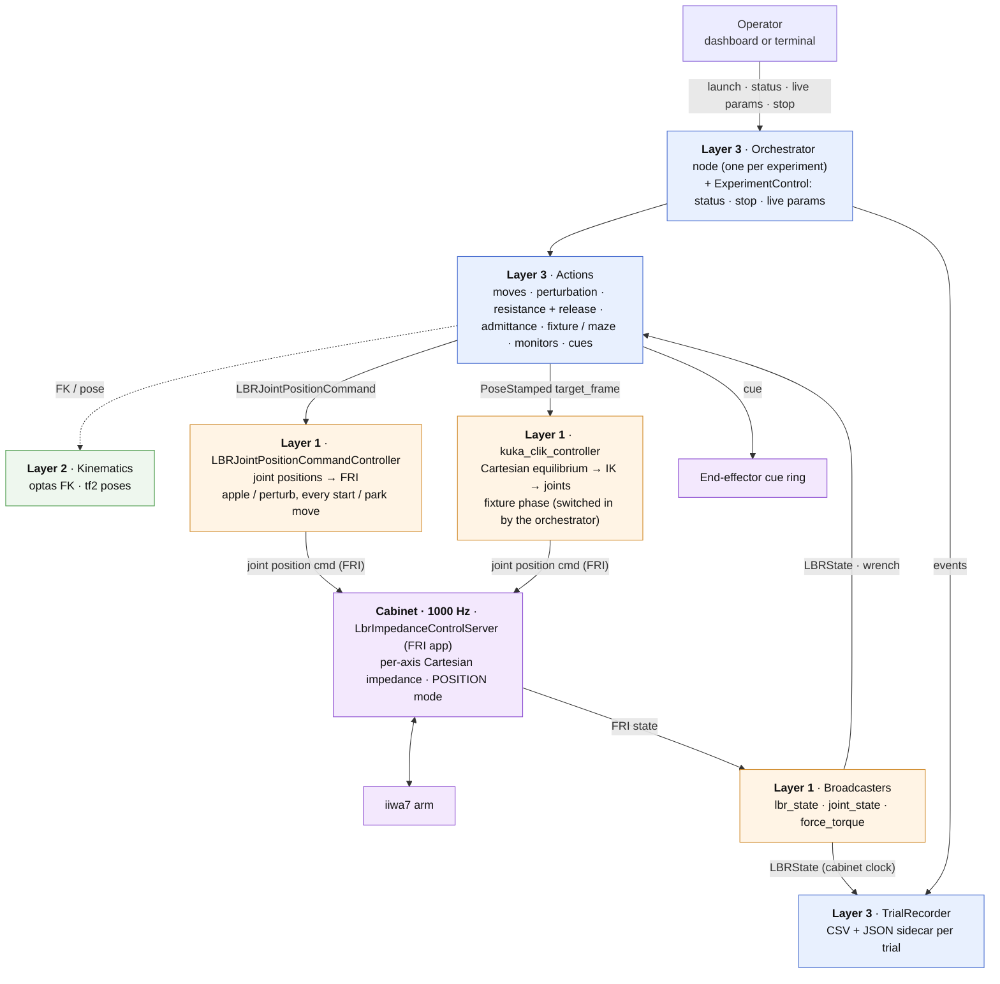
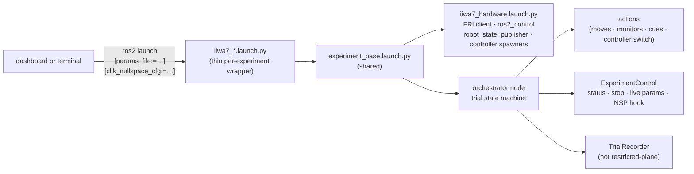
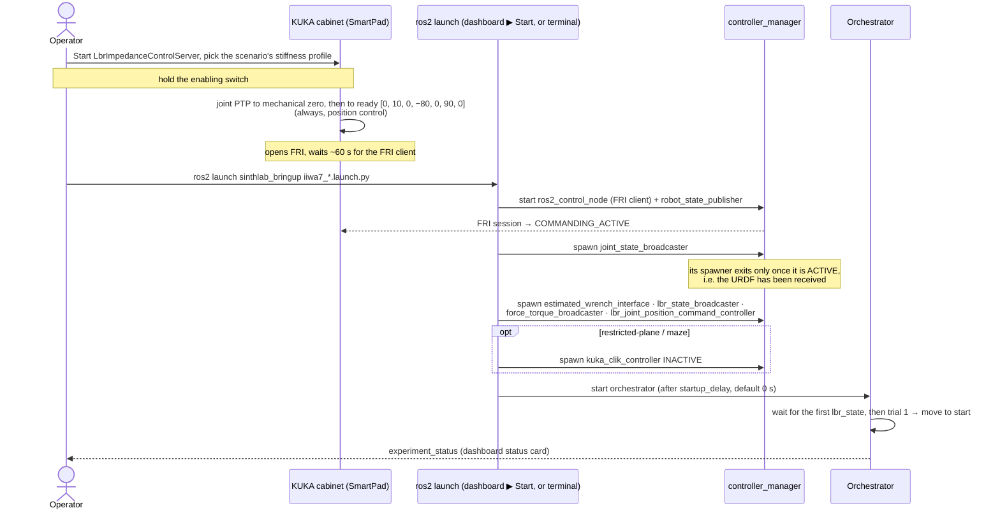
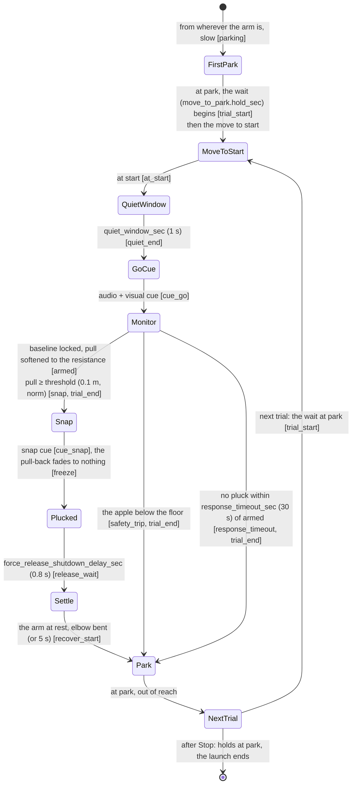
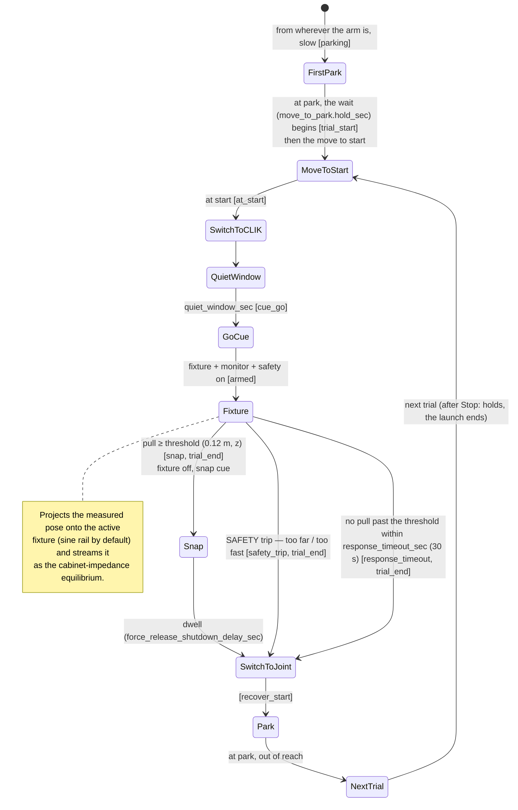
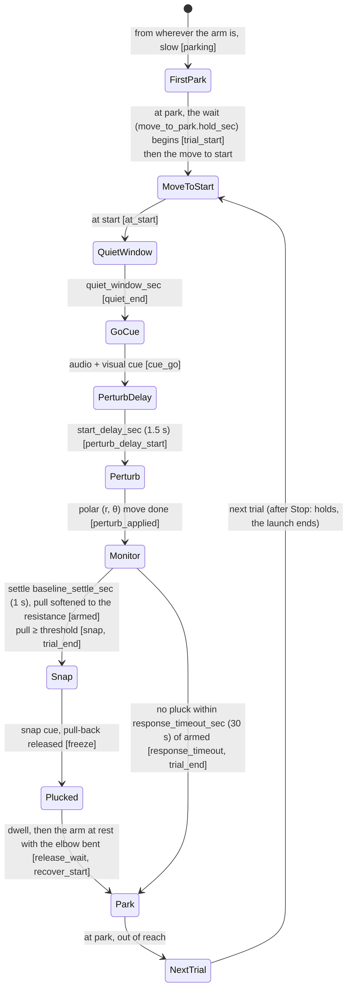
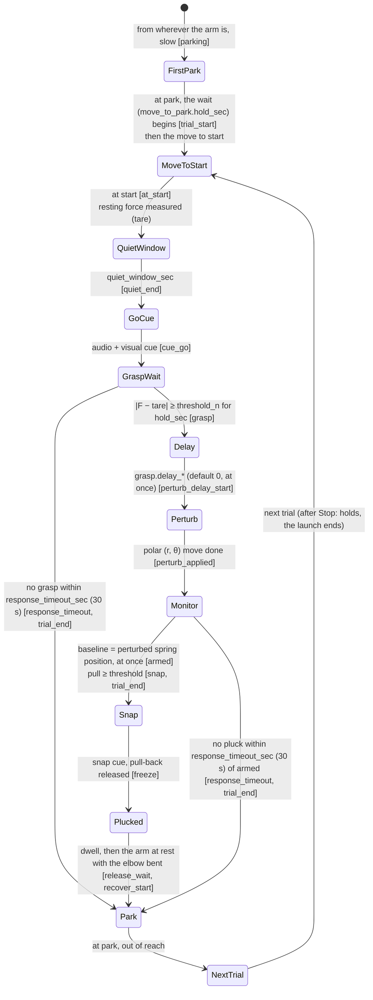
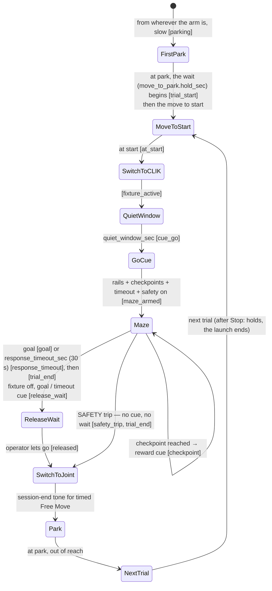
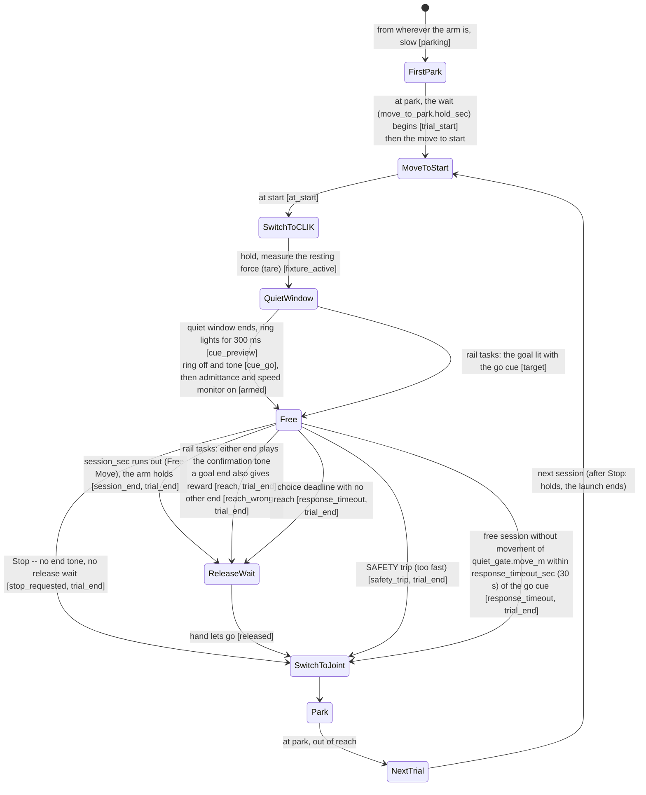

# Sinthlab KUKA Stack

A ROS 2 (Jazzy) control stack for running **compliant "apple‑pluck" experiments** on a KUKA
LBR iiwa7. It is built as an *overlay* on top of the [`lbr_fri_ros2_stack`][^1], adding the
high‑level experiment orchestration, motion actions, and the KUKA Sunrise (FRI) applications
needed to drive the arm.

All experiments run in FRI **position** mode, with the **cabinet** (`LbrImpedanceControlServer`)
providing the Cartesian spring at 1000 Hz. Apple-pluck / perturb stream **joint** setpoints via
`LBRJointPositionCommandController`; restricted-plane / maze stream a fixture-constrained **Cartesian
equilibrium** via `kuka_clik_controller`. Python state machines sequence each trial
(move → cue → monitor displacement → recoil → repeat).

The repo also carries the physical end of the rig: the parametric
[end‑effector design](end_effector_design/README.md) and the
[end‑effector board firmware](end_effector_metro_code/README.md) — a NeoPixel cue ring triggered
over an RS‑422 serial link through the media flange or over the board's own Wi‑Fi, whose **appearance
is configured on the board over its Wi‑Fi**, see [§6.7](#67-end-effector-board--the-visual-cue) — and
the [Inside electric flange data path](in_electric_flange_data_path/README.md): building that serial
link, from the X76 plug to the software, with its tests and troubleshooting. The
[reward and sync box](reward_and_sync_box/README.md) — the 24 V juice-valve driver (foot pedal, hand
switch or NSP TTL trigger) and the Beckhoff TTL stack that sends trial events to the NSP — is
documented with its parts list, wiring and panel CAD.

**To run an experiment, start with the
[experiment control dashboard](#quick-start-the-experiment-dashboard)**, a local web page for
picking an experiment, editing its parameters, Start / Stop, changing cues between trials,
and following the status and log. Every experiment can also be run from a terminal
([§5](#5-running-experiments-on-hardware)).

Why FRI **position** mode rather than torque mode (ROS-side impedance), and when torque mode would be
worth reconsidering, is in the [appendix](#appendix--why-fri-position-mode-not-torque-mode).

## Table of Contents
- [Quick start: the experiment dashboard](#quick-start-the-experiment-dashboard)
- [1. Hardware Setup (KUKA Arm)](#1-hardware-setup-kuka-arm)
- [2. Windows Laptop Setup](#2-windows-laptop-setup)
- [3. Building the Stack](#3-building-the-stack)
- [4. Simulation & Visualization (no hardware)](#4-simulation--visualization-no-hardware)
- [5. Running Experiments on Hardware](#5-running-experiments-on-hardware)
  - [Pre-training — Free Move, Move Vertical, Move Horizontal](#pre-training--free-move-move-vertical-move-horizontal)
- [6. Software Architecture](#6-software-architecture)
- [7. Data Collected](#7-data-collected)
- [8. Neural Synchronisation](#8-neural-synchronisation)
- [9. Troubleshooting](#9-troubleshooting)
- [10. Development & Contributing](#10-development--contributing)
- [Acknowledgement](#acknowledgement)
- [Appendix — why FRI position mode, not torque mode](#appendix--why-fri-position-mode-not-torque-mode)

---

## Quick start: the experiment dashboard

The experiment control dashboard runs on the ROS computer. Use it to select a task, adjust settings, start or stop a run, and monitor trials and recordings. You can also run experiments from a terminal. See [Running experiments on hardware](#5-running-experiments-on-hardware), [Without the dashboard](#without-the-dashboard), and the [dashboard developer guide](experiment_ctrl_gui/README.md).

> ⚠️ **Use the SmartPad emergency stop in an emergency.** The dashboard’s **Stop** button ends the trial and parks the arm before stopping the ROS launch. On the first run of any experiment, work in **T1** and keep a hand on the emergency stop.

### Start the dashboard
On the ROS computer wired to the arm, with the workspace built ([§3](#3-building-the-stack)):

```bash
~/lbr-stack/src/sinthlab-kuka-stack/experiment_ctrl_gui/run_gui.sh     # then open http://localhost:8080
```

Under WSL2 a Windows browser works, because Windows forwards `localhost` to WSL. `run_gui.sh`
sources ROS 2 and the workspace first. The page needs nothing extra installed and loads nothing
from the internet.

**Try it without the robot first.** This runs a simulated experiment with the same controls;
nothing is launched and nothing connects to the arm:

```bash
python3 ~/lbr-stack/src/sinthlab-kuka-stack/experiment_ctrl_gui/server.py --demo
```

| Option | Effect |
|---|---|
| `--port 8081` | serve on another port |
| `--robot-name lbr` | the arm's ROS namespace (default `lbr`) |
| `--demo` | simulated robot: nothing is launched |
| `--host 0.0.0.0` | serve beyond this computer. **Anyone who can reach the port can start the robot.** Prefer an SSH tunnel: `ssh -L 8080:localhost:8080 <ros-box>` |

### Dashboard layout

- **Top bar.** Select a monkey and task, adjust the reward, and start or stop a run. The status indicators report the ROS connection, the robot's FRI state, and the run state.
- **Left column.** Follow the current trial, arm position, and trial events. **Run** shows the current or latest run, including trial outcomes and task-specific measures. **Session history** compares the next run’s settings with the last three sessions for the selected subject and task. Before a run, expand **Before you start** for the SmartPad checklist.
- **Right column.** **Task** shows frequently adjusted settings. **Monkey** shows profile settings used by the selected task. **All settings** contains the **Live**, **Per-run**, and **Fixed** tabs.
- **Log.** The bottom bar shows the latest message and the warning count. Select **Open log** to see more.

Choose a subject in **Session history** to review their sessions. This leaves the monkey selected for the run unchanged. To reuse a setting for the selected monkey, select a value from a past session or choose **Use last session’s settings**.

### Live view

Expand **Arm** in the trial card to see the measured end-effector position, the last 8 seconds of movement, and the bounds of the current trial. Select **Open live view** for a larger view in a new tab. The front view is from the subject’s side, with Y to the right and Z up. In the top view, Y points right and X points down toward the subject. See the [live view reference](experiment_ctrl_gui/README.md#live-view) for the bounds shown for each task.

### Diagnostics

Select **Diagnostics** to test the cue ring and TTL outputs without moving the arm.

- **Visual cue.** Choose Wi-Fi or serial, then select **Check board**. For Wi-Fi, join the `KUKA_NEOPIXEL` network. For serial, attach the StarTech adapter to WSL to reach the board through X76. Select **Trigger cue** to test the current cue settings or use **LED-by-LED test** to identify dark pixels.
- **TTL sync.** Run **PulseTestServer** or **LbrImpedanceControlServer** on the SmartPad. Enter the cabinet address and select **Check outputs**. To send a test pulse, specify the output, pulse width, number of repetitions, and interval. Test pulses are disabled during experiments.

Demo mode simulates both devices. See the [diagnostics reference](experiment_ctrl_gui/README.md#diagnostics-page) for the available commands and connection details.

### Post-processing

Select **Post-processing** to export a session to NWB. Select the robot run and, if available, the Blackrock NSP recording. Enter the subject and session information, then select **Create NWB**. When the file is ready, enter the mounted server folder and select **Upload**. The dashboard verifies the copy by checksum.

With an NSP recording, export aligns the robot data to the NSP clock using the trial start and end pulses (`ainp2` and `ainp3` by default). The experiment start pulse (`ainp4` by default) is stored separately. An input renamed in Central is still found as `ainpN`. Export requires `pynwb` and `neo`. See the [post-processing reference](experiment_ctrl_gui/README.md#post-processing-page) for installation and file details.

### Running an experiment
1. **Select a task.** The task menu groups experiments and [pre-training tasks](#pre-training--free-move-reach-map-restricted-move-cued-reaches). Use the tabs beside the task name to choose a mode or rail, if offered.
2. **Prepare the SmartPad.** Start `LbrImpedanceControlServer` and make the selections listed under
   *Before you start*: FRI send period, remote IP, stiffness profile, damping, elbow stiffness (each
   question also offers **Cancel**). The app
   then **always** moves the arm to mechanical zero and on to the ready pose `[0, 10, 0, −80, 0, 90, 0]`
   (no prompt; hold the enabling switch while it moves; see
   [Start-up posture](#start-up-posture-zero-then-ready)). It then waits about 60 s for ROS.
   - **Cue over the serial link** (`visual_cue.trigger: serial`): the StarTech adapter must be
     attached to WSL — `ls /dev/ttyUSB*` shows `/dev/ttyUSB0`. After any WSL restart or crash, or a
     Windows reboot, [re-attach it](in_electric_flange_data_path/README.md#re-attach-after-wsl-restarts-or-crashes) first.
3. **Check the parameters** ([below](#live-per-run-and-fixed-parameters)). Edited rows get an
   `edited` badge, and ↺ puts one back to the YAML value. Hover over any parameter for its full
   help.
4. **▶ Start.** This runs `ros2 launch sinthlab_bringup <experiment>.launch.py`, plus your edited
   parameters if you changed any. The status card then follows each trial, e.g.
   `start → at start → quiet → go cue → armed → threshold → park → end`. Before the first trial the
   arm makes one slow move to the [park pose](#park-pose--out-of-reach-between-trials), out of reach.
5. **Change live settings** under **All settings → Live**. Most changes take effect at the next trial and show a purple `next trial` badge until then. Move speed changes take effect at the next move, which can occur within the current trial.
6. **■ Stop** ends the trial in progress at once — no cue, no release wait — **parks the arm**,
   and only then Ctrl-Cs the launch, so FRI always closes with the arm out of reach. The cut-short
   trial is saved, marked `stop_requested`. While it parks the button reads **Parking… (press to
   skip)**: a second press Ctrl-Cs at once, wherever the arm is. If the orchestrator does not
   answer, or the arm has not parked within 60 s, the launch is stopped anyway.
   - **However a run ends** — any Stop, a finished run or a crash — the dashboard then ends every node
     the launch left behind, so a lingering process can never block the next run.
   - **From a terminal**, Ctrl-C reaches every process at once, so nothing parks first. To park, call
     `ros2 service call /lbr/<orchestrator>/stop std_srvs/srv/Trigger` and Ctrl-C once the log says it
     is holding.
7. **Validate recording** checks this run's data folder
   (`analysis/validate_recording.py --folder …`) and prints the result in the log. To plot the
   run afterwards, see [Working with the data](#working-with-the-data).

**The log** is the launch's own output from every node, colour-coded by level. Filter it by level or
text, or turn off *Follow* to scroll back. It is also saved to `experiment_ctrl_gui/logs/`.

**An experiment started in a terminal** is picked up automatically. Live changes work
from the page; stop it with Ctrl-C in its own terminal.

### Live, Per-run and Fixed parameters

| Tab | When it can change | What is in it |
|---|---|---|
| **Live** | Any time, **including while running**; normally applies from the next trial | cue switches, colours, tones and timing; NSP sync; move speeds; the pull threshold and hold; the perturbation; the start pose (apple pluck); the maze timeout ([full list](#live-parameters)) |
| **Per-run** | Before **Start**, then **locked for the run** | everything else in the experiment YAML: the start pose in restricted plane / maze, rails, checkpoints and goal, move tolerances, safety limits, the fixture profile, the displacement axis, frames, debug logging |
| **Fixed** | Not from the dashboard: at the SmartPad or in the file named | what every experiment shares: SmartPad (FRI) selections, launch arguments, `iiwa7_hardware_controllers.yaml`, the CLIK redundancy posture |

- **Your edits never change the package YAML.** They go into a copy for that run, and every
  recorded trial's sidecar keeps the full parameter set it ran with, live changes included.
- **Poses** are 7 joint angles in degrees. They are checked against the iiwa7 joint limits, and a
  nearly straight (singular) arm is refused — by the dashboard and again by the orchestrator.
  - **The elbow must bend in the same direction at start and park** (A4 on the same side); an edit that flips one
    is refused — see [Park pose](#park-pose--out-of-reach-between-trials).
  - **Apple Pluck:** the start pose is live. The next trial moves to it from park.
  - **The park pose is live everywhere.** Like every live change it applies as the next trial
    begins, when the arm is already at park, so the arm first goes to the new park when that trial
    ends.
  - **Restricted Plane and Maze:** the CLIK redundancy posture follows an edited start pose
    automatically.
  - **Maze:** a new start moves the whole maze with it. Run `check_maze.py` on the edited copy
    before trusting it.
  - **Start height:** under the start pose (Per-run), enter a height above the
    ground for [the floor's](#the-floor--a-height-the-end-effector-never-goes-below) reference point
    (apple bottom or base edge) and solves the start pose that puts it there: straight up or down
    from the current start, same orientation. It refuses heights below the floor, out of reach, near
    a joint limit or singular, or whose move from park dips below the floor. Needs ROS sourced
    (`run_gui.sh`); without it the field says so.
- **Amber ⚠ notes** flag parameters other things depend on; **blue 🔗 notes** name what else an
  edit changes. Rails and checkpoints must keep their number of entries; adding a rail is a YAML
  edit.
- **Values are checked** for type, range and allowed choices before they are sent, and again inside
  the orchestrator. A refused change says why.

### Live parameters
**Every experiment:**

| Parameter | Meaning |
|---|---|
| `quiet_window_sec` | pause at the start pose before the go cue [s] (apple pluck 1.0, the CLIK experiments 2.0–4.0) |
| `quiet_gate.enabled`, `quiet_gate.move_m`, `quiet_gate.force_n`, `quiet_gate.penalty_sec` | the [guarded quiet window](#the-quiet-window--hands-off-until-the-go-cue): touching the apple before the go cue ends the trial with no reward and a penalty wait (on, 3 cm, 5 N, 5 s) |
| `move_to_park.hold_sec` | wait at park before each trial's move to the start [s] (default 2.0) |
| `move_to_park.target_joint_position` | the park pose, A1..A7 [deg]; first used when the next trial ends. Checked against the limits, and A4 must keep the start's sign |
| `audio_cue.enabled` | master switch for every beep; off, the trial runs the same but silent |
| `audio_cue_*.frequency_hz`, `audio_cue_*.duration_ms` | each tone (37–32767 Hz, 10–10000 ms) |
| `visual_cue.enabled` | master switch for the NeoPixel ring |
| `visual_cue.trigger` | how cues reach the ring: `serial` (the RS-422 link) or `wifi` (the board's access point); the experiment is the same either way |
| `visual_cue.colours.<site>` | `[r, g, b, w]` per cue site |
| `nsp_sync.enabled`, `nsp_sync.cabinet_ip`, `nsp_sync.trial_start_output`, `nsp_sync.trial_end_output`, `nsp_sync.pulse_width_ms` | [sync pulses to the Blackrock NSP](#sync-to-the-blackrock-nsp): on/off, the cabinet's address (default `172.31.1.147`), the EL2124 output pulsed at trial start and at trial end (1–4, default 1 and 2, different from each other and from `nsp_sync.experiment_start_output`, default 3, which is per-run), and the pulse width (10–5000 ms, default 500) |
| `haptic.enabled`, `haptic.min_pct`, `haptic.max_pct`, `haptic.ramp_start_m`, `haptic.ramp_full_m` | maze, Move Vertical / Horizontal: the [haptic guidance](#haptic-guidance-and-the-force-sensor) — on/off, the strength where the buzz starts and at its strongest (0–100 %, min ≤ max), and the distances to the goal where it starts and reaches full strength (full closer than start) |
| `reward_pulse.enabled`, `reward_pulse.output`, `reward_pulse.pulse_ms` | the [reward pulse](#reward-pulse) on a successful trial — on/off (default on), the EL2124 output cabled to the reward box (1–4, default 4, different from the `nsp_sync` outputs), and how long the valve stays open (10–5000 ms, default 500) |
| `move_to_start.speed_scale`, `move_to_park.speed_scale` | **move speed** (slider, 0.25–2, default 1): time-stretches the move — 0.5 = twice as slow, 2 = twice as fast. **Applies at once** (badge *next move*), from the next move — even within the current trial; a move already under way finishes at its speed. Each change is logged in the trial sidecar's `live_changes`. See [Move speed](#move-speed). |

**Plus, per experiment** (`…displacement` = `apple_pluck_impedance_control_displacement`):

| Experiment | Extra live parameters |
|---|---|
| Apple Pluck | `response_timeout_sec`; **the resistance** `resistance.stiffness_n_per_m` (slider + text box in steps of 10, from 50 N/m up to the SmartPad's profile; see [Resistance](#resistance--the-felt-stiffness-of-the-pull)), `…displacement.cartesian_displacement_threshold_m`, `…displacement.force_release_shutdown_delay_sec`, **the start pose** (`move_to_start.target_joint_position`; its elbow must bend the same way as the park pose's) |
| Apple Pluck — **perturb and perturb bump paradigms** (shown under *Pluck perturb* / *Pluck perturb bump*) | the perturbation: `perturb_start.polar_r_m` (capped per plane; **0 = an unperturbed trial**), `perturb_start.polar_theta_deg`, `perturb_start.polar_plane`; **when** (perturb only, after the go cue): `perturb_start.start_delay_mode` (`fixed` / `random`), `start_delay_sec` (fixed), `start_delay_min_sec` / `start_delay_max_sec` (random); `perturb_start.baseline_settle_sec` (perturb only); and its speed `perturb_start.speed_scale` (perturb only; applies at once) |
| Apple Pluck — **perturb bump paradigm only** (shown under *Pluck perturb bump*) | the grasp: `grasp.threshold_n`, `grasp.hold_sec`; **when**, after the grasp: `grasp.delay_mode` (`fixed` / `random`), `grasp.delay_sec` (fixed, default **0** — at once), `grasp.delay_min_sec` / `grasp.delay_max_sec` (random); **how fast** the bump moves: `grasp.bump_speed_scale` (slider, 0.25–3, default 3; applies at once) |
| Apple Pluck — **random start paradigm only** (shown under *Pluck random start*) | none live. The start positions `random_start.positions.*` (`[a, b]` m from the start pose) and `random_start.plane` are **per-run**. The start pose above is their origin: changing it moves them all |
| Restricted Plane | `response_timeout_sec`, `…displacement.cartesian_displacement_threshold_m`, `…displacement.force_release_shutdown_delay_sec` |
| Maze | `response_timeout_sec`, `virtual_fixtures.rail_lead_sec` (how easy moving along a rail feels: + lighter, − heavier, −0.15 to +0.05 s) |
| Free Move | `session_sec` (0 = until Stop), `response_timeout_sec`; the ring `ring_cue.quarters`, `ring_cue.colours.*`; the feel `free_move.damping_ns_per_m` (3–200, lower = lighter), `free_move.deadband_n` (0–15, default 2.5), `free_move.max_speed_mps` (≤ 0.5), `free_move.accel_limit_mps2`, `free_move.force_filter_tau_sec`, `free_move.tare_sec`, `free_move.trail_m` (0–0.03), `free_move.low_force_n` (0–30), `free_move.low_force_damping_ns_per_m` (40–300) |
| Move Vertical / Move Horizontal | the same as Free Move (`session_sec`, the ring, the feel `free_move.*`), and the [centre-out reach](#centre-out-reach) `centre_out.*`; the rail itself (`free_move.rail_axis`, `rail_min_m`, `rail_max_m`) is per-run |

These are deliberately **not** live:
- `cartesian_axis`: it changes what the threshold means, so it is a different experiment, not a
  different trial.
- **Safety limits:** a limit must not be loosened mid-session.
- **Move tolerances** (`joint_move_tolerance`, `cartesian_move_tolerance`): they decide when a move
  counts as arrived.
- **The start pose in Restricted Plane and Maze:** those experiments hand the arm to the CLIK, whose
  redundancy posture must equal the start pose and is read once, when the controller starts; and the
  maze's geometry hangs off the start. Edit it per-run (the posture then follows automatically).
- **Maze rails, checkpoints and goal:** verified offline by `check_maze.py`.
- **The pre-training rails:** checked by IK for reach; edit them per-run.

### Move speed
Every joint-space move — to the start, to park, the perturbation — has one **`speed_scale`**
slider (Live tab, 0.25–2, default 1). It time-stretches the whole move: it multiplies that move's
limits `move_to_pos_v_max` / `_a_max` / `_j_max` (Per-run, the base) by s, s² and s³, which makes the
move take exactly **1/s as long** along the same path. 0.5 = twice as slow, 2 = twice as fast.

*Why a scale and not the limits themselves.* These moves are short — a few to ~18° of joint travel —
so the joints never reach `v_max` (changing it does nothing), and `a_max` / `j_max` act only through
square and cube roots: quartering `a_max` stretches a 1.1 s move to just 1.5 s. The scale changes
all three together, so every move, however short, changes by exactly the factor you set.

| Move (apple pluck, from the start pose) | ×0.5 | ×1 | ×2 |
|---|---|---|---|
| Back from a 10 cm pull to the start | 2.3 s | 1.1 s | 0.6 s |
| Perturbation, 5 cm | 1.5 s | 0.7 s | 0.4 s |
| Random start, C → N (5 cm) | 2.1 s | 1.0 s | 0.5 s |

*When it applies.* **At once, from the next move** — not at the next trial: lower the park speed
during a pull and that trial's park move already uses it. A move already under way finishes at the
speed it started with: lowering the limits mid-move would leave the trajectory generator holding an
acceleration above the new limit, and its correction overshoots the target. Every change goes into the
trial sidecar's `live_changes` (name, value, time and CSV row), and every move into its `moves`: the
scale it ran at, the effective (scaled) limits and its duration — so each move's speed is recorded
directly, ready to use as an experimental variable. Joint speed stays capped at 90 deg/s after scaling.

### Parameter help
Each parameter shows a one-line description. **Hover over its name**, or tab to it, for the full
help:
- the type, YAML default, and allowed range or choices;
- whether it is live;
- the **notes from the YAML**: the reasoning, measurements and knobs;
- any caution or linked parameters.

Group headings and Fixed rows have the same help. To send someone straight to one parameter's help:
`http://localhost:8080/?exp=perturb&hover=perturb_start.polar_theta_deg`.

All of it is read from the YAML files themselves, so the page and the files cannot disagree. To
document a new parameter, see [§10](#10-development--contributing).

### Without the dashboard
The same controls from a terminal (namespace `lbr`, apple pluck shown). The orchestrator nodes are
`apple_pluck_orchestrator` (all paradigms), `restricted_plane_orchestrator` and
`maze_orchestrator`; for pre-training, `free_move_orchestrator` (Free Move, Move Vertical and Move
Horizontal).

```bash
ros2 launch sinthlab_bringup iiwa7_apple_pluck_impedance_control.launch.py                 # start; Ctrl-C stops
ros2 launch sinthlab_bringup iiwa7_apple_pluck_impedance_control.launch.py params_file:=/path/edited.yaml

ros2 topic echo /lbr/experiment_status                                                     # where the run is
ros2 param set /lbr/apple_pluck_orchestrator visual_cue.enabled false                       # live: next trial
ros2 param set /lbr/apple_pluck_orchestrator move_to_start.speed_scale 0.5                  # half-speed approach, now
ros2 service call /lbr/apple_pluck_orchestrator/stop std_srvs/srv/Trigger                    # end trial now, park, hold
```

A `ros2 param set` on anything that is not live is **rejected with the reason**, because the
orchestrator read it once at start-up. A start pose whose elbow bends the other way from the park
pose is refused. The maze, restricted-plane and
pre-training launches also accept `clik_nullspace_cfg:=`.

### Files the dashboard writes
| Where | What |
|---|---|
| `experiment_ctrl_gui/runs/<exp>_<time>.yaml` | the edited parameter copy a Start used (only when something was edited), plus `…_clik_nullspace.yaml` when a CLIK start pose was edited |
| `experiment_ctrl_gui/logs/<exp>_<time>.log` | the full launch output of each run |
| `analysis/YYYYMMDD_subject_task_HHMMSS/` | the trial recordings, written by the orchestrator as always ([§7](#7-data-collected)) |
| `analysis/sessions.csv` | one row per run, added when the run ends ([behavioural tables](#behavioural-tables-trialscsv-and-sessionscsv)) |

None of these are committed to git.

### If something is wrong
- **"ROS ✗" in the top bar.** The dashboard was started without ROS sourced, so use `run_gui.sh`.
  Start, Stop and the log still work, but live changes and robot state need ROS.
- **"Robot: no state".** Nothing is publishing `/lbr/lbr_state` yet: the launch has not connected
  to FRI, or the SmartPad app is not running or timed out. Restart the app, then Start.
- **The run pill stays on "Starting…".** The orchestrator has not reported yet. Look in the log for
  its first lines or an exception.
- **A live change is refused.** The message gives the reason: not a live parameter, out of range, or
  wrong type. A per-run parameter needs Stop, edit, Start.
- **Stop takes a while.** The nodes shut down in order. After 20 s the dashboard escalates, and the
  log says so.
- **The cue ring does not light.** Open **Diagnostics → Visual cue**: *Check board*, then *Fire cue* over
  Wi-Fi. That separates the board and ring from the wiring; see [Diagnostics](#diagnostics).
- **The serial cue link stopped answering after WSL restarted or crashed** (log: `serial port …
  cannot be opened`, or Diagnostics → Visual cue, path Serial, *Check board* fails). The adapter left WSL with it.
  Restart the dashboard (`run_gui.sh` attaches it again). If that fails, in PowerShell:
  `usbipd attach --wsl --busid <busid>`; if that fails too, `usbipd detach`, `unbind`, `bind` (as
  administrator), then `attach` again. Full steps:
  [Re-attach after WSL restarts or crashes](in_electric_flange_data_path/README.md#re-attach-after-wsl-restarts-or-crashes).
- **"Dashboard disconnected".** The dashboard server stopped. Restart it. If it was running an
  experiment, that experiment was stopped cleanly when the server stopped.

---

## 1. Hardware Setup (KUKA Arm)
- Use the "Quick Start guide" to cable up the Arm, Cabinet and the SmartPad.
- For the Safety on the X11 interface in the Cabinet:
  - First create 6 jumper cables with the provided pins.
  - Based on the PIN diagram (pg‑53 of `Spez_KUKA_Sunrise_Cabinet_en.pdf`, section 6.6.2),
    jump pins 1/2, 10/11 (external E‑Stop), 3/4, 12/13 (Operator Safety) and 5/6, 14/15
    (Safety stop 1).

---

## 2. Windows Laptop Setup
> **Why Windows + WSL2?** KUKA's robot software (Sunrise Workbench) requires Windows, while our
> stack requires Ubuntu. We use the Windows laptop to install applications onto the robot, and
> run our stack inside WSL2 (Ubuntu) on the same laptop to control the arm.

### Prerequisites
- Install Ubuntu 24.04 with `wsl --install -d Ubuntu-24.04` (the version matters — do **not**
  install the default).
- Confirm you are on WSL version 2 (`wsl -l -v` shows the version and the installed distro).
- Make sure the robot controller box is on.
- Install `Sunrise Workbench` on the laptop. For our arm version we use
  `SunriseWorkbench-1.17.0.4-setup.exe`, provided by KUKA Support.
- Install the FRI plugin in the Sunrise Workbench project (steps to be elaborated).
- For the neural-sync outputs only ([§8](#8-neural-synchronisation)): install **KUKA WorkVisual 5.0.5
  Build 600**, the build the Sunrise.OS 1.17 release notes name (Workbench: *Help → Sunrise.OS
  Release Notes*), with the `Sunrise.kop` option package from this Workbench's installation. Sunrise Workbench opens it to edit
  the cabinet's I/O configuration.

### Connection Verification
- Connect your computer to the robot controller at **X66** (default IP `172.31.1.147`) via an
  ethernet cable.
- Put your computer on the same network — set your IP to `172.31.1.148` (or anything else in the
  `/16` subnet).
  - On Windows: Settings → Network & Internet → Ethernet, edit the IPv4 manual setup to IP
    `172.31.1.148` and gateway `255.255.0.0`; leave other options as is and save.
- Ping the robot from PowerShell — `ping 172.31.1.147` — and expect something like:
  ```
  PING 172.31.1.147 (172.31.1.147) 56(84) bytes of data.
  64 bytes from 172.31.1.147: icmp_seq=1 ttl=64 time=0.868 ms
  ```
- Enable Hyper‑V on the laptop.
- Set up networking for WSL2: open WSL settings (in the Start menu) and change the Networking
  mode to **Mirrored**.
  
- In a PowerShell window **with admin privileges**, allow inbound Hyper‑V connections:
  ```powershell
  Set-NetFirewallHyperVVMSetting -Name '{40E0AC32-46A5-438A-A0B2-2B479E8F2E90}' -DefaultInboundAction Allow
  ```
  This also lets in the SmartPad app's settings report (UDP 30001, see
  [Cancelling the app / settings report](#smartpad-app-close-and-settings-report)). If the dashboard says
  *No report from the SmartPad app* while FRI works, check that port first.

### Install Application to Robot
Follow [these steps](https://lbr-stack.readthedocs.io/en/latest/lbr_fri_ros2_stack/lbr_fri_ros2_stack/doc/hardware_setup.html#install-applications-to-the-robot)
to install the application to the robot. Our application is
[`sunrise_controller_code/LbrImpedanceControlServer.java`](sunrise_controller_code/LbrImpedanceControlServer.java),
with [`TtlPulser.java`](sunrise_controller_code/TtlPulser.java) beside it in the same package, and
[`PulseTestServer.java`](sunrise_controller_code/PulseTestServer.java) as a second app for testing the
neural-sync lines ([§8](#8-neural-synchronisation)). Copy all three into the Sunrise project and
redeploy from Sunrise Workbench whenever any of them changes.

### Tool Load Data (payload calibration)
The cabinet must know the end‑effector's mass, or the compliant control modes (Cartesian / joint
impedance) refuse to activate. With an uncalibrated tool the experiment launch aborts with:
```
[lbr_fri_ros2::StateGuard]: External torque not in limits for joint lbr_A2. Measured: 2.4 Nm, limit: 2 Nm
... External torque limits exceeded. Perform load data calibration!
```
You define a **tool** in Sunrise Workbench, then let the controller measure its mass and centre of
mass with the smartPAD's **Load data** view (Sunrise.OS 1.16 SI manual §7.5; ours is 1.17).

1. **Define the tool** in Sunrise Workbench — open the project's `RoboticsAPI.data.xml` and add a
   tool under `objectTemplates`. Keep the TCP at the flange (all‑zero transform) so the FRI control
   point stays aligned with the ROS `lbr_link_ee`, and leave `loadData` at zero (Determine fills it):
   ```xml
   <objectTemplates>
     <toolTemplate class="" defaultMotionFrameRef="/SinthLabIiwa7EE_link_ee" name="SinthLabIiwa7EE">
       <frames>
         <frame name="SinthLabIiwa7EE_link_ee">
           <transformation a="0.0" b="0.0" c="0.0" x="0.0" y="0.0" z="0.0"/>
         </frame>
       </frames>
       <loadData cogA="0.0" cogB="0.0" cogC="0.0" cogX="0.0" cogY="0.0" cogZ="0.0"
                 inertiaX="0.0" inertiaY="0.0" inertiaZ="0.0" mass="0.0"/>
     </toolTemplate>
   </objectTemplates>
   ```
   `defaultMotionFrameRef` must match the frame name exactly. **Synchronize** the project to the controller.
2. **Determine the load** on the smartPAD, in **T1**: at the **Robot** level select the **Load data**
   tile → pick `SinthLabIiwa7EE` → hold the enabling switch → **Determining the load data** →
   **Apply**. Then **synchronize** the project so Sunrise Workbench keeps the values.
   - Only the wrist moves: A7 goes to 0° then to −90°, and A6 swings ±95° (A1–A4 stay put). Tick
     **Restricted motion range for axis 6** (±15° around the start) if the effector could hit the arm.
   - Start from a pose well away from singularities, and make sure nothing on the tool can move: tie
     down cables and any battery pack. Loose parts, or anyone touching the robot, falsify the result.
   - **Below 1 kg KUKA calls the mass measurement unreliable.** Weigh the effector, enter the mass in
     the tool's `loadData`, synchronize, then choose **Use existing mass** so only the centre of mass
     is measured.
3. **Attach the tool in the FRI app** so the cabinet actually compensates it: in
   `sunrise_controller_code/LbrImpedanceControlServer.java`, create the tool
   (`createFromTemplate("SinthLabIiwa7EE")`), `attachTo(lbr_.getFlange())`, and move the **tool**
   instead of the bare flange. Without this the guard still trips even after Determine.

> **Apply** stores the mass / COM on the controller; synchronizing copies them back into the project's
> `RoboticsAPI.data.xml`. Re‑run after any change to the end‑effector — a different apple height or a
> moved battery pack counts. **Stale load data shows up as** a steady external torque at rest on the
> shoulder and elbow (A2, A4) that grows as the arm moves away from the start, and in Free Move as a
> sustained ~1 Hz oscillation, mostly in Z. The `gravitation` vector in `RoboticsAPI.data.xml` assumes a standard floor mount;
> set it to match if the arm is mounted otherwise.

### Joint-limit safe stop (cabinet safety configuration)
A hard or fast pull on a compliant arm can drag a joint past its **software limit switch**. The
cabinet then locks the arm with a joint-limit error on the smartPAD, and getting out of that has
needed re-mastering. ROS cannot prevent it: it only moves the spring's equilibrium (the CLIK and the
joint moves already keep their commands inside the limits), and the hand moves the arm itself. On a
soft profile the spring's pull is small (Uniform 100: 10 N for 10 cm), so no ROS-side "wall" stops a
determined pull. The cabinet's own safety monitoring can: it stops the arm a few degrees **before**
the software limit, as an ordinary safety stop.

Set it up once, in Sunrise Workbench (names as in the Sunrise.OS safety-configuration manual; check
them against your version):

1. Open the project's **`SafetyConfiguration.sconf`** → **Customer PSM**.
2. Add **three rows**, one each for **A2, A4 and A6**: category **Workspace monitoring**, AMF 1 **Axis
   range monitoring** (that axis, the minimum and maximum below), AMF 2 and 3 empty, reaction
   **Stop 1 (on-path)**. The safety configuration allows only three instances of axis range
   monitoring, so they go on the joints that actually run close to their limits:

   | Axis | Software limit | Monitored range | Closest seen in recordings |
   |---|---|---|---|
   | A2 | ±120° | **−112° … 112°** | 102° (maze) |
   | A4 | ±120° | **−112° … 112°** | 106° (maze) |
   | A6 | ±120° | **−105° … 105°** | 102° (apple pluck, elbow folded the wrong way) |

   A1, A3, A5 and A7 (±170–175°) never came within 140° of their limits. The margin (8° on A2/A4,
   15° on A6) leaves room to brake before the software limit; if a hard pull still reaches it,
   narrow the range, and if normal runs trip it, widen it. Keep every pose you configure inside these ranges, or its move
   trips the stop.
3. **Synchronize** the project to the controller. The smartPAD then reports **"safety configuration
   is not activated"** and the robot will not move: a changed safety configuration stays inactive
   until it is signed off on the smartPAD.
4. **Activate it** (menu names as in KUKA's Sunrise documentation; your version may word them
   slightly differently):
   1. On the smartPAD, open the **Station** (or **Robot**) level → **Safety** → **Activation**.
   2. Press **Activate** and enter the **safety maintenance password** (the "Safety maintenance" user
      group's password: KUKA's default is in the operating manual, or ask whoever administers the
      cabinet if it was changed). If Activate is greyed out, first switch to that user group: main
      menu → **User group**.
   3. Check that the safety view now shows the configuration as **active**, with a new checksum, and
      that the error has cleared.
5. **Do KUKA's safety acceptance** (the checklist in the operating manual) and record the new
   checksum. KUKA requires it after any change to the safety configuration.
6. **Test in T1** before an experiment: jog A2 and A4 slowly toward ±112° and A6 toward ±105°, and check each stops
   there (smartPAD error *axis range monitoring, instance N*), then recover it as below. Then run a
   normal maze trial and check it does not trip.

**When it trips** — in a test or an experiment, where the FRI session ends as for an E-stop:

1. Switch the smartPAD's operating mode to **KRF** (controlled robot retraction). It allows slow
   jogging while a safety monitor is violated.
2. Acknowledge the message, enable, and jog the tripped axis slowly back inside its range.
3. Switch back to the previous mode (T1 or AUT) and restart the run.

**When the axis went past its software limit as well** (±120° on A2/A4/A6; smartPAD: *hardware
limit exceeded*): the monitor stops the arm, but a hard pull on a soft spring can carry the joint on
past the limit while it brakes. The software limit switches are not part of the safety controller
(Sunrise.OS manual §3.5.2.3: non-safety machine protection), so KRF does not lift them, and the
arm will not enable even in KRF. An unmastered axis has no software limits, so the way out is to
unmaster that axis, move it back, and master it again (manual §7.3):

*Unmaster and move it back*
1. Switch the smartPAD to **T1**. Note which axis is past its limit and on which side (the error
   message, or the **Axis position** view).
2. **Robot** level → **Mastering** tile. The Mastering view lists every axis and whether it is
   mastered.
3. Press **Unmaster** for that axis only. Nothing moves; the axis now shows as unmastered.
4. Acknowledge the messages, select **axis-specific jogging** (an unmastered robot allows nothing
   else) and set a low jog override (10 %).
5. Hold the enabling switch and jog **only that axis** back towards zero, well inside its monitored
   range (±112°, A6 ±105°).

*Master it again*
6. Still in the Mastering view, pick the tool: the **end-effector tool** if its tool offset has been
   taught (the axis shows a taught offset), otherwise **No tool**. Always use the same choice, and
   master from the same arm pose (the cannon position with a tool, the vertical stretch without).
7. Hold the enabling switch and press **Master** for the axis. It searches for its mastering mark,
   then moves to its zero position. Keep the enabling switch held until it stops; the axis now shows
   as mastered.

*Reference it and restart*
8. **Position referencing.** A remastered axis is not position-referenced, and the axis-range
   monitors are position-based, so they are not safe until it is (manual §13.13.1). Jog the axis
   over 0° slowly (< 30 °/s; the 10 % override is well under) through **±10.5°** (A6/A7: **±14°**)
   on each side. The safety controller references it as it crosses; the smartPAD's referencing
   message clears.
9. Check the **Safety** view shows the configuration active with no errors, switch back to the
   previous mode, restart the SmartPad app and restart the run.

---

## 3. Building the Stack
> These steps run inside **WSL2 / Ubuntu 24.04**.

1. Install ROS 2 development tools (see this [guide](https://docs.ros.org/en/jazzy/Installation/Ubuntu-Install-Debs.html) for details):
   ```bash
   sudo apt update && sudo apt install locales
   sudo locale-gen en_US en_US.UTF-8
   sudo update-locale LC_ALL=en_US.UTF-8 LANG=en_US.UTF-8
   export LANG=en_US.UTF-8
   sudo apt install software-properties-common
   sudo add-apt-repository universe
   sudo apt update && sudo apt install curl -y
   export ROS_APT_SOURCE_VERSION=$(curl -s https://api.github.com/repos/ros-infrastructure/ros-apt-source/releases/latest | grep -F "tag_name" | awk -F'"' '{print $4}')
   curl -L -o /tmp/ros2-apt-source.deb "https://github.com/ros-infrastructure/ros-apt-source/releases/download/${ROS_APT_SOURCE_VERSION}/ros2-apt-source_${ROS_APT_SOURCE_VERSION}.$(. /etc/os-release && echo ${UBUNTU_CODENAME:-${VERSION_CODENAME}})_all.deb"
   sudo dpkg -i /tmp/ros2-apt-source.deb
   sudo apt update && sudo apt install ros-dev-tools
   sudo apt update
   sudo apt upgrade
   sudo apt install ros-jazzy-desktop
   sudo apt install python3-pip
   ```
2. Create a workspace, clone, and install dependencies:
   ```bash
   source /opt/ros/jazzy/setup.bash
   mkdir -p lbr-stack/src && cd lbr-stack
   vcs import src --input https://raw.githubusercontent.com/sinthlab/sinthlab-kuka-stack/main/sinthlab_lbr_stack.repos
   rosdep install --from-paths src -i -r -y
   ```
3. **(Hardware only, one-time)** Raise the FRI external-torque limit. `lbr_fri_ros2` checks the
   *external joint torque at activation of compliant control modes*. On a
   floor-mounted iiwa7 this trips (~2.4 Nm on A2 vs. the 2 Nm default) at the extended apple-pluck
   start posture **even with no payload** — it's a gravity-model / mastering margin amplified by A2's
   moment, not a real load. Edit the upstream config
   `src/lbr_fri_ros2_stack/lbr_description/ros2_control/lbr_system_config.yaml` and raise the limit
   (keep the check enabled):
   ```yaml
   state_guard:
     external_torque_safety_check: true
     external_torque_limit: 4.0   # upstream default is 2.0
   ```
   Skip this for mock/sim. The proper long-term fix is calibrating the mounted tool's load data (see
   §2 “Tool Load Data”) so the residual stays under the default — raising the limit is the stopgap
   while the flange is load-free.
4. Install the required Python packages (only needed once per WSL session install):
   ```bash
   pip install pyoptas ruckig --break-system-packages
   ```
5. Build:
   ```bash
   colcon build --symlink-install
   ```

---

## 4. Simulation & Visualization (no hardware)

The experiments themselves need the real arm: the cabinet provides the impedance spring and the
force estimate, which no simulation here reproduces. To try the trial flow and the dashboard without
it, run the dashboard in demo mode ([Quick start](#quick-start-the-experiment-dashboard)). To look at
the arm itself:

**Mock arm in RViz** (upstream `lbr_bringup`)
```bash
# Terminal 1 — the mock arm
source install/setup.bash
ros2 launch lbr_bringup mock.launch.py model:=iiwa7
```
```bash
# Terminal 2 — visualize
source install/setup.bash
ros2 launch lbr_bringup rviz.launch.py \
  rviz_cfg_pkg:=lbr_bringup \
  rviz_cfg:=config/mock.rviz
```

**Physics simulation in Gazebo** (upstream `lbr_bringup`)
```bash
source install/setup.bash
ros2 launch lbr_bringup gazebo.launch.py model:=iiwa7
```

**MoveIt with apple (mock or gazebo)**
```bash
source install/setup.bash

# Mock + MoveIt + RViz
ros2 launch sinthlab_bringup iiwa7_moveit_apple.launch.py mode:=mock rviz:=true

# Gazebo + MoveIt + RViz
ros2 launch sinthlab_bringup iiwa7_moveit_apple.launch.py mode:=gazebo rviz:=true
```

---

## 5. Running Experiments on Hardware
> Python dependencies (`pyoptas`, `ruckig`) must be installed once per WSL session install (see
> [Building the Stack](#3-building-the-stack)).
>
> ⚠️ **Safety first.** On the first run of any scenario, operate in **T1** (reduced speed) with a
> hand on the E‑stop. The arm is actively controlled the moment a SmartPad application is running.
>
> **Start-up posture.** Every time `LbrImpedanceControlServer` starts, it moves the arm to mechanical
> zero and then to the ready pose `[0, 10, 0, −80, 0, 90, 0]`, in position control and without asking;
> each experiment's `move_to_start` then begins from there. **Keep the space above the arm clear**: at
> zero the arm stands fully upright. Why: [Start-up posture](#start-up-posture-zero-then-ready).

### Running from the dashboard
The [dashboard](#quick-start-the-experiment-dashboard) runs exactly the launches below, with the
SmartPad checklist, parameters, status and log on one page. The steps below are the terminal way, and
what the dashboard does for you. The launches accept `params_file:=/path/to.yaml` to run an edited
parameter copy; the maze, restricted-plane and pre-training launches also accept `clik_nullspace_cfg:=`.

### Scenario quick reference
| # | Scenario | Launch file | SmartPad app (FRI) | ROS controller |
|---|----------|-------------|--------------------|----------------|
| 1 | Apple Pluck          | `iiwa7_apple_pluck_impedance_control.launch.py` | `LbrImpedanceControlServer` | `LBRJointPositionCommandController` |
| 2 | Restricted on Plane  | `iiwa7_move_restricted_plane.launch.py`         | `LbrImpedanceControlServer` | `kuka_clik_controller` |
| 3 | Apple Pluck, perturb paradigm | `iiwa7_apple_pluck_impedance_control.launch.py paradigm:=perturb` | `LbrImpedanceControlServer` | `LBRJointPositionCommandController` |
| 3c | Apple Pluck, perturb bump paradigm | `iiwa7_apple_pluck_impedance_control.launch.py paradigm:=perturb_bump` | `LbrImpedanceControlServer` | `LBRJointPositionCommandController` |
| 3b | Apple Pluck, random start paradigm | `iiwa7_apple_pluck_impedance_control.launch.py paradigm:=random_start` | `LbrImpedanceControlServer` | `LBRJointPositionCommandController` |
| 4 | Maze                 | `iiwa7_maze.launch.py`                          | `LbrImpedanceControlServer` | `kuka_clik_controller` |
| 5 | Color Rule (Rail / No rail) | `iiwa7_colour_rule.launch.py` (`free_move.rail_axis` `y` / `frontal`) | `LbrImpedanceControlServer` | `kuka_clik_controller` |
| 6 | N-Choice (asterisk of rails) | `iiwa7_n_choice.launch.py` | `LbrImpedanceControlServer` | `kuka_clik_controller` |
| 7 | Cued Reaches, free (3-D; jumps and bumps) | `iiwa7_pretrain_move_free.launch.py` | `LbrImpedanceControlServer` | `kuka_clik_controller` |
| P | Pre-training (Free Move, Move Vertical, Move Horizontal) | `iiwa7_pretrain_<task>.launch.py` | `LbrImpedanceControlServer` | `kuka_clik_controller` |

**One control paradigm.** Every scenario uses FRI **POSITION** command mode with the **cabinet**
(`LbrImpedanceControlServer`) running the Cartesian impedance spring at 1000 Hz. They differ only in
what ROS streams into it:

- **Apple Pluck, all paradigms (1, 3, 3b & 3c)** — **joint** setpoints via `LBRJointPositionCommandController`
  (straight to the FRI position command, no IK).
- **Restricted-plane / Maze (2 & 4)** — a fixture-constrained **Cartesian equilibrium** via
  `kuka_clik_controller` (Cartesian target → IK → joint positions).

> **The two things that decide how a fixture feels:**
>
> 1. **Soft-inside comes from tracking, not from low stiffness.** Inside the allowed region the
>    fixture's projection returns the *measured* pose, so the spring error — and hence the force — is
>    ~zero **whatever K is**. High K only bites at the walls and on locked axes. What breaks this is
>    **tracking lag**: if the commanded equilibrium cannot keep up with the operator's hand it falls
>    behind *cumulatively* and `K × error` is felt as resistance in every direction. That is governed
>    by `kuka_clik_controller.max_linear_velocity` (**1.0 m/s**, well above hand-guiding speed) and
>    the fixture's `max_target_step_m` (**0.05 m**).
> 2. **Use an anisotropic stiffness profile.** `LbrImpedanceControlServer` takes a full per-axis
>    `{X,Y,Z,A,B,C}` diagonal. A *uniform* profile forces one compromise for locked axes, walls and
>    free motion alike, and for the maze no uniform value works (400 = mushy walls, 3000 = heavy
>    everywhere). Lock the constrained axis hard and keep the free axes firm enough for
>    walls; the interior stays free by (1).

### The quiet window — hands off until the go cue
Every experiment waits `quiet_window_sec` at the start before its go cue, and takes its resting
references then: the pull baseline and resting pose (apple pluck), the resting force (perturb bump,
Free Move), where the fixture anchors (maze, restricted plane). A hand on the apple in that window
corrupts the trial that follows, so the window is **guarded**
([`quiet_gate.py`](sinthlab_bringup/sinthlab_bringup/actions/quiet_gate.py)): if the apple is moved
or pushed before the go cue,

1. the trial **ends without reward** — event `early_touch`, no go cue;
2. the arm **parks**;
3. a **penalty wait** (`quiet_gate.penalty_sec`, on top of `move_to_park.hold_sec`) runs before the next
   trial — shaping "wait for the go cue".

Both checks compare with the window's first 0.2 s, so each pose's resting sag and resting force do
not count:

| Setting (live) | Default | Ends the trial when |
|---|---|---|
| `quiet_gate.move_m` | 0.03 m | the apple moves this far |
| `quiet_gate.force_n` | 5 N | the hand force changes this much (from the joint torques) |
| `quiet_gate.penalty_sec` | 5 s | — the penalty wait at park after an early touch |
| `quiet_gate.enabled` | true | — false = a plain timed wait |

The defaults come from the recordings: an untouched arm still settles by up to 16 mm on Uniform 100
(7 mm on 400) and its force reading wanders by up to 3 N, while an early pull moved it 74 mm with
31 N. A very light touch can pass unnoticed; lower the two thresholds with care, or untouched trials
will be broken off as the arm settles.

### The response time-out — no response, no reward
Every experiment ends a trial in which the animal does not respond in time, with one setting,
`response_timeout_sec`: **30 s** in every YAML, live (2–600 s). When it runs out:

1. the trial **ends without reward** — event `response_timeout`, then `trial_end` (the NSP pulse);
2. the arm **parks**, and the next trial follows as usual. In the maze the timeout cue plays and the
   arm waits for release first. Centre-out, Color Rule and N-Choice also wait for release, in silence.
   Their choice window starts at `armed`. Partial movement does not extend it. After timeout the fixture
   holds until fresh low-force samples span the release duration, then the arm parks.

| Experiment | Counts from | A response is |
|---|---|---|
| Apple pluck | `armed` (the baseline is locked) | the pull reaching the threshold (`snap`) |
| Apple pluck, perturb bump | the go cue (`grasp_wait`), then again from `armed` | the grasp; then the pull reaching the threshold |
| Restricted plane | `armed` | the pull reaching the threshold (`snap`) |
| Maze | `maze_armed` (the go cue) | reaching the goal |
| Centre-out, Color Rule, N-Choice | `armed` | reaching a choice threshold |
| Free Move | `armed` (the go cue) | the arm moved more than `quiet_gate.move_m` (3 cm) from where it was at the go cue; after that the session runs on to `session_sec` or Stop |
| Move Vertical, Move Horizontal | `armed` (the go cue) | the [centre-out reach](#centre-out-reach): the arm at an end of the rail (with `centre_out.enabled` off: as Free Move) |

### The floor — a height the end effector never goes below
Every experiment has a **floor**: a height above the ground (the robot stands on the ground, so
it is the base frame's z) that one point of the end effector must stay above. It is in each
experiment's YAML as `floor` (Per-run on the dashboard):

| Parameter | Meaning |
|---|---|
| `floor.height_m` | the floor, height above the ground [m]. **0.88** in every experiment |
| `floor.reference` | which point must stay above it: `apple_bottom` (lowest point of the ball) or `base_edge` (lowest point of the Ø188 base: its bottom face when the base is horizontal, the rim's edge when tilted) |
| `floor.trip_margin_m` | how far below the floor the measured point may get before the trial is aborted (default 0.03 m) |

Both reference points follow the tool's orientation, from the end-effector geometry (apple centre
215.5 mm from the flange, Ø45 ball; base Ø188, 16–93 mm from the flange). It is enforced in three
layers ([`helpers/floor.py`](sinthlab_bringup/sinthlab_bringup/helpers/floor.py)):

1. **A soft wall** wherever ROS moves the spring's equilibrium: the maze, restricted plane and rail
   fixtures and Free Move never put it below the floor, so pushing further down stretches the
   cabinet spring. At their profiles (1000–2500 N/m) that is 10–25 N per cm. In apple pluck the
   resistance softener stops following a pull downward at the floor, so the full profile holds from
   there (Uniform 100: 1 N per cm, not a wall).
2. **A trip:** the safety monitor of every experiment (apple pluck's is `pluck_safety`, floor only)
   aborts the trial and parks if the measured point gets `trip_margin_m` below the floor — event
   `safety_trip`. The next trial follows as usual.
3. **Checks before the arm moves.** The floor must stay clear of everything the experiment asks the
   arm to do:
   - the start and park poses and the joint-space move between them (and every random-start
     position and the move to it);
   - **apple pluck:** a pull straight **down** to the threshold, from the start, every random-start
     position and the perturbed start, must stay 1 cm above the floor, so the floor is never what
     ends a pull. With the default start (apple bottom 1.057 m) and the 10 cm threshold, the floor
     can be at most 0.947 m;
   - **maze and Move Vertical:** the lowest rail point must be 1 cm above the floor (Move Vertical: at most
     0.891 m; maze: 0.906 m). Free Move has no task to protect: only the start and park.

   **The dashboard refuses a setup that breaks these, with the reason and the highest floor that
   would work** — when you edit the floor, a pose, the threshold, the paradigm, the random-start
   positions, the perturbation or the rails (Per-run or live), and again at Start, before anything
   launches ([`floor.setup_problem`](sinthlab_bringup/sinthlab_bringup/helpers/floor.py)). The run
   itself re-checks the start and park at start-up and refuses live pose edits; launched outside
   the dashboard, a refused setup ends with one "Not starting: …" line instead of a traceback. A
   perturbation that would still go below the floor is raised to it, with a warning.

The floor guards the **end effector**. In the poses these experiments use, the rest of the arm is
higher, but nothing checks the elbow or wrist against it. `check_park.py` also reports the floor
on the park ↔ start path.

### Scenario 1 — Apple Pluck
This scenario streams **joint** setpoints to the `LBRJointPositionCommandController` (joint positions
go straight to the FRI position command — no IK), while the KUKA cabinet runs Cartesian impedance
natively via the `LbrImpedanceControlServer` FRI app. The arm acts as a virtual physical spring and
recoils when pushed off its commanded anchor.

**Start pose — the apple points at the monkey.** The posture `[0, −17.1, 0, −65.5, 0, 28.5, 0]` holds
the apple pointing toward the monkey (+X) and tilted **13° up**: flange ≈ (0.30, 0, 1.02) m, apple
centre ≈ (0.51, 0, 1.06) m in `lbr_link_0`, apple bottom 1.04 m (park: ~32 cm back, ~1.09 m up). That
is halfway in distance between the other experiments' start (apple centre 0.59 m out) and a start with
more room for the pull. Every joint is ≥ 53° from its limit and the pose is well conditioned (smallest
Jacobian singular value 0.137). A perturbation at its cap brings that down to ~0.064 in the worst
direction — a little less crisp, not singular.

*Room for the pull.* A pull toward the monkey **straightens the elbow** (A4 → 0). A straight elbow can
fold back either way; once it folds the wrong way (A4 > 0) it stays there, because the cabinet's spring
holds only the apple's pose and the elbow only through the weak null-space stiffness. Every later move
then swings and jerks, and park ends ~5 cm off (so each park waits out its arrival timeout). From
here a pull gets **~31 cm** toward the monkey before the elbow is within 15° of straight; the elbow
wall (`resistance.elbow_min_deg`, 35°) engages at ~25 cm. Hard pulls run on well past the 10 cm snap
(25–27 cm measured), so the start sits back from the other experiments' start: at their distance the
elbow is within 15° of straight after ~20 cm. The same pose is used by every
apple paradigm (in random start it is the origin the positions are laid out around, C). A **pluck** is any
**0.1 m** pull from the start, in any direction (`cartesian_axis: norm`), because the pull is toward
the monkey rather than along one base axis. Tilt, roll and height knobs are documented next to the
pose in `config/apple_pluck_impedance.yaml`.

**Steps to run:**
1. On the KUKA SmartPad, start the **`LbrImpedanceControlServer`** application. It opens five
   selection dialogs in sequence — choose:

   | Prompt | Select |
   |--------|--------|
   | FRI send period [ms] | `10` |
   | Remote IP address | `172.31.1.148` (your ROS / WSL2 laptop IP) |
   | Cartesian stiffness (K diagonal) | `Uniform 100` — the base the resistance slider softens; see [Resistance](#resistance--the-felt-stiffness-of-the-pull) |
   | Damping ratio (D0) | `0.7 (Standard)` |
   | Null-space (elbow) stiffness | `30 (Standard)` |

   *This app is hard‑wired to Cartesian Impedance control in `POSITION` command mode. Its four
   stiffness profiles are named by their values: `Uniform 100`, `Uniform 400` (a stiffer base for the
   resistance slider), `Uniform 1000` and `Z lock 2500, X/Y 1000, rot 120`. Other damping ratios (`0.1`, `0.2`,
   `0.3`, `1.0`) and elbow stiffnesses (`15`, `5`) are available if you want to change the feel.*
   The app then waits (~60 s) for the ROS client to connect.
2. **Launch the experiment** — this connects ROS to the waiting FRI app and starts the trial loop
   (nothing happens until you run this):
   ```bash
   ros2 launch sinthlab_bringup iiwa7_apple_pluck_impedance_control.launch.py
   ```
3. The arm moves to the start. At the beep (and a **green** ring, if the visual cue is on) pull the
   apple toward you; **0.1 m** in any direction counts. A second beep and a **red** ring confirm it,
   the arm holds for a moment, then returns to the start.

#### Resistance — the felt stiffness of the pull
How hard the apple pulls back is selectable per trial from the dashboard: **`resistance.stiffness_n_per_m`**
on the Live tab, a **slider (steps of 10) plus a text box** for any value in its range.

**The range runs from 50 N/m up to the SmartPad base.** The base is the stiffness profile picked on
the SmartPad: the app reports it to ROS ([settings report](#smartpad-app-close-and-settings-report)), and once
the run has started the slider covers **50 N/m to that value** — `Uniform 100` gives 50–100,
`Uniform 400` gives 50–400. `resistance.base_stiffness_n_per_m` (Per-run) only stands in until the
report arrives (or if it never does). A felt stiffness above the base is refused with the reason.
Like every live setting it applies **from the next trial**, and each trial's sidecar records the
resistance it ran with (`resistance`: base, felt stiffness, fraction followed).

**How.** ROS cannot change the cabinet's stiffness — the SmartPad fixes it when the app starts, and FRI
streams only the spring's equilibrium. So the SmartPad runs the **base** (by default `Uniform 100`:
100 N/m, rotation 300), and ROS can **soften** it: from the moment the monitor arms until the
threshold, the equilibrium follows a fraction *f* of the pull, so the spring is stretched by only
(1 − *f*) of it:

> **felt stiffness = base × (1 − *f*)** — on the 100 base, 50 N/m is *f* = 0.5; on a 400 base, 100 N/m is *f* = 0.75.

It works in joint space on the same joint controller, measured from the settled pose at `armed`,
so the resting sag is unchanged ([`resistance_softener.py`](sinthlab_bringup/sinthlab_bringup/actions/resistance_softener.py)).

**At the threshold the apple is plucked.** Over 0.3 s the pull-back fades to nothing: the equilibrium
follows the arm completely (keeping the resting sag, so the arm still carries its own weight), and the
hand feels no force. Once the arm has been still for 0.3 s the equilibrium holds there, so it cannot
creep; if the hand moves it again, it follows again. After
`force_release_shutdown_delay_sec` (0.8 s) the arm parks as soon as it is at rest with the elbow bent,
or after `resistance.park_wait_timeout_sec` (5 s) anyway, with a warning (event `release_wait`
marks the start of that wait).

**The elbow wall.** A pull toward the monkey straightens the elbow (A4 → 0), and a straight elbow can
fold back the wrong way and stay there (see *Room for the pull* above). So the equilibrium never
follows the arm closer to straight than `resistance.elbow_min_deg` (35°) — during the pull or after
the snap — nor closer than 14° to any joint's limit (A2/A4/A6 stop at ±105°: inside the cabinet's
±112° axis-range monitors on A2/A4, and at A6's ±105° one), and never below [the floor](#the-floor--a-height-the-end-effector-never-goes-below).
From there the full base spring resists. **That is a real wall only on a stiff base**: on Uniform 400
it holds 4 N per cm; on Uniform 100 only 1 N per cm, which a determined pull goes through. So for
apple pluck, prefer **Uniform 400 with `resistance.stiffness_n_per_m` 100**: the pull feels as on
Uniform 100, and the walls are 4× firmer. If the elbow does end up folded the wrong way, the trial
records `elbow_flipped` and the log says so; the run carries on, and restarting the SmartPad app
re-homes the arm.

- **It can only soften:** at most the base, and never below **50 N/m** during the pull — that much
  spring always remains until the snap releases it.
- **The base follows the SmartPad.** Setting the slider to the base switches softening off: the arm
  feels the bare profile — which is the default (100 on Uniform 100).
- **Quick pulls feel somewhat stiffer** than the setting: the equilibrium follows from ROS at
  100 Hz, slightly behind the arm. Slow, steady pulls get the setting. The further below the base you
  go, the stronger this is (at 50 on a 1000 base, ROS follows 95 % of the pull): **choose a base near
  the stiffest resistance you will actually use.**
- **Rotation and the elbow soften by the same fraction,** so the tool twists a little more at low
  resistance.
- **At the same damping ratio a stiffer base is more damped** (damping scales with √K): if pulls
  feel viscous, choose a lower damping ratio on the SmartPad.

### Scenario 2 — Move Restricted on a Plane
This scenario applies mathematical **virtual fixtures** (planes, boxes, cylinders, sine rails): the
arm moves freely *within* an allowed region and is pushed back *outside* it. `kuka_clik_controller`
streams a **fixture-constrained equilibrium** pose (the measured pose projected onto the allowed
manifold) and the cabinet's Cartesian impedance turns that into the free-motion + wall feel at 1000 Hz.
Along a free axis the equilibrium tracks the arm, so the spring error — and the force — is ~zero; off
the manifold it stays put, so the spring pulls the arm back.

**Steps to run:**
1. On the KUKA SmartPad, start the **`LbrImpedanceControlServer`** application. It opens five dialogs:

   | Prompt | Select |
   |--------|--------|
   | FRI send period [ms] | `10` |
   | Remote IP address | `172.31.1.148` (your ROS / WSL2 laptop IP) |
   | Cartesian stiffness (K diagonal) | **`Uniform 1000`** |
   | Damping ratio (D0) | `0.7 (Standard)` |
   | Null-space (elbow) stiffness | `30 (Standard)` |

   The app then waits (~60 s) for the ROS client to connect.
2. **Launch the experiment** — this connects ROS to the waiting FRI app and starts it:
   ```bash
   ros2 launch sinthlab_bringup iiwa7_move_restricted_plane.launch.py
   ```
3. The arm moves to its start — the maze's end-effector pose, EE ≈ (0.38, 0.01, 1.03) m, tool along +X,
   elbow A4 < 0 (apple bottom at 1.02 m); pull it down and feel it held onto the sine rail — free along
   the pull axis, walled in the other two. The pull succeeds (snap) at 0.12 m, with the 0.88 m floor
   14 cm below the start.

> **Tune the feel with the SmartPad stiffness profile.** `Uniform 1000` pins X and holds
> the arm to the rail in Y, while Z (the pull axis) stays free because the equilibrium tracks it. If
> the pull feels heavy *while moving* rather than at the rail, that is tracking lag, not stiffness —
> raise `kuka_clik_controller.max_linear_velocity`.
>
> **Tip:** Set `virtual_fixture_profile` (`sine_wave`, `flat_table`, …) in
> `virtual_fixtures_params.yaml` — this defines *where* the fixture is. For the sine rail, size the
> **wavelength against the pull stroke** — below ~1 period over the stroke it reads as a straight lean.

#### How this relates to Apple Pluck — same cabinet compliance, different ROS controller
Both run the **same cabinet Cartesian impedance at 1000 Hz**; they differ in what ROS streams:

| | Apple Pluck (1 & 3) | Restricted Plane / Maze (2 & 4) |
|---|---|---|
| SmartPad app | `LbrImpedanceControlServer` | `LbrImpedanceControlServer` |
| Compliance | **cabinet** Cartesian impedance, 1000 Hz | **cabinet** Cartesian impedance, 1000 Hz |
| ROS controller | `LBRJointPositionCommandController` | `kuka_clik_controller` |
| ROS streams | **joint** positions (the start config) | a **Cartesian** pose projected onto the fixture manifold |
| Stiffness profile | uniform (omnidirectional spring) | **anisotropic** (lock one axis, firm walls on the others) |
| Feel | omnidirectional spring toward one pose | free within the fixture; firm wall outside it |

So the cabinet — not Python — supplies the give: the arm yields to a sudden jerk at 1 kHz, and the
"walls" are **soft impedance walls** (the arm is gently pulled back onto the manifold), which is the
safer behaviour for an animal subject. The software (`MoveRestrictedOnAPlaneAction`) just keeps the
spring's equilibrium inside the allowed region.

### Scenario 3 — Apple Pluck, perturb paradigm
The **same experiment as Scenario 1** — same orchestrator, YAML, launch file, start pose, SmartPad
setup, resistance and threshold — in its **perturb paradigm** (`paradigm: perturb`): after the go cue,
the apple is displaced by a sudden, programmatic Cartesian shift, to study the response to mechanical
perturbation. The pluck threshold is **0.1 m** in any direction, measured from where the arm settles
after the perturbation (`perturb_start.baseline_settle_sec`, 1 s).

**Choosing the paradigm.** On the dashboard, the **Apple Pluck** card has four nested tabs — **Pluck
normal**, **Pluck perturb**, **Pluck perturb bump** ([Scenario 3c](#scenario-3c--apple-pluck-perturb-bump-paradigm))
and **Pluck random start** ([Scenario 3b](#scenario-3b--apple-pluck-random-start-paradigm))
— that set `paradigm` for the next Start (fixed for the run). From a terminal, `paradigm:=perturb`
(or `perturb_bump`, `random_start`) on the launch overrides the YAML. Every trial is recorded as experiment
`apple_pluck`, with `paradigm` in its sidecar. The perturbation settings below act, and are shown on
the dashboard, only in the perturb paradigms; they are **live**. To run **unperturbed trials inside a
perturb run**, set `polar_r_m` to 0.

**Tuning the perturbation** — `perturb_start` in `config/apple_pluck_impedance.yaml`:

| Knob | Effect |
|---|---|
| `polar_r_m` | How far the apple is displaced [m]. Default `0.10` (on a held apple at Uniform 100, ~10 N). **Capped per plane:** frontal 0.125, horizontal 0.175, sagittal 0.10 m, so every direction stays ≥ 36° from every joint limit, and a further 15 cm pull toward the monkey still has room. The arm's conditioning drops toward the caps (smallest singular value ~0.08 at r 0.10, ~0.064 at the frontal cap): a smaller r is crisper. Larger r also tilts the flange more. |
| `polar_plane` | `frontal` (default) — the plane **facing the monkey**, so the apple never moves toward or away from it. `horizontal` / `sagittal` — θ = 0 points **at** the monkey. |
| `polar_theta_deg` | Direction in that plane. For `frontal`: `0` = +Y (sideways), `90` = up, `180` = −Y, `270` = down. |
| `speed_scale` | **How fast** (live slider, applies at once): 0.5 = twice as slow, 2 = twice as fast. See [Move speed](#move-speed). |
| `start_delay_mode` | **When**, counted from the go cue (perturb only; perturb bump has its own delay after the grasp, `grasp.delay_*`): `fixed` — `start_delay_sec` every trial (default `1.5` s); `random` — drawn per trial, uniformly from `start_delay_min_sec`..`start_delay_max_sec` (default 0.2–0.6 s), so the animal cannot predict it. The delay each trial used is the `perturb_delay_start` event's arg. |

At r = 0.05 m from the start pose (motion of the impedance anchor):

| `speed_scale` | Duration | Peak apple speed |
|---|---|---|
| 0.5 | 1.46 s | 0.07 m/s |
| 1 *(default)* | 0.73 s | 0.13 m/s |
| 2 | 0.37 s | 0.26 m/s |

The physical apple follows the anchor through the impedance spring, so it lags a very fast perturbation.

**Steps to run:**
1. On the KUKA SmartPad, start the **`LbrImpedanceControlServer`** application with the **same
   selections as Scenario 1**:

   | Prompt | Select |
   |--------|--------|
   | FRI send period [ms] | `10` |
   | Remote IP address | `172.31.1.148` (your ROS / WSL2 laptop IP) |
   | Cartesian stiffness (K diagonal) | `Uniform 100` — the base the resistance slider softens; see [Resistance](#resistance--the-felt-stiffness-of-the-pull) |
   | Damping ratio (D0) | `0.7 (Standard)` |
   | Null-space (elbow) stiffness | `30 (Standard)` |

   The app then waits (~60 s) for the ROS client to connect.
2. **Launch the experiment** — this connects ROS to the waiting FRI app and starts it:
   ```bash
   ros2 launch sinthlab_bringup iiwa7_apple_pluck_impedance_control.launch.py paradigm:=perturb
   ```
3. The arm acts as the standard pluck, but **1.5 s after the start cue** (`start_delay_sec`) it moves
   the apple **10 cm sideways** in the plane facing the monkey. Pull from where it settles: **0.1 m** in
   any direction counts.

### Scenario 3c — Apple Pluck, perturb bump paradigm
The **perturb paradigm, triggered by the grasp** (`paradigm: perturb_bump`): the same perturbation —
same `polar_r_m`, `polar_theta_deg`, `polar_plane`, speed and delay settings — but instead of a fixed
time after the go cue, it fires once the monkey **takes hold of the apple**. The hand is on the apple
when the spring jumps, so it is felt as a **bump**.

```
go cue → wait for the grasp → delay (fixed, or random per trial) → perturbation (apple's spring moves, stays there)
       → pull measured from the PERTURBED spring position → snap at 10 cm → hold → park
       (no grasp within response_timeout_sec → the trial ends: park, next trial)
```

**Detecting the grasp — no force sensor.** The hand force is computed from the arm's joint torque
sensors (as in Free Move, `helpers/hand_force.py`). The resting force (the tool-load model's error, a
few N) is measured over the last `grasp.tare_sec` (0.5 s) of the quiet window, with the apple untouched
and the arm settled after its move from park, and subtracted; a grasp is the
remaining force at or above `grasp.threshold_n` (2.5 N) for `grasp.hold_sec` (30 ms — single-sample
spikes are ignored). It detects **force on the apple, not touch**: a hand resting on it without
pushing or pulling is not seen. If the monkey is already holding the apple during the quiet window, the
resting force exceeds `grasp.tare_max_n` and the previous trial's tare is kept, with a warning.

*Choosing the threshold.* Turn on `grasp.debug_log_enabled` (Per-run): while waiting it prints the
measured force, so you can see the resting noise and what a real grasp reads. Too low triggers on
noise; too high misses light grasps. The estimate uses `grasp.jacobian_damping` 0.02, which reads 99% of
the true force at every apple start pose (Free Move's 0.1 would read ~20% low; it needs that damping
for stability while moving, the grasp detector does not).

**What the pull is measured from.** The apple is held, so it never settles where the perturbation
sends its spring — it ends up wherever the spring's pull and the hand balance. So the baseline is the
perturbation's **target** (the perturbed spring position), locked the instant the move ends:
`disp_m` is how far the monkey holds the apple from where the spring now wants it, and the 10 cm
threshold means the same as in the normal pluck. `disp_m` may already be a few cm at `armed` (the
hand resisting the bump) — that is signal, not error. `baseline_settle_sec` does not apply. Everything
before the bump is still in the CSV (pose and joint torques from trial start).

**How fast.** A bump must be sudden, so the move uses its own `grasp.bump_speed_scale` (live slider,
0.25–3, default **3**) instead of the perturb paradigm's gentle `perturb_start.speed_scale`. At the
gentle setting the spring position barely moves for ~0.2 s, and a held apple only feels the spring as
it stretches (K × displacement), so the bump reads as a slow lean. At r = 0.10 m:

| `bump_speed_scale` | spring position moves 5 mm | 2 cm | 10 cm, done |
|---|---|---|---|
| 1 | 185 ms | 305 ms | 920 ms |
| 3 *(default)* | **65 ms** | **105 ms** | 310 ms |

3 is the cap: perturb's base limits × 3 / 9 / 27 give a 18 rad/s², j 135 rad/s³, within the fastest
perturbation validated (a 20, j 150). The force the hand feels is the spring's: ~10 N for 10 cm on
Uniform 100. Grasp detection adds `hold_sec` (30 ms) plus the time the grasp force takes to rise to
`threshold_n`.

**When.** By default the bump follows the grasp **at once** (`grasp.delay_sec: 0`). `grasp.delay_mode`
`fixed` waits `grasp.delay_sec` after the grasp; `random` draws a delay per trial from
`grasp.delay_min_sec`..`grasp.delay_max_sec`, so the animal cannot anticipate the bump. These are this
paradigm's own — the perturb paradigm's delay after the go cue (`perturb_start.start_delay_*`, 1.5 s)
is separate. Both modes and all values are live.

**Before the bump** the pull is against the SmartPad profile's full stiffness: the resistance
softening starts at `armed`, after the perturbation (as in the perturb paradigm).

**Settings** (shown under *Pluck perturb bump*): the perturbation (`perturb_start.*`, as Scenario 3),
and `grasp.threshold_n`, `grasp.hold_sec`, `grasp.delay_*` (live), `tare_max_n`,
`jacobian_damping`, debug (per-run).

**Steps to run:** as Scenario 1 (same SmartPad selections), with the **Pluck perturb bump** tab
selected, or from a terminal:
```bash
ros2 launch sinthlab_bringup iiwa7_apple_pluck_impedance_control.launch.py paradigm:=perturb_bump
```

### Scenario 3b — Apple Pluck, random start paradigm
The **same experiment as Scenario 1** — same SmartPad setup, resistance, threshold and trial — in its
**random start paradigm** (`paradigm: random_start`): each trial **starts at one of a set of
positions** laid out in a plane around the normal start, chosen at random. By default there are 9: the
origin and the 8 compass directions around it.

```
      NW   N   NE         N  = up (+Z)                 the grid lies in the plane FACING the
                          S  = down (−Z)               monkey (base Y-Z); compass as the monkey
      W    C    E         E  = the monkey's right (+Y)  sees it, facing the apple from +X
                          W  = the monkey's left (−Y)
      SW   S   SE         C  = the origin
```

- **C is the normal start pose** (`move_to_start`, the same start as the normal and perturb
  paradigms). Every other position is **5 cm from C** — the diagonals too, so the 8 lie on a circle,
  not a square. The grid spans 10 cm side to side and 10 cm top to bottom.
- **The apple only translates.** Every position keeps the start orientation, so the apple points at the
  monkey with the same 13° upward tilt wherever it starts. The run solves each position to joint
  angles itself, by 6-D IK (position and orientation) from the start pose.
- **All 9 default positions are safe to pull from.** Every joint stays ≥ 40° from its limit (S, the lowest, is
  the tightest), ≥ 46° after a further 10 cm pull toward the monkey, and the arm is well conditioned
  (smallest Jacobian singular value ≥ 0.140).
- **Order: shuffled blocks.** Each block visits every position once, in a random order, before any
  repeats, so the positions stay balanced however many trials you run. Every trial ends at the park
  pose, and the next trial's move-to-start goes from there to its position.
- **Recorded:** the sidecar's `start_position` (`C`, `N`, `NE`, …), its `plane` and `offset_m`, and the
  `start_joint_deg` it was solved to, besides `paradigm: random_start`. The trial's events are the same as the normal pluck.

**Changing the positions.** In `config/apple_pluck_impedance.yaml` (per-run, shown only under *Pluck
random start*):

- `random_start.plane` — the plane they lie in, with the start as origin: `frontal` (base Y-Z, facing
  the monkey: a = +Y, the monkey's right; b = up), `horizontal` (X-Y: a = toward the monkey, b = +Y) or
  `sagittal` (X-Z: a = toward the monkey, b = up). The same planes as the perturbation.
- `random_start.positions` — each `NAME: [a, b]` in metres from the start. Names are free; add or remove
  positions in the YAML (the dashboard edits existing ones).

No joint angles to paste: at Start the run solves every position, and **stops with the reason** if one
is out of reach, within 10° of a joint limit, nearly singular (smallest singular value < 0.10), or
bends the elbow the other way. If the start pose is changed live, it re-solves them around the new
start, and keeps the old ones (with an error in the log) if the new start leaves one unusable. To check a
layout before a session — margins included after a further 10 cm pull:

```bash
xacro $(ros2 pkg prefix lbr_description)/share/lbr_description/urdf/iiwa7/iiwa7.xacro > /tmp/iiwa7.urdf
IIWA7_URDF=/tmp/iiwa7.urdf ros2 run sinthlab_bringup solve_start_grid.py --params <the YAML>
```

**Steps to run:** as Scenario 1 (same SmartPad selections), with the **Pluck random start** tab selected,
or from a terminal:
```bash
ros2 launch sinthlab_bringup iiwa7_apple_pluck_impedance_control.launch.py paradigm:=random_start
```

### Scenario 4 — Maze
The operator (or animal) drives the compliant arm along a network of **linear rails** in a **vertical
Y‑Z plane** in front of the robot. It reuses the same fixture engine as Scenario 2
(`MoveRestrictedOnAPlaneAction` with the `maze` profile). Hitting a checkpoint plays a reward cue
(**any order, once each**); reaching the goal — or timing out — stops the fixtures, waits for the
operator to let go, and resets to the start.

From the go, the apple **buzzes harder as it nears the next reward point not yet passed** — a fork,
then the goal ([haptic guidance](#haptic-guidance-and-the-force-sensor)).

**The legs are LINES, not corridors.** Each "corridor" in `maze_params.yaml` is a *degenerate*
rectangle — a horizontal leg has `b_min == b_max`, a vertical leg has `a_min == a_max` — so the fixture
always projects the equilibrium onto the **nearest segment**, exactly like the sine rail. You slide
*along* a rail and can only turn at a junction; there is no free area to wander in.

**Why vertical, and why this start posture.** The tool axis (the EE frame's **Z** axis) points ~+X at
the subject, and the maze locks base‑X so the plane is enforced by the cabinet. The start posture
matters more than it looks: both fixtures **lock orientation**, and translating the EE while holding
orientation is far more expensive in some arm configurations than others. The start posture reaches
its EE pose with the **elbow flipped** relative to the obvious solution, which puts the cost of sideways
motion at ‖q̇‖ ≈ 2.5 instead of ≈ 19.8 (6D condition number 10 instead of 45). In the other posture the
maze is heavy in exactly the directions it is supposed to be free.

**Where the start is.** The maze start is EE ≈ **(0.38, 0.01, 1.03) m**, tool level along +X toward the
subject — also the start of the pre-training tasks, and the end-effector pose Restricted Plane starts at
(with the elbow bent the other way). The maze hangs below it, so its lowest row (b = −0.11) puts the
apple bottom at **≈ 0.91 m**, just above the 0.88 m [floor](#the-floor--a-height-the-end-effector-never-goes-below).
Across the maze every joint stays ≥ 18° from its limit (A6 nearest) and σ_min ≥ 0.12; guiding costs
up to 3.4 sideways and 7.7 vertically.

**Workspace limits (measured by IK, holding tool orientation).** From the pre-training start the arm can
reach **a ∈ [−0.40, +0.40] m** sideways and **b ∈ [−0.35, +0.20] m** up/down — but that envelope is a
**trapezoid**: full width low down, pinched at the top (at b = +0.20 only a ∈ ±0.10).

**Why the maze sits entirely at or below the start.** Climbing is hard on this arm for two independent
reasons, both measured:

| | sideways cost | vertical cost | gravity at the tool |
|---|---|---|---|
| low (b = −0.15) | 2.8 | **3.4** | −5.3 N |
| high (b = +0.15) | 3.4 | **8.6** | −5.4 N |

1. The gravity-compensation residual is a constant **~5.5 N downward**, so climbing fights it and
   descending is assisted.
2. **Vertical conditioning degrades with height** — the cost of vertical motion with orientation held
   is 3.4 low down but **8.6** near the top, 2.5× the sideways cost there.

So the maze's rows are at **b = 0, −0.055 and −0.11**: every vertical leg is in the well-conditioned
lower region and gravity is on the operator's side. The whole maze is **22.5 × 11 cm**, small enough
for the subject to reach the goal easily.

**The maze is defined RELATIVE to the start EE** (`corridor_frame: relative`, `relative_to_start: true`),
so its origin is wherever the arm starts: change `move_to_start` and the whole maze — rails, checkpoints,
goal — moves with it. It is anchored on the **settled measured** pose, not the commanded one
(`anchor_settle_sec: 3.0`, `anchor_on_measured: true`): a free axis carries no restoring force, so the
arm sinks a few cm below the commanded start; anchored on the command, the whole maze would sit that
far overhead and the checkpoints would be missed.

#### What you should expect to see

A **2-D maze** of linear rails on a 0.075 m grid — shaded cells are solid, you can only travel the
rails, and only one route reaches the goal. Coordinates are **offsets from the anchored start**
(▶ = 0,0): **a = Y sideways, b = Z up/down**; X (in/out) is locked by the cabinet.

```
   a:     -0.150    -0.075     0.000    +0.075
         ┌────────────────────────────┐
 b  0.000│░░░░░░░░░░░░░░░░░░▶════════┐│  ▶ START
         │░░░░░░░░░░░░░░░░░░░░░░░░░░░║│
 b -0.055│┌════════◆═════════════════┘│  ◆ fork (reward cue)
         │║░░░░░░░░║░░░░░░░░░░░░░░░░░░│
 b -0.110│└════════◆═════════════════★│  ★ GOAL — below the start
         └────────────────────────────┘
            the two ◆ are the only choices; every vertical leg is DESCENDED
            ░ = solid (no rail)     ═ ║ ┌ ┐ └ ┘ = rail you can travel
```

**A checkpoint fires only where a turn decision is actually made** — the **two** junctions offering a
real choice (◆). Every other junction is a corner where the turn is forced, and arriving at one tells
the subject nothing to act on, so it gets no cue. A reward tone therefore means exactly one thing:
**"you are at a fork — choose."**

| fork | the choice |
|---|---|
| (−0.075, −0.055) | drop here for the **short** route, or carry on left and drop at a = −0.15 (**long**) |
| (−0.075, −0.110) | turn right for the goal, or left along the bottom (the long way round) |

The descent at a = −0.075 is a **single rail** from the first fork straight down to the second — nothing
branches off it in between, so its midpoint is not a junction and deliberately gets no cue.

**The choice is which column to descend.** Drop at a = −0.075 for the **short route (0.49 m)**, or carry
on to a = −0.15 and drop there for the **long route (0.64 m)**. Both reach the goal row, so there are
**no dead ends** — a wrong choice costs travel rather than trapping the arm. Every vertical leg is
descended, never climbed.

**The walls hold you.** The fixture latches onto the rail you are travelling and will only hand you
over to a rail that *physically touches* it — a real junction. Push sideways mid-rail and the
equilibrium stays clamped to that rail, so the cabinet spring pulls you back onto it. A hard push can
never make an unrelated rail "nearest" and drag the arm through a wall.

**The gap matters.** On the b=0 row there is deliberately **no rail between a=−0.075 and a=0.00**
(the shaded cells left of ▶). Without it the arm could run straight from START to the goal up-link and
the maze would be trivial — that gap is what forces the long way round.

Every rail is verified reachable by IK while holding the tool orientation (`check_maze.py`: all sampled
rail points reachable, sideways cost median 2.7 / max 2.8).

#### Changing or extending the maze

**The maze is pure configuration — you never edit code to change it.** Everything lives in
`sinthlab_bringup/config/maze_params.yaml`, and the geometry is *relative to the start*, so the whole
maze follows `move_to_start` automatically.

**Rails** are four parallel arrays under the `maze` profile — one entry per segment:

```yaml
#                R1     R2     R3   ...
corridor_a_min: [ 0.00,  0.15, -0.30, ...]   # a = Y sideways
corridor_a_max: [ 0.30,  0.15,  0.30, ...]
corridor_b_min: [ 0.00, -0.15, -0.15, ...]   # b = Z up/down
corridor_b_max: [ 0.00,  0.00, -0.15, ...]
```

A **horizontal** rail has `b_min == b_max`; a **vertical** rail has `a_min == a_max`. If both spans are
non-zero you have made a *box* — an open area the arm can wander inside — not a rail.

**Rules the maze must obey**

| rule | why |
|---|---|
| no key defined twice in the same block | YAML silently keeps the **last** one, so the file says one thing and ROS loads another |
| every rail linear (degenerate in one axis) | otherwise it is an open box, not a corridor |
| all four `corridor_*` arrays the same length | they are read positionally |
| START `(0,0)` lies on a rail | otherwise the arm begins pinned against a wall |
| segments **touch** to form junctions | rails that don't touch are separate; the arm can't cross between them |
| every checkpoint and the goal lies on a rail | a waypoint off the rails can never be triggered |
| `checkpoint_x/y/z/radius` the same length | read positionally, like the rails |
| `maze_safety.max_displacement_m` exceeds the farthest rail point | otherwise the safety stop fires mid-trial |
| fits the reachable envelope | see below |

**Reach.** Holding the tool orientation, the arm covers **a ∈ [−0.40, +0.40]**, **b ∈ [−0.35, +0.20]**,
and that envelope is a **trapezoid** — full width low down, sharply pinched at the top (at b = +0.20
only a ∈ ±0.10). Vertical room is the scarce resource; sideways room is plentiful.

**If you change `move_to_start`**, you must also update `config/clik_nullspace_maze.yaml` (the
pre-training tasks have their own, `config/clik_nullspace_pretrain.yaml`, and Move Vertical
`config/clik_nullspace_pretrain_vertical.yaml`)
(`nullspace_desired_configuration`) to the same joint array, or the CLIK will hold the right EE pose in
the wrong arm posture. And re-check the *orientation-constrained* cost of the free directions — that is
what decides whether guiding feels light or like treacle, and it is not visible in reach alone.

**Validate before you touch the robot:**

```bash
# reach checks need a generated URDF (once per shell)
xacro $(ros2 pkg prefix lbr_description)/share/lbr_description/urdf/iiwa7/iiwa7.xacro > /tmp/iiwa7.urdf
export IIWA7_URDF=/tmp/iiwa7.urdf

ros2 run sinthlab_bringup check_maze.py
```

It checks every rule above, then IKs points along each rail to confirm the arm can actually reach them
while holding the tool orientation, and reports the sideways-motion cost. Exit code is non-zero on
failure, so it works in CI. Example of a bad maze:

```
  [--] key 'checkpoint_x' is defined TWICE in the same block (second at line 156).
       YAML keeps the LAST one, so the file does not say what ROS loads.
  [--] rails [10] have width in BOTH axes -- they are boxes, not lines.
  [--] rails [10] are NOT connected to the start -- unreachable, the arm can never enter them.
  [--] CP4 is 70 mm off every rail -- it can never be triggered.
  [--] maze reaches 0.99 m but maze_safety.max_displacement_m is 0.20 -- the safety stop
       would fire mid-trial. Raise it above 0.99.
FAILED (5 problem(s))
```

The duplicate-key check runs **first**. A YAML file with the same key twice parses cleanly and the
later value silently wins, so every other check would pass while the maze loads different values than
the file appears to specify.

Structural checks run without the URDF; the kinematic ones are skipped with a note if `optas` or
`IIWA7_URDF` is unavailable.

**Making it harder.** Add rails (junctions, dead ends, loops), not width. Length is cheap along `a`,
expensive along `b`. A deliberate **gap** between two collinear rails — as between `a = −0.15` and
`a = 0.00` on the b = 0 row — is what forces the long way round; without gaps a grid of rails is just
an open field.

#### Diagnostic ladder

If the maze feels wrong, switch `virtual_fixture_profile` to isolate the cause — these need no code
change, because a rail spanning the whole workspace has no walls and a long thin one *is* a line:

| profile | what it is | what it tests |
|---|---|---|
| `free_plane` | one huge corridor, no reachable wall | the plane lock + stiffness + tracking, with the maze removed |
| `single_line` | one corridor, long in Y, ±2 cm in Z | adds exactly one wall pair |
| `maze` | the real thing | full geometry |

Work up the ladder and stop at the first rung that feels wrong.

**Steps to run:**
1. On the KUKA SmartPad, start the **`LbrImpedanceControlServer`** application:

   | Prompt | Select |
   |--------|--------|
   | FRI send period [ms] | `10` |
   | Remote IP address | `172.31.1.148` (your ROS / WSL2 laptop IP) |
   | Cartesian stiffness (K diagonal) | **`Z lock 2500, X/Y 1000, rot 120`** — `{1000, 1000, 2500, 120, 120, 120}` |
   | Damping ratio (D0) | `0.7 (Standard)` |
   | Null-space (elbow) stiffness | `30 (Standard)` |

   > **Use an anisotropic profile, not a uniform one.** The axes are the **flange's**, not the base's
   > (Sunrise impedance refers to the commanded frame, the flange). At the maze start the flange Z — the
   > tool axis — points along base +X, so Z 2500 locks the radial axis and the cabinet enforces the plane
   > in hardware; flange X/Y (≈ vertical and sideways) at 1000 hold the arm firmly and equally on the rails. Uniform profiles could
   > never win: 400 made the walls mushy, 3000 made everything heavy.
   >
   > **Rotation 120, not 300.** The maze's constraints are all *translational* (X = the plane, Y/Z =
   > the rails), so orientation stiffness defines nothing about the maze — it only stops the tool
   > twisting. But holding orientation *while translating* is the expensive motion, so 120 reduces
   > guiding effort **without** softening the plane or the rails. Trade-off: the tool twists a little
   > more — watch the apple angle. (To try another rotational stiffness, add a profile to
   > `LbrImpedanceControlServer.java`.)
2. **Launch:**
   ```bash
   ros2 launch sinthlab_bringup iiwa7_maze.launch.py
   ```
3. The arm drives from the ready pose (where the SmartPad app always leaves it) to ▶START.
4. The arm settles for 3 s, the fixture anchors on where it **rests**, the go cue plays, and the rails go
   live. Drive to the goal (or let the 30 s response time-out expire).

   > **Watching progress.** Set `virtual_fixtures.debug_log_enabled: true` and the fixture logs your
   > maze position at `debug_log_rate_hz` (2 Hz):
   > `maze: a=+0.180 b=+0.002 -> on rail C1`, or `OFF rail (nearest C1, 31 mm away, being pulled back)`.
   > Every run also writes `analysis/robot_trajectory_*.csv` with
   > `time, x, y, z, rel_a, rel_b, corridor, off_rail, rail_dist` — plot `rel_a` vs `rel_b` straight on
   > top of the rail coordinates in `maze_params.yaml`. Set `checkpoint_monitor.debug_log_enabled: true`
   > to also see live distance to each checkpoint and the goal.

> **⚠️ Gravity matters on the free axes.** Along a rail the equilibrium tracks the arm, so the spring
> exerts ~no restoring force in that direction and the tool's weight rests on **gravity compensation**.
> Measured on the bare flange: the arm sinks ~4 cm and then **stops** (bounded, not a runaway). That is
> why the fixture anchors on the settled pose. With the real EE mounted, run tool-load **Determine**
> first — a wrong `loadData` makes the sink larger and biases every vertical leg.
>
> **Safety-stop (backstop, not a substitute).** `SafetyStopMonitor` (`maze_safety` in the params) trips if
> the EE leaves the start pose by > 0.30 m or exceeds 1.5 m/s (for 5 consecutive samples), or the robot state stops
> arriving for 0.5 s, and **aborts immediately** —
> stops the fixture and drives back to the start posture, no release wait. This exists because the FRI
> velocity guard only *neutralises the command*, it does not halt the trial. It catches a runaway; it does
> not remove the need for correct gravity compensation.
>
> **Tuning the feel.** The goal is effortless movement *along* a rail and a hard wall *across* it.
> Along a rail the spring exerts no force by design (the equilibrium is the arm's own position
> projected onto the rail), so what you feel there comes from lag, damping and the orientation lock.
> The levers, in the order worth trying:
> 1. **`virtual_fixtures.rail_lead_sec`** — the **ease knob**, Live between trials. It aims the
>    equilibrium slightly *ahead* of the arm along the rail it is on, cancelling the tracking lag that
>    reads as drag (the equilibrium reaches the arm a few tens of ms late, and stiffness × speed × lag
>    pulls back). `0` = off; **+0.01 to +0.03** = lighter (at 0.2 m/s, +0.03 is ~6 N of assist);
>    the cap is +0.05, because beyond the real lag the arm starts to pull itself along; **negative** =
>    a deliberate speed-dependent drag, if the task should be harder. It never acts across a rail, so
>    the walls are unchanged, and never leads more than 2 cm.
> 2. **Damping ratio** (SmartPad: 0.1 / 0.2 / 0.3 / 0.7 / 1.0). The cabinet damps the arm's velocity,
>    which is felt as drag along the rail that grows with speed. Lower is lighter; check the walls and
>    the return to start do not ring.
> 3. **Rotational stiffness** (the maze profile's rot 120): the biggest lever on how heavy guiding
>    feels even when moving slowly, and it costs no fixture fidelity — only more tool twist. To try
>    another value, add a profile to `LbrImpedanceControlServer.java`.
> 4. **Null-space (elbow) stiffness** (SmartPad: 30 / 15 / 5 Nm/rad): how firmly the elbow is held.
>    Moving the flange moves the elbow too, so this is felt as a steady resistance; lower is lighter,
>    but watch the elbow does not swing.
> 5. **Y/Z stiffness**: how firmly you are held on a rail. Raise if the rails feel mushy.
>
> **What is left when all of these are at their lightest** is the arm's own inertia and drive
> friction (about 23 kg of links to move), and the walls catching the part of your push that is not
> exactly along the rail. Separate the two with the ladder: the maze profile with
> `virtual_fixture_profile: free_plane` has the plane lock only, `single_line` adds one wall pair, and
> `maze` adds the rails. Wherever it gets clearly heavier is the part to work on.
>
> Damping 0.1 / 0.2 apply to the Cartesian spring only; the elbow's damping stays at 0.3, Sunrise's
> minimum for it.
>
> To tell them apart, move along one rail at a steady speed and watch
> `ros2 topic echo /lbr/force_torque_broadcaster/wrench --field wrench.force` (it reads 0 below 2 N).
> Drag that grows with speed is lag or damping; a push-back that is there even when you move slowly
> is the orientation lock or gravity.
>
> If a *free* direction feels heavy no matter what, suspect the **start posture** rather than any of
> these — see the note on orientation-constrained translation above.

> **Moving the maze = changing `move_to_start`.** Because everything is start-relative, the joint start
> pose is the one knob that positions the maze. Everything moves with it automatically — but you still have
> to respect **reach**: holding the start orientation the arm covers **a ∈ [−0.40, +0.40], b ∈ [−0.35,
> +0.20]**, and that envelope is a trapezoid (pinched at the top). Every rail point in the shipped maze
> is verified reachable. If you pick a very different start, re-check the footprint **and** re-check the
> orientation-constrained cost of the free directions — a bad posture reintroduces the treacle feel.
>
> **Two syncs to keep (both are pre-set):**
> - `config/clik_nullspace_maze.yaml` `nullspace_desired_configuration` **must equal**
>   `move_to_start.target_joint_position`. The CLIK matches only the EE *pose* and resolves the arm's
>   redundant 7th DOF toward that posture; a mismatch holds the right pose in the wrong arm shape.
> - `checkpoint_monitor.relative_to_start` and the fixture's `corridor_frame` must **both** be relative (or
>   both absolute), or the rewards land in the wrong place relative to the walls.
>
> **Editing the shape:** rails live in `maze_params.yaml` as `corridor_a_min/a_max/b_min/b_max`
> (with `restricted_axis: x`, `a = Y` sideways and `b = Z` up/down, as **offsets from start**). Keep them
> degenerate — a horizontal leg has `b_min == b_max`, a vertical leg has `a_min == a_max` — or you get a
> box with free area inside it again. Segments must **touch** to form a junction; START (0,0) must lie on
> one; the checkpoint/goal **X**-offset is 0 (on the locked plane), and Y/Z carry the position.

### Scenario 5 — Color Rule (unsignaled reversals)
A task of its own (the **Color Rule** card under Experiments), not part of pre-training: some days it
is all that runs. It runs on the free-move node with the centre-out reach fixed to its `rule` mode
([`colour_rule.yaml`](sinthlab_bringup/config/colour_rule.yaml),
[`helpers/rule_schedule.py`](sinthlab_bringup/sinthlab_bringup/helpers/rule_schedule.py)).

1. **The cue.** The **whole ring** previews **red** or **blue** for 300 ms (`ring_cue.colours.rule_red` /
   `rule_blue`). Colors are drawn at random, with no more than `rule.max_repeats` repeats in a row. The monkey can reach when the ring goes dark and the go tone starts. Reaching before Go plays a low warning tone and ends the trial without juice.
2. **The choice.** Each colour means one end: in block 1, red means `rule.red_end` (right) and blue the
   other. Either choice plays the same confirmation tone. The end indicated by the colour also delivers juice. The
   ring goes dark at the choice (no red "reached" ring: red is a cue here).
3. **The reversal.** Once the last `rule.window` choices of the block are at least
   `rule.criterion_pct` % correct, and the block has run at least `rule.min_trials` choices, the
   mapping flips from the next trial: **the contingency flips without any signal to the animal**. No
   tone, no light, nothing on the ring changes; only the outcomes tell him. A session runs as many
   blocks as he reaches criterion for.

**Rail or No rail** (the card's tabs, per run: `free_move.rail_axis`), with the same criterion:

| Option | `rail_axis` | The arm | A choice is |
|---|---|---|---|
| **Rail** | `y` | held to one horizontal rail through the start, ±0.15 m (as Move Horizontal) | reaching an end (within `centre_out.end_tol_m`) |
| **No rail** | `frontal` | free in the plane facing the monkey: left, right, up, down, but never toward or away from him | reaching `centre_out.free_reach_m` (0.12 m) to the left or right of the start |

With no rail, the arm also stays inside Free Move's box (`free_move.box.*`, default `standard`: up to
1 cm above the start, ±18 cm sideways, 12 cm down), checked safe at the start pose by the dashboard and
again at start-up. That keeps an upward push away from the singular pose above +0.02 m. Keep
`free_reach_m` inside the box's sideways reach. SmartPad: "Z lock 2500, X/Y 1000, rot 120", damping 0.7,
elbow 30, as Move Horizontal.

Only choices count: a trial with no choice (time-out, early touch, safety stop) neither helps nor hurts
the criterion. Every run starts at block 1 with red = `rule.red_end`; the criterion settings are live and
apply from the next choice without resetting the block. The centre-out mode is fixed to the rule: the
node refuses to start this task in any other mode.

| Parameter | Default | Meaning |
|---|---|---|
| `rule.red_end` | `right` | the end red means in block 1 |
| `rule.window` | `20` | the criterion looks at the last this many choices of the block |
| `rule.criterion_pct` | `80` | ...and reverses once at least this % of them are correct |
| `rule.min_trials` | `20` | ...and the block has run at least this many choices |
| `rule.max_repeats` | `3` | at most this many trials in a row with the same cue colour |
| `centre_out.free_reach_m` | `0.12` | No rail: how far left or right is a choice [m] |

Events: `reversal` (the new mapping; on the first trial of a new block, for the record only),
`cue_colour` (red / blue), then `target` (the end the colour means) and `reach` / `reach_wrong`. Each
trial's sidecar has `rule`: the mapping, block, choices so far in the block and the window's % correct,
before the choice. `trials.csv` gets the choice, correct, cue colour, mapping, block, choices in block,
window % and reversal, and the paradigm (rail / no rail); `sessions.csv` gets the number of choices, %
correct, reversals and the mean choices to criterion.

**On the rig, before a subject:** check that the red and blue whole-ring cues are clearly different from
where the monkey sits (quarter 3 is dark on the current ring, so three quarters light), that a reversal
leaves no trace he could perceive, and, for No rail, that the plane feels free and the reach distance
is comfortable.

### Scenario 6 — N-Choice (depleting rewards on an asterisk of rails)
A task of its own (the **N-Choice** card under Experiments), on the free-move node
([`n_choice.yaml`](sinthlab_bringup/config/n_choice.yaml),
[`actions/n_choice.py`](sinthlab_bringup/sinthlab_bringup/actions/n_choice.py),
[`helpers/bandit_schedule.py`](sinthlab_bringup/sinthlab_bringup/helpers/bandit_schedule.py)).

**The asterisk.** Straight rails from the start in the plane facing the monkey, each
`free_move.ray_length_m` long (0.07 m). **How many** is the run's choice (the card's tabs,
`free_move.ray_layout`, 2-8; default 2): start with 2 and add choices over sessions. They are always
**evenly spaced**, 360/n degrees apart, so no two choices are closer than any others, and mirror-symmetric
left to right: an even number starts at right (2 = left / right, 4 = the cross, 8 = every compass
direction), an odd number straight down (3 = down, up-right, up-left at 120 degrees). Directions are
named right, up-right, up, ... for the compass angles, otherwise by angle (`30deg`; 0 = right, 90 = up). Near the start a push slides the arm out along the rail
closest to its direction; once out on a rail it stays on it (a sideways push only slides it back toward
the start). Nothing moves toward or away from him. The number and length are per-run
([`helpers/rail_shapes.py`](sinthlab_bringup/sinthlab_bringup/helpers/rail_shapes.py)).

**The start** is Move Vertical's, 5 cm below the maze start, in the middle of the arm's vertical span
(up is the limit from the maze start), so rails can go up as well as down; the dashboard's floor check
covers the lowest rail's end. SmartPad: "Z lock 2500, X/Y 1000, rot 120", damping 0.7, elbow 30.

**One choice per trial.** A dim green light previews the trial for about 300 ms. The light goes out as the go tone starts. The task arms after the LED board confirms the light is off and the audio worker signals playback. If an enabled cue is unconfirmed after 250 ms, the arm stays at the start and the dashboard asks the operator to stop the run. Reaching a rail end (within `n_choice.end_tol_m`) ends the choice and delivers the reward immediately on a rewarded trial. Both rewarded and unrewarded choices play the same confirmation tone when the choice registers. The arm holds until release, then returns to park. The recorded outcomes are `choice` and `choice_unrewarded` respectively. After the choice, the probabilities update as follows.

- the direction chosen **depletes**: p → p − `deplete` × (p − `p_min`);
- every other direction **recovers**: p → p + `recover` × (`p_max` − p).

So a direction he keeps choosing gets worse, and one he leaves alone gets better again. He has to track
which directions are paying from his own rewards.

| Parameter | Default | Meaning |
|---|---|---|
| `n_choice.p_max` / `p_min` | `0.9` / `0.1` | the range the probabilities move in |
| `n_choice.deplete` | `0.3` | how much of the way to `p_min` the chosen direction falls, per choice |
| `n_choice.recover` | `0.1` | how much of the way to `p_max` every other direction rises, per trial |
| `n_choice.start` | `full` | `full`: every direction starts at `p_max` · `random`: each starts between `p_min` and `p_max` |
| `n_choice.end_tol_m` | `0.015` | this close to a rail's end counts as choosing it [m] |

All live, from the next trial (the probabilities are kept, clipped to a new range). Each trial's sidecar
has `n_choice`: every direction's probability before the choice and the best direction(s).
`trials.csv` gets the choice, rewarded, the chosen direction's p, the best direction(s), chose-best and
every p; `sessions.csv` gets the reward rate, % chose best, % switches and the choices per direction.

**On the rig, before a subject:** with the diagnostics scripts, solve every rail's end from this start
(the diagonals especially); then push out along each rail and check the junction at the start is smooth,
with no snag when committing to a rail.

### Scenario 7 — Cued Reaches, free (3-D), with jump and bump perturbations
The **Free (3-D)** variant of the **Cued Reaches** card (beside Horizontal and Vertical), on the free-move
node, for the CIHR grant's perturbation aims ([`pretrain_move_free.yaml`](sinthlab_bringup/config/pretrain_move_free.yaml),
[`actions/free_reach.py`](sinthlab_bringup/sinthlab_bringup/actions/free_reach.py),
[`helpers/free_reach.py`](sinthlab_bringup/sinthlab_bringup/helpers/free_reach.py); experiment `move_free`).
Navin's Apple Pluck (Scenarios 1 and 3) is unchanged.

**The reach.** The same cue modes as the rails, without the rail: the apple is free in 3-D inside the box
(`free_move.rail_axis: none`; `frontal` holds it to the plane facing him, per-run). He may push or pull it
toward or away from himself (the box gives 3 cm toward him, 5 cm away), but only the movement's part in the
plane facing him, sideways and up / down, is scored: depth neither counts toward the reach's length nor
against its direction. A reach ends when that part has gone `free_reach.distance_m` (5 cm) from where it
started. Same start, posture and SmartPad profile as N-Choice ("Z lock 2500, X/Y 1000, rot 120", damping
0.7, elbow 30).

**The cue** (`free_reach.cue`, the card's tabs, **live**):

| Tab | Cue | Rewarded (`reach`) | Not rewarded (`reach_wrong`) |
|---|---|---|---|
| **Any direction** | the whole ring | any reach | – |
| **Cued** | the cued direction's quarter (0 up, 1 right, 2 down, 3 left) | a reach ending within `free_reach.cone_deg` (15°) of it | a reach ending outside it |

As on the rails, the ring turns red where the reach ended (that way's quarter; the whole ring with no
cue) and the end tone plays; only the juice differs. The `reach` / `reach_wrong` argument is the direction
the reach ended in (degrees, 0 = right, 90 = up). The cone is checked where the reach ends, not along the
way, so a correction after a bump counts.

**The perturbation** (`perturb.kind`, **live**; with Cued only), on `perturb.probability` of trials (0.33):

- `none`: standard cued reaches.
- `jump`: the apple jumps `perturb.jump_m` (1.5 cm) before he grips it, `jump_delay_min_sec`..`max_sec`
  (0.1-0.3 s) after the go cue; he reaches from where it landed. If he grips first, no jump (`jump_skipped`).
- `bump`: once he has gone `perturb.bump_at_m` (2.5 cm) along the cue, the apple is pushed `perturb.bump_m`
  (1.5 cm) across it, and in 3-D also `perturb.bump_depth_m` (1 cm) in depth; the target stays, so he has
  to correct.

Angles (`perturb.jump_angles_deg`, `perturb.bump_angles_deg`, default `[90, 270]` = perpendicular, both
sides) are from the cued direction, counter-clockwise as he sees the plane. Each jump or bump drives the
admittance's equilibrium along a minimum-jerk path (`perturb.jump_sec`, `bump_sec`, 0.1 s), so the stiff
cabinet spring carries the arm and his hand with it (`AdmittanceMoveAction.displace()`); then the
admittance carries on from there.

**The bump's depth.** Which way is set per trial by a rule (`perturb.bump_depth_rules`, balanced with the
angles): `against` his depth movement at the bump's onset or `with` it (the defaults), or a fixed `toward` /
`away`. His depth movement is his depth velocity if at least `perturb.bump_depth_still_mps` (0.02 m/s), else
the depth he has moved the apple so far (5 mm or more), else toward or away at random. If the box has less
room that way, the depth is cut short and the log says so.

**The cue and the go.** The trial's cue shows for `free_reach.cue_delay_min_sec`..`max_sec` (0.3 s = the
standard flash) before the go (light off + tone); longer values give an instructed delay. The quiet
window's guard runs through it, so moving early is an early touch.

**The schedule.** Shuffled blocks: every direction `free_reach.block_trials` (6) times, `round(probability ×
block_trials)` of them perturbed, cycling through the angles (and depth rules); never more than
`perturb.max_in_row` (1) perturbed trials together. Any change of cue, perturbation or settings starts a
new block.

**The grip** (event `grip`, the reaction time): the hand's force on the apple, every direction, tared,
at least `grip.threshold_n` (3 N) for `grip.hold_sec`, or the apple moved `grip.move_m` (5 mm). No touch
sensor is read yet.

**Reach and the box.** From this start the arm has about 7 cm up and down and much more sideways. With
all four directions the reach is 5 cm; without up, 6 cm; left and right only, 12 cm. The dashboard and the
node refuse any setting whose reaches, jumps or bumps need the apple outside the box (5 mm margin), before a
run and on every live change.

**Recorded:** events `target`, `grip`, `jump` / `jump_end` / `jump_skipped`, `bump` / `bump_end`, `reach` /
`reach_wrong`. The sidecar has `free_reach` (cue, direction, perturbation, angle, depth rule, block, cue
delay) and `free_reach_result` (perturbed, depth delivered and its basis, crossing angle, error).
`trials.csv` adds the target, the perturbation and whether it happened, grip and perturbation times from
the go cue, the crossing angle and error, the bump's depth, correct and block; `sessions.csv` adds % correct
overall, on standard and on perturbed trials, against / with his depth movement, and the median grip time.

**On the rig, before a subject:** confirm the box start-up check passes at this start; with the arm
held lightly, run a few bump and jump trials and check the displacement is felt but not violent (lower
`bump_m` / `bump_depth_m` or lengthen `bump_sec` if needed); check the grip time against the recorded force.

### Pre-training — Free Move, Reach Map, Restricted Move, Cued Reaches
Short tasks that get a subject used to the arm before the real experiments, all on the free-move node.
In the dashboard, Free Move, Reach Map and Restricted Move are under **Pre-training**; Cued Reaches is under
**Experiments**, where every task organised in trials sits:

| Card | Tabs | Experiments (each its own YAML and launch file) |
|---|---|---|
| **Free Move** | Session · Long moves | `free_move` |
| **Reach Map** | Long moves · New best | `reach_map`: measures reach by direction for the monkey’s profile ([below](#reach-map--how-far-this-monkey-reaches)) |
| **Restricted Move** | Rail: Horizontal · Vertical | `restricted_move_horizontal`, `restricted_move_vertical`: Free Move held to one rail, a session per trial, rewarded when it runs its full `session_sec`; no target |
| **Cued Reaches** | Horizontal · Vertical: Either end · Restricted cued · Cued end; Free (3-D): Any direction · Cued | `move_horizontal`, `move_vertical`: one [centre-out reach](#centre-out-reach) per trial on a rail (the keys are main's, so recordings stay comparable); `move_free`: the same free in 3-D, with jump and bump perturbations ([Scenario 7](#scenario-7--cued-reaches-free-3-d-with-jump-and-bump-perturbations)) |

A card with a variant row holds one experiment per variant (Restricted Move: two rails; Cued Reaches: two
rails and Free), each with its own settings and start pose; the variant is fixed during a run, and the card
reopens on the one last used. The rail tasks:

- start at the **maze start**, EE ≈ (0.38, 0.01, 1.03) m, tool along +X toward the subject, with the
  CLIK posture `config/clik_nullspace_pretrain.yaml` (the same as the maze's) — except the **vertical**
  rail, which starts **5 cm lower**, in the middle of its rail, with its own posture
  `config/clik_nullspace_pretrain_vertical.yaml`;
- run on the CLIK, like the maze;
- have no threshold. Free Move and Restricted Move run as one **session** per trial, for `session_sec`
  or until **■ Stop**, then the arm parks; in Cued Reaches each trial is one **centre-out reach**.
- record the same per-trial CSV and sidecar, into `analysis/YYYYMMDD_subject_task_HHMMSS/`.

| Task | Launch file | SmartPad stiffness | The subject… | Success |
|---|---|---|---|---|
| **Free Move** | `iiwa7_pretrain_free_move.launch.py` | **Uniform 1000** | moves the arm anywhere in a box around the start (9 × 40 × 12 cm); it stays where it is let go | the session running its full `session_sec` |
| **Cued Reaches · Vertical** (`move_vertical`) | `iiwa7_pretrain_move_vertical.launch.py` | **Z lock 2500, X/Y 1000, rot 120** | moves it up or down one vertical rail (±0.07 m); it stays where it is let go | one [centre-out reach](#centre-out-reach) per trial, from the centre to the lit end |
| **Cued Reaches · Horizontal** (`move_horizontal`) | `iiwa7_pretrain_move_horizontal.launch.py` | **Z lock 2500, X/Y 1000, rot 120** | moves it left or right along one horizontal rail (±0.15 m); it stays where it is let go | one [centre-out reach](#centre-out-reach) per trial, from the centre to the lit end |
| **Restricted Move · Vertical / Horizontal** | `iiwa7_pretrain_restricted_move_vertical.launch.py` / `…_horizontal.launch.py` | **Z lock 2500, X/Y 1000, rot 120** | moves it along the rail, as above | the session running its full `session_sec` |

Use **damping 0.7** and **elbow 30** for all three. All three run one orchestrator
(`free_move_orchestrator.py`); the YAML's `experiment` and `free_move.rail_axis` pick the task.

#### Guards
Every guard on the three pre-training tasks, from the setup to the trial:

| Guard | Free Move | Move Vertical / Horizontal | Where it acts | What happens |
|---|---|---|---|---|
| **Posture check of the workspace** | the box (`free_move.box.*`): every corner, edge middle and face centre | the rail (`free_move.rail_min_m` / `rail_max_m`): 15 points along it | the dashboard, on every edit and at Start; **and the experiment at start-up**, however it was started | refused, naming the point: the experiment does not run. It must keep, with the start's orientation held, the elbow (A4) **≥ 30°** bent (the 23 Nov jerk began at ~23°, on the way to a straight elbow), every joint **≥ 10°** from its limit, and the arm away from singular postures (σ_min ≥ 0.08) |
| **The workspace wall** | the box | the rail's ends | every tick of the trial | the equilibrium never passes it; pushing further only stretches the cabinet spring (a soft wall) |
| **The floor** | ✓ | ✓ | the setup check (start, park, the move between, Move Vertical's bottom end), then every tick | a soft wall for the equilibrium; the arm `floor.trip_margin_m` (3 cm) below it trips the safety stop ([The floor](#the-floor--a-height-the-end-effector-never-goes-below)) |
| **The leash** (`leash_m`, 3 cm) | ✓ | ✓ | every tick | the equilibrium never runs more than 3 cm ahead of the arm, so a bad force reading pulls at most 30 N |
| **Speed trip** (`free_move_safety.max_speed_mps`) | 1.5 m/s for 5 samples | 1.5 m/s for 5 samples | the trial, from the go cue | safety stop: the trial ends (`safety_trip`) and the arm parks |
| **Distance trip** (`free_move_safety.max_displacement_m`) | 0.32 m from the start (8 cm past the box's farthest corner) | off: the rail bounds them | the trial, from the go cue | safety stop |
| **Robot state watchdog** (`free_move_safety.state_timeout_sec`) | 0.5 s | 0.5 s | the trial, from the go cue | no `lbr_state` for that long: safety stop, logged "the arm stopped reporting" |
| **SmartPad stiffness** (`free_move.smartpad_stiffness_n_per_m`) | ✓ | ✓ | before the go cue | another profile than the task's: no go cue; the arm parks and holds |

The posture checks use the same robot model and limits on the dashboard and in the experiment
(`helpers/start_grid.py`: `box_problem`, `rail_problem`; a too-long rail fails like this: `the rail point +0.268 m from the start straightens the elbow to A4 29 deg`). They check the workspace against the **start
pose**, so changing the start (the start-height field, `move_to_start.target_joint_position`) re-checks it.

#### Free Move — admittance in a box, no goal
The arm goes wherever it is pushed, within a box around the start, and stays wherever it is let go.
There is no goal; the
reward is the session running its full `session_sec`. It runs as one free-movement **session**: for `session_sec` (live), then the end tone, the
wait for the hand to let go, park, and the next session; or, with `session_sec` 0 (the default),
until **■ Stop** on the dashboard, which ends it at once -- no end tone, no wait for the hand to let
go -- parks the arm and ends the launch.

ROS owns the cabinet spring's **equilibrium** and moves it at a speed proportional to the hand's force
(`speed = force / free_move.damping_ns_per_m`). The cabinet spring then pulls the arm after it
([`admittance_move.py`](sinthlab_bringup/sinthlab_bringup/actions/admittance_move.py)). The CLIK still
does the IK; ROS only moves the target point.

- **The feel is set in the YAML, not on the SmartPad, and all of it is live.**
  - `damping_ns_per_m`: the only resistance — lower is lighter, **but below about 40 the arm rings
    or trembles.** Free Move is a loop through the hand (force → equilibrium → cabinet → arm → hand)
    with about 170 ms of delay, and such a loop is stable only if the damping is high enough for how
    firmly the hand holds: at 30 the arm moves in stop-go bursts, at 20 it trembles. At the default
    **50**, 5 N moves the arm about 0.1 m/s and 10 N about 0.2 m/s.
  - `deadband_n` (default **2.5 N**): a **round threshold**, the same in every direction. A force
    below it moves nothing; above it the force counts, in full from twice the threshold. It also keeps
    the arm's own small model errors from driving the motion (below). Raise it if the arm creeps or
    oscillates when nobody touches it; lower it for a lighter start.
  - `max_speed_mps`: speed cap, 0.35 m/s by default.
  - `accel_limit_mps2`: **smoothness** — how fast the speed may change (default 4 m/s²; 0 = off).
    The force reading is noisy and flickers across the threshold; without this the speed follows
    every jolt and the motion feels bumpy. But it also makes the arm lag the hand: too low (around
    1.5 m/s²) and the arm moves in stop-go bursts and rocks against the hand at ~1.5 Hz. Lower is
    smoother, but laggier.
  - `force_filter_tau_sec`: low-pass on the force reading (default 0.03 s; larger = smoother, but its
    lag adds to the loop's delay and makes it ring sooner).
  - `trail_m` (default **5 mm**): a strong push moves the arm faster than the equilibrium may move,
    so the hand drags the arm ahead of it against the spring, and on letting go the spring pulls the
    arm back: a jerk at the end of a fast move, then a spring-back. While the hand moves the arm
    faster than 0.1 m/s, the equilibrium stays at most this far behind it along the push, so the
    spring resists a fast drag by at most 1000 N/m × 5 mm = 5 N and has almost nothing to spring
    back with. "Behind it" is measured from where the arm would rest **on the rail and above the
    floor**, so a fast push down at the floor never pulls the equilibrium forward along the push.
  - `low_force_n` (default **10 N**) and `low_force_damping_ns_per_m` (default **100**): a hand
    resting on the apple makes the same hand loop bob up and down (~1.6 Hz in Z). Below
    `low_force_n` the damping rises toward `low_force_damping_ns_per_m` at the threshold, which halves
    the loop's gain there. Pushes above `low_force_n` feel as set by `damping_ns_per_m`. Set it equal
    to `damping_ns_per_m` to turn this off.
- **Where the force comes from.** Free Move computes the hand's force itself from the arm's
  **external joint torques** (`F = pinv(J)ᵀ τ_ext`), with a damped Jacobian inverse
  (`jacobian_damping`, Per-run, default **0.1**) and the round threshold above. It does not use lbr's
  estimated wrench topic: that applies its 2 N dead band **per axis**, so a diagonal push — split
  across axes that switch on and off independently — snaps between them and feels bumpy. (That topic
  is unchanged for everything else, e.g. the release check.)

  The joint torques also carry the arm's own **model errors** (gravity, dynamics, the tool's load
  data), and the elbow amplifies them most:

  | `jacobian_damping` | A push is read at | Direction bent by up to | 1 Nm of elbow (A4) error reads as |
  |---|---|---|---|
  | 0.02 | 99–100 % | 0° | 4.3 N — on the arm this **oscillated** (~1 Hz, mostly Z) |
  | **0.1** (default) | 78–96 % | 6° | 3.4 N |
  | 0.2 | 47–85 % | 17° | 2.0 N |

  At 0.1, the 2.5 N threshold absorbs a model error of up to **0.74 Nm at the elbow (A4)** and
  **1.1 Nm at the shoulder (A2)**; a steady error larger than that (stale load data showed ~1 Nm and
  2–3 Nm) creeps or oscillates the arm. **0.1 with the 2.5 N threshold is smooth and stable on this
  arm, diagonals included.** The bend is a
  constant small offset for a pose, never a snap between axes. If it ever oscillates (around the
  elbow, mostly in Z), first **re-determine the tool's load data** — stale load data is the largest
  model error — then raise `deadband_n` or `jacobian_damping`. With `debug_log_enabled` (Per-run) the
  log shows the per-joint torques. A per-joint torque dead band is not a fix: an X push loads A2 and
  A4 in opposite directions, so it would bend X pushes by 34–86°.
- **Why "Uniform 1000".** The spring is what makes the arm follow the moving
  equilibrium and hold where it stops, so it must be firm. At 1000 N/m the arm trails by a few mm. A
  soft profile makes it sag and lag, so it is no longer admittance. Rotation 300 holds the tool
  orientation. On Uniform 100 the arm runs on by 2–7 cm after every let-go, and a push during that
  run-on moves it much further. So **free move checks the profile the SmartPad app reports**
  (`free_move.smartpad_stiffness_n_per_m`, 1000) before the go cue: with any other stiffness there is
  no go cue, the log says why, and the arm parks and holds there. Stop, restart
  LbrImpedanceControlServer with Uniform 1000, and start again. With the check enabled, a missing or stale report also closes the trial before the go cue.
  The complete six-axis diagonal must match the task profile.
- **The equilibrium is integrated from force, never copied from the arm.** An equilibrium set to
  the measured pose gives zero spring force, and the arm sinks under the gravity residual. That is
  the collapse the threshold give-in once caused. Upstream `lbr_ros2_control/AdmittanceController`
  integrates from the measured joints and assumes a stiff, position-controlled arm, so it is not
  used here.
- **Letting go: the arm glides to a stop and holds.** A hand usually lets go while the arm is still
  moving. If the equilibrium simply braked to a stop, the arm would coast past it and the spring would
  slowly pull it back, by up to a centimetre. So for up to 0.3 s after a let-go the equilibrium follows
  the arm (plus its resting sag, measured at the tare), then freezes where the arm stopped.
- **What keeps it safe — none of these limits where the arm may go:**
  - **A leash** (`leash_m`, 3 cm): the equilibrium is never more than this ahead of the arm, so a
    bad force reading can never pull harder than 30 N.
  - **A tare:** the force at rest, about 5 N from the gravity residual, is measured each session
    before the go cue and subtracted.
  - **The runaway monitor** (`free_move_safety`): it aborts to park if the arm moves faster than
    **1.5 m/s** for 5 new position samples in a row, or is dragged **0.32 m** from the start
    (`max_displacement_m`: 8 cm past the box's farthest corner, against the spring). That is about twice the fastest hand push recorded (0.79 m/s sustained), so a strong push
    passes and a runaway does not. The speed is measured between the arm's tf updates, using their own
    timestamps.
- **The box** (per run, Free Move only): the equilibrium never leaves it, a soft wall like the floor —
  pushing past a face only stretches the cabinet spring (10 N per cm at Uniform 1000), and the arm
  comes away from it at once. **Its origin is the start position** (the end effector at the start
  pose): every bound is an offset from the start, in the base frame — X toward the subject, Y
  sideways, Z up. Pick a preset with `free_move.box.preset`, or `custom` and type the six bounds:

  | `box.preset` | X min / max | Y min / max | Z min / max | Size |
  |---|---|---|---|---|
  | `standard` (default) | −0.05 / +0.03 | −0.18 / +0.18 | −0.12 / +0.01 | 8 × 36 × 13 cm |
  | `more_x` | −0.08 / +0.06 | −0.14 / +0.14 | −0.08 / +0.01 | 14 × 28 × 9 cm |
  | `most_x` | −0.10 / +0.08 | −0.10 / +0.10 | −0.04 / 0.00 | 18 × 20 × 4 cm |
  | `centred` | −0.04 / +0.04 | −0.12 / +0.12 | −0.02 / +0.02 | 8 × 24 × 4 cm, the start in the middle |
  | `custom` | `box.x_min_m` / `x_max_m` | `box.y_min_m` / `y_max_m` | `box.z_min_m` / `z_max_m` | each min ≤ 0 ≤ max [m] |

  The arm reaches only about 3 cm **up** from this start but 12 cm down, so most of the box sits below
  the start, and a corner combines directions — forward with sideways straightens the elbow, back with
  down takes A6 to its limit — so a longer X costs Y or Z, and every cm up costs forward reach or
  width. Every preset keeps, at every corner, edge middle and face centre, the elbow (A4) at least
  **30°** bent, every joint at least 10° from its limit and the arm away from singular postures
  (σ_min ≥ 0.08), holding the start's orientation. Its limits: up is the arm's reach (the elbow
  straightens 3 cm above the start), sideways and forward the elbow, back and down A6's limit. Outside
  it the elbow straightens: moved 0.4 m sideways and 10 cm up, the elbow passed 0° (a straight arm,
  singular) with a jerk, flipped to the other elbow posture, and the arm ran on in it until the stack
  stopped. The dashboard checks the box, preset or custom, against the start pose at every edit and at
  Start and refuses one that is not safe, naming the point. **The experiment checks it again at
  start-up** and does not run with an unsafe box, however it was started (a terminal `ros2 launch`
  included): the launch ends with the reason. Along one axis alone the arm reaches about X −0.15 / +0.10,
  Y ±0.21 and Z −0.29 / +0.03 m from this start; in a box, the corners combine directions, so a longer
  X costs Y or Z. Keep the area around the box clear: the table, the chair.
- **What is still felt:** the arm's own inertia and joint friction (as in apple pluck), the damping,
  and the threshold before it starts. The estimate of the hand's force also drifts a little with
  posture, so far from the start some directions can feel slightly assisted or held back.

#### Long moves — a reward for each long movement
On the Free Move card, the **Long moves** tab (`long_move.reward: each_move`) pays for every movement
of at least `long_move.min_m` as it ends, with the reward tone (`audio_cue_reward`), instead of paying
for the session's end. The session runs as before, for `session_sec` or until Stop. It builds up to the
maze's long movements: raise `min_m` live as he learns ([`long_move.py`](sinthlab_bringup/sinthlab_bringup/actions/long_move.py),
logic in [`helpers/long_moves.py`](sinthlab_bringup/sinthlab_bringup/helpers/long_moves.py)).

A **movement** runs from one rest to the next: it starts when the arm moves faster than
`start_speed_mps`, counts once it has gone `confirm_m` from where it rested (a resting hand's ~7 mm bob
never does), and ends once it has been slower than `stop_speed_mps` for `stop_sec`. Its **length** is
the straight-line distance from where it started to where it ended; its **straightness** is that length
over the path travelled.

| Parameter | Default | Meaning |
|---|---|---|
| `long_move.reward` | `session` | `session`: the session's end pays (as before) · `each_move`: each long movement pays (the card's tabs) |
| `long_move.min_m` | `0.10` | shortest rewarded movement [m] |
| `long_move.min_straightness` | `0` | 0–1, length over path at least this; 0 = not checked |
| `long_move.min_gap_sec` | `1.0` | at least this long between two rewards [s] |
| `long_move.start_speed_mps` / `stop_speed_mps` / `stop_sec` | `0.03` / `0.02` / `0.3` | where a movement starts and ends |
| `long_move.confirm_m` | `0.02` | a movement counts once it has gone this far [m] |

All live, from the next session. Events: `move_start` (confirmed), `move_end` (argument
`length=…;straightness=…;duration=…;peak_speed=…`), and `long_move` (its length) when it is rewarded.
`validate_recording.py` counts them.

**On the rig, before a subject:** with debug logging on, make a few long and short pushes and check the
log reports one movement per push with about the right length; rest a hand on the apple and check it
reports none.

#### Reach Map — how far this monkey reaches
Run once or twice per animal, instead of guessing the reach and adjusting it after he arrives
(`config/reach_map.yaml`, `iiwa7_reach_map.launch.py`, SmartPad **Z lock 2500, X/Y 1000, rot 120**).
Free Move in the **frontal plane** (`free_move.rail_axis: frontal`: left, right, up, down, no depth) from the
vertical tasks' start (the middle of the arm's vertical span), inside its own box (±0.18 m sideways, 8 cm
down, 6 cm up), one session until Stop. Two rewards, switchable mid-session (`long_move.reward`, live):

- **Long moves** (`each_move`): every movement of at least `long_move.min_m` (6 cm) pays. Start here.
- **New best** (`new_best`): the plane is split into `reach_map.sectors` directions (12, every 30°); a
  movement pays when its farthest point beats its direction's best this run by `reach_map.margin_m` (1 cm),
  at least `reach_map.min_m` (3 cm) from the start (`helpers/reach_map.py`, `BestTracker`; event
  `new_best` `deg=..;reach=..;prev=..`). The bests last the whole run, so the rewards thin out as the edges
  stop moving: switch back to Long moves to keep him working.

The dashboard's Run monitor for this card is the map (experiment_ctrl_gui/README.md, "Monkey profiles"),
read from the trajectory CSVs as they are written. Per direction: the **comfortable reach** (the
`reach_map.percentile`, 80, of the farthest points of his outward movements that way) and the farthest;
a reach that ends at the box is **arm-limited** (he would have gone farther). Its four values (right, up,
left, down) are saved to the monkey's profile, which sets the rail ends of Restricted Move, Cued Reaches
and the Color Rule. Left and right are measured at the map's start, 5 cm below the horizontal tasks' rail.

Rig checks: the box passes the Start check (posture, floor) from this start; New best pays as the hand
pushes out and stops paying once a direction's edge is reached; the map's points line up with the live view.

#### Move Vertical / Move Horizontal — Free Move on one rail
Each is **Free Move constrained to one straight rail through the start** — one leg of the maze. The
arm goes along the rail wherever it is pushed and stays where it is let go; across the rail the
cabinet spring holds it on the rail. There is **no threshold**, and it has the same feel settings
(`free_move.*`, all live). Each trial is one [centre-out reach](#centre-out-reach) along the rail.

The rail is per-run, in the `free_move` block:

| Parameter | Move Vertical | Move Horizontal |
|---|---|---|
| `rail_axis` | `z` | `y` |
| `rail_min_m` / `rail_max_m` | −0.07 / +0.07 m | −0.15 / +0.15 m |

Only the hand's force **along** the rail counts, the equilibrium moves only along it, and it stops at
the rail's ends ([`admittance_move.py`](sinthlab_bringup/sinthlab_bringup/actions/admittance_move.py)).
Because the equilibrium is moved by force and never copied from the arm, an untouched arm holds its
height on the vertical rail. `rail_axis: none` is Free Move itself.

**The ring.** `ring_cue.quarters` names the quarters that light green while the arm is free to move:
Move Vertical `[0, 2]` (up and down), Move Horizontal `[1, 3]` (right and left), Free Move all four.
The ring's 60 LEDs are addressed in data order from the ring's `DIN`: pixel index 0–59 (LED 1–60,
counting from 1), so quarter *q* is pixels 15*q* to 15*q* + 14 (the board's `/segments` / `SEG` with
`factor=4`, [end-effector firmware](end_effector_metro_code/README.md#ring-addressing-on-the-arm)).
At the start pose, seen from the front of the arm, the quarters face:

| Quarter | Pixels | LEDs | Faces | Rail end | Setting |
|---|---|---|---|---|---|
| 0 | 0–14 | 1–15 | up | Move Vertical's up end (`rail_max_m`, +Z) | `centre_out.quarter_up: 0` |
| 1 | 15–29 | 16–30 | right | Move Horizontal's right end (`rail_max_m`, +Y) | `centre_out.quarter_right: 1` |
| 2 | 30–44 | 31–45 | down | Move Vertical's down end (`rail_min_m`, −Z) | `centre_out.quarter_down: 2` |
| 3 | 45–59 | 46–60 | left | Move Horizontal's left end (`rail_min_m`, −Y) | `centre_out.quarter_left: 3` |

Quarter 3 (LEDs 46–60) does not light on the current ring: Move Horizontal's left end shows dark.

The ring turns with A7, so the map holds for the start poses' A7 (2°). Check it with Diagnostics →
Visual cue → **Quarter 0**–**3** (one quarter green, the rest dark; **Off** clears it) with the arm at
the start pose.
The quarter cues go out on whichever path `visual_cue.trigger` selects: the board's `/segments`
request over Wi-Fi, or the equivalent `SEG` command over the serial link.

**Reach** (IK holding the tool orientation): from the maze start, sideways to ±0.15 m and down to
−0.12 m are fine (every joint ≥ 17° from its limit; at −0.12 m the apple bottom is at 0.90 m, above the
0.88 m floor); **up is the limit** — the arm nears a singular pose above +0.02 m, and +0.08 m is out of
reach. So the vertical span is the maze start −0.12 / +0.02 m. Move Vertical starts in the **middle**
of that span, 5 cm below the maze start (A1–A7 `[1.6, 53.6, 1.0, 63.4, 0.6, 96.1, 2.0]`), so its rail is
**±0.07 m** — the same span, apple bottom 0.90–1.04 m, every 1 cm of it solved with every joint 17–31°
from its limit.

#### Centre-out reach
In Move Vertical and Move Horizontal each trial is **one reach**: the **centre** is the start, and the
two **goals** are the rail's ends ([`centre_out.py`](sinthlab_bringup/sinthlab_bringup/actions/centre_out.py)).

1. **Cue preview.** Before the go tone the ring lights green: the **whole ring** for **Either end**
   (`target: either`: both ends pay, so no direction is cued), or **the cued end's quarter**, drawn at
   random each trial (never more than `max_repeats` of the same end in a row), in the two cued modes:
   - **Restricted cued** (`target: restricted`): the other half of the rail is **closed**, so the arm
     can only move toward the cue. The cue always matches the one open direction: the step before cued.
   - **Cued end** (`target: cued`): the whole rail is **open**; only the cued end pays.
   From the go tone on, the apple **buzzes harder as it nears the goal end** and is silent around the
   centre ([haptic guidance](#haptic-guidance-and-the-force-sensor)).

   At the end of a reach the same quarter (Either end: the whole ring) turns red.
2. **The first end the arm reaches** (within `end_tol_m` of it) ends the trial:
   - a **goal end**: the confirmation tone and the reward pulse.
   - the **other end** (Cued end only: Restricted cued cannot reach it): the same confirmation tone, without a reward.

   Either way the ring turns **red** (`ring_cue.colours.reached`): the reached end's quarter in the cued
   modes, the whole ring for Either end. It stays red until the hand lets go.
3. Then, as any trial: the arm holds where it is, the **release wait** (the ring goes dark at release), **park**, and the next trial from
   the start.
4. **No reach** within `response_timeout_sec` (30 s) ends the trial too, without reward. Moving the arm
   is not enough here: the response is the reach. `session_sec` does not apply.

The position is the arm's own along the rail, where it rests — not the equilibrium — so a reach counts
only when the arm is really there. All of it is live, in the `centre_out` block:

| Parameter | Default | Meaning |
|---|---|---|
| `centre_out.enabled` | `true` | off = plain free movement on the rail, one session per trial; the session's end then rewards, as in Free Move |
| `centre_out.target` | `either` | `either`: both ends are goals and the whole ring lights · `restricted`: one end per trial, drawn at random, only its quarter lights, the other half of the rail closed · `cued`: drawn the same way, the whole rail open, only the cued end is rewarded |
| `centre_out.max_repeats` | `3` | `restricted` / `cued`: at most this many trials in a row to the same end (0 = no cap); switching mode restarts the count |
| `centre_out.end_tol_m` | `0.02` | this close to an end counts as reaching it (0.005–0.03 m) |
| `centre_out.quarter_down` / `quarter_up` | `2` / `0` | Move Vertical: the ring quarter lit for the down end (`rail_min_m`) and for the up end (`rail_max_m`) |
| `centre_out.quarter_left` / `quarter_right` | `3` / `1` | Move Horizontal: the ring quarter lit for the left end (`rail_min_m`) and for the right end (`rail_max_m`) |

The ends are named by where they are, seen from the front of the arm: **down** / **up** on Move
Vertical's rail, **left** / **right** on Move Horizontal's.

**Switching within a session.** `centre_out.target` is live, and the paradigm tabs on the Move Vertical
/ Move Horizontal card stay clickable while it runs: a click switches the mode from the next trial (the
tab shows *next trial* until then), so one session can work up from following the cue to choosing:
**Restricted cued → Cued end → Either end**. The goal logic is [`helpers/reach_targets.py`](sinthlab_bringup/sinthlab_bringup/helpers/reach_targets.py),
unit-tested without ROS: `python3 -m pytest sinthlab_bringup/test`.

Events: `closed_end` (the closed end's name, Restricted cued only) and `target` at the go
cue (the goal end's name, or `either`), then the outcome — `reach` (a goal
end, the reward) or `reach_wrong` (the other end), each with the end's name as its argument — or
`response_timeout`. They are in the trial CSV and sidecar; `validate_recording.py` reports each trial's
target and outcome.

#### Before the first session with a subject
1. **Free Move, sign check (T1, hand on the E-stop).** Set `free_move.debug_log_enabled: true`
   (Per-run tab, before Start — every debug-log switch, in every experiment, is a Per-run setting).
   Push the tool gently sideways: **the arm must move with the push.** If it moves against it, stop
   at once; the force frame is wrong.
2. **Free Move, creep and feel.** Leave the arm untouched for 10 s; it must not move. Then move it
   around the space the subject will use, and tune `damping_ns_per_m` and `deadband_n` live.
3. **Move Vertical, hold.** Let go at a few heights on the rail; the arm must stay where it is let go.
4. **Ring.** Confirm the rail quarters really are up/down (or left/right) as seen by the subject, and
   that `centre_out.quarter_down` / `quarter_left` lights at the down / left end — swap it with
   `quarter_up` / `quarter_right` if not.

#### A suggested progression
1. **Free Move:** sessions of free handling, damping lowered as the subject gets confident.
2. **Move Horizontal:** centre-out reaches along the horizontal rail.
3. **Move Vertical:** centre-out reaches along the vertical rail.
4. **Maze**, along its own diagnostic ladder: `free_plane` → `single_line` → `maze`.

#### Further pre-training tasks worth adding (not implemented yet)
- **Touch and hold.** The arm holds still; the reward comes for holding the apple (force above a
  level for a time). It teaches contact and needs only the force topic.
- **Wait for go.** The reward is withheld if the arm is moved before the go cue. It teaches the quiet
  window every real experiment starts with.
- **One corner.** An L-shaped, two-rail maze profile (one turn), between the single rails and the
  maze. This needs YAML only.
- **Short pull.** Apple Pluck with a 2–3 cm threshold, raised live as the subject learns. No new code.

---

## 6. Software Architecture
The stack separates **hard real‑time physical loops** from **high‑level orchestration**, so that
Python state transitions never compromise the 1000 Hz hardware control loops.

**Parameters come from the YAML only.** Every experiment parameter is read with `get_required_param`
([`helpers/node_utils.py`](sinthlab_bringup/sinthlab_bringup/helpers/node_utils.py)): no defaults
in code, so a key missing from the YAML stops the orchestrator at startup with its name. Only values
the launch supplies (`robot_description`, `paradigm_override`, `subject`) are optional,
via `get_launch_param`. Live changes go through the dashboard ([Live parameters](#live-parameters)).

### 6.1 System Overview — data flow
Both paths end in a joint **position command** over FRI, and the **cabinet's Cartesian impedance
provides the compliance**. Every start and park move sends **joint** setpoints via
`LBRJointPositionCommandController`, and so does the whole apple-pluck / perturb trial. For their
fixture phase, restricted-plane / maze switch to `kuka_clik_controller` and send a fixture-constrained
**Cartesian equilibrium**, which it IKs to joints. Robot state flows *back up* to the Python actions
and the recorder, and the operator drives the orchestrator from the dashboard or a terminal.



Blue: Layer 3, orchestration (Python). Green: Layer 2, kinematics (Python). Orange: Layer 1,
real-time control (C++, ros2_control). Purple: hardware.

The actions, one by one, are in the [§6.2 table](#62-composition--the-launch-brings-up-hardware-the-orchestrator-runs-the-experiment).
The visual cue fires over the RS-422 serial link or the ring's Wi-Fi, whichever `visual_cue.trigger`
selects ([§6.7](#67-end-effector-board--the-visual-cue)).

> **Where the "feel" is decided.** The fixture geometry (Python) says *where* the walls are; the
> cabinet's **per-axis stiffness** says *how firm* they are; and the **tracking clamps**
> (`kuka_clik_controller.max_linear_velocity`, `virtual_fixtures.max_target_step_m`) decide whether the
> allowed region feels free. All three must be set together — see the note in section 5.

### 6.2 Composition — the launch brings up hardware, the orchestrator runs the experiment
The codebase keeps a hard line between **hardware bring‑up** and **experiment logic**, and that line
*is* the launch ↔ orchestrator boundary:



- **Launch files own the hardware.** Every experiment launch is a *thin wrapper* (~25 lines) over one
  shared [`experiment_base.launch.py`](sinthlab_bringup/launch/experiment_base.launch.py), which does
  the identical hardware setup for every experiment: build the `robot_description`, include
  `iiwa7_hardware.launch.py` (FRI client + `ros2_control` + broadcasters), and start the
  orchestrator. A wrapper supplies only the three things that differ — the **config YAML**, the
  **orchestrator** to run, and the **controllers**: `lbr_joint_position_command_controller` is always
  the ACTIVE one, and the fixtures additionally load `kuka_clik_controller` INACTIVE for the
  orchestrator to switch to.

- **The orchestrator owns the ROS side.** Each experiment has exactly one orchestrator node (1:1 with
  its launch) that builds the experiment's **trial state machine** (Free Move, Move Vertical and Move
  Horizontal share `free_move_orchestrator`, configured by their YAML). The orchestrators are kept
  **independent** (no shared base) so each reads top‑to‑bottom as one self‑contained experiment.

- **Orchestrators are composed only of actions.** An orchestrator holds no inline robot logic; it is a
  wiring of reusable **action** objects, each with a uniform `start()` → `on_complete` shape, chained
  by callbacks. Changing a step means swapping an action, not rewriting the node:

  | Action | Responsibility |
  |--------|----------------|
  | `MoveToPositionJointSpace` | drive to an absolute joint target (FRI position cmd). Used for every start move |
  | `ParkMove` | the move to the park pose, out of reach: the run's first move (slow) and the end of every trial. Refuses a park pose whose elbow bends the other way from the start |
  | `PerturbInitialPosition` | polar (r, θ) perturbation from the start pose (joint‑space DLS‑IK) |
  | `ResistanceSoftener` | from `armed` to the snap, let the equilibrium follow part of the pull, so the felt stiffness is below the SmartPad's; at the snap, follow the arm completely (the apple is plucked) until it rests; never toward a straight elbow, within 14° of a joint limit, or below the floor (apple / perturb) |
  | `SwitchControllerAction` | switch between the joint controller and `kuka_clik_controller` (restricted-plane / maze) |
  | `MoveRestrictedOnAPlaneAction` / `MoveInMazeAction` | stream the fixture‑constrained equilibrium to `kuka_clik_controller` |
  | `CartesianImpedanceDisplacementMonitor` | baseline → displacement threshold → snap → hold for the dwell → complete |
  | `CheckpointMonitor` | maze checkpoints (reward once each, any order) and the goal |
  | `AdmittanceMoveAction` | Free Move: moves the equilibrium at force ÷ damping, leashed to the arm; within a box around the start, or on one rail (Move Vertical / Horizontal) |
  | `SafetyStopMonitor` | runaway backstop: too far or too fast → abort to park (restricted-plane / maze / pre-training). Free Move's distance trip is 0.32 m, past its box. In every experiment it also trips when the robot state (`lbr_state`) stops arriving for `state_timeout_sec` (0.5 s) |
  | `ForceReleaseWaiter` | wait until the operator lets go (external force ≈ 0) before the maze or a pre-training task parks |
  | `AudioCue` / `VisualCue` / `WaitAction` | tone cue / NeoPixel ring cue / one‑shot delay |
  | `RingStateCue` | pre-training: holds a quarter-ring state (green / red / blue / dark) via the board's `/segments` |
  | `TrialRecorder` (helper) | one CSV + JSON sidecar per trial ([§7](#7-data-collected)) |
  | `ExperimentControl` (helper) | outside control: `<ns>/experiment_status` (JSON, latched), `<ns>/<orchestrator>/stop` (end the trial now, park, hold), the live-parameter gate, and the NSP event hook |

  **Outside control.** Every orchestrator creates one
  [`ExperimentControl`](sinthlab_bringup/sinthlab_bringup/helpers/experiment_control.py) and ends each
  trial with `control.begin_trial(self._next_trial)` rather than starting the next one directly.
  That call is where, after a Stop, the arm holds at park instead, and where accepted live-parameter
  changes are applied: `_reload_live()` calls `reload()` on the cue, monitor and perturbation actions.
  So a change never lands mid-trial. The dashboard ([`experiment_ctrl_gui/`](experiment_ctrl_gui/README.md))
  is built on these interfaces, and anything else can use them too.

  <a id="start-up-posture-zero-then-ready"></a>**Start-up posture: zero, then ready — always.** Every
  time the **Sunrise app** starts, before ROS is involved and with no prompt, it does two joint PTPs in
  plain position control:

  ```
  wherever the arm was left  ->  mechanical zero [0, 0, 0, 0, 0, 0, 0]  ->  ready [0, 10, 0, −80, 0, 90, 0]
  ```

  and only then opens FRI and switches Cartesian impedance on. ROS's first move (`move_to_start`) then
  always begins from the ready pose.

  *Why.* The arm could otherwise be left in any posture — a previous experiment's start, a jog, a
  half-finished move — and the joint path from there to the next experiment's start is different every
  time. Some of those postures and paths pass through or near a **singular configuration** (a
  straight or folded arm, where the Jacobian's smallest singular value drops toward **0**). There the
  cabinet's Cartesian impedance cannot act in some directions, so ROS's joint targets are tracked
  badly or the arm locks up. The cabinet's own **position** controller has no such problem, so the app
  leaves any such posture in position control. Going through zero gives one known, repeatable route
  every time, and the ready pose is well conditioned (smallest singular value 0.206) with every
  experiment's start reachable from it. There is no "stay here" option: the move always happens, so
  every run starts from the same posture.

  *What to watch.* At zero the arm stands fully upright, so keep the space above it clear, and hold the
  enabling switch while it moves (T1). Separately, the dashboard and orchestrator refuse a *start pose*
  that is nearly straight (max(|A2|, |A4|, |A6|) < 12°), so ROS never parks the arm in a singular pose.

  <a id="park-pose--out-of-reach-between-trials"></a>**Park pose — out of reach between trials.** Every
  experiment runs

  ```
  wherever the arm is  →(slow)→  PARK  →(hold_sec)→ start → trial → PARK  →(hold_sec)→ start → …
  ```

  so between trials the apple is **out of the monkey's reach**: pulled back over
  the robot's base and raised, at about **(0.2, 0, 1.1) m** in every experiment. The pose is
  `move_to_park.target_joint_position` in each experiment's YAML, also live on the dashboard; the move is `ParkMove`.

  *Two postures, one place.* The experiments hold the arm in two elbow postures: apple pluck and
  Restricted Plane bend the elbow one way (A4 < 0), the maze, rails and Free Move the other (A4 > 0).
  Between the two, every joint-space path passes **A4 = 0 — a straight, singular elbow**, where the
  cabinet's Cartesian impedance cannot follow (the same failure as a straight arm at start-up). The
  maze's hand pose has no usable elbow-negative solution (only mirror postures 6° from the joint
  limits), so the two families stay, and each parks at the same place with its own elbow:

  | Family | Experiments | Park pose (A1..A7, deg) |
  |---|---|---|
  | elbow − | Apple pluck (all paradigms), Restricted Plane | `[0, −55, 0, −95, 0, 10, 0]` |
  | elbow + | Maze, Move Vertical / Horizontal, Free Move | `[−3.6, 45, −3.6, 95, 0.7, 90, −15.7]` |

  A park pose whose elbow bends the other way from the start is **refused** — by the dashboard, at a
  live start-pose change, and at start-up.

  *The first move.* The SmartPad app always leaves the arm at its ready pose (elbow −). For the maze
  family the run's first move, ready → park, therefore **passes the straight elbow once** — as every
  maze-family run did before parking existed (ready → maze start). It runs slowly for that,
  `move_to_park.first_move_speed_scale` (0.5 in the maze family; 1.0 for apple pluck and Restricted
  Plane, whose first move stays on one side of the elbow), and a live speed change during it applies
  only after it. Every later move stays on one side. The move from park to the start runs at
  `move_to_start.speed_scale` 0.7 (live) — a little slower than the other moves.

  *The wait at park.* After reaching park — the first time and after every trial — the arm waits
  `move_to_park.hold_sec` (live, 2 s) before it moves to the next trial's start. The trial (and its
  `trial_start` sync pulse) begins as that wait does.

  *Ending a run parks first.* The dashboard's Stop leaves the arm at park before anything else
  happens; FRI closes only after that (see Running an experiment).

  *Arriving at the start.* Apple pluck's move to the start waits until the apple is really there
  (`move_to_start.wait_for_physical_arrival`, within 3 cm, 1.5 s at most): it comes ~40 cm from park on
  a soft spring and lags the command, and the quiet window — the grasp detector's tare, the pull's
  baseline — must start with the arm at rest.

  *Checked offline* (σ_min = smallest singular value of the Jacobian, 0 = singular): park ↔ every start
  in its family, including the 9 random-start positions, σ_min ≥ 0.16 and ≥ 24° from every joint
  limit. From the end of a trial straight to park: as good as from there back to the start was, for a
  12 cm pull in any direction, the whole maze / rail region and Free Move within 0.30 m. Park takes two
  extra moves per trial, ~2–3 s each at speed scale 1.

  *Is it out of reach?* For apple pluck, park holds the apple ~32 cm behind its start and 3 cm higher;
  for the maze family, ~40 cm back and 10 cm up. That is a judgement from the robot's side — check
  it against the chair. To move it, edit `move_to_park.target_joint_position` (live) keeping A4's
  sign. The dashboard checks the limits and the elbow, not the path, so check the path to the start
  first:
  `IIWA7_URDF=/tmp/iiwa7.urdf ros2 run sinthlab_bringup check_park.py --params <the edited YAML>`.

  <a id="smartpad-app-close-and-settings-report"></a>**Cancelling the app.** Every set-up question has a
  **Cancel** choice, which ends the app before anything moves. Once it is running, end it with the
  SmartPad's own stop; ROS sees the FRI session end. Neither is a safety function — the E-stop is the
  E-stop. If ROS does not connect within 60 s, the app ends rather than holding with no client.

  **The app reports its settings to ROS.** FRI carries robot state only, so ROS cannot see what was
  chosen on the SmartPad. Once the dialogs are answered, the app sends its selections — profile name,
  the stiffness values, damping, elbow stiffness and damping, FRI send period, tool — as one JSON line
  over UDP to the chosen remote IP, port **30001**, once a second until it ends. The selections
  cannot change during a run; the report is repeated only so it gets through (ROS starts after the
  app, and UDP can drop a packet). Whether the app is still running is FRI's to say, not this.
  [`helpers/smartpad_link.py`](sinthlab_bringup/sinthlab_bringup/helpers/smartpad_link.py) listens
  and keeps the latest report:

  - the run's folder gets **`smartpad_params.json`** (one per run, beside the trials), so the data says
    what the cabinet actually ran. It is written when the run starts (`received: false` until a report
    arrives) and rewritten when the report comes in, so it holds the report however late it arrived;
  - the dashboard shows it under *Before you start* and flags any difference from the checklist;
  - apple pluck takes the resistance base from it, re-read at every trial
    (`resistance.base_stiffness_n_per_m` only until a report arrives).

  It is best effort: if no report arrives (an older app on the cabinet, the network, a firewall), the
  experiment runs exactly as before and the sidecar says `received: false` with the reason. The port
  is `SETTINGS_PORT` on both sides (the Java app and `smartpad_link.py`); keep them equal.

  A trial is then literally a chain of actions — e.g. apple‑pluck:
  `move_to_start → quiet_window → audio_cue → monitor → (snap cue) → move_park → repeat`.

### 6.3 Hardware Bring‑up Sequence
Controllers are spawned in a deliberate order: `joint_state_broadcaster` first (it needs no URDF
and proves the controller_manager has received the robot description), then the controllers that
parse the URDF in `on_init()`.



### 6.4 Layers
**Layer 1 — Real‑time control (C++ / ros2_control)**
- **Cabinet‑side Cartesian impedance (`LbrImpedanceControlServer`):** the KUKA cabinet runs the
  Cartesian‑impedance virtual spring at 1000 Hz with a **per‑axis** `{X,Y,Z,A,B,C}` stiffness diagonal,
  so it can enforce axis‑aligned fixtures in hardware (lock a plane, firm walls on the free axes). ROS
  only streams the equilibrium to it.
- **`LBRJointPositionCommandController` (lbr_ros2_control):** the **apple‑pluck / perturb** controller
  — forwards joint positions straight to the FRI position command (no IK). Typed message
  `lbr_fri_idl/LBRJointPositionCommand` on `…/command/lbr_joint_position_command`.
- **`kuka_clik_controller` (IDRA Lab, vendored):** the **restricted‑plane / maze** controller — a
  Closed‑Loop IK tracker that converts the fixture's Cartesian equilibrium into joint commands. Message
  `geometry_msgs/PoseStamped` on `…/kuka_clik_controller/target_frame`. Its `max_linear_velocity` caps
  how fast that equilibrium may chase the operator's hand and is the main "does the fixture feel free"
  knob.

**Layer 2 — Kinematics math (Python)**
- **`optas`:** used inside the Python actions for fast Forward Kinematics (FK) and analytical
  Jacobian conversions, avoiding singular‑matrix crashes when reading Cartesian poses or mapping
  forces.

**Layer 3 — State‑machine orchestration (Python)**
The experimental flows are orchestrated by high‑level `rclpy` nodes (one per experiment), each
composed entirely of the modular actions catalogued in §6.2 — `MoveToPositionJointSpace`,
`PerturbInitialPosition`, `ResistanceSoftener`, `SwitchControllerAction`,
`MoveRestrictedOnAPlaneAction` / `MoveInMazeAction`, the monitors, `AudioCue`, `VisualCue`, `WaitAction` —
plus `TrialRecorder` and `ExperimentControl`. The per‑scenario flows are below.

### 6.5 Control rates — why a 1000 Hz spring but a 10 ms FRI period
The cabinet's control loop and the FRI network exchange run on **two different clocks** — don't
conflate them:

| Clock | What it does | Rate |
|-------|--------------|------|
| **Cabinet control loop** | Computes the Cartesian‑impedance law (`F = K·(x_target − x) − D·v`) and applies joint torques. | **1 ms (1000 Hz)** — fixed by KUKA Sunrise |
| **FRI send period** | Network packet exchange with the ROS client: ROS pushes a new **equilibrium** (joint positions for apple‑pluck, a Cartesian pose for restricted‑plane) and reads back state. | **10 ms (100 Hz)** — you pick 1 / 2 / 5 / 10 ms |

So selecting **10 ms does not slow the spring down.** The cabinet keeps evaluating the impedance
physics every 1 ms against the latest equilibrium; FRI only refreshes the *target* (the spring's
anchor) and the *feedback* 100×/second.

**Between FRI packets**, the cabinet holds the last commanded equilibrium and runs the 1 kHz loop
against it, smoothing the stepwise 10 ms updates via `joint_position_tau` (a 40 ms EMA in
`lbr_system_config.yaml`) so the arm doesn't jerk. Because the target moves slowly (a start pose, a
gentle pull), a 100 Hz anchor refresh is plenty — the 1 kHz loop fills in the dynamics.

**Why 10 ms and not 1 ms?** The FRI send period is a hard deadline the *client* must meet; miss it
and the session drops out of `COMMANDING_ACTIVE` and the robot stops. The client is ROS 2 on
**WSL2 — not a real‑time OS** — over a jittery ethernet link, so reliably hitting a 1–2 ms deadline
is impractical while 10 ms is robust. It also matches the ROS rate (`controller_manager`
`update_rate: 100` in `config/iiwa7_hardware_controllers.yaml`) — no point sending faster than ROS produces
commands.

This decoupling is the whole reason the impedance lives **on the cabinet**: the fast,
safety‑critical loop stays at 1 kHz on a real‑time controller, while the slow, non‑real‑time ROS
link only streams a position target at 100 Hz. Running the impedance in ROS instead would pin the
spring law to that ~100 Hz link — far coarser and riskier for torque control.

### 6.6 Experiment State Flows
Each flow is one trial. The event token each step logs is in brackets (see [§7](#events-per-experiment)).
A trial runs from `trial_start` — at park, as the wait before the move to start begins — to
`trial_end`, marked at the outcome: the threshold, the goal, the timeout, the session's end, or any
failure (early touch, no response in time, safety trip, no grasp, Stop). These two are the
[NSP sync pulses](#sync-to-the-blackrock-nsp). The move back to park after `trial_end` is still in
the trial's file.
Every trial ends in `control.begin_trial(...)`: it applies any pending live changes, then starts the
next trial; after a Stop it holds at park instead, and the dashboard ends the launch.
**In every flow, the quiet window is guarded:** moving or pushing the apple before the go cue goes
straight to park without reward [`early_touch`], and the next trial starts only after the penalty wait
([The quiet window](#the-quiet-window--hands-off-until-the-go-cue)). The diagrams leave that branch out.
**No response in time** ends the trial too, without reward, then parks [`response_timeout`]
([The response time-out](#the-response-time-out--no-response-no-reward)); the diagrams show it.

**Flow 1 — Apple Pluck** (joint controller throughout). The **random start** paradigm runs this same flow;
only `MoveToStart` targets that trial's start position, picked at `trial_start`. Every flow begins
with one slow move to the [park pose](#park-pose--out-of-reach-between-trials) and ends each trial there.


**Flow 2 — Restricted Plane** (joint moves, CLIK fixture). Recorded by `TrialRecorder` like the others,
with `disp_m` as the extra column.


**Flow 3 — Apple Pluck, perturb paradigm** (joint controller throughout). The cue comes **before** the
perturbation: the monkey starts reaching, then the apple is displaced.


**Flow 3c — Apple Pluck, perturb bump paradigm** (joint controller throughout). The perturbation waits
for the grasp, so it lands while the hand is on the apple.


**Flow 4 — Maze** (joint moves, CLIK fixture)


**Flow 5 — Free Move, Move Vertical, Move Horizontal** (joint moves, CLIK with admittance — on a rail, one centre-out reach per trial, for the last two)


### 6.7 End-effector board — the visual cue

The [apple‑pluck end effector](end_effector_design/README.md) carries its own microcontroller, an
**Adafruit Metro M4 AirLift**, which drives the 60‑LED RGBW **NeoPixel ring** on the cover as a
**visual cue** for the subject. Its CircuitPython firmware lives in
[`end_effector_metro_code/`](end_effector_metro_code/README.md).

**The cue is on and off with a timer.** The ROS computer sends `CUE` over an RS‑422 serial link
that runs through X76 and the media flange to the tool connector; the board runs its configured cue,
then answers `ACK CUE` once the ring is lit:

```
   ROS computer ─USB─► StarTech ══ X76 1/2 ══ media flange ══ tool pins 9/10 ──► MikroE ──► Metro D8
                ◄──────────────── X76 4/5 ══ media flange ══ tool pins 12/13 ◄── MikroE ◄── Metro D0
                                                                                  ring on, then off
```

**Power reaches the effector the same way:** the cabinet's 24 V comes down the X650/X651 data cable
to **tool pins 1/2**, into the Tobsun converter, down to the 5 V rail. Full pinout in
[`end_effector_design/README.md`](end_effector_design/README.md#tool-connector-pinout).

**The cabinet does not trigger the cue.** This arm has the **Media flange Inside electric**, a
pass‑through with no cabinet‑driven I/O, and the Sunrise project has no generated I/O groups
(`src/com/kuka/generated/` does not exist). The Sunrise application plays no part in the cue.

**The wire path is an RS‑422 serial link.** One full-duplex differential link carries both the cue
trigger and, later, the sensor data off the tool. A dry-contact relay on X76 1–2 would be **two
orders of magnitude slower** — a mechanical contact is 5–15 ms against ~80 µs of wire time.

| | |
|---|---|
| ROS box | **StarTech ICUSB422IS** — isolated USB↔RS‑422, 2500 Vrms, FTDI FT232RL |
| Tool | **MIKROE‑2821 RS485 3 Click** — SN65HVD31, full duplex, 3.3 V |
| Link | shielded twisted pair on the CTR pairs through the flange |

Notes:

- **No optocoupler.** The StarTech isolates the link from the ROS computer (2500 Vrms), and the
  tool side runs on the Metro's own 3.3 V.
- **`latency_timer` must be set to 1.** FTDI defaults to 16 ms of buffering, which would hand back
  exactly the delay the serial link was chosen to avoid. See §9.
- **The full build** — parts and links, the X76 plug assembly, wiring, WSL2 setup, tests and
  troubleshooting — is in [`in_electric_flange_data_path/`](in_electric_flange_data_path/README.md); the command set is in
  [the firmware README](end_effector_metro_code/README.md#the-serial-link).
- **The ack marks the light.** The firmware writes `ACK CUE` only after `pixels.show()`, so its
  arrival on the ROS computer is a per-trial cue-delivery timestamp, about 1 ms after the ring lit.

**Choosing the path.** The experiments never know which path a cue takes: `visual_cue.trigger` in each
experiment's YAML picks it, and it can be changed live (dashboard or `ros2 param set`), taking effect
from the next trial.

```yaml
visual_cue:
  enabled: true                 # master switch
  trigger: "serial"             # serial (the RS-422 link) or wifi (the board's access point)
  serial_port: "/dev/ttyUSB0"   # the StarTech adapter in WSL (serial only)
  remote_board: "192.168.4.1"   # the board on its own access point (wifi only)
  colours:                      # optional, per cue site: [r, g, b, w]
    play: [0, 255, 0, 0]        # trial start: green
    snap: [255, 0, 0, 0]        # threshold reached: red
```

| | `serial` | `wifi` |
|---|---|---|
| Needs | the StarTech attached to WSL (automatic with `run_gui.sh`; by hand `usbipd attach --wsl --busid <id>`) | this computer joined to the board's **`KUKA_NEOPIXEL`** network (its Ethernet link to the robot is separate) |
| Check it | Diagnostics → Visual cue, path **Serial**: **Check board** | Diagnostics, path **Wi-Fi**: **Check board**, or `curl http://192.168.4.1/status` |
| A cue | `CUE` or `CUE r g b w` | `GET /cue`, after `/config?r=..&g=..&b=..&w=..` for a colour |
| A ring state (pre-training) | `SEG f colors` / `OFF` | `/segments?factor=f&colors=…` / `/off` |
| Delivery time | a few ms, every cue | varies from cue to cue |
| Code | [`visual_cue_serial.py`](sinthlab_bringup/sinthlab_bringup/actions/visual_cue_serial.py) | [`visual_cue_remote.py`](sinthlab_bringup/sinthlab_bringup/actions/visual_cue_remote.py) |

Either way each cue site can carry its own colour (`visual_cue.colours`): green at trial start, red at
threshold, goal and timeout, blue for Maze checkpoints. Maze pays once per checkpoint per trial when `reward_pulse.maze_checkpoints` is enabled. The goal also pays. Closely spaced rewards use separate valve pulses. Commands go out from one background thread, so a
slow or missing board never stalls a trial; every cue is logged with its round trip, a failed one says
why, and the board's acknowledgement — sent only once the ring is lit — is recorded as
`cue_visual_ack`. [`VisualCue`](sinthlab_bringup/sinthlab_bringup/actions/visual_cue.py) is called
beside `AudioCue` at all eight cue sites.

**Quarter-ring states (pre-training).** The pre-training tasks do not flash a cue; they *hold* a
state on the ring — chosen quarters green while travelling, red at the threshold, blue on success,
dark otherwise — on either path. See
[Pre-training](#pre-training--free-move-move-vertical-move-horizontal).

#### Changing what the cue looks like

**On the board, not in ROS**, apart from a per‑event colour (`visual_cue.colours`
above). Brightness, pattern, segments, duration, rate and the default colour live **on the board** and
are set over the board's **own Wi‑Fi access point**:

1. Join **`KUKA_NEOPIXEL`** from a laptop or phone (the board hosts it; it never joins another
   network). The board is always at **`192.168.4.1`**.
2. Call `/config` with any subset of settings — unsent fields are unchanged:
   ```bash
   curl "http://192.168.4.1/config?r=0&g=255&b=0&w=0&pattern=segment&segments=6&duration=1.2"
   curl  http://192.168.4.1/cue              # try it, no robot needed
   curl "http://192.168.4.1/config?save=1"   # keep it across reboots
   curl  http://192.168.4.1/status           # read everything back, incl. the live trigger pin
   ```
3. **`brightness` (0.0–1.0) is not capped in firmware.** At 1.0 the 60‑LED ring can draw up to
   **~4.8 A at 5 V**; the default `0.2` is a conservative starting point, not a measured limit for
   your build. Before raising it, check the converter rating, the 5 V wiring gauge, that 5 V is
   injected at all four quarter‑ring joints, and the temperature inside the casing — the effector
   is handled by an animal. The
   [power section](end_effector_metro_code/README.md#power--read-before-raising-brightness) has
   the per‑colour current table.

The split is deliberate: each cue says *when*, and the board — already configured by hand — decides
*what*. A cue adds only a colour per event: pattern, duration and brightness stay a commissioning
step.

> **Full settings reference, wiring, patterns, and the commissioning order are in
> [`end_effector_metro_code/README.md`](end_effector_metro_code/README.md).**

### Haptic guidance and the force sensor

The apple also carries a **coin ERM motor** and an **FSR**, both on the same serial link as the cue
(wiring and placement: [end-effector README, "Haptics and force sensor"](end_effector_design/README.md#haptics-and-force-sensor);
firmware: [`HAP` and `FSR`](end_effector_metro_code/README.md#the-serial-link)). One link object per
port carries all three ([`visual_cue_serial.py`](sinthlab_bringup/sinthlab_bringup/actions/visual_cue_serial.py)),
whichever path `visual_cue.trigger` picks for the cues: the haptics and the sensor always use the serial
link on `visual_cue.serial_port`.

**Haptic guidance** ([`haptic_guidance.py`](sinthlab_bringup/sinthlab_bringup/actions/haptic_guidance.py)):
the apple buzzes harder the closer the hand brings it to the goal. From the go until the trial ends:

| Distance to the goal *d* | Strength |
|---|---|
| *d* ≥ `haptic.ramp_start_m` | 0 (silent) |
| between | `haptic.min_pct` → `haptic.max_pct`, linearly as *d* falls |
| *d* ≤ `haptic.ramp_full_m` | `haptic.max_pct` |

| Experiment | The goal | Default ramp |
|---|---|---|
| **Maze** | the nearest reward point **not yet passed** this trial: an unvisited fork (checkpoint), or the goal; distance to the edge of its sphere. A fork already passed no longer pulls | 0.06 m → 0 m |
| **Move Horizontal** | the goal end of the rail: with `either` the nearer end, with `cued` the cued end only | 0.10 m → 0.02 m: silent within 5 cm of the centre |
| **Move Vertical** | the same, on its rail | 0.05 m → 0.02 m: silent within 2 cm of the centre |

`haptic.min_pct` (30) is where the buzz starts: a coin ERM needs some drive before it spins at all.
All of `haptic.*` is live, read at the next trial. The strength goes to the board 20 times a second;
the board drops the motor to 0 on its own if it stops hearing from the experiment for 0.5 s, and the
experiment silences it at the trial's end and at Stop. Free Move and the experiments without a
`haptic` block do not buzz.

**The force sensor.** With `end_effector.fsr_rate_hz` > 0 (100 by default, in every experiment) the
board streams the FSR and every trial file gets four more columns (see the
[data dictionary](#end-effector-force-sensor-all-experiments)). Before the first session, measure how
much the motor leaks into the reading:

```bash
ros2 run sinthlab_bringup check_haptic_fsr.py          # no experiment running; prints the reading at 0/30/60/100 %
```

---

## 7. Data Collected

### One CSV + one JSON sidecar per trial, for every experiment

Plus, once per run in the same folder, **`smartpad_params.json`**: what the SmartPad app reported it
runs with (`settings`: `stiffness_profile`, `stiffness` {X,Y,Z,A,B,C}, `damping`,
`nullspace_stiffness`, `nullspace_damping`, `send_period_ms`, `tool`; `received`, `from`) — or
`received: false` and why. See [the settings report](#smartpad-app-close-and-settings-report).
And **`experiment_start.json`**: when the run's experiment start sync pulse was sent (`t_wall`, `t_ros`;
`fri_s`/`fri_ns` if the arm's state had arrived), `pulse_sent` (false with `nsp_sync.enabled` off), the
`output`, the `experiment` and the `session_id`. The same record is in every sidecar as `experiment_start`.

Verified on hardware 2026-09-23: 100 Hz, clean cabinet clock, all 10 apple-pluck events captured in
order, every trial passing `validate_recording.py`. Every column is defined in the data dictionary
below.

| | Apple pluck (pluck) | Apple pluck (perturb) | Apple pluck (perturb bump) | Apple pluck (random start) | Restricted Plane | Maze |
|---|---|---|---|---|---|---|
| Columns | **42** | **42** | **42** | **42** | **42** | **47** |
| Extra over the core | `disp_m` | `disp_m` | `disp_m` | `disp_m` | `disp_m` | `rel_a` `rel_b` `corridor` `off_rail` `rail_dist` `rail_nearest` |
| Events | 10 | 12 | 14 (8 on `response_timeout` with no grasp) | 10 | 7 (`snap` or `safety_trip`) | 12 |
| Sidecar extras | `paradigm`, `threshold_m` | `paradigm`, `threshold_m`, `perturbation` | `paradigm`, `threshold_m`, `perturbation` | `paradigm`, `threshold_m`, `start_position`, `start_joint_deg` | `threshold_m`, `fixture` | `maze_geometry` |
| Size | 2.9 MB/min | 2.9 MB/min | 2.9 MB/min | 2.9 MB/min | 2.9 MB/min | 3.2 MB/min |

**The 41-column core**

| Block | Cols | Contents |
|---|---|---|
| Time | 5 | `t`, `t_wall`, `t_ros`, **`fri_s`, `fri_ns`** |
| EE pose | 7 | `x y z` + quaternion |
| Joints | 21 | `meas_A1..A7`, `cmd_A1..A7`, `ext_A1..A7` — rad and Nm |
| FRI health | 6 | `tracking`, `session`, `quality`, `safety`, `drive`, `control` |
| Events | 2 | `event`, `event_arg` |

Why each earns its place:

- **`fri_s`/`fri_ns`** is the cabinet's own clock — the anchor for aligning to the Blackrock NSP.
- **The quaternion** captures the apple's orientation, so an off-axis pull is measured.
- **`cmd − meas`** is the impedance droop — under Cartesian impedance the arm lags its equilibrium by
  `F / k`, and that lag is signal, not error. A steady offset at rest points at un-modelled tool mass.
- **`ext_A1..A7`** measures a pull with no force sensor fitted.
- **FRI health per sample** makes a bad trial self-diagnosing.
- **`disp_m`** (pluck/perturb, restricted plane) is the dependent variable of the experiment. Recording it per sample is
  also what lets the threshold crossing be interpolated to sub-millisecond, which the 10 ms cabinet
  stamp cannot give on its own.

### Events, per experiment

**Every experiment** may also record **`early_touch`** — the apple was moved or pushed in the quiet
window ([The quiet window](#the-quiet-window--hands-off-until-the-go-cue)). The trial then ends there
without reward: `trial_start`, `at_start` (and `fixture_active` on the CLIK), `early_touch`, `trial_end`,
the move to park. `validate_recording.py` accepts such a trial as complete.

Every experiment may record **`response_timeout`** — no response within
`response_timeout_sec` ([The response time-out](#the-response-time-out--no-response-no-reward)). The
trial ends there without reward: `response_timeout`, `trial_end`, the move to park, with no `snap`,
`cue_snap` or `freeze` (in the maze, the release wait first). `validate_recording.py` accepts such a trial as complete.

#### Apple pluck

**Records from** `_next_trial()` (at park, the wait before the move to start) **to** `on_park_complete()`
— the whole trial including the approach and the return to park, not just the pull.

**Extra column (1):** `disp_m` — displacement from the locked baseline, computed by
`CartesianImpedanceDisplacementMonitor` every tick. **The dependent variable of the experiment.**

**Events**, in trial order. Some callbacks mark more than one event:

| Orchestrator callback | `event` | `event_arg` | Marked when |
|---|---|---|---|
| `_next_trial()` | `trial_start` | trial index | at park, the wait before the move to start begins |
| `on_move_complete()` | `at_start` | — | the arm has reached the start pose |
| `on_quiet_window_complete()` | `quiet_end` | — | the quiet window has elapsed |
| `on_quiet_window_complete()` | `cue_go` | — | the audio + visual go cues have been fired |
| `on_monitor_armed()` | `armed` | — | the baseline is locked; the animal may pull |
| `on_monitor_snap()` | `snap` | **displacement, m** | the pull crosses the threshold |
| `on_monitor_snap()` | `trial_end` | trial index | right after `snap`; also right after `response_timeout`, `safety_trip`, `early_touch` or `stop_requested` when one of those ends the trial |
| `on_monitor_snap()` | `cue_snap` | — | the snap cues have been fired |
| `on_monitor_snap()` | `freeze` | — | the pull-back is released: the equilibrium follows the arm (`resistance.release()`). The token keeps its old name so older recordings and `validate_recording.py` still match |
| `on_monitor_complete()` | `release_wait` | — | the dwell is over; waiting for the arm to rest with the elbow bent |
| `on_monitor_complete()` | `recover_start` | — | the hold has elapsed; the move back to start begins |
| `_check_elbow()` | `elbow_flipped` | A4, deg | at `at_start` or before the park: the elbow bends the wrong way (the run carries on) |
| `on_response_timeout()` | `response_timeout` | — | no pluck within `response_timeout_sec` of `armed`; followed by `trial_end`, `recover_start` and the park |
| `on_safety_trip()` | `safety_trip` | — | the apple went more than `floor.trip_margin_m` below [the floor](#the-floor--a-height-the-end-effector-never-goes-below); followed by `trial_end`, `recover_start` and the park |

**Cue delivery events** (all three experiments, fired from the cue classes rather than the state
machine, so they can appear anywhere and more than once):

| Event | Fired when | `event_arg` | Observed or inferred? |
|---|---|---|---|
| `cue_visual_ack` | the board acknowledges a cue (`ACK CUE` on serial, the `/cue` reply on Wi-Fi) | round trip, ms | **observed** — the firmware calls `pixels.show()` before it answers, on either path, so an ack means the ring is already lit |
| `cue_audio_end` | the beep subprocess exits | process lifetime, s | **observed** — `[console]::Beep` blocks for exactly `duration_ms`, so the sound's START is `end − duration_ms` |

These exist because `AudioCue.on_complete` fires when `Popen` *returns* — about 49 ms in on WSL2,
and roughly 290 ms before any sound (the Windows process takes ~340 ms to spawn). Nothing else in
the system observes either cue, so without these the record cannot say when the animal was cued.

`armed` is the one that matters behaviourally — it is the moment the baseline locks and the animal
may pull. Reaction time is `snap − armed`.

#### Apple pluck, perturb paradigm

Identical to the pluck paradigm, plus two events between `cue_go` and `armed`:

| Orchestrator callback | `event` | `event_arg` | Marked when |
|---|---|---|---|
| `on_audio_complete()` | `perturb_delay_start` | delay, s | the go cue is out; the wait before the perturbation starts |
| `on_perturb_complete()` | `perturb_applied` | magnitude, m | the perturbation move has finished |

`armed` then comes after the monitor's settle (`perturb_start.baseline_settle_sec`), so the baseline is the
post-perturbation rest pose.

The applied perturbation **vector** is constant within a trial and goes in the sidecar, not in a
column.

#### Apple pluck, perturb bump paradigm

As perturb, but between `cue_go` and `perturb_delay_start` the trial waits for the grasp:

| Orchestrator callback | `event` | `event_arg` | Marked when |
|---|---|---|---|
| `on_audio_complete()` | `grasp_wait` | — | the go cue is out; the grasp detector is armed |
| `on_grasp()` | `grasp` | force, N | the hand force (after the tare) has stayed ≥ `grasp.threshold_n` for `grasp.hold_sec` |
| `on_response_timeout()` | `response_timeout` | — | no grasp within `response_timeout_sec`; followed by `trial_end` and `recover_start` |

`perturb_delay_start` (arg: the delay this trial drew) then counts from `grasp`, and `armed` comes the
moment the perturbation finishes, with the baseline at the perturbed spring position — no settle wait.
Bump latency is `perturb_applied − grasp`; the detection itself lags the first contact by about the
hold time plus the force reaching the threshold.

#### Maze

**Records from** `_next_trial()` (at park) **to** park complete — the approach and the settle included,
not just the maze phase.

**Extra columns (6):** `rel_a`, `rel_b`, `corridor`, `off_rail`, `rail_dist`, `rail_nearest`

**Events:**

| Orchestrator callback | `event` | `event_arg` |
|---|---|---|
| `_next_trial()` | `trial_start` | trial index |
| `on_move_complete()` | `at_start` | — |
| `on_switched_to_fixture()` | `fixture_active` | — |
| `on_quiet_window_complete()` | `cue_go` | — |
| `on_go_complete()` | `maze_armed` | — |
| `on_checkpoint_reward(i)` | `checkpoint` | **index** |
| `on_goal_reached()` | `goal` | — |
| `on_timeout()` | `response_timeout` | — (not solved within `response_timeout_sec`) |
| `on_safety_trip(reason)` | `safety_trip` | reason code |
| the outcome above | `trial_end` | trial index |
| `force_release.start()` | `release_wait` | — |
| force release complete | `released` | — |

`off_rail` transitions stay a column rather than events — it toggles too often to be useful as one.

#### Pre-training

**Records from** `_next_trial()` (at park) **to** park complete, like the maze.

**Extra columns:** all three have six of their own: `eq_dx`, `eq_dy`, `eq_dz` (the commanded equilibrium minus the start,
base frame, m) and `f_adm_x`, `f_adm_y`, `f_adm_z` (the force that moved it: tared, filtered and
past the threshold, base frame, N).

**Events:**

| Orchestrator callback | `event` | `event_arg` |
|---|---|---|
| `_next_trial()` | `trial_start` | trial index |
| `on_move_complete()` | `at_start` | — |
| `on_switched_to_fixture()` | `fixture_active` | — |
| `on_quiet_window_complete()` | `cue_go` | — |
| `on_go_complete()` | `armed` | — |
| `on_session_over()` | `session_end` | — (`session_sec` ran out; waits for release) |
| `on_response_timeout()` | `response_timeout` | — (not moved `quiet_gate.move_m` within `response_timeout_sec` of the go cue; parks at once) |
| `on_safety_trip(reason)` | `safety_trip` | reason code |
| the outcome above | `trial_end` | trial index |
| `force_release.start()` | `release_wait` | — |
| force release complete | `released` | — |

---

### The cabinet clock, measured

`check_clock_drift.py` on the real arm, 29 996 samples over 300 s:

| | |
|---|---|
| Populated | yes — real Unix epoch |
| Resolution | **quantised to 10.000 ms**, exactly the FRI sample period |
| Sample spacing | median 10.000 ms, **p99 10.000 ms** |
| Drift vs the ROS box | **< 0.1 ppm** |
| Discontinuities | none |
| Absolute offset | ~15 min ahead — **harmless**, it is the *rate* that matters |

The stamp is an exact, jitter-free **sample grid**, not a free-running clock. It says which sample
with no ambiguity; sub-sample event timing comes from interpolating the signal, not from reading the
clock. Drift is a non-issue — an hour accumulates under 0.4 ms.

### Cue delivery is measured, not assumed

`AudioCue.on_complete` fires when `Popen` **returns** — about 49 ms in on WSL2, and roughly **290 ms
before any sound** (the Windows process takes ~340 ms to spawn). Audio and visual therefore fire in
the same callback but arrive ~340 ms apart. Two events close that gap:

| Event | Fired when | Arg | |
|---|---|---|---|
| `cue_audio_end` | the beep process exits | lifetime, s | **observed** — `[console]::Beep` blocks for exactly `duration_ms`, so the sound's START is `end − duration_ms` |
| `cue_visual_ack` | the board acknowledges a cue (`ACK CUE` on serial, the `/cue` reply on Wi-Fi) | round trip, ms | **observed** — the firmware calls `pixels.show()` before it answers, on either path, so an ack means the ring is already lit |

There is **no photodiode and no microphone**. Robot events (snap, checkpoints, goal) align to neural
data well under 10 ms; cue-locked analysis still depends on the two markers above, which over the serial link
arrives within a few ms of the ring lighting (§6.7).

### Sync to the Blackrock NSP

The hardware path — the Beckhoff stack inside the reward and sync box, on the cabinet's EtherCAT, BNC lines to the NSP, and the
cabinet code that pulses them — is in [§8 Neural Synchronisation](#8-neural-synchronisation). Every
orchestrator passes
`TrialRecorder(..., on_event=self.control.on_event)`, and `mark()` calls it **synchronously, before
anything else**, so a pulse leaves at the same instant the event is logged. There is one call site,
so the two cannot drift apart in a later edit. At `trial_start` (at park, as the wait before the move
to start begins) and `trial_end` (the outcome or failure — [§6.6](#66-experiment-state-flows)),
[`helpers/experiment_control.py`](sinthlab_bringup/sinthlab_bringup/helpers/experiment_control.py)
sends the cabinet one UDP datagram, `PULSE <output> <width ms>`, to `<nsp_sync.cabinet_ip>:30002`
([the cabinet code](reward_and_sync_box/README.md#the-code)). The send takes well under a millisecond and
never blocks the trial.

**Experiment start.** Once per run, as the experiment's node comes up and before trial 1, the trial
recorder ([`trial_recorder.py`](sinthlab_bringup/sinthlab_bringup/actions/trial_recorder.py)) sends one
`PULSE` on `nsp_sync.experiment_start_output` through the same path: the NSP's marker of when the
experiment started. Its send time is recorded in the run folder's **`experiment_start.json`** and in
every trial's sidecar (`experiment_start`), and the log says *NSP sync: experiment start pulse*. It is
sent whether the experiment is started from the dashboard or a terminal.

All of it applies to **every experiment and pre-training task**: Apple Pluck (every paradigm),
Restricted Plane, Maze, Free Move, Move Vertical and Move Horizontal, each with the same defaults.

The settings are the `nsp_sync` block of each experiment YAML. All but the experiment start output
are live (the dashboard's *Live* tab, applied at the next trial boundary); that one is per-run, read at
launch:

| Parameter | Default | Meaning |
|---|---|---|
| `nsp_sync.enabled` | `true` | send the pulses |
| `nsp_sync.cabinet_ip` | `172.31.1.147` | the cabinet's address on the network this computer reaches it by (X66: `172.31.1.147`) |
| `nsp_sync.trial_start_output` | `1` | EL2124 output (front jack SYNC 1–4) pulsed at trial start |
| `nsp_sync.trial_end_output` | `2` | EL2124 output pulsed at trial end |
| `nsp_sync.experiment_start_output` | `3` | EL2124 output pulsed once per run, before trial 1 (per-run). The three outputs must all differ |
| `nsp_sync.pulse_width_ms` | `500` | how long each pulse stays high, 10–5000 ms |

If the outputs are changed, change the post-processing page's sync channels to the NSP analog inputs
those jacks are cabled to.

#### Reward pulse

A successful trial opens the juice valve: at its outcome — the **snap** in apple pluck and restricted
plane, the **goal** in the maze, the **centre-out reach** to a goal end in Move Vertical and Move
Horizontal, and in Free Move a **session that runs its full `session_sec`** — the experiment sends `PULSE <reward_pulse.output> <reward_pulse.pulse_ms>`
to the cabinet the same way. That output's jack, **SYNC 4**, is cabled to the reward box's **NSP**
jack, so the valve stays open for `pulse_ms`: that is the reward size. Failures (no response, early
touch, safety trip, Stop, a reach to the wrong end) get none. A Free Move session with `session_sec` 0
runs until Stop, so it never sends one: set a session length to reward it.

It is independent of `nsp_sync.enabled` and uses the same `nsp_sync.cabinet_ip`. Each reward is logged
(*Reward: PULSE 4 500 (SYNC 4, valve open 500 ms) on snap.*). The settings are the `reward_pulse`
block of every experiment YAML, all live:

| Parameter | Default | Meaning |
|---|---|---|
| `reward_pulse.enabled` | `true` | send the reward pulse on a successful trial |
| `reward_pulse.output` | `4` | EL2124 output (front jack SYNC 1–4) cabled to the reward box's NSP jack; must differ from the `nsp_sync` outputs |
| `reward_pulse.pulse_ms` | `500` | how long the valve stays open, 10–5000 ms |
| `reward_pulse.count` | `1` | pulses per reward: more than 1 gives a burst of separate drops, each `pulse_ms` long |
| `reward_pulse.gap_ms` | `300` | closed valve between a burst's pulses, 100–5000 ms (pulses must not touch: the cabinet stretches a pulse that is still high into one long opening) |

**Calibrating the reward: milliseconds to microlitres.** `pulse_ms` is a time, not a volume.
[`analysis/reward_calibration.py`](analysis/reward_calibration.py) measures the conversion. It sends the
same `PULSE 4 <ms>` command in batches (50 openings each by default, shuffled widths, 3 batches per width,
plus blank batches with no pulse); you weigh each batch. Then it fits volume per pulse against width and
gives the width for a volume:

```bash
python3 analysis/reward_calibration.py sweep --widths 20 40 60 100 150 200 300 --out reward_calib/2026-11-24.csv
python3 analysis/reward_calibration.py fit reward_calib/2026-11-24.csv --density 1.0 --out reward_calib/profile.json
python3 analysis/reward_calibration.py ms --profile reward_calib/profile.json 100 250   # -> reward_pulse.pulse_ms
python3 analysis/reward_calibration.py check --profile reward_calib/profile.json --width 133   # before a session
```

Run it with the arm parked under **PulseTestServer** (it never moves the arm), with no experiment running,
the session's fluid, reservoir fill, tubing and spout, the line primed, FLUSH off and the pedal and hand
switch unplugged. A sweep can be stopped and resumed (the same command continues it). A pulse the cabinet
does not confirm stops the batch, which is redone; it is never repeated blindly. Pulses must be at least
0.3 s apart with the valve closed (`TtlPulser` extends a pulse that is still high, so overlapping pulses
would merge into one long opening). Widths whose batches vary by more than 10 % are left out of the
calibrated range, and a volume outside that range is refused. `--demo` runs the whole procedure against
a simulated cabinet. Recalibrate after changing the valve, tubing, spout, fluid or reservoir.

**Rewards of several drops** (`reward_pulse.count` > 1): calibrate the burst itself with
`sweep --burst N --burst-gap-ms G` (the same N and G as the experiment's). Each opening adds a fixed
amount on top of its width, and the line may not recover between drops, so a burst is not N single
pulses. The fit is then microlitres per reward against each pulse's width, and `ms` says which
`count`, `gap_ms` and `pulse_ms` to set. Keep each burst setting in its own sweep file. `trials.csv`
counts every opening (`reward_pulses`) and the total valve time.

**The calibration the dashboard uses.** Commit each calibration's files (the sweep CSVs, plans and the
`fit --model interp` profiles, one per burst setting) to `analysis/reward_calibrations/<date>_<setup>/`, with
a README saying what was measured. The dashboard (`experiment_ctrl_gui/reward_volume.py`) reads the newest
folder: every task's Reward section shows mL per reward (⚠ outside the calibrated widths, or for a burst
whose gap differs from its calibration), can set the valve time from a volume, and the Run monitor shows the
juice given and the rate per hour. Current: `2026-11-23_gravity_reservoir`, provisional (the gravity-fed
reservoir's flow falls as it empties, ±10 %): about 0.78–1.69 mL for one pulse of 100–400 ms, and every
opening costs ~0.45 mL before its width counts. Redo it once the pressure system is in.

**Two pulses per trial are enough.** One at each end gives offset *and* local rate; every other event
is already in the CSV on the cabinet clock, so the fitted map carries them along for free. Each event
has its own line, so a dropped pulse shows up as a missing edge on that line instead of silently
mispairing every subsequent trial.

**The log says whether it works.** The cabinet answers every command. The first answer is logged
(*NSP sync: the cabinet confirms pulses*); a refusal is logged as an error with the cabinet's reason
(e.g. the outputs are unavailable because the I/O configuration is missing); no answer within a second
is warned once per address (the experiment app is not running, or `cabinet_ip` is wrong).

### Behavioural tables: trials.csv and sessions.csv
The recording above holds everything, but not in a form you can open and read. Beside it, every run
folder gets plain tables of what happened, written as each trial ends:

| File | One row per | Holds |
|---|---|---|
| `<run folder>/trials.csv` | trial | the common columns below, then the task's own (centre-out: target, closed end, chosen end, correct) |
| `<run folder>/movements.csv` | movement | Long moves only: length, straightness, duration, peak speed, rewarded |
| `<run folder>/tables.md` | | what every column means |
| `analysis/sessions.csv` | run (Start to Stop) | date, subject, experiment, paradigms, trials, % success, rewards, valve time, the task's key settings at the start and what changed during the run, plus the task's own summary (centre-out: % correct) |

**Common columns:** run, session id, **subject**, experiment, paradigm, trial, times (trial start, go
cue, outcome, trial end; Unix s on the ROS computer), outcome (`reach`, `reach_wrong`, `snap`, `goal`,
`response_timeout`, `early_touch`, `safety_trip`, `stop_requested`, …), success (1 / 0 / blank for an
aborted trial), go-to-outcome latency, reward pulses and total valve-open time (as commanded; the sidecar
now keeps each pulse under `rewards`), partial, and the code version (git SHA, dirty).

**The sidecar stays the record; the tables are views of it.** They are computed from the sidecars by
[`helpers/outcome_tables.py`](sinthlab_bringup/sinthlab_bringup/helpers/outcome_tables.py), so they can
be rebuilt at any time, including for runs recorded before they existed or started from a terminal:

```bash
python3 analysis/outcome_tables.py                 # every run in the data folder
python3 analysis/outcome_tables.py <run folder>    # one run
```

The recorder appends to `trials.csv` as each trial ends; the dashboard adds the run's `sessions.csv`
row when the run ends.

**The subject.** The dashboard asks for a subject ID at every Start (`test` for a run without an
animal) and passes it as the launch argument `subject:=<id>`; from a terminal, add `subject:=<id>` to
the `ros2 launch` line.

**The data folder** is `~/lbr-stack/src/sinthlab-kuka-stack/analysis`, or `$SINTHLAB_DATA_DIR` if set,
for the recorder and the dashboard alike, so a dashboard started from a test checkout (`~/lbr-test`)
still finds the runs.

**Adding a task's columns.** Register a `TaskTables` subclass for the experiment in
`helpers/outcome_tables.py` (the module's docstring has a template; `CentreOutTables` is a worked
example): the columns and their descriptions, the key settings for `sessions.csv`, and how to read each
column from the trial's events and parameters. Anything a task wants in its table must be marked as an
event (`recorder.mark("choice", end)`) or be a parameter. An experiment with no class of its own gets
the common columns.

### The sidecar

Everything constant within a trial: experiment, trial index, session and subject id, all four clocks
sampled together at trial start **and** end, FRI state, active controllers, git SHA, start pose,
baseline, perturbation, maze geometry, and the full resolved parameter dump.

Two fields worth knowing:

- **`events`** — every `mark()` with the moment it *actually* happened (`t`, `t_wall`, `t_ros`,
  `fri_s`, `fri_ns`) and the CSV row it landed on. The CSV column is quantised to the 10 ms grid;
  this is not. Use the column to **find** an event, the sidecar to **time** it. This is what a TTL
  pulse lines up against.
- **`partial`** — true until the trial completes. The sidecar is written at `start()` and kept current
  on every event, so an interrupted trial still has one and identifies itself rather than looking
  like a finished trial with events missing.

- **`maze_geometry`** embeds the corridors as they were *at record time*. Without it a six-month-old
  run silently plots against whatever `maze_params.yaml` says today.

### Data dictionary

Every column, what it holds and where it comes from. `LBRState` fields are copied straight from
`<ns>/lbr_state`; "derived" means the recorder computes it.

#### Time (all experiments)

| Column | Unit | Source | Meaning |
|---|---|---|---|
| `t` | s | derived | Seconds since the recorder started. Convenience axis for plotting; **not** an alignment clock. |
| `t_wall` | s (Unix epoch) | `time.time()` on the ROS box | Absolute wall time at the moment the callback ran. Use to correlate with video files — but see the clock section below: the ROS box clock was measured ~3 min off. |
| `t_ros` | s | `node.get_clock().now()` | ROS clock. Matches TF stamps, so it is the right clock for reasoning about anything ROS-side. |
| `fri_s` | s (Unix epoch) | `LBRState.time_stamp_sec` | Cabinet clock, seconds part. |
| `fri_ns` | ns | `LBRState.time_stamp_nano_sec` | Cabinet clock, nanoseconds part. **Quantised to the 10 ms sample period** — see the clock section below. Together with `fri_s` this is the exact, jitter-free sample grid and the anchor for NSP alignment. |

#### End-effector pose (all experiments)

Forward kinematics of `measured_joint_position`, expressed in `lbr_link_0` (the robot base).
Computed by the recorder rather than read from TF, so pose and joints share one timestamp.

| Column | Unit | Meaning |
|---|---|---|
| `x` `y` `z` | m | EE position in the base frame. |
| `qx` `qy` `qz` `qw` | — | EE orientation as a unit quaternion (scalar last). The apple can be pulled off-axis, so orientation is measured, not assumed. |

#### Joints (all experiments)

Seven values each, `A1`…`A7`, base to wrist. **Radians and newton-metres — SI throughout.**
(`record_fri_session.py` writes degrees; the two files are deliberately not the same convention.)

| Column | Unit | Source | Meaning |
|---|---|---|---|
| `meas_A1..A7` | rad | `measured_joint_position` | Where the arm actually is. |
| `cmd_A1..A7` | rad | `commanded_joint_position` | Where the cabinet is commanding it to be — under Cartesian impedance this is the *equilibrium*, not a position the arm will reach. |
| `ext_A1..A7` | Nm | `external_torque` | Torque the cabinet attributes to outside forces, gravity model removed. This is how a pull is measured without a force sensor. A steady non-zero value at rest means un-modelled tool mass. |

**`cmd − meas` is the impedance droop.** Under Cartesian impedance the arm deliberately lags its
equilibrium by `F / k`; that difference is the signal, not an error.

#### FRI health (all experiments)

Mostly constant. Included per-sample so a bad trial is self-diagnosing without cross-referencing a
second file.

| Column | Source | Values |
|---|---|---|
| `tracking` | `tracking_performance` | 0…1. How well the cabinet is following the command; drops when the commanded pose is unreachable or the arm is being fought. |
| `session` | `session_state` | 0 IDLE · 1 MONITORING_WAIT · 2 MONITORING_READY · 3 COMMANDING_WAIT · **4 COMMANDING_ACTIVE** (the only one in which commands take effect) |
| `quality` | `connection_quality` | 0 POOR · 1 FAIR · 2 GOOD · 3 EXCELLENT |
| `safety` | `safety_state` | **0 NORMAL_OPERATION** · 1 SAFETY_STOP_LEVEL_0 · 2 LEVEL_1 · 3 LEVEL_2 |
| `drive` | `drive_state` | 0 OFF · 1 TRANSITIONING · **2 ACTIVE** |
| `control` | `control_mode` | 0 POSITION · **1 CART_IMP** · 2 JOINT_IMP · 3 NO_CONTROL |

Anything other than session 4 / safety 0 / drive 2 for any part of a trial means that trial is
suspect, and `validate_recording.py` fails it.

#### Events (all experiments)

| Column | Meaning |
|---|---|
| `event` | Empty on most rows. On the first sample at or after an event, the token from the event tables above. Several events can land on one sample; they share the cell, joined with `|`. |
| `event_arg` | One number whose meaning depends on the token: trial index, displacement in m at `snap`, checkpoint index, perturbation magnitude, safety reason code. Empty where the token carries no payload. |

Events land on a **sample boundary**, so their time is known to ±5 ms from the row alone. Recover
finer timing by interpolating the underlying signal — see the clock section below.

#### Apple pluck / perturb only

| Column | Unit | Source | Meaning |
|---|---|---|---|
| `disp_m` | m | `CartesianImpedanceDisplacementMonitor` | Distance of the EE from the baseline pose locked at `armed`, along `cartesian_axis` (`norm` = 3-D distance). **`nan` when the monitor is not measuring**: before `armed`, and from the end of the post-snap hold onward. **The dependent variable.** The trial ends when it crosses `cartesian_displacement_threshold_m`. Recording it per sample is what makes the crossing time recoverable to sub-millisecond by interpolation. |

#### Maze only

All maze coordinates are **relative to the anchor** — the EE pose captured after the fixture's
`anchor_settle_sec` — and lie in the plane left free by `restricted_axis` (the maze is in Y-Z, so
`a` = Y and `b` = Z).

| Column | Unit | Meaning |
|---|---|---|
| `rel_a` | m | In-plane offset from the anchor along the first free axis. |
| `rel_b` | m | Same, second free axis. Plot `rel_b` against `rel_a` to get the maze view. |
| `corridor` | index | Index of the nearest corridor **when on-rail**, else **−1**. Not a strict inside/outside test: the corridors are zero-width lines, so "on rail" means within `on_rail_tol` of one. |
| `off_rail` | 0 / 1 | 1 when the arm is further than `on_rail_tol` from every corridor — i.e. being actively pulled back by the virtual fixture. Mirrors `corridor == -1`. |
| `rail_dist` | m | Distance to the **nearest** corridor segment, always populated. On-rail it is ≤ `on_rail_tol`; off-rail it is how hard the fixture is working. |

`rail_nearest` is the index of the nearest corridor, **always populated** — on-rail or not. Off-rail,
`corridor` reads −1, and `rail_nearest` says *which* corridor the arm has been pushed off.

#### End-effector force sensor (all experiments)

With `end_effector.fsr_rate_hz` > 0 ([haptic guidance and the force sensor](#haptic-guidance-and-the-force-sensor)),
four columns after the experiment's own. Each row carries the **latest** force sample when the row was
written (rows follow `lbr_state`, ~100 Hz); a repeated `fsr_t_ms` is the same sample.

| Column | Unit | Meaning |
|---|---|---|
| `fsr_raw` | 0–65535 | The FSR divider on the board's A2 (`AnalogIn.value`). Higher = more force; uncalibrated. |
| `fsr_t_ms` | ms | The board's own clock when that sample was taken. |
| `fsr_age_ms` | ms | How long before this row the sample arrived on the ROS computer. Growing values mean the stream stopped. |
| `haptic_pct` | % | The haptic strength the board was driving **at that sample**: mask or model motor leakage with it. |

All four are blank (`nan`) until the first sample arrives.

#### Sidecar fields

| Field | Meaning |
|---|---|
| `schema_version` | Bump when columns change, so loaders can branch. |
| `experiment` | `apple_pluck` · `maze` (and the pre-training tasks). Older perturb recordings say `perturb`; `validate_recording.py` reads both |
| `paradigm` | Apple pluck: `pluck`, `perturb`, `perturb_bump` or `random_start` |
| `trial_index` | Counter within the session. |
| `session_id` | Shared by every trial from one launch. |
| `subject` | Animal identifier, from a ROS param. |
| `clock_sync.start/end` | All four clocks sampled together at both ends of the trial. Gives the offsets *and* the drift over that trial. |
| `fri` | `sample_time_s`, and the session/control mode at trial start. |
| `controllers_active` | Which ros2_control controllers were running — catches "wrong controller was loaded". |
| `git` | Commit SHA and dirty flag of the stack that produced the file. |
| `experiment_start` | The run's experiment start sync pulse, the same in every trial of the run: `t_wall`, `t_ros`, `fri_s`/`fri_ns` (null if the arm's state had not arrived yet), `pulse_sent`, `output`. Also in the run folder's `experiment_start.json`. |
| `start_pose` | Commanded and measured joint vectors at trial start. |
| `baseline` | Apple pluck / perturb: the pose `disp_m` is measured from. |
| `resistance` | Apple pluck / perturb: `base_stiffness_n_per_m` (the SmartPad profile), `felt_stiffness_n_per_m` and `follow_fraction` this trial ran with. |
| `perturbation` | Apple pluck, perturb / perturb bump: the perturbation (`r_m`, `theta_deg`, `plane`), its `trigger` (`go_cue` or `grasp`) and `delay_mode` (`fixed` / `random`; the delay itself is the `perturb_delay_start` event's arg). Constant per trial, hence metadata not a column. |
| `start_position` | Apple pluck, random start paradigm: which start position this trial used — by default `C` (origin), `N`, `NE`, `E`, `SE`, `S`, `SW`, `W`, `NW`, as the monkey sees them ([Scenario 3b](#scenario-3b--apple-pluck-random-start-paradigm)). |
| `plane`, `offset_m` | Apple pluck, random start paradigm: that position's plane and `[a, b]` offset from the start [m]. |
| `start_joint_deg` | Apple pluck, random start paradigm: the joint pose A1..A7 [deg] it was solved to. |
| `maze_geometry` | Maze: corridors, checkpoints and goal **as they were at record time**. Without this an old run silently plots against whatever `maze_params.yaml` says today. |
| `moves` | Every joint-space move of the trial (start, perturbation, park), as it ran: `move`, its `speed_scale`, the **effective** limits after scaling (`v_max_deg_s` — after the 90 deg/s cap — `a_max_rad_s2`, `j_max_rad_s3`), the planned `duration_s`, `from_deg` / `to_deg`, and the `t` / CSV `row` it started at. So each move's speed is on record directly, not reconstructed from the parameters. |
| `live_changes` | Live parameters applied **mid-trial** (only the move `speed_scale`s do that): each with `name`, `value`, `t`, `t_wall` and the CSV `row` it took effect at. The move it applies to is the next one that starts. Absent when nothing changed. |
| `params` | Full resolved ROS parameter dump for the orchestrator node, taken when the trial starts, so it includes any live change applied at that trial (dashboard or `ros2 param set`) and a dashboard run's per-run edits. |
| `events` | **Every `mark()` with the moment it actually happened** — `t`, `t_wall`, `t_ros`, `fri_s`, `fri_ns` and the CSV row it landed on. The CSV column is quantised to the 10 ms sample grid; this is not. Use the column to *find* an event, this to *time* it — and it is what a TTL pulse lines up against. |

### Sizing

```
47 columns × ~12 B × 100 Hz  ≈  55 KB/s  ≈  3.3 MB/min
```

A 10-minute maze run is ~33 MB. Rows are written **incrementally** and flushed on every event row,
and the sidecar is rewritten on every event — so a crash or Ctrl-C costs at most the last fraction
of a second, and the interrupted trial is marked `partial: true` rather than looking complete.

Recorded data is gitignored ([Where files go](#where-files-go)).

### Working with the data
After a session, check the recordings, then plot them. The scripts in `analysis/` need only Python 3
with numpy and matplotlib: no ROS, no pandas. They run on the ROS computer, or on any laptop you
copy a run folder from `analysis/` to (keep the `.csv` and `.meta.json` pairs together).

**1. Find the run.** Each launch writes one folder, `analysis/YYYYMMDD_subject_task_HHMMSS/`, with
one CSV and one `.meta.json` sidecar per trial ([Where files go](#where-files-go)). The dashboard's
Run card shows the folder of the current run.

```bash
cd ~/lbr-stack/src/sinthlab-kuka-stack/analysis
ls -d [0-9]*/                                   # one folder per launch, newest last
```

**2. Validate it** before analysing anything. The dashboard's **Validate recording** button runs the
same check.

```bash
python3 validate_recording.py --folder 20260923_M1_apple-pluck_160523
python3 validate_recording.py                   # just the newest trial
python3 validate_recording.py --all             # every trial in every folder
```

It checks each trial for:
- the right schema;
- the sample rate, with no gaps;
- a monotonic cabinet clock;
- a healthy FRI session, safety state and drives for the whole trial;
- every expected event, once and in order;
- a complete sidecar;
- for pluck / perturb, that the `disp_m` peak agrees with whether `snap` happened.

Exit code 1 if any trial fails, so it can gate a batch script. A trial cut off by a Ctrl-C passes as
`PASS (partial)`: what is there is sound, but it did not finish. One ended by **Stop** is
complete on disk (it ends at park) but carries `stop_requested` and lacks the events after it.

**3. Plot it.**

```bash
python3 plot_trajectory.py                                        # newest trial, in a window
python3 plot_trajectory.py --folder 20260924_M1_maze_101500 # every trial of one run, overlaid
python3 plot_trajectory.py --file 20260924_M1_maze_101500/robot_trajectory_20260924_101512.csv
python3 plot_trajectory.py --folder <run> --save run.png          # static image of the final frame
python3 plot_trajectory.py --file <trial.csv> --save trial.gif    # animated GIF of the 3-D path
```

Paths are relative to `analysis/` (absolute paths work too). On WSL or any headless computer use
`--save`; a `.png` is the final frame, and a `.gif` animates.

| Option | Effect |
|---|---|
| `--file <csv>` | one trial |
| `--folder <run folder>` | every trial of one launch, overlaid |
| `--all` | every trial in every folder, overlaid (mixes runs; mostly for a quick look) |
| `--save out.png` \| `out.gif` | write a file instead of opening a window |
| `--no-anim` | draw the whole 3-D path at once |
| `--fps 25`, `--frames 250` | GIF playback rate and length (more frames = smoother, slower to render) |
| `--elev 22`, `--azim -58` | 3-D view angle; `--elev 0 --azim 0` looks straight down +X |
| `--stretch-x` | magnify X to show drift off the maze plane. **This distorts the view**, and the title says so |

**What the two panels show:**
- **Left, apple pluck / perturb: displacement against time.**
  - `disp_m` in mm, with the threshold line;
  - markers at `cue_go`, `armed`, `perturb_applied` (perturb) and `snap`;
  - reaction time is the gap between `armed` and `snap`;
  - with `--folder`, every trial overlaid and labelled by its start time.
- **Left, maze: the maze face-on** (sideways a × vertical b, metres from the start).
  - the rails in grey, the forks (checkpoints) as orange rings, the goal as a green star;
  - the operator's path, with red dots wherever it was off a rail;
  - rails come from the trial's sidecar, so the plot shows the maze that was actually run.
- **Right, every experiment: the 3-D end-effector path** in the base frame, with the start and every
  trial event marked. It is animated with `--save *.gif`. With `--folder` it shows the last trial.

**4. Retime a GIF** to line up with camera footage, without re-rendering:

```bash
python3 retime_gif.py trial.gif --show          # how long it plays now
python3 retime_gif.py trial.gif 57 -o synced.gif   # make it play in exactly 57.0 s
```

**Your own analysis.** A trial is a plain CSV plus a JSON sidecar; the
[data dictionary](#data-dictionary) documents every column and field.

```python
import csv, json
rows = list(csv.DictReader(open("20260923_M1_apple-pluck_160523/robot_trajectory_20260923_160541.csv")))
meta = json.load(open("20260923_M1_apple-pluck_160523/robot_trajectory_20260923_160541.meta.json"))
events = meta["events"]            # precise event times (wall, ROS and cabinet clock)
params = meta["params"]            # every parameter this trial ran with
```

Align to neural data with the cabinet clock, `fri_s` / `fri_ns`; see
[Sync to the Blackrock NSP](#sync-to-the-blackrock-nsp).

### Where files go

Each launch gets a folder named `YYYYMMDD_subject_task_HHMMSS`, using the rig’s local 24-hour clock.

```
analysis/
  20260923_M1_apple-pluck_160523/
      robot_trajectory_20260923_160523.csv
      robot_trajectory_20260923_160523.meta.json
      robot_trajectory_20260923_160541.csv
      ...
```

The subject comes from the dashboard or the `subject:=` launch argument. A launch without a subject uses `unknown`. Task names use hyphens between words, such as `color-rule` and `n-choice`. Launches with the same name in the same second get a suffix such as `-02`. Each folder holds one CSV and one JSON sidecar per trial.

**All of it is gitignored** (run folders and any loose `analysis/*.csv` / `*.meta.json`). Recorded data is never version-controlled.

## 8. Neural Synchronisation

Trial events reach the Blackrock NSP as **5 V TTL pulses on BNC lines** (output 1 = trial start,
output 2 = trial end), sent by the Sunrise cabinet through a small Beckhoff EtherCAT stack (EK1100,
EL9505, EL2124) that lives in the reward-and-sync box. The hardware, its wiring, the cabinet's
WorkVisual configuration, the cabinet code (`TtlPulser`, `PulseTestServer`) and the step-by-step tests
are all in [`reward_and_sync_box/README.md`](reward_and_sync_box/README.md#sync-ttl-pulses-to-the-nsp).

---

## 9. Troubleshooting
- **A new run hangs at the controller spawners** (e.g. waiting on `estimated_wrench_interface` /
  the wrench broadcaster) and nothing moves. The spawners only finish once the new launch's FRI
  connection to the SmartPad app is up, so the connection never came up. In order of likelihood:
  1. **A process from the previous run is still alive** — typically an old `ros2_control_node`
     still holding the FRI connection. **The dashboard cleans these up itself**: whenever a run ends
     (stopped, finished or crashed) it ends anything the launch left behind (Ctrl-C, then SIGTERM, then
     SIGKILL, logged as *Cleaning up …*), and before every Start it ends leftovers of any earlier run,
     including one started from a terminal. From a terminal alone, check and clean with
     `ps -ef | grep -E "ros2_control_node|spawner|_orchestrator|robot_state_publisher" | grep -v grep`
     and `pkill -f "ros2_control_node|controller_manager/spawner|_orchestrator.py|robot_state_publisher"`.
  2. **The app's 60 s window ran out.** After (re)starting, the app moves to zero and the ready pose,
     then waits 60 s for ROS; if nothing connects it **ends** (SmartPad log: *Connection timeout:
     Could not find ROS 2 client after 60 seconds*). Restart the app and Start the experiment within
     the window.
  3. **Started too early** — before the app reached *Creating FRI connection to …* (still moving to
     zero / ready). Stop, wait for that line on the SmartPad, Start again.
- **Visual cues over the serial link stop after WSL restarts or crashes.** The StarTech adapter is
  detached from WSL whenever WSL stops. Restart the dashboard (`run_gui.sh` attaches it again), or
  re-attach it with usbipd (detach → unbind → bind → attach if a plain `attach` fails):
  [Re-attach after WSL restarts or crashes](in_electric_flange_data_path/README.md#re-attach-after-wsl-restarts-or-crashes).
- **The arm stops with a safety error and will not move** — the smartPAD shows *axis range
  monitoring, instance N* (or a *motion paused* message) after a hard or fast pull. A joint reached
  its monitored range (A2/A4 ±112°, A6 ±105°, see
  [Joint-limit safe stop](#joint-limit-safe-stop-cabinet-safety-configuration)) and the cabinet
  stopped it. The FRI session has ended, so the run cannot carry on. Recover with **KRF**:
  1. Switch the smartPAD's operating mode to **KRF** (controlled robot retraction). It allows slow
     jogging while a safety monitor is violated.
  2. Acknowledge the message, enable, and jog the tripped axis slowly back inside its range (the
     instance number follows the order the rows were added: 1 = A2, 2 = A4, 3 = A6).
  3. Switch back to the previous mode (T1 or AUT), restart the SmartPad app if it ended, and restart
     the run.

  If the smartPAD says *hardware limit exceeded* instead, the joint went past its software limit
  (±120°) while braking, and KRF does not lift that: unmaster the axis, jog it back, remaster
  ([steps](#joint-limit-safe-stop-cabinet-safety-configuration)).
- **"Overrun detected", the arm stops or jerks, or never reaches its start.** Record what the robot and
  ROS were doing, reproduce the problem, and read the summary:
  ```bash
  ros2 run sinthlab_bringup record_fri_session.py      # second terminal, BEFORE the launch; Ctrl-C when done
  ```
  It prints each notable event as it happens: FRI session, connection-quality, safety and drive changes;
  gaps in the robot state stream; controller overruns and their loop time; the commanded joints jumping;
  the arm lagging its commanded pose; high external torque; A6 near the wrist singularity; and the trial
  steps. It saves `fri_session.csv`, `events.txt` and `summary.txt`.
- **Before trusting any timestamp for neural alignment.** The cabinet clock in `<ns>/lbr_state` is
  what trial data will be aligned to the Blackrock NSP with (see
  [§7 Data Collected](#7-data-collected)), and it is **not NTP-disciplined** — it
  was measured ~11 min fast on 2026-09-22. That offset is harmless (trials are anchored by the sync
  pulse, so only the clock's *rate* matters), but the rate has to be measured:
  ```bash
  ros2 run sinthlab_bringup check_clock_drift.py                 # 5 minutes, namespace /lbr
  ros2 run sinthlab_bringup check_clock_drift.py --seconds 900   # longer = tighter drift estimate
  ```
  It reports four things: whether `time_stamp_nano_sec` actually carries sub-second information (if
  it is constant, the timestamp is useless for alignment and the recording design has to change);
  the drift in ppm and how many ms that accumulates over a trial, a block and a session; the absolute
  offset; and any step discontinuity, which would corrupt alignment silently. Exit code is non-zero
  if the resolution check fails or a step is found.

  - Overruns that start right **after** the session leaves `COMMANDING_ACTIVE` mean the cabinet dropped
    FRI: check the FRI send period chosen on the smartPAD is `10` ms, and the Ethernet link to the cabinet.
  - Overruns **without** a session change point at the laptop missing its deadlines: close other load
    (browsers, video, the recording software), and disconnect other networks (such as the ring's Wi-Fi)
    to test whether they are the cause.
- **RViz shows nothing / Gazebo crashes immediately.** The graphics library may be trying to use a
  GPU that isn't available. Force software rendering, then relaunch:
  ```bash
  export LIBGL_ALWAYS_SOFTWARE=1
  ```

---

## 10. Development & Contributing
- This stack follows an **underlay → overlay** structure. It reuses
  [`lbr_fri_ros2_stack`](https://github.com/lbr-stack/lbr_fri_ros2_stack)[^1], which in turn has
  ROS 2 as its underlay — so our code imports classes and functions from `lbr_fri_ros2_stack`.
- The `sinthlab_lbr_stack.repos` file lists every repository dependency that gets imported during
  setup. After setup, `~/lbr-stack/src` (the default) contains 4 repositories.
- **We own and manage only `sinthlab-kuka-stack`** — make changes only in that folder. Its git
  repository is [here](https://github.com/sinthlab/sinthlab-kuka-stack).
  - To contribute, create your own branch and open a pull request on GitHub so changes can be
    tracked and approved.
- If you use Copilot (or another AI‑assisted editor), open the codebase from the **root**
  (`~/lbr-stack` by default) so the agent can index the whole codebase including its dependencies.

> **Maintainer (Navin Modi) disclosure:** for my development I have used VS Code and Claude / Copilot
> agents for assisted development.

### Testing / rebuild loop
After making changes, rebuild from the workspace root (`~/lbr-stack` by default), re‑source, and
relaunch:
```bash
rm -rf build/ install/ log/
colcon build --symlink-install
source install/setup.bash
```

Four offline checks run without hardware and are worth using before a deploy:
```bash
# maze geometry: rails, connectivity, reachability, CLIK nullspace, duplicate YAML keys
ros2 run sinthlab_bringup check_maze.py

# cue ring firmware: the real code.py against stubbed CircuitPython, on a virtual clock
python3 sinthlab-kuka-stack/end_effector_metro_code/test_code.py

# every YAML parameter has a one-line description (the dashboard's help is read from these)
python3 sinthlab-kuka-stack/experiment_ctrl_gui/check_param_docs.py

# the dashboard, against a simulated experiment (no ROS needed)
python3 sinthlab-kuka-stack/experiment_ctrl_gui/server.py --demo
```

**Documenting a parameter.** Every key in `sinthlab_bringup/config/*.yaml` carries a one-line
description on its own line: what it is, with units, e.g. `polar_r_m: 0.05  # perturbation distance
from the start [m]`. Longer reasoning goes in comment lines directly above the key. The dashboard
shows both, under each parameter and in its hover help. Add a new parameter the same way.

---

## Acknowledgement
This work is built on top of Huber et al.[^1]; all original credit for `lbr_fri_ros2_stack` goes to
that team.

The vendored controllers in [`vendored_controllers/`](vendored_controllers/) —
`kuka_clik_controller`, `controller_base`, and `debug_msg` — are by the **IDRA Lab** (University of
Trento), from [`idra-lab/ros2_effort_controller`](https://github.com/idra-lab/ros2_effort_controller)
(branch `kuka-prop-ctrl`), used via
[`idra-lab/kuka_lbr_control`](https://github.com/idra-lab/kuka_lbr_control). They are distributed
under the Apache License 2.0 (see [`vendored_controllers/LICENSE`](vendored_controllers/LICENSE)).

## License
Copyright 2026 Matt Perich. Licensed under the [Apache License 2.0](LICENSE); see also
[`NOTICE`](NOTICE). The vendored controllers keep their own license and authors (above).

[^1]: LBR-Stack: ROS 2 and Python Integration of KUKA FRI for Med and IIWA Robots, Journal of Open Source Software. [doi](https://doi.org/10.21105/joss.06138)

---

## Appendix — why FRI position mode, not torque mode

Every experiment runs in FRI **position** mode, with the cabinet computing the Cartesian spring. FRI
**torque** mode (cabinet gravity compensation only, the whole spring computed in ROS) looks like the
route to variable impedance, but on this arm it has hard constraints.

### What torque mode does on this arm

1. **In `ClientCommandMode.TORQUE` the joint position you send is not the servo reference.** The cabinet
   servos to the `positionHold` pose captured when the Sunrise app starts, and the commanded torque is
   added on top: push the arm and it springs back to the app-start pose whatever position is commanded.
   **Torque mode can only perturb the arm around that anchor; it cannot drive it anywhere**, so it
   cannot run a move-to-start.
2. **Zero cabinet stiffness is unusable.** `JointImpedanceControlMode(0,…,0)` leaves nothing holding the
   joints, so the ~2.5 Nm gravity-compensation residual makes the arm drift until FRI aborts with
   **"illegal axis delta"** — even with zero commanded torque, using lbr's own
   `lbr_torque_command_controller`.
3. **Non-zero cabinet stiffness stops the drift but tethers the arm** to the app-start pose:

   | K [Nm/rad] | sag (2.5 Nm residual) | tether at EE 20 cm from start |
   |---|---|---|
   | 30 | ~4.8 deg (visible) | ~9 N |
   | 50 | ~2.9 deg (not visible) | ~16 N |

   K = 30 is the lowest that holds, and that tether adds to every fixture force.
4. **Both the sag and the stiffness floor are set by the gravity residual** (`sag = residual / K`). With
   a 0.5 Nm residual, K = 10 would sag less than K = 50 does at 2.5 Nm, with a third of the tether. So
   torque mode's quality is gated on gravity-compensation accuracy.
5. **Echoing the measured joint position as the FRI position command breaks under fast motion.** FRI
   limits how much the commanded position may change per cycle; a raw echo changes as fast as the
   operator's hand and trips "illegal axis delta". It needs rate limiting.
6. **The idra-lab effort controllers abort the process** (`std::terminate`) if a newly desired joint
   torque differs from the applied one by more than 10 Nm, and joint damping of `2*sqrt(K)` turns
   velocity noise into large torque swings — at K = 200 a 0.14 rad/s transient trips it, less than the
   arm's own glide speed.

### Why position mode is enough

**Soft-inside does not come from low stiffness.** Inside a corridor the fixture's projection returns the
measured pose, so the spring error — and the force — is ~zero whatever K is. High K only bites at the
walls. Firm walls and a free interior are therefore not in conflict, *provided the equilibrium can
track the hand*. Position mode gets both from two settings:

- **The CLIK tracking clamps:** `kuka_clik_controller.max_linear_velocity` (1.0 m/s) and
  `max_target_step_m` (0.05 m) let the commanded equilibrium keep up with hand-guiding speed, so it never
  falls behind cumulatively.
- **An anisotropic cabinet stiffness:** `LbrImpedanceControlServer` takes a full per-axis
  `{X,Y,Z,A,B,C}` diagonal, e.g. `Z lock 2500, X/Y 1000, rot 120` =
  `{1000, 1000, 2500, 120, 120, 120}` (flange frame) — lock the constrained axis hard, keep the free axes firm enough
  for walls.

### When torque mode would be worth reconsidering

Only when **both** hold:

- the real end effector is mounted **and** SmartPad **Determine** has been run and persisted to
  `RoboticsAPI.data.xml`, so the gravity residual — and with it the stiffness floor and the tether —
  drops; **and**
- the experiment design can accept an operator pre-positioning the arm, since torque mode anchors at
  the app-start pose and cannot drive there itself.

A useful first test is a **zero-torque float**: stream `joint_position = measured, torque = 0` through
`lbr_torque_command_controller` and see whether the arm simply holds its pose. If it drifts, gravity
compensation is not good enough and nothing above that layer will work.
