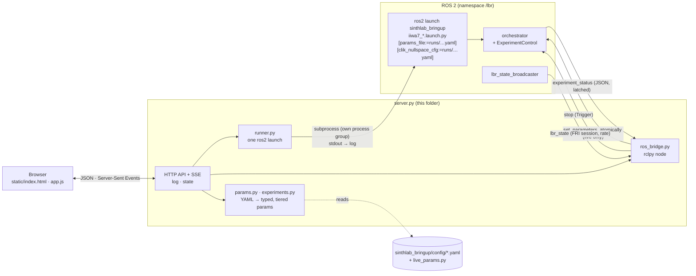

# Experiment Control Dashboard: architecture and software

This guide describes the dashboard’s architecture, ROS interfaces, and parameter model. For operating instructions, see the [dashboard quick start](../README.md#quick-start-the-experiment-dashboard).

---

## Contents
- [Architecture](#architecture)
- [Components](#components)
- [Robot side: ExperimentControl](#robot-side-experimentcontrol)
- [Parameter model](#parameter-model)
- [Monkey profiles](#monkey-profiles)
- [Parameter documentation](#parameter-documentation)
- [Diagnostics page](#diagnostics-page)
- [Live view](#live-view)
- [Post-processing page](#post-processing-page)
- [HTTP API](#http-api)
- [Process control](#process-control)
- [Demo mode](#demo-mode)
- [Security](#security)
- [Extending](#extending)
- [Developing and testing](#developing-and-testing)

---

## Architecture



- The dashboard starts and stops ROS launches and uses the orchestrator’s public ROS interfaces. It discovers experiments started from a terminal through the same interfaces.
- The task YAML files define default values, descriptions, and notes. The dashboard writes per-run edits to a copy in `runs/` and passes it as `params_file:=`.

---

## Components

| File | Role |
|---|---|
| `server.py` | `ThreadingHTTPServer`: static files, the JSON API, and a Server-Sent Events stream of log lines and state (state is re-sent every second). Owns start / stop |
| `runner.py` | runs one `ros2 launch` in its own process group, pumps its output into the log ring buffer (5000 lines) and `logs/`, and stops it: SIGINT → 20 s → SIGTERM → 5 s → SIGKILL |
| `ros_bridge.py` | `RosBridge`: an rclpy node on a background executor that subscribes to `experiment_status`, `lbr_state` and the CLIK's `target_frame` (the live view's pull point) and calls `set_parameters_atomically` / `stop`. `UnavailableBridge` when ROS is not sourced. `DemoBridge` for `--demo` |
| `kinematics.py` | solves the start pose from a requested height: 6-D IK straight up or down from the current start, checked against reach, joint limits, the elbow and the floor. Builds the iiwa7 URDF with xacro, so it needs ROS sourced; without it the field says why |
| `experiments.py` | the experiments (launch file, YAML, orchestrator node, SmartPad profile, controllers, run name, `group`): definitions grouped under **Experiments** and **Pre-training** (`GROUPS`); an experiment's `paradigms` appear as nested tabs on its card and set its `paradigm_param` for the next Start (apple pluck: pluck / perturb / perturb bump / random start, `paradigm`; Move Vertical / Horizontal: either / cued end, `centre_out.target`), and parameters of some paradigms only (`live_params.PARADIGM_ONLY`) are shown only under those; cautions and linked parameters |
| `params.py` | YAML → flat dotted names; descriptions and notes; type coercion; per-run edits; the edited YAML and CLIK posture files; the Fixed tab's sections |
| `board.py` | the Diagnostics page's Visual cue tab: sends each board command over the board's Wi-Fi or, as `GET /<cmd>`, over the serial link through the StarTech adapter; `FakeBoard` for `--demo` |
| `ttl.py` | the Diagnostics page's TTL sync tab: relays `STATUS` / `ALLOFF` / `PULSE` to the cabinet's UDP 30002; `FakeCabinet` for `--demo` |
| `live_view.py` | the Live view: builds the running experiment's bounds from the parameters it runs with, anchors them once per trial, and turns the measured joints into the end effector by forward kinematics (`kinematics.py`) |
| `postprocess.py` | exports a session to NWB (`analysis/nwb_export.py`) and uploads it to the server. Runs one job at a time and reports progress through the event stream. |
| `static/` | the pages: `index.html` + `app.js`, `diagnostics.html` + `diag.js` + `ttl.js`, `postprocess.html` + `post.js`, `live.html` + `live_view.js`, and `style.css`. No external libraries or fonts |
| `demo_launch.py` | stands in for `ros2 launch` in demo mode |
| `check_param_docs.py` | fails if any key in `sinthlab_bringup/config/*.yaml` has no one-line description |
| `run_gui.sh` | sources ROS 2 and the workspace, then runs `server.py` |

Dependencies: the Python standard library and PyYAML (installed with ROS); `rclpy` and the message
packages when ROS is sourced. The Post-processing page also needs `pynwb` and `neo`, installed with
`numpy` held below 2 (ROS's scipy needs it):

```bash
pip install --user --break-system-packages pynwb neo "numpy<2"
```

Without them the page says so and the rest of the dashboard is unaffected.

---

## Robot side: ExperimentControl

[`helpers/experiment_control.py`](../sinthlab_bringup/sinthlab_bringup/helpers/experiment_control.py)
makes an orchestrator controllable from outside. Every orchestrator uses the following interfaces.

| Interface | Type | Behaviour |
|---|---|---|
| `<ns>/experiment_status` | `std_msgs/String`, JSON, transient-local | published on every trial event and once a second: experiment, trial, phase, held (stopped and parked), live values **in effect**, and changes **pending** for the next trial |
| `<ns>/<orchestrator>/stop` | `std_srvs/Trigger` | end the trial in progress at once, park, and hold there: no further trial starts |
| `set_parameters` | parameter callback | names in `live_params.py` are range-checked, accepted and **applied at the next trial boundary**; anything else is rejected with the reason |
| `on_event(token, arg)` | `TrialRecorder` hook | every `mark()` updates the status, and with `nsp_sync.enabled` sends the cabinet a TTL pulse command at `trial_start` and `trial_end` (`NspPulser`) |

The orchestrators end each trial with `control.begin_trial(self._next_trial)`. That call is where,
after a Stop, the arm holds at park, and where accepted changes are applied: `_reload_live()` calls `reload()` on the cue,
monitor and perturbation actions and updates the quiet-window and timeout durations. The next trial’s sidecar records the values in effect. Move speed changes apply from the next move, as described below.

---

## Parameter model

| Tier | Decided by | Enforced by |
|---|---|---|
| **Live** | `LIVE_PARAMS` in [`live_params.py`](../sinthlab_bringup/sinthlab_bringup/helpers/live_params.py): fnmatch globs per experiment | the orchestrator's parameter gate, and the server |
| **Per-run** | every other key in the experiment YAML | the server refuses edits while that experiment runs; the orchestrator rejects runtime sets |
| **Fixed** | not in the experiment YAML: SmartPad selections, launch arguments, `iiwa7_hardware_controllers.yaml`, the CLIK posture | shown read-only (`read_fixed_config()`) |

`live_params.py` has no ROS import, so the dashboard loads it from the source tree whether or not
ROS is sourced; the orchestrators import the same module, so the two cannot disagree. It also holds
the checks, which `check_value()` applies on both sides:
- `LIMITS` (ranges), `CHOICES` (enums) and `STEPS` (a step makes the dashboard draw a **slider**
  next to the text box — e.g. the resistance, 10 N/m; the text box still takes any value in range).
  `limits_for(name, context)` narrows a range that depends on another value — the resistance slider
  runs from 50 N/m up to the SmartPad base entered, so the dashboard passes the current values when it
  describes the parameters;
- **poses** (`check_pose`): 7 values, within `IIWA7_LIMITS_DEG`, and not a straight arm
  (max(|A2|, |A4|, |A6|) ≥ `STRAIGHT_BELOW_DEG`, 12°: below that the arm is singular);
- **pairs**, checked against the other values in force (`context`): the perturbation's r against its
  plane's cap (`PERTURB_R_MAX`), and the start pose against the recover pose, which must be equal.

Live motion parameters: every move's `speed_scale` is live in every experiment, and IMMEDIATE
(`live_params.IMMEDIATE`): `ExperimentControl.apply_immediately` hands it straight to the move's
`set_speed_scale`, used from that move's next start, and logs it with `TrialRecorder.note_change`. The
dashboard marks such rows *next move*. The base limits `move_to_pos_*` are per-run. The start /
recover pose is live in apple pluck only (`_POSE`), re-read at the trial boundary.

**Dashboard-only checks and conveniences** (`experiments.py`, `params.py`):
- `CAUTION`: amber notes on parameters other things depend on. They never lock anything.
- `LINKED`: `move_to_start.target_joint_position` and `move_to_start_recover.target_joint_position`
  are set together — per-run edits change both, and a live change sends both in one
  `set_parameters_atomically` call (all or nothing), so the node never sees them differ.
- **Parallel arrays** (`corridor_*`, `checkpoint_*`) must keep their length.
- **Coercion:** values from the browser are coerced to the YAML default's exact type, because ROS
  refuses a set that changes a parameter's type.

**Launch overrides** (`ExperimentParams.launch_overrides()`):
- With any edit, the YAML is written to `runs/<exp>_<time>.yaml` and passed as `params_file:=`.
- If a CLIK experiment's start pose was edited, a matching `runs/<exp>_<time>_clik_nullspace.yaml` is
  passed as `clik_nullspace_cfg:=`. `iiwa7_hardware.launch.py` joins that argument onto the package
  directory, and an absolute path replaces the package part, so the generated file is used as is.

---

## Monkey profiles

Each monkey has a profile shared by Free Move, Reach Map, Restricted Move, Cued Reaches, Colour Rule, and N-Choice. Apple Pluck, Restricted Plane, and Maze use their task YAML files and per-run edits.

| Layer | Settings | Location |
|---|---|---|
| **Task defaults** | Task configuration, including outputs, cue board, controllers, floor, safety, and park pose | Experiment YAML |
| **Monkey profile** | Arm response, reach by direction, trial timing, and reward pulse settings | `<data dir>/subjects/<ID>.yaml` |
| **Pending edits** | Changes for the next run | Dashboard |

Pending edits take precedence over a profile, and profile values take precedence over task defaults. See `ExperimentParams.base()` and `ExperimentParams.current()`.

- **Profile mapping.** Each arm response, timing, and reward field maps to a task parameter in `profiles.FIELDS`. Reach sets the horizontal and vertical rail endpoints (`free_move.rail_min_m` and `free_move.rail_max_m`), including Colour Rule in Rail mode. The dashboard caps profile values at the task limits and shows a note when it does. The no-rail Colour Rule choice distance, N-Choice rail length, and Free Move box are set per task. The dashboard flags choice distances beyond the monkey’s profile reach.
- **Save to profile.** The dialog compares settings for the selected task with the profile, including live values queued for the next trial. Select the changes to save. Reward settings can apply to an individual task via `reward_by_task`. A running task keeps the profile it started with. The update applies when a new run starts.
- **Profile records.** Each save increments the profile version and appends a record to `<ID>.changes.jsonl` with the timestamp, version, source, note, and changed values. The generated run YAML names the profile and version and records its values. The recording folder contains a snapshot in `subject_profile.yaml`.
- **New profiles.** Select **New monkey…** to create a profile using the default values. If an existing subject has no profile, **Create** in the Monkey menu uses the selected task’s current settings. The `test` subject uses task defaults and has no profile.
- **Changing subjects.** If edits are pending when you select another monkey, choose whether to keep them, clear them, or cancel. If you enter a different subject ID in the **Start** dialog, the dashboard selects that monkey first so you can review the settings. **Session history** can display another subject’s sessions independently.
- **Reach Map.** This pre-training task measures reach in the frontal plane from the vertical tasks’ start pose. **Long moves** rewards movements that reach the distance threshold (`long_move.min_m`). **New best** rewards a movement when it exceeds the previous best in its direction by at least `reach_map.margin_m`. Both modes can be selected during a run. A direction’s best is tracked for the whole run.
- **Reach Map results.** The map uses the run’s trajectory CSVs and refreshes every 5 seconds during a run. It shows the farthest point of each outward movement and the farthest and comfortable reach by direction. Comfortable reach is the 80th percentile by default (`reach_map.percentile`). Directions limited by the workspace are unchecked by default. Horizontal reach is measured about 5 cm below the horizontal rail, where there is more room to reach sideways. Selected values and the map record can be saved only to the recorded monkey’s profile. See [the map endpoint](reach_view.py) and [reach calculations](../sinthlab_bringup/sinthlab_bringup/helpers/reach_map.py).

---

## Parameter documentation

The help text comes from the YAML files (`params.yaml_docs()`):

```yaml
    # Notes: the rationale, measurements, or tuning guidance. Comment lines directly above the key,
    # with no blank line between, belong to that key (or to that block, above a block).
    polar_r_m: 0.05  # perturbation distance from the start [m]      <- the description
```

- **Description:** the comment on the key's own line. It is shown under the parameter and at the top
  of its popup. Every key, blocks included, must have one.
- **Notes:** the comment block above the key. Prose lines are reflowed into paragraphs; indented
  lines (tables, diagrams) keep their columns.
- **Borrowed notes:** a key with no notes of its own borrows a sibling's notes when they mention it
  by name. The perturbation's notes sit above `polar_r_m` but explain θ and plane too.
- **Enforcement:** `check_param_docs.py` walks every YAML in `sinthlab_bringup/config/` and exits 1
  listing any undocumented key.

The Fixed tab's SmartPad and launch-argument rows are not YAML keys; their help is in
`SMARTPAD_HELP` and `LAUNCH_HELP` in `params.py`.

---

## Diagnostics page

Select **Diagnostics** in the dashboard to test the visual cue and TTL outputs without moving the arm.

### Visual cue

The Metro board drives the NeoPixel ring. Select a connection method and use **Check board** to see the current settings and connection status.

- **Wi-Fi.** Join the `KUKA_NEOPIXEL` network. The board address is `192.168.4.1`.
- **Serial.** Attach the StarTech adapter to WSL (normally `/dev/ttyUSB0`). The connection uses RS-422 via X76. The serial port is reserved for the duration of an experiment. Use `diagnostics.html#serial` to open Diagnostics with serial selected.

Under **Cue settings and tests**, you can change colour, pattern, segments, duration, period, brightness, and enabled state. Apply the settings and select **Trigger cue** to test them. **Solid colour** lights the whole ring. **Quarter 0** through **Quarter 3** light one quarter in green. You can turn the ring off, save settings to the board, or restore the firmware defaults. The **LED-by-LED test** shows the active pixel number to help locate a dark section. **Board replies** shows the latest raw reply and round-trip time.

The dashboard server relays each command through [board.py](board.py). The serial path uses `GET /<command>?<params>`. On older firmware, **Check board**, **Trigger cue**, **Solid colour**, the quarter buttons, and **Off** fall back to `PING`, `CUE`, `SEG`, and `OFF`. Settings and the LED-by-LED test require Wi-Fi on that firmware. Demo mode simulates the board for both connection methods.

### TTL sync

Run **PulseTestServer** or **LbrImpedanceControlServer** on the SmartPad. Enter the cabinet address (default `172.31.1.147`) and select **Check outputs** to send `STATUS`. The dashboard remembers the address in the current browser. Use `diagnostics.html#ttl` to open this tab directly.

Select an output, pulse width (10–5000 ms), number of repetitions, and the repeat interval. **All outputs in sequence** sends one pulse on output 1, two on output 2, and so on. Each pulse lights its channel LED on the EL2124. **Stop** ends a series and sends `ALLOFF`. **All outputs low** also sends `ALLOFF`. Commands, replies, and round-trip times appear in the log.

The server uses the same UDP commands as the experiments. During a run it permits `STATUS` only, since the NSP would record a test pulse as a trial edge. See [ttl.py](ttl.py) and the [reward and sync box reference](../reward_and_sync_box/README.md#sync-ttl-pulses-to-the-nsp). Demo mode uses a simulated cabinet.

## Live view

The **Arm** section of the trial card shows motion and trial bounds during a run. Select **Open live view** to open `/live.html` in a larger view. Both views use the robot base frame. The front view is from the subject’s side, with Y to the right and Z up. The top view has Y to the right and X pointing down toward the subject.

- **Bounds.** The server uses the run’s configuration and reported live values. Before the trial is armed, bounds relative to the start are drawn around the nominal end-effector position. Once armed, the display uses the measured position at that moment. The experiment may anchor its bounds at a different point in the trial, leading to differences of a few millimetres.
- **Arm and pull point.** The view calculates the end-effector position from the measured joints on `lbr_state` and shows its last 8 seconds of motion. CLIK experiments also show `target_frame`, the spring’s target.
- **Trial progress.** The server tracks the centre-out target and reached endpoint, as well as forks passed in Maze. Opening the view mid-trial shows the progress so far.

| Experiment | Bounds shown |
|---|---|
| All experiments | the start; the floor (`floor.height_m`, for the flange at the start's orientation) and its safety trip line; the safety distance (`*_safety.max_displacement_m`) where it is on |
| Apple Pluck | the pull threshold (`cartesian_displacement_threshold_m`): a sphere, or two planes for one axis. Perturb / perturb bump: the perturbed start. Random start: every start position |
| Restricted Plane | the active fixture (`virtual_fixture_profile`): the sine rail, a locked plane, a box (`x_min`, `x_max`, `z_min`) or a cylinder; the pull threshold along its axis |
| Maze | the rails (a corridor with width as a box), the forks (filled once passed this trial), the goal |
| Free Move | the box, as `free_move.box.preset` sets it (a preset, or the custom x/y/z min and max from the start) |
| Move Vertical / Horizontal | the rail and its end zones (`centre_out.end_tol_m`); the goal end filled green once lit (both for `either`), red once reached |

It updates 15 times a second on the event stream (`live` events) and fetches `/api/live_view` again
whenever the bounds change (a new trial's anchor, a live parameter). Without a robot model (no ROS: the
demo without ROS sourced) it draws around a nominal start and says so. `?nostream` polls instead, as
on the dashboard.

## Post-processing page

Select **Post-processing** to export a session as an NWB file and upload it to a mounted server folder. Export and upload are disabled during experiments.

1. **Recordings.** Select a local robot run from `analysis/` or enter another run folder. For the Blackrock NSP recording, enter a recording file (`.nev` or `.ns1`–`.ns6`) or its folder. A network mount is supported. Leave the NSP field blank for a robot-only export. Default sync channels are `ainp6` for trial start, `ainp7` for trial end, and `ainp8` for experiment start. The default threshold is 2.5 V. Choose whether to include continuous NSx data and NEV spikes. **Check recordings** summarises the inputs and flags missing sync channels.
2. **Subject and session.** Enter the required subject ID and any metadata you want saved in the archive. The browser remembers these fields for the next export.
3. **Archive to NWB.** The default output path is `<run folder>/sub-<subject>_ses-<session>.nwb`. **Create NWB** runs [nwb_export.py](../analysis/nwb_export.py). The result shows the file path, size, trial count, time base, and sync fit, including matched pulses, RMS and maximum residuals, and clock drift.
4. **Upload to server.** After export, the page fills in the NWB path. The destination defaults to the NSP recording’s folder when available. Upload writes `<name>.partial`, checks its SHA-256 checksum against the source, and renames it after verification. To replace an existing copy, select **Replace an existing file with the same name**.

**How the clocks are aligned.** The cabinet pulses EL2124 output 1 at every `trial_start` and output 2
at every `trial_end`; the NSP records them on the two channels set on the page. The rising edges are matched to the
robot's `trial_start` / `trial_end` events (their wall-clock times), tolerating pulses missing at either
end and extra pulses, and a straight line `t_nsp = slope · t_wall + intercept` is fitted (offset and
drift). The whole file then runs on the NSP's clock, starting at the NSP recording's start. A recording
whose edges do not line up with the run is refused. Without an NSP recording the file runs on the
robot's clock from its first sample. The experiment start pulse (output 3) is on its own line and is not
used for the fit: its edges go into the file as `processing/sync/experiment_start_edges` (NSP clock)
and are shown in the result; a recording without that channel is noted, not refused.

**What the file holds.** Subject and session metadata; per NSx stream an `ElectricalSeries` (neural
channels, raw int16 with their gains) and a `TimeSeries` of the analog inputs (volts); the NEV spikes
as units (one per channel and unit) and NEV events as an events table; under `processing/behavior`
the end-effector position (`Position`) and orientation, measured and commanded joint angles, external
joint torques, the FRI state and clocks, every other recorded column, and the robot events table;
`processing/sync` with the matched edges and the fit; the trials table (start/stop from
`trial_start`/`trial_end`, experiment, paradigm, threshold, the sidecar as JSON); in `notes`, the
SmartPad settings, the git state and the sync summary.

You can also run the export from a terminal.

```bash
python3 analysis/nwb_export.py --robot analysis/expt_<run> --nsp /mnt/server/<recording>.ns5 \
    --subject-id <id> --sex M --age P8Y --out session.nwb
```

## HTTP API

POSTs need the header `X-Experiment-Ctrl: 1`; errors return 409 with `{"ok": false, "error": …}`.

| Method | Path | Does |
|---|---|---|
| GET | `/api/experiments` | every experiment, its tab (`group`) and its SmartPad selections |
| GET | `/api/groups` | the experiment-list tabs, in order: `experiments`, `pretraining` |
| GET | `/api/params/<exp>` | `params` (typed rows with tier, value, default, description, notes, caution, links, limits, choices, step), `groups` (block docs), `fixed` (Fixed tab sections) |
| GET | `/api/state` | runner state, ROS availability, status, robot, data folder, edit counts |
| GET | `/api/logs` | the log ring buffer |
| GET | `/api/live_view` | the Live view: `geometry` (the running experiment's bounds, anchor, start) and `live` (end effector, pull point, trial, phase, the trial's goal / reached end / forks passed) |
| GET | `/api/events` | Server-Sent Events: `{"type": "log" \| "state" \| "post", "data": …}` |
| POST | `/api/params/<exp>` `{name, value}` | per-run edit; refused while that experiment runs |
| POST | `/api/params/<exp>/reset` | drop all edits |
| GET | `/api/profile` | the chosen monkey, its profile, the profile layout, profile names, recent subjects, its change log |
| GET | `/api/reach_map[?run=<folder name>]` | the Reach Map view: this (or the given, or the latest) Reach Map run's points, outward reaches, reach per direction and the four proposed profile values |
| GET | `/api/profile/diff?exp=<exp>` | Save to profile: the profile fields where that task's values in effect differ |
| POST | `/api/subject` `{subject}` | choose the monkey; its profile applies to every free-move task (refused while a run for another subject is going) |
| POST | `/api/profile/save` `{values, task_only, exp, note, from_task, reach_map_run}` | write the chosen monkey's profile (a new version); `task_only` = rewards for `exp` only (null = back to the profile's); `from_task` = start from `exp`'s values; `reach_map_run` = keep a record of that Reach Map run with the reach |
| POST | `/api/start` `{experiment}` | launch; refused if anything is running, here or in a terminal. With `nsp_sync.enabled`, first sends the cabinet the experiment start pulse (`PULSE <nsp_sync.experiment_start_output> <width>`) and logs when it was sent and the answer |
| POST | `/api/stop` | the orchestrator ends the trial and parks, then Ctrl-C (again = skip parking) |
| POST | `/api/live` `{name, value}` | `set_parameters_atomically` on the running orchestrator, with any linked parameter in the same call |
| POST | `/api/validate` | `analysis/validate_recording.py --folder <this run's folder>`, output to the log |
| GET | `/api/post/state` | Post-processing: whether `pynwb` / `neo` are installed, the local run folders, the current job |
| POST | `/api/post/scan` `{robot, nsp}` | what the robot run and the NSP recording hold |
| POST | `/api/post/convert` `{robot, nsp, out, meta, sync_channels, threshold_v, include_continuous, include_spikes}` | start the NWB archive job; progress as `{"type": "post"}` events |
| POST | `/api/post/upload` `{nwb, dest, overwrite}` | start the verified copy to the server folder |
| POST | `/api/post/cancel` | cancel the running job |
| POST | `/api/diag/board` `{path, addr, port, cmd, params}` | Diagnostics page: relays one command to the end-effector cue board (`board.py`): only its own commands (`status`, `config`, `cue`, `set_color`, `segments`, `off`, `led_test`). `path` `wifi` (default): over HTTP, only to a private address. `path` `serial`: as `GET /<cmd>?<params>` on the serial link, only to `/dev/ttyUSB<n>` or `/dev/ttyACM<n>`, refused while an experiment runs |
| POST | `/api/diag/ttl` `{addr, cmd}` | Diagnostics page: relays one command to the cabinet's TTL sync outputs (`ttl.py`): only `STATUS`, `ALLOFF`, `PULSE <output 1-4> <width 10-5000 ms>`, only to a private address; pulses refused while an experiment runs |

---

## Process control

- **Start:** `ros2 launch sinthlab_bringup <launch> [overrides]` runs with `start_new_session=True`,
  so one signal reaches the launch and every node it spawned. `RCUTILS_COLORIZED_OUTPUT=0` and
  `PYTHONUNBUFFERED=1` keep the log clean and live.
- **Stop:** the orchestrator's stop service; once the status reports `held` (parked), SIGINT to the
  process group, exactly like Ctrl-C. After 20 s it sends SIGTERM, and after 5 s more SIGKILL.
- **Shutting down the server** stops a launch it started, the same way.
- **The data folder** is the newest `analysis/expt_<run_name>_*` modified since the launch started.

---

## Demo mode

`--demo` replaces the ROS side:
- `demo_launch.py` stands in for `ros2 launch`. It prints a banner and exits cleanly on SIGINT, so
  Start / Stop run for real.
- `DemoBridge` simulates an orchestrator on a fast clock. It uses the same trial phases, the same
  Stop / held behaviour, the same live-parameter rules (`live_params.py`), the same apply-at-next-trial
  behaviour, and heartbeats once a second.

Nothing connects to the arm.

---

## Security

The server binds to `127.0.0.1` unless `--host` says otherwise, since whoever reaches it can start the
robot. POSTs require a custom header that a page on another site cannot send without CORS, which
the server never grants. So a malicious web page cannot drive the robot through a local browser.
Static files are served from `static/` only, with no path traversal.

---

## Extending

**A new live parameter:**
1. Add its name or glob to `LIVE_PARAMS` in `live_params.py`, with a range in `LIMITS` (and
   `CHOICES` if it is an enum, or a `STEPS` entry for a slider).
2. Make the action that uses it re-readable: give it a `reload()` (see `AudioCue.reload()`,
   `CartesianImpedanceDisplacementMonitor.reload()`) and call that from the orchestrator's
   `_reload_live()`.
3. Declare it in the experiment YAML, with a one-line description on its line. ROS will not set a
   parameter the node never declared, and `check_param_docs.py` fails without the description.

It then appears on the Live tab automatically. Do step 2 before step 1: a listed name that is never
re-read would be accepted and silently ignored, which is the failure the gate exists to prevent.

**A new experiment:** add an `Experiment` to `EXPERIMENTS` in `experiments.py` (its `group` picks the
tab), an entry in
`LIVE_PARAMS`, and create an `ExperimentControl` in its orchestrator. The orchestrator must end each
trial with `control.begin_trial(...)` and pass `on_event=self.control.on_event` to its `TrialRecorder`.
Add its step list to `STEPS` in `static/app.js` for the status card.

---

## Developing and testing

```bash
python3 experiment_ctrl_gui/server.py --demo --port 8765      # the whole page against a simulated robot
python3 experiment_ctrl_gui/check_param_docs.py               # YAML documentation complete?
```

URL options, for testing and for linking:

| Option | Effect |
|---|---|
| `?exp=maze` | select an experiment |
| `?tab=live` \| `run` \| `fixed` | open a tab |
| `?hover=<parameter>` | open that parameter's help popup |
| `?nostream` | poll `/api/state` every second instead of using the event stream. Use it behind a proxy that breaks SSE, and for headless screenshots, since an open stream never lets a headless browser go idle |
